# 开工管理调整 PRD

## 目录
- §1 修订追踪
- §2 背景与目标
- §3 功能清单
- §4 功能细节规格
- §5 核心流程
- §6 边界与异常
- §7 验收清单

## 本文件使用说明
本文件为开工管理独立需求文档，不替换户口管理PRD。沿用现有文档的七章阅读结构，不添加功能结构图和页面布局示意章节。原型、附录及业务规则交接另附。
已确认规则写入正文；建议与待确认口径明确标注，不能据此直接上线结算。金额和百分比计算样例见《开工管理_业务规则与开发交接》。

## §1 修订追踪
| 版本 | 日期 | 状态 | 内容 |
| --- | --- | --- | --- |
| V1 | 2026-10-31 | 初稿，待评审 | 现有开工管理结合22项截图需求及两项口径确认 |

## §2 背景与目标
- [MOD] 基于现有开工管理列表、新开工、详情与操作弹窗进行调整，保留原有场次管理链路。
- 明确开工资金来源，统一隐藏占成与B数方案入口，让场中操作可预览、收工资金方向可核对。
- 用户：账房操作人、确认人、结算人员、系统配置管理员。
- 本次交付：本地交互原型、独立PRD、需求追踪、计算与测试样例；不涉及真实资金操作或消息发送。
- 确认结论：暂存泥码与现金码均减少上下数，只有泥码扣累计转码；开工银头变化保留待确认。

## §3 功能清单
| 页面 | 名称 | 范围 | 来源 |
| --- | --- | --- | --- |
| P1 | [MOD] 开工列表 | 查询、汇总、导出、进入场次操作 | CH-04、CH-22 |
| P2 | [MOD] 新开工 | 基本设置、资金来源、出码、占成方案 | CH-01～05、CH-08 |
| P3 | [MOD] 场次详情与信息记录 | 资金来源组合、操作信息、对应通知预览与复制 | CH-10、CH-11 |
| P4 | [MOD] 转码 | 正负金额调整累计转码 | CH-12 |
| P5 | [MOD] 加彩 | 同场次追加资金与出码 | CH-13 |
| P6 | [MOD] 中途存 / 中途取 | 筹码分类存取与余额上限 | CH-14、CH-15 |
| P7 | [MOD] K现 / 暂存 | 分类筹码输入与金额联动 | CH-16、CH-17 |
| P8 | [MOD] 小费 | 员工/荷官泥码及现金码小费留档 | CH-18 |
| P9 | [MOD] 收工结算 | 离台筹码、金额去向、占成和码粮转账 | CH-05～07、CH-09、CH-19～21 |
| P10 | [MOD] 佣金占成设置 | 隐藏占成命名与默认方案 | CH-04、CH-08 |

### 全局操作规则
- 沿用双密码：每个业务提交都需操作人密码与确认人密码；不显示额外确认人选择框，不保存或记录密码。原型仅校验是否填写，正式系统需验证身份与权限。
- 所有备注输入框均选填。金额默认以“万”为界面单位，最多四位小数，计算超出部分直接截断；零金额与留空按对应功能校验。
- 提交前展示结果，成功后同步数据与日志；取消不生效。业务与消息发送分开处理，消息失败不可重做资金操作。

## §4 功能细节规格

### 4.1 P1 开工列表
沿用现有筛选区、金额汇总、列表及行内操作。筛选支持户口号、玩家姓名、隐藏占成户口、状态、币种、月份及起止时间；查询与重置明确分开，回车可查询。快捷日期保留今天、昨天、本周、上周、本月、上月、自定义。
- 表头保留：状态、开工时间、收工时间、户口、户口名、玩家姓名、后缀、类型、币种、厅别、占成%、占成码粮%、占成/隐藏占成、现金、存卡、M、本金、转码、上下数、佣金、小费、操作；场次号按勾选显示。
- 仅把原“贷款”改名“M”；原“占成/偷食”改名“占成/隐藏占成”。原型将操作列固定右侧以便宽表使用。
- 顶部及本页合计不区分币种，按当前查询结果直接加总原始金额，不做汇率换算。列表小费独立统计；收工上下数包含本场小费一次。
- 列表上方统一展示现金、存卡、M、本金、转码、上下数、佣金、小费及场次统计卡片；表格底部展示本页场数及现金、存卡、M、本金合计，均不区分币种，按查询结果的原始金额直接加总，不做汇率换算。进行中行提供详情、转码、加彩、收工；已收工只可查看。导出使用当前已提交筛选结果；原型下载CSV，正式系统保留Excel导出。
- 正常：提交查询后表格和汇总一致。异常：开始时间晚于结束时间则提示并不执行。边界：无结果显示空态并禁用导出。

### 4.2 P2 新开工
沿用左右分区：左边基本设置，右边资金来源与出码。下方显示占成设置和双密码，底部确认开工。仅移除基本位，其余原有基本输入字段保留。户口号采用输入框加检索按钮，支持户口号/姓名模糊匹配、回车检索和结果选择；结果显示户口号、姓名、会员卡及状态，选择后带出资料，修改关键词清空旧资料，空结果明确提示。M单/借贷与现码恢复原字段名称；占成比、对应码粮比分别显示，切换方案自动带出。游戏类型与筹码币别保存到场次信息。
- 基本设置保留户口、户口名、玩家姓名、会员卡号、后缀、类别、厅别、开工币种、筹码币别、汇率类型、游戏类型。户口名只读，玩家姓名可修改；卡号默认户主会员卡，可输入其他卡号，仅存为本场快照。
- 现金、提存卡、M可组合；显示本金合计和泥码/现金码组成。泥码随本金与现金码变化；负数、零本金、现金码超过本金、存卡或M额度不足均禁止提交。
- A数可启用隐藏占成并添加隐藏占成户口及方案。B数的占成设置仅需选择占成方案，默认选中系统默认方案，允许切换，不要求占成人户口，不提供新增占成户口操作。
- 隐藏占成的户口号使用文本输入框，支持直接输入；提交时去除首尾空格，校验必填、户口存在、正常状态及同场不重复。占成方案及对应比例展示保留。
- B数同样保留原有隐藏占成输入区，不因切换类别隐藏。原型分别保留本户占成及额外隐藏占成记录；两组同时启用时逐组展示结算明细，具体叠加核算仍待业务确认。
- 正常：核对资金与方案后双密码确认，生成场次并进入详情。异常：户口锁定、必填缺失不生成记录。边界：切换户口重新带出卡号，不将上一户口卡号串入新户口。
- 开工银头增减按CH-03仍待确认；原型不模拟其入账。原型支持通过换汇资金完成固定/即时汇率开工；转出币种与开工币种不同，筹码币种与开工币种一致。实际银头与正式报价规则仍待确认。

### 4.3 P3 场次详情与信息记录
保留现有场次头部、金额摘要、操作按钮、操作记录和消息记录。头部显示户口、姓名、类别、币种、场次号、厅别、会员卡号和状态。
- 开工本金卡采用左右布局：左侧显示“开工本金（万）”和总额，右上方将现金、存卡、M按上中下三行排列，标签与金额同一行对齐，金额保留四位小数；初始本金和加彩总额分开，收工核算只各计一次。
- 操作记录保留时间、操作、金额、累计转码、操作人、确认人、备注；在备注右侧新增“信息”。使用通知摘要卡片展示业务通知标题、户口和关键金额，最多两行；完整通知通过“查看通知”展开，不将完整模板直接铺在表格内。
- 加彩、中途存、中途取、K现、暂存、小费成功后生成对应消息；记录中可查看完整消息内容。不展示独立消息记录区；通知查看及复制统一放在操作记录的信息列。
- 正式系统发送目标为该户口有效WhatsApp收件信息；消息不包含密码、内部备注或其他未授权资料。通知模板及业务对应关系见本轮同步章节；真实收件信息与失败重试权限仍待确认。
- 原型仅生成待发送消息并提供预览，不连接WhatsApp；不能把原型待发送记录当成送达凭证。
- 正常：业务成功后日志与消息同步展示。异常：正式消息失败不重复执行业务资金动作。边界：已收工关闭所有场中提交入口，查询与查看仍可用。

### 4.4 P4 转码
转码弹窗展示当前累计转码、可输入正负数的变动金额、变动后累计、选填备注和双密码。
- 正数增加、负数扣减，不把输入当作新的累计值；输入不得为零，最多四位小数。
- 转码仅调整累计转码，不自动修改本金、存卡、M和上下数。
- 正常：确认后累计转码和操作记录同步变化。异常：非数字、缺密码不修改场次。边界：累计是否允许小于零待确认；原型允许负向演示，负的实际转码不能收工。

### 4.5 P5 加彩
加彩归属于当前场次，沿用现有加彩弹窗：现金、提存卡及存卡余额、M单选择、本户口签M/其他户口签M（户口号或姓名检索）、批额总额/已用/剩余、新签M单、追加本金合计、选填备注及双密码。新签M单包含金额、天数（默认30）、选填备注及双密码。追加本金全部以泥码给出，合计实时更新。
- 追加本金与初始本金区分记录。仅出泥码部分计入新增累计转码；此口径沿用实查出码逻辑，跨币种情况另确认。
- 存卡与M均按户口和币种校验。保留本户口/其他户口签M及单据选择，其他户口支持输入检索。原型可填写新签M单并选用，正式签发、占用和核销沿用既有单据服务。
- 正常：确认后追加本金、转码、来源余额及记录一次生效，同时生成消息。异常：额度不足、资金合计为零不得提交。边界：可不使用M单；所选M单必须属于指定户口及当前币种且未使用；追加本金全额增加累计转码。

### 4.6 P6 中途存 / 中途取
中途存采用紧凑单栏弹窗：顶部展示当前转码和当前上下数；泥码、现金码并排输入，分别说明对累计转码的影响；下方实时展示泥码＋现码合计与存后累计转码预计，再显示选填备注及双密码，底部取消/确认。中途取参照现有紧凑单栏弹窗：顶部显示当前转码、当前上下数和可取中途存余额，泥码/现金码并排输入，下方展示合计（从账房取走筹码）、取后累计转码及剩余中途存余额，保留选填备注和双密码。已确认保留部分取出，金额不得超过对应筹码的中途存余额；仅参照现有布局，不采用“必须全额取出”限制。
- 中途存：两种输入不得负数、合计须大于零；泥码扣减累计转码，现金码不改变累计转码；两种金额都加入中途存余额。
- 中途取：与中途存相反，泥码增加累计转码、现金码不改变转码，两种金额从对应中途存余额扣除。累计已存减累计已取为可取余额。
- 建议除总额校验外按筹码类型分别校验，避免以现金码余额取出泥码；该细分口径待业务确认，原型采用较严格校验。
- 正常：成功后余额、记录、消息一致。异常：负金额或超出存量不提交。边界：刚好取完允许，后续再取应提示余额不足；已收工不允许存取。

### 4.7 P7 K现 / 暂存
K现与暂存分别使用同类左右布局：左侧泥码、现金码、选填备注，右侧变动预览，底部双密码。暂存在备注上方补充两列汇总卡：本次上下数、累计转码、预计佣金（转码×费率）、本场小费（员工/荷官明细），按输入实时预览；上下数按当前值减暂存泥码及现金码计算，小费在操作时记录，收工时计入最终上下数。
- K现：泥码扣减累计转码，现金码不影响累计转码；现金码部分增加公司现金银头。K现总额计入本场留痕，收工不得与收工时新增K现重复入账。
- 暂存：用户已确认，泥码和现金码均减少上下数，仅泥码扣减累计转码。每次提交按本次输入金额处理，不是覆盖上次暂存额。
- 暂存保持场次进行中；如何取回暂存、重复录入撤销、暂存归属钱包未明确，不能把暂存等同于已结清的存入户口。
- 正常：双密码确认后更新并生成消息。异常：负数、合计为零不提交。边界：仅现金码K现时累计转码保持不变；仅现金码暂存时上下数减少但转码保持不变。

### 4.8 P8 小费
保留员工与荷官两种小费类型，输入泥码、现金码金额、选填备注和双密码；两者可单独或组合输入，非负且合计须大于零；显示仅记录的结果。
- 小费仅记录金额、对象类型、操作人及时间，可产生WhatsApp消息；操作时不改变累计转码、即时上下数、公司银头和存卡；收工时将本场小费计入最终上下数。
- 收工时将本场历史小费合计加回台面上下数一次，不重复输入或重复累计。
- 小费支持泥码或现金码单独填写及组合填写；合计和记录展示两种筹码的金额。泥码与现金码小费均纳入本场小费合计，收工时统一加回上下数。
- 正常：成功后记录可查，金融余额保持原值。异常：零/负数或缺密码不提交。边界：同场多次小费逐笔留痕，但不会重复进入收工计算。

### 4.9 P9 收工结算
收工保留离台泥码、现金码、实际转码、上下数、收工金额去向、选填备注和双密码；收工筹码合计放在左侧离台泥码和现金码输入框下方、收工金额去向上方，输入时实时更新；右侧显示结算明细预览。仅移除员工小费、荷官小费两个输入框。保留实际转码及计算过程、上下数计算过程、预计佣金、历史小费汇总；移除“结算本场佣金”勾选操作及“全部存入户口”快捷操作，保留K现金额和存入户口输入框。小费在收工时计入最终上下数。
- 实际转码在当前累计基础上扣除本次离台泥码；负结果不得直接收工。盈亏方向以客人视角展示“客人赢/客人输”。完整计算样例见独立业务规则文档，建议公式仍需账房复核。
- 有隐藏占成：客人赢，隐藏占成户口分别向公司支付占成款和码粮；客人输，公司分别向隐藏占成户口支付两笔款。金额使用正数，方向由输赢决定，禁止负金额配合反方向重复反转。
- B数：使用开工时的方案快照；公司与开工户口之间按同样方向进行占成/码粮结算。无需另一个占成人户口。
- 公司户口从中转户“大账户”配置解析，不能让操作人临时自由输入。正式系统缺公司户口/方案/币种映射时阻止结算。
- 收工K现金额减少公司现金银头；存入户口金额增加本户该币种存卡余额。原型要求两者之和等于收工筹码总额，此资金去向完整性规则为建议，待确认。
- 正常：确认前可核对每笔转出、转入、金额；成功后场次收工并保留明细。异常：资金不足、鉴权失败、重复提交应全部不入账或返回原结果，不能部分成功。
- 边界：平局码粮方向未定，原型有占成时阻止零盈亏收工；无占成平局可收工。冻结户口、系统配置变更及多隐藏占成并存需按附录约束处理。

### 4.10 P10 佣金占成设置
系统原投食/偷食设置统一展示为“隐藏占成设置”，业务字段显示占成，不保留容易混淆的旧称谓。
- 配置项包括方案名、占成比、代理支付码粮比及默认方案。B数开工默认加载一个有效方案，可在开工时改选其他方案。
- 原型提供三条演示方案、编辑与默认方案切换。正式系统按既有可用币种/厅别/生效版本匹配方案；比例范围由业务最终确认。
- 保存需双密码；修改配置不追溯重算已开工场次，场次保留当时方案快照。隐藏占成配置与B数配置是否共用配置源待确认。
- 正常：切换默认后下一次新开工默认带出新方案。异常：方案缺失、重复默认或必填缺失不允许保存。边界：百分比为零必须保留为明确零值，不能当作未设置。

## §5 核心流程

### 5.1 P1 开工列表
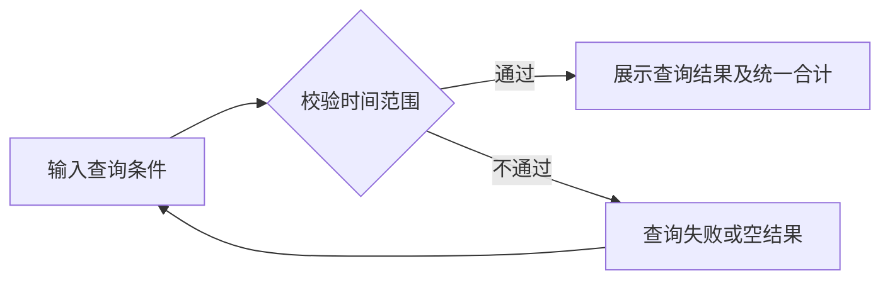

### 5.2 P2 新开工
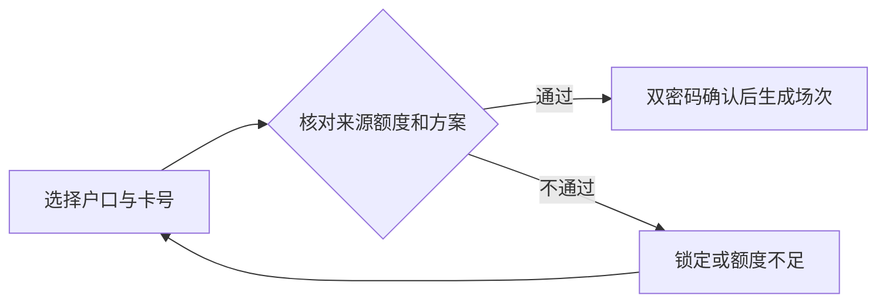

### 5.3 P3 场次详情与信息记录
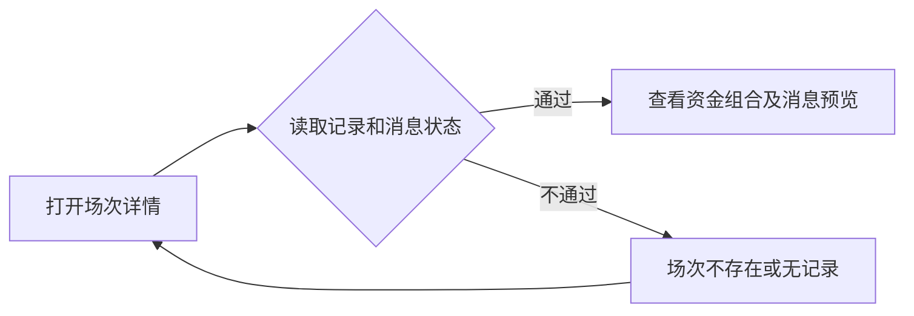

### 5.4 P4 转码
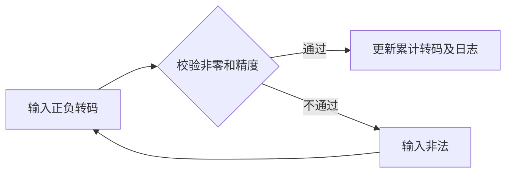

### 5.5 P5 加彩
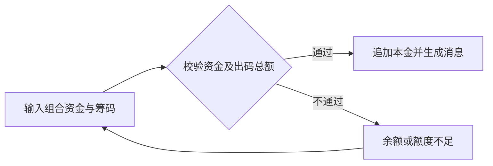

### 5.6 P6 中途存 / 中途取
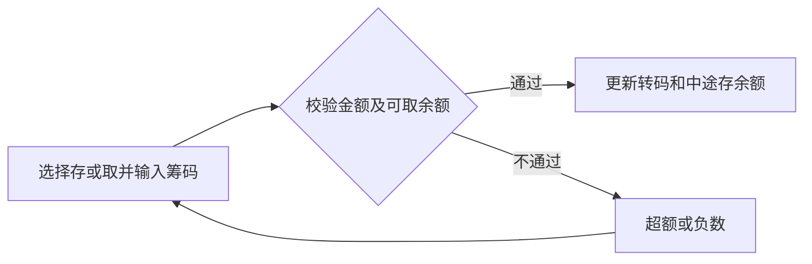

### 5.7 P7 K现 / 暂存
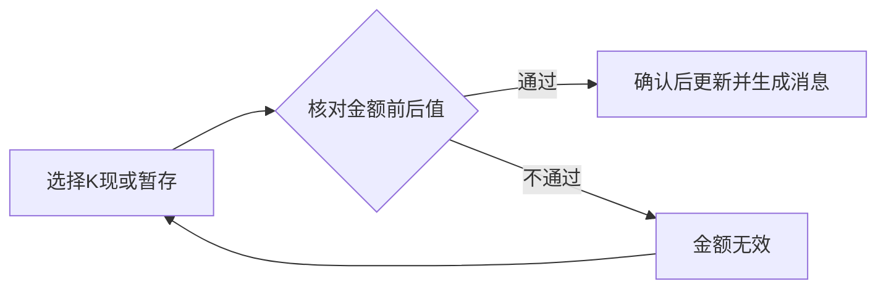

### 5.8 P8 小费
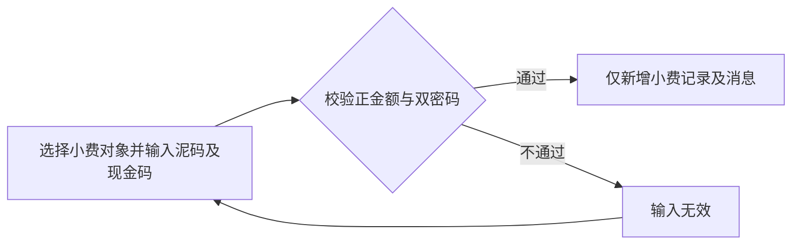

### 5.9 P9 收工结算
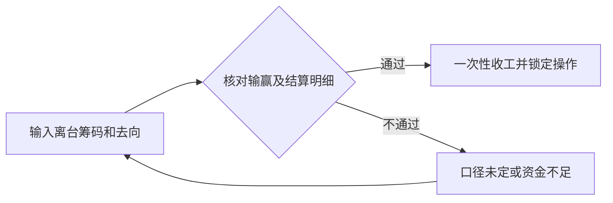

### 5.10 P10 佣金占成设置
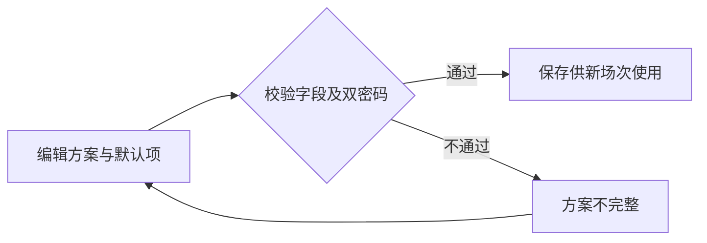

### 场次状态
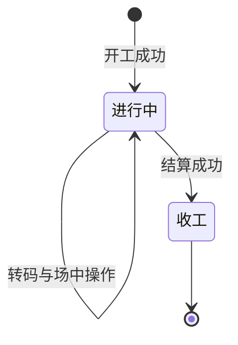

## §6 边界与异常
| 编号 | 情况 | 处理 |
| --- | --- | --- |
| CC-01 | 负数输入 | 仅转码允许正负；其他金额不得为负 |
| CC-02 | 输入超过四位小数 | 输入提示纠正；计算结果向零截断到四位，不四舍五入 |
| CC-03 | 存卡/M不足或账户锁定 | 阻止开工或加彩；不消耗部分来源 |
| CC-04 | 中途取超额 | 校验实时已存未取余额；原型同时按筹码类别校验 |
| CC-05 | 重复提交或并发收工 | 同场操作串行校验，重复请求返回原结果，不重复资金变动或发消息 |
| CC-06 | 跨币种 | 列表合计不区分币种、不换算；业务余额仍按币种核算，出码换算和银头口径未定时不执行相关结算 |
| CC-07 | 客人输与赢切换 | 明细同步更新方向，款项金额非负；不可沿用旧方向 |
| CC-08 | 上下数为零 | 有占成的码粮结算方向待确认，阻止默认转账；原型明确提示 |
| CC-09 | 消息渠道失败或手机号无效 | 业务成功保留，消息单独失败/待处理；不得重新扣款 |
| CC-10 | 系统默认方案被修改 | 既有场次使用开工快照；新场次用当前有效默认方案 |
| CC-11 | 取消弹窗 | 不更新余额、累计、日志或消息；重新打开密码为空 |
| CC-12 | 已收工场次 | 只能查看和导出，不允许再做场中操作 |
| CC-13 | 暂存多次/取回 | 多次按增量记录；取回、撤销流程未定，不提供伪造恢复操作 |
| CC-14 | 公司户口或对方余额不可用 | 正式收工阻止整笔交易，明确错误，不出现只扣一方 |

## §7 验收清单
### 7.1 功能验收
| 编号 | 来源 | 页面 | 可判定标准 |
| --- | --- | --- | --- |
| AC-01 | CH-01 | P2 | 新开工表单不出现基本位或筹码面值输入。 |
| AC-02 | CH-02 | P2 | 选择户口后填入户主卡号；本场可修改，不覆盖户口主资料。 |
| AC-03 | CH-03 | P2/P10 | 开工币种银头减少、筹码币种银头增加仍未定，不作为已确认入账规则。 |
| AC-04 | CH-04 | P1/P2/P3/P10 | 设置标题统一“隐藏占成设置”；户口、筛选、列表中的旧业务称谓统一占成语义。 |
| AC-05 | CH-05 | P9 | 客赢：隐藏占成户口转公司；客输：公司转隐藏占成户口；以盈亏绝对额计算正金额。 |
| AC-06 | CH-06 | P9 | 客赢时隐藏占成户口向公司支付本场实际转码对应码粮。 |
| AC-07 | CH-07 | P9 | 客输时公司向隐藏占成户口支付本场实际转码对应码粮。 |
| AC-08 | CH-08 | P2/P10 | B数只选系统占成方案；默认选中，允许切换其他方案；无新增占成户口按钮。 |
| AC-09 | CH-09 | P9 | B数在公司户口和开工户口之间按相同方向结算码粮；占成结算使用该开工户口。 |
| AC-10 | CH-10 | P3 | 信息列显示金额组成；加彩、中途存、中途取、K现、暂存、小费产生WhatsApp消息记录。 |
| AC-11 | CH-11 | P3 | 本金卡左侧显示本金总额，右上方纵向三行显示现金、存卡、M，金额四位小数；加彩另列，避免与初始本金重复。 |
| AC-12 | CH-12 | P4 | 正数增加累计转码，负数减少累计转码。 |
| AC-13 | CH-13 | P5 | 同场追加现金、提存卡及所选M单，全部以泥码给出；支持本户口和其他户口签M。 |
| AC-14 | CH-14 | P6 | 泥码和现金码均不得负数；只扣泥码对应累计转码；展示两者合计及中途存余额。 |
| AC-15 | CH-15 | P6 | 取出不超过已存未取金额；泥码返增累计转码，现金码不改变转码。 |
| AC-16 | CH-16 | P7 | 仅泥码扣累计转码；现金码单独输入，公司现金银头增加相应现金码金额。 |
| AC-17 | CH-17 | P7 | 用户确认泥码、现金码均减少上下数；仅泥码扣减累计转码。 |
| AC-18 | CH-18 | P8 | 给员工或荷官的泥码及现金码小费按笔记录；不改变转码，收工时合计计入上下数一次。 |
| AC-19 | CH-19 | P9 | 收工表单无员工小费、荷官小费输入；历史小费合计计入收工上下数一次。 |
| AC-20 | CH-20 | P9 | 移除结算本场佣金复选框，保留预计佣金展示；员工小费和荷官小费输入框仍移除，占成与码粮按对应规则计算。 |
| AC-21 | CH-21 | P9 | K现减少公司现金银头；存入户口增加该币种存卡余额，不直接增加现金余额。 |
| AC-22 | CH-22 | P1 | 列表表头、合计及导出统一使用M。 |
| AC-23 | 补充校验 | P1 | 查询结果、统一汇总与导出范围一致，空结果不能导出。 |
| AC-24 | 补充校验 | P2/P5 | 现金10、存卡5、M5、现金码2时，总本金20、泥码18；超出来源余额阻止提交。 |
| AC-25 | 补充校验 | 全部提交 | 未填任一密码均阻止；备注留空可以提交；密码不出现在日志或导出中。 |
| AC-26 | 补充校验 | P4/P6/P7 | 负数转码、存取逆向及暂存扣减按交接文档样例逐项验证。 |
| AC-27 | 补充校验 | P9 | 同一场次连续双击确认仅结算一次；成功后操作入口不可再次提交。 |
| AC-28 | 补充校验 | P9 | 客赢与客输分别核对占成款及码粮款的转出、转入和正金额，零盈亏按待确认约束拦截。 |
| AC-29 | 补充校验 | P10 | 默认方案改变后影响下一次开工，已开工方案和金额不变化。 |
| AC-30 | 补充校验 | P3 | 消息只在业务成功后生成；渠道失败可重发消息但不重做业务。 |
| AC-31 | 补充校验 | P1/P2/P3/P10 | 用户可见文案无投食/偷食旧称，无贷款表头；历史数据不丢失。 |
| AC-32 | 补充校验 | P3/P9 | 初始资金来源、追加资金和收工去向分别留痕，统计不重复。 |

### 7.2 非功能验收
- 权限、安全、日志与并发按附录A4执行。无权限不得依靠隐藏按钮绕过校验。
- 桌面列表横向滚动时操作可用；弹窗内容过长可滚动，确认按钮保持可达；窄屏分区上下排列。
- 输入、提示和表头清晰可读；按钮可键盘操作，关闭弹窗焦点返回触发按钮。

### 7.3 异常验收
CC-01～CC-14均须有明确处理结果；错误输入不得产生资金、日志或消息的半成品。

### 7.4 结算专项签收
- 业务方确认附录A9中的资金相关开放问题后，补齐正式规则与样例，再执行端到端联调。
- 账房核对每个币种的存卡、M、公司银头、占成户口与场次日志；财务核对转出转入相等。
- 所有适用验收项通过且未决资金口径闭环，方可上线；原型通过不代表真实系统鉴权、记账或WhatsApp已联通。

### 最新界面调整验收

| 页面 | 检查项 | 通过标准 |
|---|---|---|
| P1 列表 | 顶部及本页合计 | 不拆分币种；筛选后统计同步；顶部九项卡片齐全，底部显示现金、存卡、M、本金及场数 |
| P2 开工 | 隐藏占成户口输入 | 文本输入；空值、不存在、锁定、重复户口阻止提交；A数与B数都保留设置 |
| P3 详情 | 本金来源布局 | 本金在左，现金/存卡/M在右上方纵向三行，数值四位小数 |
| P5 加彩 | 现有操作完整保留 | 现金、提存卡余额、本户/他户签M、新签和选单、合计、备注、双密码齐全；全部出泥码 |
| P6 中途存 | 单栏弹窗与预览 | 当前转码/上下数、两种筹码说明、合计和存后累计转码实时显示 |
| P6 中途取 | 部分取出 | 允许小于余额；超过对应筹码余额阻止；显示合计、取后转码及剩余余额 |
| P7 暂存 | 备注前汇总 | 展示上下数、累计转码、预计佣金、本场小费及员工/荷官明细；随输入更新 |
| P8 小费 | 泥码及现金码 | 可单独或组合输入；负数或合计零阻止；记录保留两种金额并累计小费 |
| P9 收工 | 保留与移除项 | 合计在左；保留实际转码、上下数、预计佣金、小费汇总及金额去向；无两类小费输入、无佣金勾选、无全部存入快捷操作 |

## §10 本轮原型同步（2026-11-01）

### 10.1 新开工布局及当场码粮 [MOD]

- 选择B数后，占成方案以行内抽屉展示在“开工类别”所在行正下方，跨越基本设置的两列；后续厅别、币种字段顺延。切回A数收起，不使用侧边抽屉或独立底部卡片。
- 保留占成方案选择及隐藏占成设置。占成方案与当场可编辑比例联动，选方案后可继续修改本场值。
- B数占成方案抽屉包含可编辑的结算方式、占成比、码粮比；优先带入所选币种/结算方式的个人配置，缺失项使用角色默认。
- 当场值保存为场次快照，佣金预览与相关结算使用场次值；个人配置、角色默认后续修改不追溯场次。
- 比例0有效，留空和超范围禁止确认；备注仍选填，双密码仍必填。

### 10.2 资金来源与换汇加彩 [MOD]

| 场景 | 页面与操作 |
|---|---|
| 开工资金组合 | 现金＋M＋存卡＋换汇资金，换汇计入的是目标币种换入金额，避免重复统计 |
| 换汇开工 | 不需换汇/固定汇率/即时汇率；选固定或即时后展示对手户口账户、转出币种、金额、汇率、兑换方案和结果 |
| 换汇加彩 | 加彩弹窗增加同样的换汇设置，与现金、存卡、M组合；确认后计入追加本金和泥码出码 |
| 明细展示 | 开工本金右侧逐项纵向展示现金、存卡、M、换汇资金；记录保存换汇来源、金额、汇率及类型 |
| 列表 | 显式展示占成户口、隐藏占成户口、操作人（员工）；占成户口筛选覆盖两类户口，导出同样包含这些字段 |

- 原型使用本户口转出币种存卡资金，汇率只读系统设置；尚未接入正式即时报价。
- 正常：换入金额与其他来源合并后生成场次或追加记录，成功后回写户口存卡。
- 异常：转出余额不足、汇率非正数、来源与目标币种相同、无效金额或账户锁定时禁止提交；失败不产生部分扣款。
- 边界：业务页面不提供乘除方式选择，统一按系统配置算法计算；取消不扣款；只换汇加彩不新增开工场次，不改写原开工快照。

### 10.3 通知模板与业务对应 [MOD]

| 业务操作 | 通知模板 | 主要内容 |
|---|---|---|
| 普通开工 | 开工通知 | 户口、户名、客户名称、会员卡号、开工本金、币种、类别、备注 |
| 加彩（含换汇加彩） | 加彩通知 | 户口和客户资料、开工本金、本次加彩、总本金、币种、类别、备注 |
| 收工 | 收工信息 | 户口和客户资料、本金、币种、离台数、小费、本场上下数、本场/月转码、本次回M、未还M、收工存款/取现、类别、备注 |
| 暂存 | 暂存通知 | 户口和客户资料、Marker额度、开工本金、币种、小费、离台数、当前上下数、本场转码、本次暂存、类别、备注 |
| 中途存 | 暂存通知－游戏中 | 户口和客户资料、Marker额度、开工本金、币种、本次暂存、类别、备注 |
| 暂存资金独立重新开工 | 暂存开工通知 | 户口和客户资料、开工本金、币种、上次暂存、本次取暂存开工、类别、备注 |
| 中途取、转码、K现、小费 | 保留操作文案 | 尚无用户提供的专用通知模板，不套用暂存开工模板 |

- 所有模板仅中文，保留原模板配色：开工/加彩蓝色、收工橙色、暂存系列绿色；存取款深红色，需求归入户口管理PRD。
- 日期、经手人和内容均使用操作时快照。没有采集的月转码、回M、未还M、离台数等字段显示“—”；不得填截图示例数或把未知值当0。
- 原型经手人为演示员工；正式系统使用实际操作员工。消息不包含密码。备注是否允许对外发送须按既有可见权限校验，原型中仅使用操作备注。
- 操作成功后生成对应通知，不自动调用WhatsApp发送；失败、取消不生成成功通知。

### 10.4 信息栏缩略展示 [MOD]

- “备注”右侧的“信息”栏显示紧凑摘要卡片：通知类型、户口、最多两项关键金额及币种，摘要最多两行，避免整张模板撑高列表。
- “查看通知”打开完整的项目/内容双列表格；“复制文案”复制完整通知，与预览使用相同的历史数据，而非仅复制缩略摘要。
- 复制有成功/失败反馈；查看和复制均不改变业务状态、不重复记账，不表示已发送或已送达。
- 缩略展示不隐藏查看和复制入口；长姓名、长备注在完整预览中换行，不遮挡操作按钮。

### 10.5 暂存重新开工 [NEW]

- 已确认“暂存开工”是独立重新开工，不等于中途取；“游戏中暂存”对应中途存。
- 暂存操作记录提供“暂存重新开工”入口，带出原户口、币种及来源暂存信息，成功后新建独立场次并生成暂存开工通知。
- 原型按该条暂存全额取用，仅允许原户口与原币种；成功后来源记录标记“已重新开工”，禁止重复使用；取消或失败不消费来源。
- 部分取暂存重新开工、跨户口或跨币种规则尚未确认；不影响此前中途取支持部分取出的规则。

### 10.6 增量验收

| 场景 | 预期 |
|---|---|
| A数切B数再切A数 | 类别行下方展开/收起抽屉，已有基本字段保留 |
| 修改本场比例后开工 | 场次与佣金显示本场值，个人配置不变 |
| 换汇开工及换汇加彩 | 目标资金计入本金，来源存卡只扣一次；失败无余额变动 |
| 不同类型的操作成功 | 生成对应模板；中途取不生成暂存开工通知 |
| 摘要查看与复制 | 摘要不超过两行；完整通知与复制字段一致 |
| 后续更改户口资料 | 旧通知仍保留操作当时的姓名和金额 |
| 暂存独立重新开工 | 创建新场次，来源标记已使用，重复操作被阻止 |

- 当前完成的是原型逻辑、模板与模块联动检查；未进行真实WhatsApp发送、真实鉴权记账或浏览器视觉验收。

### 10.8 新开工与加彩 [MOD]（2026-11-02）

- 移除新开工独立的“当场码粮占成”卡片；B数在开工类别行下方展开占成方案抽屉。
- 抽屉内可选择方案，直接编辑结算方式、占成比例及码粮比例；选择方案带入比例，编辑仅作用于本场，不修改原方案或个人设置。A数不显示该编辑区。
- 换汇开工、换汇加彩必须输入对手户口账户；换汇方案显示来源币种、目标币种、汇率及换入金额；计算方式只读系统配置的乘法或除法。
- 总出码金额包含现金、提存卡、M及换汇后资金；保留转出存卡金额输入，不以原币金额重复计入本金。
- 加彩新增现金余额加彩，与现金、存卡、M、换汇资金组合使用；显示对应币种可用余额，超额和负数禁止提交，成功后扣减余额并增加本场加彩及累计转码。

### 10.9 小费与收工优先还M [MOD]（2026-11-02）

- 小费保留泥码和现金码输入，可单独或组合填写；分员工、荷官记录。本场小费在收工时加回台面上下数一次。
- 收工公式展示“中途存金额”，当前仍取中途存扣除中途取后的余额；完整公式见业务交接文件。
- 收工存在本场开工或加彩未还M时，先用收工筹码还M，剩余筹码才可取现或存卡；不将未使用的可用M额度当作欠款。
- 一般M单表展示单号、户口号、借款金额、已还金额、本次还款和剩余未还；原型按开工后加彩顺序自动分配，筹码不足时部分还款。
- 已还额度回补对应M单户口可用额度；保留本次还款和未还快照，收工通知显示真实还款值。
- 还M只改变资金去向，不再次扣减上下数或转码；取消、校验失败无还款，已收工禁止重复提交。
- 当前范围为本场开工及加彩M，不自动冲还其他场次或历史未关联M单。截图中的人工单号、短信备注、手动编辑分配暂未实现，需另行确认范围。

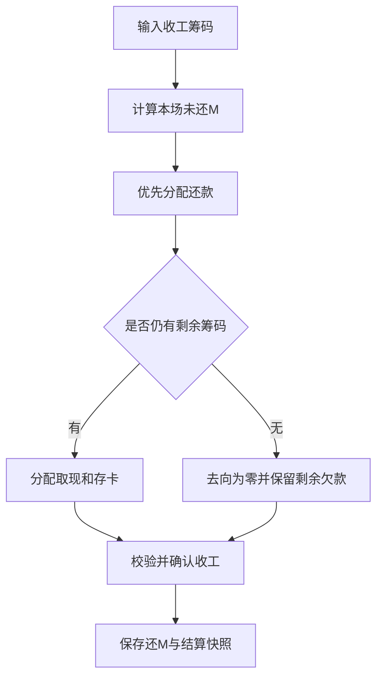

### 10.10 通知入口与验收 [MOD]

- 移除详情底部“WhatsApp 消息记录”整块，移除开工管理顶部“WhatsApp 消息模板”按钮。
- 操作记录的信息列继续展示对应业务通知摘要，可查看完整通知并复制；不实际外发消息。
- 验收：B数编辑后保存本场比例、原方案不变；现金余额加彩成功及超额失败；泥码小费恢复且收工只累计一次。
- 验收：未还M为10万，筹码5万时全部还M、剩余欠款5万、可分配0；筹码15万时还M10万、可分配5万。
- 验收：还M后取现和存卡总额必须等于剩余筹码；重复收工被拒绝；收工通知还款值与记录一致。
- 验收：两处WhatsApp独立入口均不存在，但操作记录通知预览和复制可用。

### 通用视觉与日期筛选 [MOD]（2026-11-02）

- 整站保持 Tidewell 浅灰画布、白色卡片和深青主色；日期范围控件采用 Havenest 白色、翠绿色及圆角样式。
- 开工列表、冻结列表、存取款报表、换汇开工报表、财务报表共用双月日历；窄屏上下排列两个月，避免横向滚动。
- 保留今天、昨天、本周、上周、本月、上月、自定义；快捷项仅填入日期，点击搜索后应用。重置清空筛选。
- 选定开始与结束日后确认；支持跨月、跨年、同日。反向点选自动整理先后顺序；只选一个端点时不能确认；关闭不提交草稿。
- 日期范围包含首尾日，按上海时区解释；清空并确认表示不限制日期。围数结次仍为年/月，开户生日不改为范围控件。
- 金额正数不加符号、负数保留减号；零不带符号。上下数不再用箭头及“上/下”前缀，颜色提示保留。
- 弹窗内容可换行；宽屏收工仍使用左侧录入、右侧预览，窄屏上下排列。M单表格随可用宽度换行，不以裁切隐藏内容。
