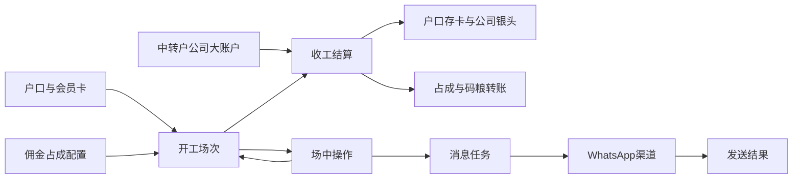

# 开工管理调整 · 附录

## A2 目标用户与角色
| 角色 | 职责 |
| --- | --- |
| 操作人 | 创建场次、录入场中操作、核对结算预览 |
| 确认人 | 独立校验本次操作并确认权限 |
| 结算人员 | 核对资金来源、占成、码粮和银头记录 |
| 配置管理员 | 管理占成方案、公司账户映射和消息模板 |

## A3 资料流与系统串接

- 开工保留户口、卡号、方案和资金来源快照；实际后端接口与表结构由研发结合既有系统设计。
- 业务操作成功后提交消息任务；消息携带业务单号关联，但不得因消息重试而重新入账。
- 开工银头、跨币种与暂存取回接口暂不定义，等待对应业务口径。

## A4 非功能要求
- 服务端逐次验证操作人与确认人身份、不同角色的确认权限和当前户口/场次状态；密码不得记录、导出或回显。
- 金额使用精确十进制，输入精度、存储精度、显示单位统一。不能用二进制浮点直接结算。
- 收工对场次、账户余额、转账及日志保持事务一致；跨服务失败有明确待处理状态与对账机制。
- 并发操作基于当前版本和余额校验；双击、超时重试具有同一业务操作标识。
- 所有业务变动留存单号、类型、币种、金额、变动前后、操作人、确认人、时间和选填备注。
- 查询、导出仅限授权范围；WhatsApp只包含允许对客户披露的信息。发送失败保留原因与重试历史。
- 性能指标由现网数据量与并发基线确认，不虚构毫秒级承诺；至少保证提交期间禁用重复点击并展示处理状态。

## A9 待确认事项
| 编号 | 来源 | 主题 | 需确认内容 | 当前处理 |
| --- | --- | --- | --- | --- |
| Q-01 | CH-03 | 开工银头 | 开工币种银头减少、筹码币种银头增加；来源为现金/存卡/M时如何映射？同币种是否分别记现金柜与筹码柜？ | 用户确认继续待定；原型不执行银头增减。 |
| Q-02 | CH-05～09 | 平局码粮 | 上下数为零但实际转码非零时，码粮由谁付谁？ | 原型有占成时阻止平局收工。 |
| Q-03 | CH-08、09 | B数与隐藏占成并存 | B数是否允许附加隐藏占成？是否同一方案源、同币种、同厅别？ | 保留原表单，两组可同时填写；原型逐组演示，正式叠加规则待业务确认。 |
| Q-04 | CH-10 | WhatsApp策略 | 收件号码来源、模板、自动发还是人工确认、失败重试权限、语言与幂等窗口？ | 原型只生成待发送消息，无外部发送。 |
| Q-05 | CH-12 | 负累计转码 | 允许负数变动，累计是否可小于零？负实际转码如何处理？ | 原型允许负累计但禁止负实际转码收工。 |
| Q-06 | CH-13～17 | 上下数核算 | 已确认收工公式加回本场小费并扣除暂存和加彩。 | 以最新交接公式验收；中途存金额采用扣取后余额。 |
| Q-07 | CH-15 | 中途取类别约束 | 仅限制总额还是同时泥码/现金码分别不得超过已存？ | 原型按类别及总额严格限制。 |
| Q-08 | CH-17 | 暂存闭环 | 暂存按增量还是快照？是否有取回/撤销？暂存资产去向和交收如何避免重复？ | 减上下数和泥码扣转码已确认；原型按增量，无取回动作。 |
| Q-09 | CH-18 | 泥码小费 | 保留泥码及现金码小费；给员工时仅泥码扣转码，公司收回对应筹码、扣现金，本金不变；荷官小费只增加上下数和离台数，不改变本金、转码及银头，收工计入上下数。 | 本场两种筹码小费汇总一次，收工不重复录入。 |
| Q-10 | CH-20 | 普通佣金 | 普通佣金的结算入口、付款方向、入账规则及与月结、隐藏占成码粮的关系如何确定？ | 不自动结清普通佣金；列表演示估算，真实应承接户口方案。 |
| Q-11 | CH-21 | 去向完整性 | 已确认先还本场未还M，剩余筹码再取现或存卡。 | 还M、取现、存卡之和等于收工筹码；跨场历史欠款范围仍待明确。 |
| Q-12 | CH-02、08 | 配置及权限 | 替换会员卡是否需验证归属？可用方案、比例上下限、权限与生效时间？ | 原型卡号非空、比例0～100；实际约束待确认。 |
| Q-13 | CH-13 | M单与跨币种 | 既有本户/他户M单的签发和选择、跨币种出码换算如何联动？ | 原型已支持本户/他户检索、新签M单及勾选，全部以泥码给出；正式单据服务及跨币种出码仍需联调确认。 |

### 已确认事项
- 2026-10-31：暂存的泥码与现金码都减少上下数，只有泥码扣累计转码。
- 2026-10-31：开工银头变化继续保留待确认。

## A11 来源与需求追踪
来源：用户两张开工管理需求截图（共22项）；现有列表、新开工、场次详情及弹窗的Chrome只读观察；本轮两项文本确认。现网观察只代表可见界面，不代表后端计算已验证。
| 编号 | 原始需求摘要 | 页面 | 验收 |
| --- | --- | --- | --- |
| CH-01 | 新开工移除基本位 | P2 | AC-01 |
| CH-02 | 会员卡默认户主卡号，可改其他卡号 | P2 | AC-02 |
| CH-03 | 开工银头变动待确定 | P2/P10 | AC-03 |
| CH-04 | 投食/偷食改名 | P1/P2/P3/P10 | AC-04 |
| CH-05 | 隐藏占成盈亏转账 | P9 | AC-05 |
| CH-06 | 客赢码粮转公司 | P9 | AC-06 |
| CH-07 | 客输公司支付码粮 | P9 | AC-07 |
| CH-08 | B数不输入占成人户口，使用默认方案 | P2/P10 | AC-08 |
| CH-09 | B数码粮参照隐藏占成结算 | P9 | AC-09 |
| CH-10 | 记录备注旁增信息列及WhatsApp | P3 | AC-10 |
| CH-11 | 本金展示资金来源组合 | P3 | AC-11 |
| CH-12 | 转码可正负 | P4 | AC-12 |
| CH-13 | 加彩沿用现有弹窗操作 | P5 | AC-13 |
| CH-14 | 中途存规则 | P6 | AC-14 |
| CH-15 | 中途取逆向与上限 | P6 | AC-15 |
| CH-16 | K现分泥码和现金码 | P7 | AC-16 |
| CH-17 | 暂存影响上下数与转码 | P7 | AC-17 |
| CH-18 | 小费记录并计入收工 | P8 | AC-18 |
| CH-19 | 收工移除员工和荷官小费 | P9 | AC-19 |
| CH-20 | 收工移除本场佣金勾选 | P9 | AC-20 |
| CH-21 | 收工K现与存户口 | P9 | AC-21 |
| CH-22 | 列表贷款改为M | P1 | AC-22 |
