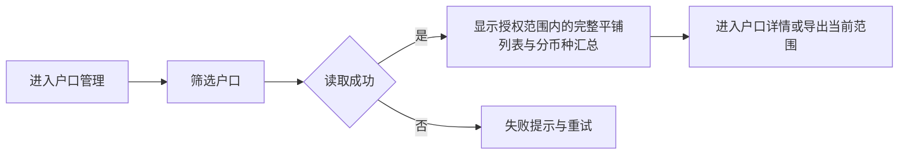
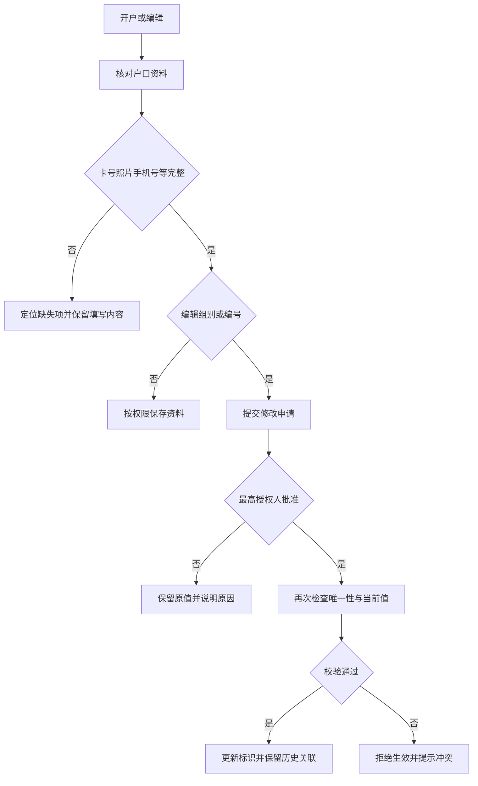
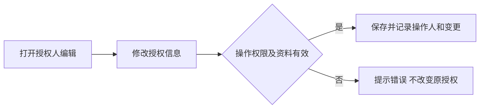
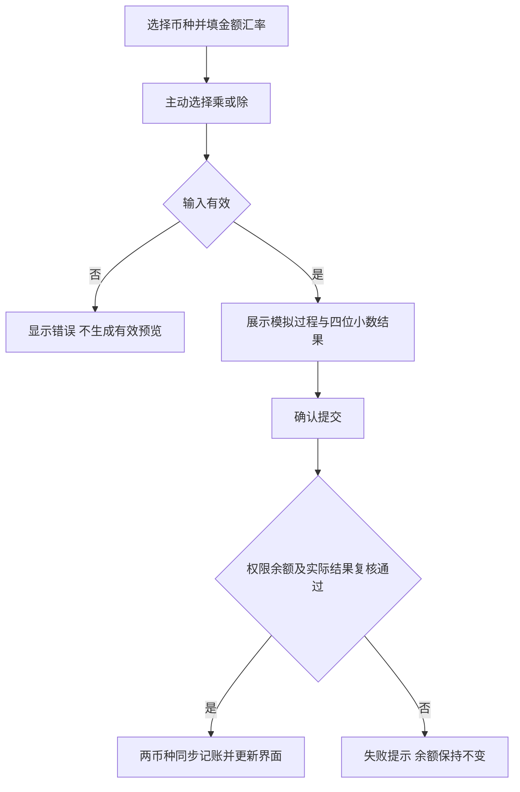
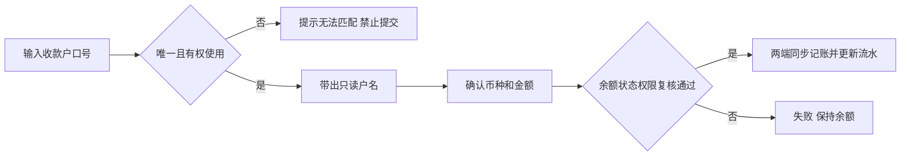
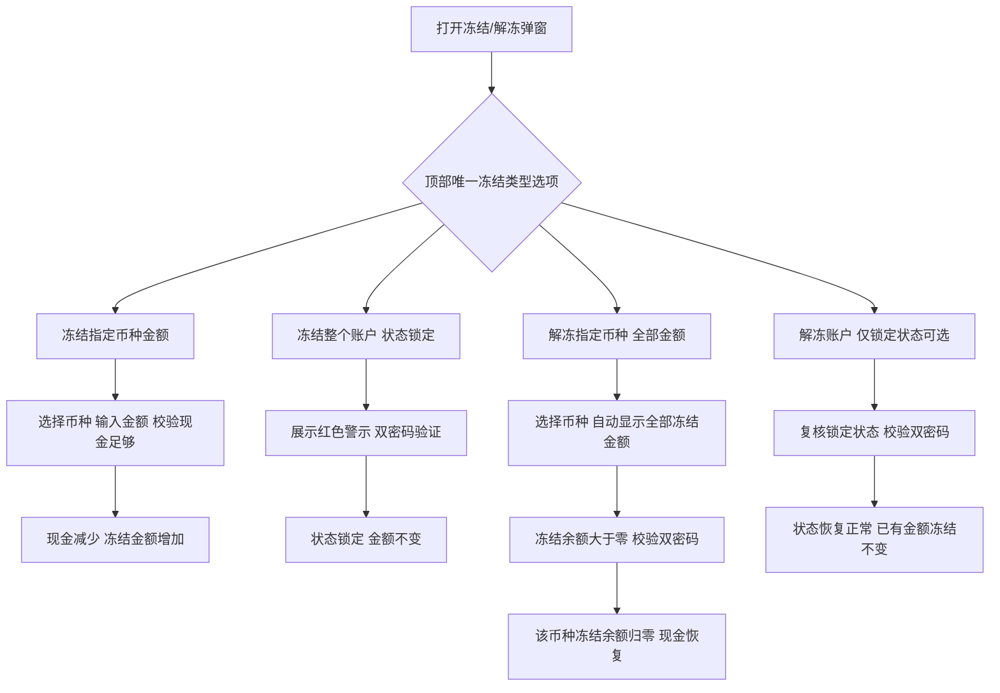
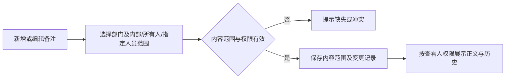

# 户口管理界面与业务规则调整 PRD

## 目录

- [[#§1 修订追踪表]]
- [[#§2 背景与目标]]
- [[#§3 功能清单]]
- [[#§4 功能细节规格]]
- [[#§5 功能流程图]]
- [[#§6 异常与边界场景]]
- [[#§7 验收清单]]

## 本文件使用说明

- 本文件是可评审草稿，未代表已完成业务签收或后台上线。
- 来源：用户需求截图、2026-10-31 Chrome 实查户口列表/详情/编辑表单/个人码量设置弹窗，以及用户当次明确回复。
- 户口列表现状入口：[户口管理](https://fmcapp.com/newVIP/accounts)。未检查源码、数据库或实际执行资金操作。
- “明确要求”指截图和用户回复；“建议”是为补齐交互或保障一致性提出的设计，需评审；未明确部分见附录 A9。
- 配套：[[PRD_户口管理调整_20261031_appendix]]；开发所需字段、计算示例与精度约定见 [[户口管理_业务规则与开发交接]]。
- 本次交付为界面调整规格与需求文档，不修改线上系统；所有布局为方案示意，示例不引用真实客户资料。

## §1 修订追踪表

| 版本 | 日期 | 编制 | 状态 |
|---|---|---|---|
| V1 | 2026-10-31 | Codex 根据需求资料整理 | 初稿，未送外部评审 |
| V1.1 | 2026-10-31 | 根据用户补充调整 | 移除布局示意章；户口列表补充基础字段，保留原有状态、金额及操作列，移除层次结构 |

### 最新交互调整汇总（2026-10-31）

- 列表：保留原金额/额度/状态字段，补充组别、姓名、角色、介绍人、开户厅；移除层次结构，操作列右侧固定，查询/重置及导出可用，恢复两条分币种汇总。
- 开户/编辑：恢复资料字段；卡号手动输入必填；取消旧户口核对；照片信息统一入口、一至两张；组别编号可编辑。会员资料展示图片、卡号、国籍、性别、生日。
- 详情：备注标题与正文分行，多条正文同行分号分隔；批额与已签额变化分两表；未结算显示数字。
- 码粮：每币种分别配置即结和月结，只配置占成比及对应码粮比，统一保存并回显。
- 授权：完整多人表单，隐藏操作人只读框及确认人选择框；详情展示人员、授权、照片及备注。
- 转账/换汇：左右分区；收款信息与余额在右侧；换汇显示过程、结果和余额，系统汇率只读，按系统配置的乘法或除法换算，不提供计算方式选择。
- 冻结/解冻：指定币种金额与整个账户两类，资金与账户状态独立处理。
- 通用：业务提交需操作人和确认人密码，备注选填；管理备注下方为含操作人的时间轴。原型顶部“原型说明”入口隐藏。

## §2 背景与目标

### 2.1 背景与现状依据

| 区域 | 本次实际观察 | 调整目标 |
|---|---|---|
| 户口列表 | 支持户口号/姓名/电话、状态、角色、组别、厅、会员卡号筛选；树形层级与分币种余额 | 补充组别、姓名、角色、介绍人、开户厅，保留状态、金额和操作，移除层次结构 |
| 编辑资料 | 有组别代码、编号、角色、手机号、会员卡号及证件正反面；会员卡号提示可选，区号为输入框 | 强化开户必填；区号改为选择；敏感标识修改受控 |
| 户口概况 | 存卡、冻结、Marker、消费、本月转码、积分、月结佣金、未结算 | 增加现金余额，明确存卡与现金边界；移除消费列 |
| 基本资料 | 批额/信用额度和已签额在基本资料内 | 移至额度变化记录下面，拆为批额与已签额两张变化记录表 |
| 个人设置 | 标题为“个人码量设置”，按币种配置 A数、现金、M、月结码粮、积分比、代理佣差；留空沿用系统 | 仅配置占成比对应码粮比，分即结/月结；移除其他个人比例项 |
| 详情操作 | 有授权人、换汇、转账、冻结/解冻、管理备注入口 | 优化交互，并定义数据、权限和日志联动 |

### 2.2 目标与范围

- 开户资料完整：组别、角色、会员卡号、照片信息、手机号可检查、可追溯。
- 资金展示清晰：存卡与现金分开；冻结直接扣减显示的现金余额，解冻恢复；分币种查看。
- 操作更易核对：换汇显示系统配置的乘法或除法换算过程；转账带出收款户名；资金结果统一四位小数截断。
- 配置与权限清晰：个人码粮支持即结/月结；敏感标识需最高授权人批准；备注可见范围可控。
- 范围内：户口管理页面、相关弹窗，以及冻结报表、结算、码粮、操作日志的必要联动。
- 范围外：全后台重做、支付渠道、自动汇率行情、自动识别证件、短信验证码、全量历史数据重算。

### 2.3 已确认的关键业务决定

| 决定 | 明确口径 | 影响页面 |
|---|---|---|
| 冻结与现金 | 冻结成功后直接扣减“现金余额”的展示数值；冻结金额单列，解冻恢复现金余额 | P1、P3、P8 |
| 码粮周期 | 支持“即结”和“月结” | P4、结算关联 |
| 资金精度 | 输入金额及计算结果最多保留四位小数，超过部分舍去，不四舍五入；计量单位待确认 | P3、P6、P7、P8 |

## §3 功能清单

| 编号 | 页面/区域 | 类型 | 调整范围 | 对应截图需求 |
|---|---|---|---|---|
| P1 | 户口管理列表 | [MOD] | 原列表增补基础字段；保留状态、金额及操作；移除户口层次结构 | CH-08、CH-15 |
| P2 | 开户/编辑户口 | [MOD] | 组别、角色、会员卡、手机号及敏感字段审批 | CH-01～06、CH-18 |
| P3 | 户口详情/概况/额度区 | [MOD] | 存卡与现金分离、移除消费、额度信息迁移 | CH-07～09、CH-12 |
| P4 | 个人码粮设置 | [MOD] | 客户独立配置、去除佣差、占成对应码粮、即结/月结 | CH-10、CH-11 |
| P5 | 授权人编辑弹窗 | [MOD] | 移除人工输入确认人要求，保留操作权限和日志 | CH-13 |
| P6 | 换汇弹窗 | [MOD] | 系统汇率只读、系统配置的乘法或除法预览、双账户流水 | CH-14、CH-15 |
| P7 | 转账弹窗 | [MOD] | 删除转入厅选择，收款户口号带出户名 | CH-16、CH-15 |
| P8 | 冻结/解冻弹窗与冻结列表 | [MOD] | 现金扣减/恢复、冻结明细、报表联动 | CH-17、CH-08、CH-15 |
| P9 | 管理备注弹窗及备注卡片 | [MOD] | 可见范围、操作人、操作/编辑时间、变更日志 | CH-19 |

保留不变：侧栏其他分组、场次记录、M额度变化记录、开户厅/介绍人等未指定修改的字段。仅因本需求必要的显示和联动调整例外，不能借此删除原有业务能力。

## §4 功能细节规格

**统一备注规则：** 所有备注输入框均为选填，包括管理备注、授权人备注及资金操作备注；移除必填标识与空内容拦截，留空也可提交。管理备注允许保存空正文或将已有正文清空，保留操作记录；两项密码仍须填写。

**统一操作密码要求（最新确认）**

- 所有业务提交操作均展示“操作人密码”“确认人密码”两个必填密码输入框：开户、编辑资料、存款、取款、转账、换汇、冻结、解冻、个人码粮保存、授权人保存、备注新增/修改、敏感编号变更申请及批准/拒绝。
- 任一密码为空时阻止提交并显示对应提示；输入隐藏显示，不在多个操作之间自动复用。取消、关闭或成功后清空密码；失败不改变业务数据。
- 查询、查看详情/图片/记录、展开收起及取消等浏览动作不要求密码；授权人新增行、移除草稿行、选择照片等在最终保存时统一校验。
- 原型仅演示必填校验，授权人保留原有两项密码不可相同校验；正式系统须沿用服务端双人身份与权限验证，密码不写入配置、日志或导出。未实现的业务入口沿用本规则作为后续要求。

### 4.1 P1 户口管理列表

**界面展示**

- 在原有列表上增补字段，完整顺序为：户口号、组别、姓名、角色、介绍人、开户厅、状态、各币种金额、未还M卡、操作。原“类型”以“角色”展示，避免重复列。
- 移除户口层次结构及树形展开/收起操作，改为平铺列表；不改变后台户口关系数据。
- 列表上方恢复现有两条汇总栏：浅蓝色“各币种总余额”、浅红色“各币种总未还M卡”；按港币、人民币、美元、越南盾、USDT排列，各自显示金额和“万”单位，币种之间使用竖线分隔。
- 列表与顶部汇总的金额沿用现有紧凑数字格式，不补末尾零（例如100、9.3、9.234）；有效精度最多四位小数，超过部分截断。此项仅调整显示，不改变资金计算精度；详情继续使用四位小数展示。
- 未还M卡汇总按币种独立统计；列表无未还M卡显示“—”，有记录时按币种逐行显示红色金额；原型使用虚构的 HKD 10、CNY 28 演示，汇总与行数据一致。
- 账户相关字段参考现有样式：户口号为蓝色链接；姓名前以角色颜色圆点区分，别名以浅灰文字展示；角色用彩色小标签；正常状态使用绿色圆点和“正常”文字（对应原型启用状态）。继续保留新增字段，不恢复户口层次结构。
- 币种单元格首行显示余额，第二行在有额度资料时显示“批:X 欠:Y 可用:Z”；批额与说明文字为灰色，非零欠额为红色，可用额度为绿色。没有额度记录时只显示余额，不伪造额度行。
- 批、欠、可用分别沿用后台对应数据字段及口径，不根据余额自行推算可用额度；原型固定示例仅用于展示样式，不代表已确认额度计算规则。
- 组别显示户口的组别代码；姓名独立成列；角色使用角色名称；介绍人无数据时显示“无”；开户厅显示开户时所属厅。
- 保留原有状态、各币种金额、未还M卡与操作列；户口号及操作列的详情入口均可进入详情。
- 操作列表头及单元格固定在列表可视区域最右侧；横向滚动时位置不变，其他字段在其下方滚动。固定列使用不透明背景及左侧分隔阴影，详情按钮始终可见、可点击；窄屏保持同样行为。
- 保留现有筛选、开户、重置、导出与分币种余额汇总。此前原型的现金/存卡余额口径切换恢复保留，作为待评审建议；列表、汇总与导出采用一致口径，不同币种不相加。

**页面与业务联动**

- 查询区明确展示户口号/姓名/电话、组别、角色、状态、开户厅、会员卡号及余额口径（原型建议项），提供“查询”和“重置”按钮。
- 点击“查询”或在查询输入框按 Enter 后应用条件并更新列表、结果数量和分币种汇总；输入未提交时不改变当前结果。
- “重置”清空查询条件、恢复默认口径并查询全部授权范围内户口；返回列表保留已应用的查询条件。
- 列表标题右侧显示“导出数据”，导出当前已应用查询条件下的全部结果；未提交的新条件不影响导出。无结果时禁用导出。原型提供可用 Excel 打开的 CSV 文件，正式导出格式沿用现有系统。

- 导出当前筛选范围，保留上述全部业务字段及顺序，不导出操作按钮和户口层次结构；币种金额表头注明单位与余额口径。
- 无结果显示空态；加载失败显示失败和重试。
- 查询、详情和导出均只包含当前用户有权查看的户口。

### 4.2 P2 开户/编辑户口

- 开户及编辑页仅保留“照片信息”上传区域，不再提供证件正面、证件反面上传入口。其他证件信息字段保留。

- 上传区统一命名“照片信息”，最少一张、最多两张；点击“确认开户”时若没有照片，阻止提交并提示“请至少上传一张照片”。多选及多次追加均校验累计数量，超出两张时拦截本次上传并提示，可移除后重新上传。详情同步显示缩略图并支持放大；默认演示户口预置两张标注 SAMPLE 的示例图片，不使用真实证件。

- 开户恢复原有资料字段：组别代码、编号、姓名、别名、角色、上线户口、介绍人、开户厅、短信语言、区号及手机号、备用电话、电子邮箱、国籍、性别、生日、证件类型及号码、会员卡号、内部备注、客户备注。补充字段保存后编辑可回显。
- 会员卡号为必填项，开户使用手动输入形式；仅保留“照片信息”一个上传区域，移除证件正面/反面上传；最少一张、最多两张。所有备注选填，保留双密码验证。
- 布局按户口信息、联系资料、会员资料与证件、备注、操作验证分区；宽屏三列，中屏两列，小屏单列，缩减区块留白，底部保存区保持可见。正式下拉选项沿用后台字典，不以原型示例选项替代。

- 编辑户口时会员卡号使用文本输入框，回显当前卡号，可手动修改；去除首尾空格后必填，保存后同步到详情。开户同样使用会员卡号文本输入框。

- 当前原型编辑页暂不展示组别/编号审批提示条及“申请修改 / 查看审批”入口；组别代码和户口编号在当前原型中可直接编辑并保存，保留必填、格式及重复编号校验。此为当前原型调整；正式业务最高授权人审批要求是否取消，仍需另行确认。

**入口与布局**

- 开户沿用列表入口；编辑沿用详情入口。顶部明确区分“新开户口”和“编辑户口”。
- 表单自上而下：基本资料 → 联系资料 → 会员卡与证件 → 备注 → 底部保存区。
- 编辑模式下组别代码、编号可编辑；当前版本不展示审批提示及申请入口。

| 展示项 | 控件 | 必填规则 | 页面行为与提示 |
|---|---|---|---|
| 组别代码 | 保留原控件，提供核对提示 | 必填；需核实业务代码 | 与编号组合展示户口号预览；是否从代码库选择见 Q4 |
| 编号 | 保留原控件 | 必填 | 保留前导零；完整户口号重复时阻止保存 |
| 角色 | 下拉选择 | 必须明确选择（建议） | 旁边显示适用佣金模式说明；角色与模式映射见 Q5 |
| 区号 | 可搜索选择器 | 必选 | 显示国家/地区及区号；不允许任意文本冒充有效区号 |
| 手机号 | 电话输入 | 必填 | 按所选地区校验格式；不显示或发送验证码 |
| 会员卡号 | 文本输入框 | 必填，去除首尾空格 | 开户和编辑一致；唯一性和归属规则见 Q3 |
| 照片信息 | 唯一照片上传区 | 最少一张，最多两张 | 无照片不得确认开户；不再单列证件正反面上传 |
| 其他证件资料 | 保留现有控件 | 原规则不变 | 国籍、性别、生日、证件类型/号码保留，证件正反面上传入口移除 |

**交互与保存**

- 必填校验失败时定位到首个错误，同时保留其他已填内容。
- 卡号切换后提示重新核对照片信息；照片可预览和删除，删除最后一张后不能提交有效开户。
- 户口详情“会员资料”展示会员卡号、会员姓名、国籍、性别、生日及已上传照片信息缩略图；图片使用当前户口保存的上传文件，不使用文字占位卡代替。多张图片排列展示，点击可放大预览并切换上一张/下一张。
- 无图片时显示“暂无上传图片”和编辑上传入口；图片加载失败显示明确提示。编辑保存后同步刷新会员卡信息与图片；取消编辑不更改已保存资料。
- 照片上传失败、仍在上传或格式不支持时不算有效照片。格式/大小上限见附录建议值。
- 区号改变后重新校验手机号；格式校验只证明格式符合规则，不证明号码归属或已接通。
- 选择角色后展示当前佣金模式与个人覆盖提示；不得隐式覆盖已经确认的个人配置。
- 建议历史缺资料户口仍可查看，并标记“资料待补齐”；编辑保存时提示补齐，不能自动填假数据。是否阻止历史户口交易见 Q12。

**组别代码与户口编号修改**

- 当前原型允许直接编辑保存，保留必填、格式与重复编号校验，保存需要双密码；不显示审批入口。
- 修改后列表、详情与查询显示新标识，历史余额、场次、额度、授权和备注继续关联同一稳定户口，不创建新账户。
- 早期最高授权人审批要求现列为正式上线待确认项；附录审批流程仅供讨论，不作为当前原型交互验收条件。

### 4.3 P3 户口详情/概况/额度区

- 会员资料展示国籍、性别、生日，与开户/编辑保存的对应字段一致；空值显示“未填写”，生日按 YYYY-MM-DD 展示。

**布局调整**

1. 顶部保留户口号、姓名、角色、状态、返回和现有操作区。
2. 顶部备注卡片只显示当前登录人员有权看的备注正文，不展示部门、可见范围、人员、时间或逐条编辑/历史入口；保留统一的“管理备注”按钮。
3. “户口概况”改为整行宽度；基本资料与个人码粮/授权信息放在其下方，避免列宽不足。
4. 概况列建议顺序：币种、余额、现金垫付、积分垫付、存卡、冻结、Marker、本月转码、积分、月结佣金、未结算。“未结算”沿用现有界面的数值显示格式，不显示“待核对”等状态文字；原型以 0.0000 演示，正式数值沿用现有指标数据，不改变计算口径。
5. 删除概况中的“消费”列，仅隐藏此处展示，不删除消费记录或消费管理菜单。
6. 在“额度变化记录”表格下方，分别显示“批额额度变化记录”和“已签额额度变化记录”两张独立表格，替换原“批额与已签额”合并展示；再接原有 M额度变化记录。

**现金与存卡口径**

- 现金余额：当前可使用的现金展示值。冻结成功直接扣减该值，解冻成功恢复；不再对该值重复扣一次冻结金额。
- 存卡：每场收工收回的筹码对应记录；必须完成相关上下数交收后才具备转现金条件。
- 未完成交收的存卡不计入可取现金；不能因为“已收工”就自动当成现金。
- 交收完成后何时转现金、转换金额是否等于存卡原额、部分交收如何处理待 Q2 确认；先保留关联场次、待交收金额与状态展示能力。
- 存款、取款、转入、转出、冻结、解冻及换汇成功后，更新对应币种现金显示与流水；失败时不更新。
- 所有金额明确币种与单位；不同币种禁止合成一个无币种总额。

**批额额度变化记录 / 已签额额度变化记录**

- 批额和已签额变化分别成表，不混合展示。两表字段顺序统一为：单号、额度类型、币种、变动金额、操作人、时间；金额列保留现有“万”单位标识。
- 每行对应一笔实际额度变动，变动金额以正负号表示增加或减少，不能将当前余额直接当作变动金额。按操作时间倒序展示；无记录显示空态。记录从对应额度业务取得，不由页面人工改写。
- 额度类型沿用对应业务记录的类型名称；已签额和 Marker 的定义及对应关系需确认，不能直接认定两者相等。
- 本次观察到列表/详情/M记录间有需要核对的口径差异，只记为规则核实项，不判定账务错误。
- 详情可用币种范围应与账户配置一致；列表可见 USDT、所查详情未见 USDT，需要确认是否按有效币种动态显示。

### 4.4 P4 个人码粮设置

**界面调整**

- 建议将按钮与卡片统一命名“个人码粮设置”；当前系统为“个人码量设置”，需业务确认术语后全局统一。
- 保留“沿用系统默认/个人设置”来源提示；留空沿用默认，明确输入零与未配置不同。
- 移除 A数码粮、现金码粮、M码粮、积分比、代理佣差的输入、展示和新配置提交字段；旧配置迁移及历史结算数据单独处理，不默认删除历史。
- 个人设置仅保留“占成比”和“对应码粮比”两项比例，按客户、币种、结算周期分别保存，切换后回显对应配置。
- 弹窗采用多币种配置矩阵：每个币种分即结、月结两行，分别维护占成比、对应码粮比；两套配置同时保留，不能二择一。可同时编辑多个币种，统一输入操作人和确认人密码后点击“保存全部配置”。
- 打开时回显各币种已保存值；保存前校验全部输入，任一项失败不提交任何配置，提示具体币种、周期及字段。取消不改变原配置；比例全部留空表示沿用默认比例，结算方式独立保存，零值必须保留。
- 户口详情的个人码粮卡片按币种展示已保存的结算方式、占成比、对应码粮比；未配置显示“默认”。每币种仅配置一种结算方式；切换结算方式保留当前输入比例，保存后生效，历史业务的处理仍按版本规则确认。
- 保留按币种配置维度；占成比例一对多档位、各类比例关系及单位见 Q6，不预设累计相加公式。

**逻辑与联动**

- 对同一客户的配置优先于其适用系统默认；个人没有配置的项目才继承默认（建议，需明确继承粒度）。
- 展示保存后的实际生效值及来源，避免空输入被误认为零。
- 改角色时重新核对适用佣金模式；不得自动追溯更改已结算历史。
- 建议新配置只作用于后续业务，进行中的场次使用哪个版本由 Q7 决定。
- 个人码粮设置弹窗显示“操作人密码”和“确认人密码”两个必填密码输入框，隐藏输入内容，替代原型的模拟验证勾选框；缺少任一项时阻止保存并明确提示。正式系统须通过现有身份验证后保存配置，密码不得写入配置、操作日志或导出。原型只做必填演示，不验证真实身份、不保存密码。授权人编辑仅隐藏确认人选择框，仍保留两项密码。
- 任一比例无效、币种重复或有效规则无法确定时阻止保存并说明；取消不改变配置。

### 4.5 P5 授权人编辑弹窗

- 按最新截图还原“编辑授权人”表单，支持新增、移除多位授权人。每位包含姓名（必填）、区号、电话、授权种类、会员卡号、照片和备注。
- 授权种类沿用截图：取款、出佣金、消费、订务、签贷款、数据查询、开工，支持多选。正式选项与现有配置保持一致。
- 隐藏“确认人”选择框及“操作人”只读信息，仅保留操作人密码和确认人密码两个必填输入框，隐藏密码内容；两项密码不可相同，沿用截图中的校验提示。
- 正式系统仍需执行原有双人身份与权限验证；隐藏选择框后确认人身份如何由现有机制确定需开发核对，不以密码非空或不相同代替身份认证。原型只演示本地输入校验。
- 户口详情授权人卡片：未设置时显示“尚未设置授权人”；设置后按授权人分块显示姓名、区号及电话、会员卡号、授权种类标签，有照片时显示可点击放大的缩略图，有备注时显示备注。支持多位授权人；未填写电话或卡号显示“未填写”，无授权种类显示明确空态。保存后立即刷新卡片，不仅拼接姓名。
- 编辑时回显已保存授权人资料；新增、移除及编辑先作用于草稿，取消不改变已保存资料。保存成功刷新详情并记录操作人、时间及变更，密码不进入日志、配置或导出。
- 本项不取消组别/编号变更的最高授权人审批要求。

### 4.6 P6 换汇弹窗

- 左侧输入对手户口账户、转出币种、转入币种和转出金额，展示只读系统汇率及操作人、确认人密码；右侧展示兑换方案、双方收付金额及变动后余额。窄屏上下排列。
- 本账户与对手户口必须不同，对手户口须存在且可交易；禁止同币种换汇、非正金额和任一方付款币种余额不足。
- 普通换汇、换汇开工和换汇加彩统一读取系统设置的对应币种对汇率；业务页面不得手动修改汇率或选择乘除算法。系统未配置汇率时提示并禁止提交，不自动反推其他币种对。
- 按系统配置的乘法或除法换算，金额结果保留四位小数并截断；预览不扣款、不产生报表记录。系统汇率由设置模块维护，成功交易保存成交汇率和算法快照，后续改价不回算历史。
- 普通户口换汇是双账户对转：本账户原币种转出给对手户口；对手户口目标币种转出给本账户。双方余额及四条流水必须同时成功。
- 换汇报表记录一笔换汇单；存取款报表记录本账户两条和对手户口两条流水，全部关联同一换汇单号，记录所属户口、对手户口、币种、带符号金额、变动后余额、成交时间及操作人。
- 提交时重新校验双方状态、可用余额和系统汇率；如成交条件与预览不一致，应更新预览供核对，不静默按旧报价扣款。失败、取消、重复提交不得造成部分入账或额外流水。
- 本节双账户四条流水规则针对普通户口换汇。换汇开工及换汇加彩继续沿用各自资金来源与场次联动，不能把收到目标资金和投入场次重复计为收入。

#### 系统汇率算法配置

- 系统设置 → 汇率设置 → 编辑，增加“算法”单选下拉：乘法 ×、除法 ÷；既有未设置算法的配置默认乘法。
- 汇率列表同时展示币种对、汇率、算法、类型及操作，编辑时带出当前保存值。算法按币种对分别保存，不自动修改反向币种对。
- 管理员保存后，普通换汇、换汇开工和换汇加彩的新计算统一读取该币种对的汇率和算法；业务操作页面仅展示换算过程，不允许临时覆盖。
- 汇率须大于零，除法不得使用零汇率；缺少或无效配置时阻止提交。保存失败或取消编辑保留原配置。
- 成功交易的汇率及算法形成快照，后续修改系统配置不改变历史金额和报表。系统设置变更记录修改前后汇率、算法、操作人及时间。

### 4.7 P7 转账弹窗

- 转账弹窗采用左右分区：左侧为转出户口、收款户口号、币种、金额、选填备注及两项密码；右侧为自动匹配的户口名字/编号、额度、资料查看、证件预览、账房备注和分币种余额。底部统一显示取消/确认转账；窄屏自动上下排列。

- 收款户口信息区参照提供截图，包含户口额度（万）、户口号/姓名/编号、查看入口、证件预览、账房备注及收款人户口余额（万）。额度及余额按币种分别展示；暂无资料时显示空态。查看和证件预览在当前弹窗内展开，不清空转账草稿；更换收款户口立即清空旧信息。备注和证件需遵守当前操作人的查看权限。

- 移除“转入厅”选择项。保留当前转出户口只读信息。
- 输入收款户口号后自动查询，在输入框右侧只读展示户口名字和户口编号；建议精确匹配完成后显示“已核对”，查找中禁止提交。
- 收款户名及户口编号只读；修改户口号立即清空旧户名、编号和旧匹配结果，避免转向上一个户口。
- 多条匹配、未找到、无权查看或目标状态不允许时，禁止提交并给出可理解提示；不能自动选第一条。
- 由唯一户口定位目标归属；若户口号只在厅内唯一，需先解决全局定位规则，不能简单删掉转入厅后上线。
- 建议本期按同币种现金转账；跨币种需求通过明确换汇流程处理，是否已支持跨币种需核实。
- 确认区显示收款户口号、户名、币种、金额和操作后余额预估；转账两端与流水必须同时成功，取消不记账。

### 4.8 P8 冻结/解冻与冻结列表

**冻结类型（最新补充）**

- “解冻账户”选项仅在账户为“锁定”状态时可选，正常状态下禁用；提交时再次校验状态，防止重复或过期操作。

- 选择“冻结整个账户（状态锁定）”时，在类型选择下方展示红底红字警示：“整个户口状态将被标记为「冻结」，所有操作均受限制”。仅整户冻结显示，金额冻结和解冻不显示此警示；保存后的状态名称仍为已确认的“锁定”。

- 金额解冻按账户及币种聚合余额校验，不要求选择或匹配单张冻结单；一次解冻所选币种全部冻结金额，不允许手动输入部分金额。保留正金额、四位截断和双密码校验。后台记录解冻流水并与冻结报表保持一致；原型自动按先冻结先释放分配历史记录，正式关联策略由开发确认，不增加用户选择步骤。

- 弹窗仅保留顶部一个“冻结类型”下拉框，不显示冻结/解冻切换按钮或重复下拉框，提供“冻结指定币种金额”“冻结整个账户（状态锁定）”“解冻指定币种（全部金额）”“解冻账户”四个选项；所有提交操作均须填写操作人密码和确认人密码，备注选填。
- 指定币种金额：选择币种和金额，冻结扣减该币种现金余额、增加冻结金额；解冻恢复对应金额。此类操作不自动将户口状态改为锁定。
- 整个账户：不填写币种和金额，提交后户口状态变为“锁定”，详情、列表、状态筛选及导出同步展示；原型按状态锁定处理，不扣减现金、不改变已有金额冻结。解冻账户后状态恢复正常，不自动解冻指定币种金额；解冻指定币种金额仅恢复对应资金，不解除账户锁定。
- 原型锁定后拦截开工、存款、取款、转账及换汇入口；允许查看、查询与解锁。正式锁定的完整限制范围、是否允许入款及在途业务处理需业务确认，后端须执行对应限制。
- 冻结列表分“额度冻结详情”和“户口冻结详情”，金额变动与账户状态变更分别展示；不将整户锁定算入冻结金额汇总。不允许重复锁定或重复解锁。

**界面与现金联动**

- 冻结区展示当前户口、币种、现金余额、拟冻结金额、冻结备注（选填）及操作后现金余额。
- 冻结成功：直接减少显示的现金余额，增加对应冻结金额；不是损失、消费或取款。
- 金额解冻不选择冻结记录，直接选择币种，解冻金额只读显示该币种全部冻结余额，展示该户口该币种冻结总余额及操作后现金/冻结余额。冻结列表用于查询流水，解冻从户口详情进入，不限定于单笔冻结记录。
- 解冻成功：减少冻结金额并恢复现金余额；已全部解冻记录保留，不删除原记录。
- 本次金额解冻仅支持所选币种全额解冻；冻结余额为零时阻止提交。提交时以最新余额为准，后台须处理并发变更，避免重复解冻。

**冻结列表界面与查询**

- 沿用“报表管理 → 冻结列表”，标题下显示“查询额度冻结及户口停用启用记录”。默认打开“额度冻结详情”，另一页签为“户口冻结详情”。页签、筛选卡片和表格沿用户口管理视觉风格。
- 两页签均保留搜索户口（户口号/姓名）、操作类型、今天/昨天/本周/上周/本月/上月/自定义、开始日期、结束日期、筛选、重置、汇出。
- 额度操作类型：全部、冻结、解冻；户口操作类型：全部、冻结账户、解冻账户。切换页签保留户口及日期条件，将操作类型重置为全部。
- 输入日期包含首尾日；开始日期晚于结束日期时提示错误，不执行新查询。搜索支持模糊匹配；重置清空全部条件；快捷日期填入范围，点击搜索后查询。
- 无数据时显示“暂无记录”；不将截图中的“载入中”作为永久空状态。汇出仅包含当前页签已应用筛选的结果与当前列，空结果提示暂无可汇出记录。

| 页签 | 显示列 |
|---|---|
| 额度冻结详情 | 时间、户口号、姓名、操作类型、变动金额、冻结后余额、操作人、备注 |
| 户口冻结详情 | 时间、户口号、姓名、操作、变更前状态、变更后状态、操作人、备注 |

- 金额列附币种及“万”，保留四位小数；冻结增加冻结余额用正号，解冻减少冻结余额用负号。冻结后余额是该次操作完成时该户口该币种的余额快照，不随以后操作改写。
- 记录按操作时间倒序。每次成功的冻结/解冻生成一条记录；一次全额解冻即使关联多张冻结单，也只展示一条操作流水。
- 整户冻结记录“正常 → 锁定”，解冻记录“锁定 → 正常”；两类状态变动不改变币种冻结余额。失败、取消或密码校验未通过均不生成流水。

**开户及户口资料联动**

- 新开户成功后，户口状态默认为正常，各币种冻结余额为零；初始开户不生成冻结/解冻记录。不得将上一户口的锁定状态、冻结余额或冻结单带入新户口，也不得清除旧户口历史流水。
- 户口号由组别代码和编号组合，姓名来自开户资料。记录关联稳定的户口标识，不用可编辑的户口号作为唯一关联键。
- 修改组别代码、户口编号或姓名后，冻结列表展示与搜索同步使用最新资料；原流水保留操作时户口号/姓名快照供审计，金额、状态变更、操作人和时间不被改写。
- 户口详情发起金额冻结/解冻后，现金及冻结余额、户口列表金额、额度冻结详情同步更新；现金不足、冻结余额为零、重复提交不能产生部分更新或重复记录。
- 整户冻结/解冻后，户口列表及详情状态、开工和资金操作的状态限制、户口冻结详情同步更新。解冻账户不自动释放币种冻结金额，币种解冻也不自动解锁账户。
- 开户照片、会员卡号、国籍、性别、生日和联系方式继续保存在会员资料中，不新增到冻结列表或其汇出列。查询冻结列表不改变账户资料或资金。
- 全额金额解冻仍只选择币种，不要求用户选择冻结记录；表格用于查询，不增加与截图不符的逐行解冻操作。

### 4.9 P9 管理备注

**界面展示**

- 按用户提供的现有弹窗截图还原“户口备注管理”：保留部门下拉、可见范围下拉、备注输入框、添加按钮，以及右上角关闭和底部关闭按钮。
- 新增/编辑表单置于弹窗上方，备注记录置于新增备注操作下方。记录参照提供的操作日志截图，使用蓝色圆点、浅色竖线的纵向时间轴；按最近操作时间倒序排列，时间与操作人显示在每条记录顶部，下一行显示备注正文；记录较多时可滚动，无记录显示“暂无备注”。
- 部门选项沿用后台部门配置，截图当前选中“场面”。保留“内部（仅同部门可见）”选项，同时保留此前要求的“所有人可见”和“指定人员可见”。新增备注默认部门为场面、范围为内部（演示默认，正式默认沿用系统配置）。
- “所有人”建议明确为“拥有该户口访问权限的内部人员”，不代表对外公开或客户可见；该范围仍需确认。
- 选择指定人员时出现人员多选器，至少一人；保存前展示范围摘要。
- 户口详情的备注区采用紧凑横条：首行左侧显示“户口备注”标题，右侧显示“管理备注”按钮；备注正文在标题下方另起一行，保持紧凑间距，不增加标题分隔栏或逐条整行分隔。多条备注正文同行排列，使用分号分隔，不在备注之间强制换行；标题与正文仍分行，正文超出容器宽度时自然换行；默认最多两行，超出时显示展开/收起；无备注显示紧凑空态。仅展示正文，保留统一“管理备注”入口。部门、可见范围、操作人、操作时间、编辑人和编辑时间，以及编辑/修改记录入口，统一放在新增备注下方的时间轴记录区；创建时尚未编辑显示“未编辑”。
- 点击添加或保存修改后保持弹窗打开，刷新下方时间轴记录和详情正文；新增表单清空备注正文，失败保留输入。修改记录包含正文、部门、范围变更前后值与操作信息。
- 文案中的“操作人/操作时间”指首次创建人/时间；后续编辑信息单列，防止覆盖原始创建记录。

**业务与异常处理**

- 无查看权限的人不能在详情、搜索、日志、导出或历史版本中看到备注内容。
- 编辑权限与可见权限分开；有权看不自动获得修改权。审计人员如何查看受限内容需明确授权。
- 修改内容或可见范围均记录前后值及操作者；删除是否支持及保存期限见 Q13，本期不默认提供永久删除。
- 范围缩小后，原可见但已被移除的人不再能读取当前备注与受限历史正文。
- 保存失败保留草稿；多人同时编辑时提示冲突，不能静默覆盖。
- 与开户页现有“内部备注”“客户备注”的关系待确认；不得将管理备注复制到可对外展示的客户备注。

### 存取款报表（P3资金操作的联动页面）

- 从“报表管理 → 存取款报表”进入，按参考截图复刻筛选区、单行汇总和明细表，沿用户口管理的卡片、蓝色按钮及表格风格。
- 筛选包括户口号、角色、类型、币种、月份、今天/昨天/本周/上周/本月/上月/自定义、开始/结束时间。筛选与重置可用，日期倒置不执行查询；快捷日期清除月份限制以避免冲突。
- 表头：单号、角色、姓名、户口号、类型、币种、金额(万)、结余后、收款户口、备注、时间。角色、姓名、户口号可排序；负金额红色、正金额绿色；金额四位小数，空收款户口或备注显示“—”。
- 汇总展示合计笔数、存款总额、取款总额、存卡开工、加彩存卡、收工存卡。与已应用筛选的结果一致；取款、存卡开工和加彩存卡汇总使用支出绝对额，存款及收工存卡为收入。转账保留转出/转入明细，类型筛选统一归为转账，不重复计入存取款小计；换汇不进入本报表。
- 汇总为筛选结果原始金额直接相加，不做汇率换算；需要单币种核对时使用币种筛选。行内始终保留币种。
- 导出Excel包含当前筛选及排序结果的全部列；没有记录时显示“暂无记录”，空结果不得导出。时间使用业务时区。

**取款及关联操作的数据影响**

报表仅涵盖存款、取款、转账、存卡开工、收工存卡、加彩存卡六类操作。换汇、冻结/解冻不写入该报表；开工与加彩只有实际使用存卡的部分写入，现金或M来源不生成存卡流水。

| 操作 | 报表影响 | 余额口径 |
|---|---|---|
| 户口取款成功 | 新增一条取款流水，金额为负；增加取款总额及笔数 | 该户口该币种现金余额扣减后的快照 |
| 户口存款成功 | 新增一条存款流水，金额为正 | 该户口该币种现金余额增加后的快照 |
| 转账成功 | 转出、转入户口分别产生对应类型流水，金额方向相反；转出行带收款户口 | 各自户口对应币种现金余额；不计入普通取款总额 |
| 存卡开工 | 记录存卡开工类型负向流水，关联场次号 | 扣减后的存卡余额 |
| 加彩存卡 | 记录独立的加彩存卡类型负向流水，关联场次号，不并入存卡开工类型 | 扣减后的存卡余额 |
| 收工存入户口 | 收工存卡类型的正向流水，关联场次号 | 该币种存卡余额；不与现金存款重复统计 |
| 冻结及解冻 | 仅产生冻结列表流水，不算存款或取款 | 现金与冻结之间转移，不能误算客户资金进出 |
| 新开户及编辑资料 | 不产生资金流水、不增加合计笔数；新户口不清空已有报表 | 按稳定户口标识关联，显示/搜索同步最新户口号与姓名 |

- 取款提交必须同时通过账户正常、双密码、正金额、四位小数处理、可用现金足够等校验；全部通过后才扣款并生成流水。取消、失败、空密码及余额不足不得改变余额或报表。
- 备注选填并原样保存。流水单号唯一，保存操作时间、户口标识、角色快照、币种、金额和交易后余额；后续交易不能改写既有“结余后”。操作人/确认人需留审计数据，但不增加截图中未显示的列，也不保存密码。
- 原型角色按流水发生时快照展示，姓名/户口号按当前资料展示，同时保留历史快照。正式系统按权限限制可查询和导出的户口范围。
- 开工/收工存卡联动在合并原型内演示；自动上下数交收、换汇开工划款及隐藏占成真实转账属于后续服务联调范围，不因截图存在对应类型而伪造已完成入账。

**验收补充**

- 取款1万成功后，现金余额减少1万，新增且仅新增一条负1万流水，取款汇总增加1万；重复业务请求不得重复扣减。
- 修改备注、切换筛选和导出不改变金额；日期、角色、类型、币种筛选与导出一致。
- 转账收支两条记录可对应核对；换汇、冻结/解冻均不进入本报表。
- 编辑户口号后可按新户口号查出旧流水；新开户后其他户口历史记录仍保留。

### 换汇开工报表（开户后开工业务的联动页面）

- 入口为“报表管理 → 换汇开工报表”，保留截图筛选区、合计场次/换汇场次及列表，视觉风格与户口、开工管理一致。
- 筛选：户口号、换汇户口号、所有换汇类型（不需换汇/固定汇率/即时汇率）、开工币种、月份、今天/昨天/本周/上周/本月/上月/自定义、起止时间；支持筛选、重置、导出Excel。起止时间倒置阻止查询，快捷日期清空月份条件。
- 表头：场次号、户口（姓名及户口号上下排列）、换汇户口、换汇类型、汇率、开工币种、现金、存卡、本金、余额变化、时间。金额单位万、四位小数；汇率六位小数。不适用或尚无余额变化时显示“—”，不能以零冒充未提供的数据。
- 按截图保留不需换汇的普通场次，汇率显示1.000000、换汇户口显示“—”。合计场次统计当前筛选全部场次；换汇场次只统计固定汇率与即时汇率场次。

**产生数据的业务操作**

| 操作 | 报表变化 |
|---|---|
| 开工选择固定汇率并成功提交 | 新增一条固定汇率开工记录，绑定场次、开工户口、换汇户口及成交汇率快照；合计场次、换汇场次各加一 |
| 开工选择即时汇率并成功提交 | 新增一条即时汇率开工记录，保存本次确认成交的汇率快照；合计场次、换汇场次各加一 |
| 开工选择不需换汇并成功提交 | 普通场次展示增加一条，合计场次加一，换汇场次不增加 |
| 仅切换汇率选项、预览、取消或提交失败 | 不新增记录，不改变汇总或余额 |
| 单独换汇、存取款、转账、加彩 | 不作为新的换汇开工场次写入本报表；原开工资金快照不能因后续加彩或资金操作改写 |

**户口资料与资金联动要求**

- 新开户后成功开工，报表关联该户口稳定标识。编辑户口号、姓名后展示及检索同步最新资料，同时保留交易时快照；创建其他户口不能清空旧场次报表。
- 现金、存卡、本金取初始开工资金来源快照，本金可包含M资金，不能只按现金加存卡重算。现金/存卡使用来源币种还是开工币种等值，须与跨币种资金口径一起确认后实现；不得把不同币种原值直接合并成本金。
- 固定汇率和即时汇率都必须保存本次实际使用的汇率，后续系统汇率变更不追溯修改历史报表。正式系统需分别记录报价来源、取价时间及成交汇率，禁止以“当前最新汇率”动态替换历史值。
- 换汇户口须关联实际换汇账户，不能因开户选择固定或即时汇率便默认推断为开工户口。该账户的选择入口、是否允许同户及资金方向待确认。
- 报表“余额变化”须来自该开工换汇实际入账流水；需确认展示哪个户口、哪个币种及哪类余额，不得直接使用本金或当前余额代替。失败/余额不足/锁定/密码校验失败时不得产生部分报表记录或部分扣款。
- 成功开工与资金入账、报表记录应一次生效；重复提交同一开工请求只产生一场记录。导出内容和统计范围与已应用筛选一致。
- 与存取款报表区分：换汇开工报表按场次展示；涉及提存卡时，存取款报表按已确认的存卡开工口径记录，不能因换汇额外重复统计普通取款。

**当前原型边界与验收**

- 普通开工记录已从合并原型开工模块读取；固定/即时汇率示例以示例场次号和示例户名标识，不改变真实或演示账户余额。
- 原型已支持固定/即时汇率换汇开工成功提交，按本户口转出币种存卡扣减、换入开工币种资金计入本金；汇率为可编辑演示值，未接入真实报价或正式记账。筹码币种仍须与开工币种一致。
- 验收：固定、即时各成功开工一场时新增两条换汇记录；普通场次不增加换汇场次；失败、重复请求不重复记账；更改系统汇率后历史汇率不变；筛选/导出一致。

## §5 功能流程图

### 5.1 P1 列表

### 5.2 P2 开户与敏感信息变更

### 5.3 P3 存卡与现金

转换触发、金额与撤销处理未确认，不能把本图直接当作自动入账规则。

### 5.4 P4 个人码粮

### 5.5 P5 授权人

### 5.6 P6 换汇

### 5.7 P7 转账

### 5.8 P8 冻结记录状态

### 5.9 P9 备注

## §6 异常与边界场景

| 编号 | 页面 | 场景 | 预期处理 |
|---|---|---|---|
| CC-01 | P2 | 已取消旧户口核对后提交表单 | 不读取或校验旧户口字段，不影响保存 |
| CC-02 | P2 | 会员卡无可选项/加载失败 | 提示卡源异常，不能跳过必选规则 |
| CC-03 | P2 | 图片未完成上传/最后一张被移除 | 不能作为满足开户条件 |
| CC-04 | P2 | 国际手机号/区号改变 | 按对应地区重校验，不统一限制为11位 |
| CC-05 | P2 | 申请批准前新户口号被占用 | 批准时阻止生效，原号不变 |
| CC-06 | P3 | 历史存卡含负值或口径不清 | 不直接批量改为现金，先核对并记录迁移决策 |
| CC-07 | P3 | 重复收到交收完成结果 | 不重复转现金；部分交收规则未定则不启用自动转换 |
| CC-08 | P4 | 空值/零值/默认值缺失 | 明确区分；不静默将缺失当零 |
| CC-09 | P4 | 改角色或配置时已有在途场次 | 保留原生效规则，按确认后的版本策略处理 |
| CC-10 | P6 | 汇率零、负数、无效数字或计算结果截断为零 | 阻止提交并展示原因 |
| CC-11 | P6/P7/P8 | 网络超时，结果未知 | 显示待核实并查询原操作，不能按失败重新重复记账 |
| CC-12 | P7 | 查询返回顺序与输入顺序不同 | 只展示当前户口号匹配结果 |
| CC-13 | P7 | 自转账/重号/跨厅无权限 | 阻止；多条匹配不得自动选一条 |
| CC-14 | P8 | 两人同时冻结或解冻 | 按最新可用金额校验，不出现超额冻结或重复恢复 |
| CC-15 | P9 | 可见范围缩小、人员停用 | 及时撤回对应阅读权限，历史正文同样受控 |
| CC-16 | P9 | 两人同时修改备注 | 提示冲突，不静默覆盖 |
| CC-17 | 全部金额 | 元与万元换算/极小数/负数 | 按统一确定的精度单位处理；不可只格式化界面 |
| CC-18 | P1/P3 | 币种无数据与加载失败 | 无记录可显示零或横杠且含义统一，失败不能显示为零 |

## §7 验收清单

### 7.1 功能验收

| 编号 | 页面 | 验收标准 | 判定方式 |
|---|---|---|---|
| AC-01 | P1 | 基础字段依次显示户口号、组别、姓名、角色、介绍人、开户厅；保留状态、各币种金额、未还M卡及操作；移除层次结构 | 核对完整表头、平铺行及详情入口 |
| AC-02 | P1 | 筛选有效，列表、汇总和导出的余额口径一致；导出保留完整业务字段 | 检查筛选、空态、导出字段顺序、分币种余额及数据权限 |
| AC-03 | P2 | 开户/编辑移除旧户口核对区块和相关校验，详情不展示旧户口 | 不填写旧户口信息可正常保存 |
| AC-04 | P2 | 组别、编号必填且完整户口号不重复 | 缺项和重号分别提交，必须拦截 |
| AC-05 | P2/P4 | 角色能对应明确佣金模式，不误覆盖个人设置 | 根据签收后的角色映射逐个验证 |
| AC-06 | P2 | 会员卡号手动输入且必填，照片一至两张成功上传 | 无卡号、无照片、上传失败、有效照片四组测试 |
| AC-07 | P2 | 区号必选、手机号必填且按地区校验，无验证码流程 | 验证至少两个地区及不匹配格式 |
| AC-08 | P2 | 组别/编号可编辑，审批提示和入口隐藏，保存需要双密码 | 检查必填、重号、密码及保存后标识同步 |
| AC-09 | P2 | 改号后历史关联保持完整 | 比较改号前后场次、余额、额度、备注与日志 |
| AC-10 | P3 | 概况有现金、存卡、冻结，且没有消费列 | 检查表头及数据，消费模块历史仍可访问 |
| AC-11 | P3 | 未交收存卡不计入可取现金 | 构造收工未交收场次，检查现金及取款限制 |
| AC-12 | P3 | 完成交收后的转换仅按确认规则生效一次 | Q2确认后验证正常、重复、撤销或部分交收路径 |
| AC-13 | P3 | 批额与已签额变化分成两张独立记录表，字段为单号、额度类型、币种、变动金额、操作人、时间 | 核对两表字段顺序、时间排序、金额正负与来源；无记录显示空态 |
| AC-14 | P4 | 每币种仅设置占成比和对应码粮比，其余个人比例项移除 | 保存再打开；核对实际生效值与后台结果 |
| AC-15 | P4 | 每币种同时保存即结和月结两套比例，分别回显、互不覆盖 | 使用已签收计算样例分别结算及重复触发 |
| AC-16 | P5 | 授权人完整表单保留，隐藏操作人只读信息及确认人选择，保留两项密码 | 完成合法编辑并检查日志；其他敏感审批仍有效 |
| AC-17 | P6 | 左右分区展示换汇；默认系统汇率可手调，切换乘除不改汇率，结果与预览一致 | 使用交接补充中的算例逐笔核对 |
| AC-18 | P6/P7/P8 | 超过四位小数舍去，不四舍五入 | 检查界面、实际记录、流水和导出结果一致 |
| AC-19 | P7 | 无转入厅；左侧输入，右侧带出户名、编号、额度、备注、证件及余额 | 修改户口号、未找到、重号、无权限分别验证 |
| AC-20 | P7 | 转出、转入和流水一致，不发生单边成功 | 验证正常、失败、重复提交、超时查询 |
| AC-21 | P8 | 金额冻结扣减现金、解冻恢复；整户冻结状态锁定、解冻账户恢复正常 | 虚构样例：现金100冻结20后显示80，解冻20后显示100 |
| AC-22 | P8 | 仅一个冻结类型下拉框，四项文案正确；金额全额解冻与账户解冻记录可查 | 核对无重复控件、正常状态禁用解冻账户，并检查记录与余额 |
| AC-23 | P9 | 内部（同部门）、所有人及指定人员范围分别生效，未授权者不能读取正文 | 三个不同授权账号测试详情、搜索、导出、历史 |
| AC-24 | P9 | 新增备注下方以时间轴显示记录，包含部门、范围、操作人、创建/编辑时间及修改记录；详情仅显示正文 | 新增、编辑后检查弹窗仍打开、记录刷新及详情正文展示 |
| AC-25 | P3/P6/P7/P8 | 成功操作刷新对应现金，失败不改金额 | 逐项验证存取款、换汇、转账、冻结与解冻 |

### 7.2 非功能性验收

详见附录 A4：权限与数据范围检查、金额精度、一致性、重复提交、图片访问控制、日志保护、失败提示和浏览器布局。性能指标须先确认业务数据量与环境，未擅自承诺固定响应时间。

### 7.3 边界验收

- CC-01～CC-18逐条执行，记录测试步骤、实际结果和证据。
- 所有资金例子使用测试账户；不得使用真实生产资金验证。
- 特别回归：跨币种不相加、超时不重复入账、冻结不重复扣减、备注权限不被导出绕过。

### 7.4 专项签收

- 截图19项需求均在附录追踪表映射到页面与验收项。
- 业务方签收：会员卡来源、角色佣金映射、存卡转换、精度单位、占成计算与历史生效策略。
- 产品/开发签收：页面布局、字段校验、权限、记录关系与错误处理。
- 所有纳入发布范围的验收项通过才可上线；开放问题必须解决，或明确移出发布范围并同步修改规格及验收，不能直接勾选通过。

## 下一步建议

优先评审附录 A9 中直接影响记账和权限的事项，再确认布局与字段文案。界面调整可按本文评审，资金计算实现须结合交接补充和业务确认结果。

### 冻结列表与开户联动补充验收

- 新开户后正常且无冻结流水；旧户口冻结历史继续可查询。
- 冻结2万后生成一条正向记录，冻结余额增加2万且现金减少2万；全额解冻后新增负向记录且冻结余额为零。
- 冻结账户及解冻账户各新增一条状态记录，币种金额保持不变。
- 编辑户口号/姓名后可按新值查询同一户口原流水，历史金额和时间不变。
- 两页签字段与截图一致，筛选、日期快捷项、重置、汇出可用，导出结果与筛选一致。
- 日期倒置、余额不足、空密码、重复锁定或重复解锁均不产生流水或资金变更。

## §10 本轮原型同步（2026-11-01）

### 10.1 户口概况与个人码粮 [MOD]

| 内容 | 需求与展示 |
|---|---|
| 现金垫付 | 在现金余额后增加现金垫付，金额单位万；与现金余额、Marker分开展示，不把M欠款计入现金垫付 |
| 积分垫付 | 增加积分垫付，单位为积分，不带“万”，与现金垫付分列 |
| 两种结算方式 | 每个币种分别设置即结、月结的占成比及对应码粮比，同时保存，互不覆盖 |
| 默认与零值 | 留空表示沿用角色默认，明确填写0表示零比例；不可把0当作未配置 |
| 当场引用 | 开工选择户口、币种及结算方式后带出对应个人配置；未配置项使用角色默认，可修改本场值，不回写个人设置 |

- 正常：批量保存并再次打开，所有币种的两套配置保持一致。
- 异常：比例超出0–100、超过四位小数或缺少任一密码时不保存。
- 边界：欠款为零显示零；欠款正式数据来源与积分透支规则仍需对接现有业务，不能把原型零值视为生产余额。

### 10.2 存取款通知 [NEW]

| 操作类型 | 通知 | 内容 |
|---|---|---|
| 存款 | 存款通知 | 日期、经手人、户口帐号、户口名称、存款金额、币种、账户余额、备注 |
| 取款 | 取款通知 | 日期、经手人、户口帐号、户口名称、取款人、取款人手机号、取款金额、币种、账户余额、备注 |

- 存款、取款成功后显示对应通知预览；流水保留“消息预览”“复制文案”入口。
- 取款操作补充取款人和手机号输入，用于当次通知；未录入显示“—”。备注保留选填。
- 通知仅保留中文，使用截图中的深红标题配色及项目/内容两列表格。截图中的姓名、电话、金额不作为业务默认值。
- 内容使用操作成功时的资料、金额及变动后余额；后续修改户口资料不改变旧通知。
- 复制按钮复制完整中文通知，复制成功或失败均有明确提示；失败可手动选择复制，不应提示已成功。
- 原型不实际发送WhatsApp；取消、校验失败不生成成功通知，不扣减资金。

### 10.3 换汇资金联动与边界 [MOD]

- 换汇开工及换汇加彩支持固定汇率、即时汇率，选择后展开转出币种、转出存卡金额、汇率、乘除方式与换入结果。
- 原型演示采用本户口转出币种存卡为来源；目标为开工币种。转出扣一次，换入资金计入本金，不重复列入普通现金或普通存卡来源。
- 换汇按系统配置的乘法或除法换算，不提供计算方式选择；提交保存本次汇率、算法及资金来源快照。失败、锁定、余额不足不能部分扣款。
- 正式业务的换汇账户范围、资金账户类型、实时取价及银头口径仍待签收；此处说明原型现状，不代表已确认上线规则。

### 10.4 增量验收

| 场景 | 预期 |
|---|---|
| 同币种即结10%、月结20%保存 | 再次打开分别保持10%、20%，互不覆盖 |
| 个人码粮填0 | 开工带入0，不能改用默认值 |
| 存款成功后修改姓名 | 历史通知保留原姓名、当时余额 |
| 取款失败或取消 | 无成功通知、无余额变化 |
| 复制通知 | 完整中文字段与预览一致，不含密码 |

### 10.5 开户手机号格式校验（2026-11-02）

- 手机号必填；失焦、切换区号和确认开户时校验。编辑户口复用同一规则。
- 错误提示显示在手机号下方，并突出输入框；提交失败定位手机号，不创建户口或覆盖资料。
- 输入本地号码，不重复填写区号；只允许数字，不接受字母、空格或符号。首尾空白在提交时去除。
- 原型规则：+86为11位且首位1、第二位3–9；+852/+853/+65为8位；+886/+84为9位。其他地区保持现有支持范围，不默认套用11位。
- 校验仅证明符合当前格式规则，不代表号码存在或归属验证；无短信验证码流程。非+86地区完整号段规则仍需正式开发时补齐。
- 验收：空值、位数错误、字母、重复区号均阻止开户；+86的13800138000通过、12800138000失败；切换区号立即重新校验。
- 阅读版隐藏文件使用说明、修订追踪表和最新交互调整汇总；这些编写记录保留于源文档，正文目录中不再显示对应入口。

### 10.6 户口概况与换汇 [MOD]（2026-11-02）

- 户口概况及顶部卡片使用“余额、现金垫付、积分垫付、存卡、冻结、月结佣金”；仅调整显示名称，原指标来源、精度和单位不变，积分垫付不带“万”。
- 户口换汇必填对手户口账户，空值或本户口不能提交；开工和加彩换汇同时校验对手户口存在且可用。
- 换汇按系统配置的乘法或除法计算，不展示乘除选择。保留转出金额、币种、汇率及结果预览；操作记录保存对手户口。
- 当前原型的对手户口用于记录关联；是否需要对手户口双边记账、如何记账仍需业务明确，不据此新增扣款。
- 现金余额加彩按场次币种扣减本户口余额，存取款报表记一笔取款，备注标识“现金余额加彩”和场次；不得重复记存卡加彩。

### 10.7 增量验收

- 概况名称与最新原型一致；金额和单位不变。
- 换汇缺对手户口不能提交；取消或校验失败不改变余额。
- 现金余额加彩成功只扣对应币种一次，余额不足不产生流水。

### 通用视觉与日期筛选 [MOD]（2026-11-02）

- 整站保持 Tidewell 浅灰画布、白色卡片和深青主色；日期范围控件采用 Havenest 白色、翠绿色及圆角样式。
- 开工列表、冻结列表、存取款报表、换汇开工报表、财务报表共用双月日历；窄屏上下排列两个月，避免横向滚动。
- 保留今天、昨天、本周、上周、本月、上月、自定义；快捷项仅填入日期，点击搜索后应用。重置清空筛选。
- 选定开始与结束日后确认；支持跨月、跨年、同日。反向点选自动整理先后顺序；只选一个端点时不能确认；关闭不提交草稿。
- 日期范围包含首尾日，按上海时区解释；清空并确认表示不限制日期。围数结次仍为年/月，开户生日不改为范围控件。
- 金额正数不加符号、负数保留减号；零不带符号。上下数不再用箭头及“上/下”前缀，颜色提示保留。
- 弹窗内容可换行；宽屏收工仍使用左侧录入、右侧预览，窄屏上下排列。M单表格随可用宽度换行，不以裁切隐藏内容。

### 换汇与资金报表联动验收

| 编号 | 验收场景与结果 |
|---|---|
| AC-FX-01 | 普通换汇、换汇开工、换汇加彩只读系统币种对汇率，无人工汇率输入及算法切换；缺少配置阻止提交 |
| AC-FX-02 | 本账户支付10 HKD，系统汇率0.92，对手支付9.2 CNY；本账户HKD减10、CNY加9.2，对手HKD加10、CNY减9.2 |
| AC-FX-03 | 成功后换汇报表新增1笔，存取款报表新增4条；同一换汇单号可关联双方收付与余额快照 |
| AC-FX-04 | 任一方余额不足、户口冻结、校验失败或取消时，双方余额、换汇报表与资金流水均不变 |
| AC-FX-05 | 重复提交同一业务请求只生成1笔换汇单和4条流水；按每个币种分别核对，双方金额合计为零 |
| AC-FX-06 | 系统汇率修改后仅影响新业务，历史换汇单的汇率、算法与成交金额保持不变 |

### 汇率算法配置验收

| 编号 | 验收结果 |
|---|---|
| AC-FX-07 | 编辑汇率时可选择乘法或除法；保存后列表显示对应算法，再次编辑正确回显 |
| AC-FX-08 | 转出10、汇率2：乘法换入20，除法换入5；普通换汇、换汇开工和加彩均遵循同一配置 |
| AC-FX-09 | 业务操作页面无算法切换和手动汇率入口，系统设置修改后新业务采用新配置 |
| AC-FX-10 | 零汇率、无效算法阻止保存或交易；取消不改变配置；算法变更不重算历史四条流水与成交金额 |

### 泥码管理：三类兑换的银头联动

| 操作 | 公司现码 | 公司泥码 | 公司现金 |
|---|---|---|---|
| 现金换泥码 | 不变 | 增加本次金额 | 减少本次金额 |
| 现码换泥码 | 减少本次金额 | 增加本次金额 | 不变 |
| 泥码换现码 | 增加本次金额 | 减少本次金额 | 不变 |

- 同一币种等额兑换，金额单位为万；选择项目、币别及输入金额后，展示三类银头变动前后金额。
- 成功后更新账房额度和公司户资金，新增一笔泥码记录并保存前后余额。泥码列表金额以泥码增加为正、减少为负。
- 只影响表中对应银头，不改变客户开工本金、转码、上下数或M欠款。
- 金额须大于零；项目、币别、户口及操作凭证需有效。转出现金、现码或泥码不足时整笔失败，不新增交易记录、不改变余额。
- 验收：每类兑换10万，按上表增减10万，第三类余额保持不变；切换币别仅影响所选币种。
