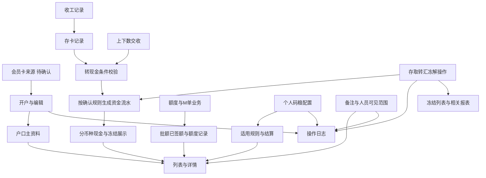
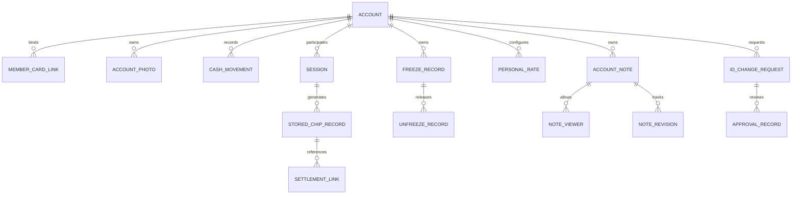
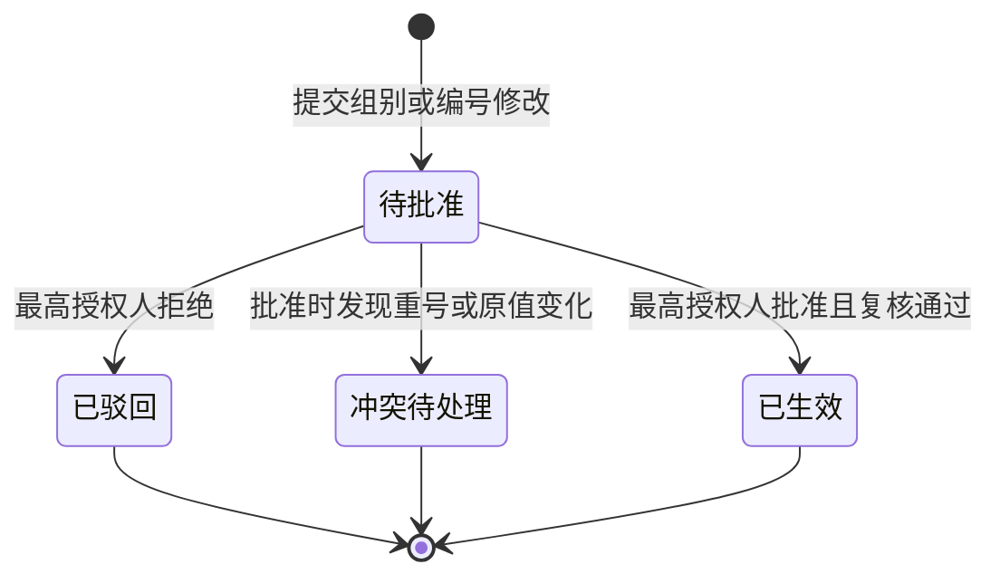

# 户口管理调整 PRD 附录

主文档：[[PRD_户口管理调整_20261031]]。本附录用于需求追踪、权限评审、数据关联与待确认事项处理。

## 目录

- [[#A1 需求干系人与来源追踪]]
- [[#A2 目标用户与角色]]
- [[#A3 资料流与系统串接]]
- [[#A4 非功能性需求]]
- [[#A7 后台权限与业务关系]]
- [[#A9 待确认事项]]
- [[#A10 名词定义]]
- [[#A11 相关资源]]

## A1 需求干系人与来源追踪

### A1.1 职责

| 角色 | 负责事项 | 确认对象 |
|---|---|---|
| 需求方/业务负责人 | 资金、码粮、存卡和会员规则 | 身份待指定 |
| 产品负责人 | 需求范围、界面、验收与问题闭环 | 用户或其指定人员 |
| 最高授权人 | 组别/编号变更审批 | 不默认等同超级管理员 |
| 开发负责人 | 落地方案、迁移、联调 | 待指定 |
| 测试/验收人员 | 场景验证、资金核对、权限验证 | 待指定 |

### A1.2 截图逐项追踪

| 编号 | 截图要求 | 对应页面 | 确定性 | 验收 |
|---|---|---|---|---|
| CH-01 | 确认客户旧户口，有则记录备注 | P2 | 最新要求已取消，不再收集或校验 | AC-03 |
| CH-02 | 确认组别代码 | P2 | 明确；代码来源待确认 | AC-04 |
| CH-03 | 角色涉及佣金模式 | P2/P4 | 明确；具体映射待确认 | AC-05 |
| CH-04 | 会员卡号一定要选 | P2 | 最新要求：开户及编辑手动输入必填；绑定规则待确认 | AC-06 |
| CH-05 | 会员证件至少一个会员卡照片 | P2 | 明确 | AC-06 |
| CH-06 | 手机必填、不收验证码、区号选择、格式校验 | P2 | 明确 | AC-07 |
| CH-07 | 存卡为收工筹码，交收完成后才能变现金 | P3 | 前置条件明确；转换时点和金额待确认 | AC-11、12 |
| CH-08 | 新增现金余额，取存转冻影响现金 | P3/P8 | 明确；用户确认冻结直接扣减显示现金 | AC-10、21、25 |
| CH-09 | 户口概况不需要显示消费 | P3 | 明确，仅移除该展示 | AC-10 |
| CH-10 | 个人码粮按不同客户指定 | P4 | 明确；继承粒度建议 | AC-14 |
| CH-11 | 占成对应码粮、A数、现金、M、积分；不要代理佣差；分别结和月结 | P4 | 最新要求：仅占成比对应码粮比，分即结/月结；其他比例项移除 | AC-14、15 |
| CH-12 | 批额和已签额移到额度变化记录下面 | P3 | 用户补充：拆成两张变化记录表，统一六个字段 | AC-13 |
| CH-13 | 授权人编辑弹窗不需要输入确认人 | P5 | 最新要求：仅隐藏确认人选择与操作人只读信息，两项密码保留 | AC-16 |
| CH-14 | 换汇使用系统汇率与系统配置的乘法或除法，展示双方资金变动 | P6 | 明确 | AC-17 |
| CH-15 | 所有操作输入金额、结果四位小数，超出舍去 | P3/P6/P7/P8 | 截断明确；单位和中间步骤精度待确认 | AC-18 |
| CH-16 | 转账不用转入厅，输入收款号自动带出户名 | P7 | 明确；重号定位待确认 | AC-19、20 |
| CH-17 | 冻结记录显示在冻结报表 | P8 | 明确；建议复用冻结列表 | AC-22 |
| CH-18 | 组别代码和编号修改需最高授权人同意 | P2 | 当前原型可直接编辑，隐藏审批入口；正式审批要求待确认 | AC-08、09 |
| CH-19 | 备注所有人/部分人可见，操作人、操作/编辑时间及日志 | P9 | 明确；所有人范围与审计权限待确认 | AC-23、24 |

### A1.3 证据边界

- 已实查：户口列表、一个户口详情、个人码量配置弹窗、编辑页加载完成后的字段。
- 已观察：当前开户复用表单有会员卡号可选提示、区号文本框、证件正反面上传区；未提交开户或编辑。
- 未逐一展开：授权人、换汇、转账、冻结、管理备注弹窗及后台接口。因此其具体旧字段不作既成事实，目标布局按截图需求提出。
- 页面中实际客户姓名、证件号码、余额、账号密码不复制进交付文档；场景用虚构值。

## A2 目标用户与角色

| 角色概念 | 范围 | 说明 |
|---|---|---|
| 户口业务角色 | 股东线、市场线、代理线、公司线、散客等当前分类 | 决定业务适用规则，不能直接当作操作人员权限 |
| 柜台/资料操作人员（建议角色名） | 开户、资料维护、被授权资金操作 | 实际角色和授权沿用权限设置核实 |
| 业务配置人员（建议角色名） | 个人码粮设置 | 是否需要双人校验沿用现状，另行确认 |
| 最高授权人 | 敏感标识修改批准 | 唯一来源和授权范围待确认 |
| 审计/财务查看人员（建议角色名） | 对账和授权范围内的历史查看 | 不能因可看日志而默认能看所有受限备注 |

## A3 资料流与系统串接

### A3.1 数据流

### A3.2 联动约束

| 变化 | 必须同步的内容 | 失败原则 |
|---|---|---|
| 现金存取 | 户口现金、资金流水、存取款报表 | 不先更界面假装成功 |
| 同币种转账 | 付款方现金、收款方现金、两端流水和同一业务关联 | 不允许单边成功 |
| 换汇 | 两币种金额、汇率方向、结果、流水、换汇报表 | 不允许只扣出不入账 |
| 冻结/解冻 | 显示现金、冻结余额、原冻结记录、明细与冻结列表 | 不重复扣减或恢复 |
| 存卡转现金 | 来源场次、交收完成标记、存卡与现金、转换流水 | 规则未定前不启用自动转换 |
| 组别/编号改变 | 户口展示标识、搜索定位、原业务关联、审批与日志 | 历史关联不能断裂 |
| 备注范围改变 | 页面正文、搜索、导出、历史和审计访问 | 无权限者不能通过旁路读取 |

技术备注：资金操作应具备唯一业务标识和原子提交；预览、提交、流水、导出应共享同一金额口径。技术实现与接口路径由开发设计，本稿不虚构已存在接口。

## A4 非功能性需求

| 类别 | 要求 | 验收方式 |
|---|---|---|
| 权限 | 页面控件隐藏与实际操作权限同时生效 | 低权限账号直接请求受限功能，确认拒绝 |
| 数据范围 | 只允许访问授权户口/厅及指定备注 | 跨厅、指定人员之外、导出历史交叉验证 |
| 一致性 | 同一操作的余额、流水和报表最终一致，处理中明确提示 | 正常与失败注入测试，并对账 |
| 重复提交 | 同一请求重试不产生第二次资金变动 | 连点、网络超时、重放同一请求 |
| 并发 | 多人操作按最新有效余额校验 | 同时冻结、转账、解冻，不超用可用金额 |
| 精度 | 四位小数截断规则贯穿输入、记录和展示 | 交接补充全部算例回归 |
| 图片 | 照片按户口权限访问，上传失败可重试 | 无权账户尝试访问；类型和大小边界测试 |
| 图片约束（建议） | JPEG/PNG/WebP，单张不超过10MB；不默认接入OCR | 评审上限后测试；格式内容需一致 |
| 日志 | 业务流水、审批和备注变更可关联，不记录密码 | 抽查前后值、操作人、时间、业务号 |
| 错误反馈 | 网络错误、无数据、加载中、金额为零分别表达 | 断网、空结果、正常零值测试 |
| 兼容与布局（建议） | 桌面端至少验证1440和1920宽度；表格可横向滚动，不压缩到不可读 | 检查表头、操作栏和弹窗在目标宽度完整 |
| 性能 | 依据账户数量、流水量、并发人员数设目标 | 测试数据量和环境由开发/业务签收后测量 |
| 时区 | 使用系统确认的业务时区，同一记录跨页面一致 | 创建与编辑时间、月结边界分别核对 |

## A7 后台权限与业务关系

### A7.1 权限矩阵（评审建议，非现有授权清单）

| 能力 | 资料操作权限 | 资金操作权限 | 配置权限 | 最高授权人 | 审计查看权限 |
|---|---|---|---|---|---|
| 查看户口 | 按数据范围 | 按数据范围 | 按数据范围 | 按数据范围 | 按数据范围 |
| 开户/普通资料维护 | 是 | 不自动拥有 | 不自动拥有 | 依角色授予 | 否 |
| 组别/编号修改申请 | 可申请 | 不自动拥有 | 不自动拥有 | 可审批 | 只读审计 |
| 存取转汇冻结解冻 | 否 | 按具体操作授权 | 否 | 不默认拥有 | 只读 |
| 个人码粮配置 | 否 | 否 | 是，保留原校验 | 依授权 | 只读 |
| 授权人资料编辑 | 需单独授权 | 不自动拥有 | 不自动拥有 | 依授权 | 只读 |
| 查看备注 | 访问户口权限与备注范围均满足 | 同左 | 同左 | 不能默认绕过范围 | 需单独定义审计特权 |
| 编辑备注范围 | 需备注管理权限 | 需备注管理权限 | 需备注管理权限 | 依授权 | 否 |

隐藏授权人弹窗的确认人选择框（保留确认人密码），不代表任何用户均可扩大授权。调整涉及权限授予时仍必须经过系统既定操作权限验证。

### A7.2 多厅与唯一性

- 现有后台有全厅与开户厅；不据此推断为多租户。
- 户口定位、跨厅查看与转账权限须沿用确认后的业务规则。
- 转账删除转入厅前，必须确认户口号能唯一定位，或定义不需要人工选厅的消歧机制。
- 任何跨币种汇总需明确折算依据；本次默认分币种展示，不提供隐含汇率合计。

### A7.3 概念实体关系

仅表达概念关联，不指定数据库表结构；会员卡一户多卡、存卡与交收对应基数需业务签收后确定。

### A7.4 标识审批状态（历史建议，当前原型不启用）

不设置自动超时批准；审批人、是否可自批、撤回入口和通知方式见 Q8。

### A7.5 历史数据与导出

- 历史缺手机号/卡号/照片：列出缺失项，明确补录策略，不自动补假值。
- 历史存卡与现金：必须有余额口径对照与核对结果后才能迁移，不仅改列名。
- 历史代理佣差：停用范围、生效时间和已结算数据处理须签收，不删除审计证据。
- 导出保留现有功能，同时服从字段口径、精度与备注可见权限。

### A7.6 日志要求

- 覆盖资料变更、标识申请/批准/驳回、生效、码粮配置、授权人、资金操作、备注内容和范围变化。
- 记录业务对象、动作、结果、操作人、操作时间、修改前后值；审批保留申请人与批准人。
- 不记录密码；敏感备注与照片不向一般日志查看者默认公开。
- 保存期限、导出权限、历史修正方式由业务确认，未擅自指定年限。

## A9 待确认事项

### 已确认，不再等待

| 项目 | 用户确认 |
|---|---|
| 冻结现金展示 | 冻结后直接扣减显示的现金余额；解冻恢复 |
| 码粮结算周期 | 即结和月结（按用户最新表述） |

### 开放问题

截止以业务阶段表达，避免虚构排期或负责人承诺。所有“建议”仅用于评审，不等于客户已批准。

| 编号 | 问题 | 评审建议/影响 | 决策方 | 最迟确认点 |
|---|---|---|---|---|
| Q1 | 四位小数按基础币种单位还是“万”？负数如何舍去？多步骤中间值何时截断？ | 建议统一业务单位并向零截断；单位不同会造成一万倍精度差异 | 业务/财务 | 计算开发前 |
| Q2 | 存卡交收后自动转换还是另行操作？转换金额、部分交收、撤销如何处理？ | 不默认等额全转；需至少正常、部分、撤销三个算例 | 业务/财务 | 存卡现金联动开发前 |
| Q3 | 会员卡来自卡库还是外部系统？是否一户一卡？能否跨户复用？ | 必选明确；来源与绑定规则决定控件和数据关系 | 业务 | 开户开发前 |
| Q4 | 组别代码来源、编号规则和唯一性范围是什么？ | 不能默认只由大写字母组成；旧户口号不自动改变新号 | 业务 | 表单校验开发前 |
| Q5 | 每个业务角色对应什么佣金模式？换角色怎样处理？ | 需逐角色模式表；账户角色与操作权限角色分开 | 业务 | 佣金联动开发前 |
| Q6 | 占成对应码粮是否多档？各比例按何单位？每币种已选择一种结算方式，历史切换如何生效？原月结码粮字段如何迁移？ | 周期已确认，计算关系仍未知；需实例和互斥/叠加规则 | 业务/财务 | 码粮开发前 |
| Q7 | 个人配置修改如何影响正在进行和已收工未结算场次？ | 建议历史已结算不重算；进行中采用明确版本规则 | 业务/财务 | 配置生效开发前 |
| Q8 | 最高授权人从何处识别？是否自批、如何批准和通知？ | 建议独立申请/批准；不自动等同当前admin | 业务/权限负责人 | 审批开发前 |
| Q9 | 所有人可见是否只指有权访问户口的内部人员？指定人员之外谁可审计正文？ | 建议户口访问权限与备注范围双重满足 | 业务 | 备注权限开发前 |
| Q10 | 是否允许负现金或超额冻结/转账/换汇？ | 金额解冻已确定为指定币种全部金额；负现金例外需确认 | 业务/财务 | 资金操作开发前 |
| Q11 | 转账号是否全局唯一？跨厅及跨币种允许范围？ | 不能删除转入厅后随机定位目标；建议同币种现金转账 | 业务/开发 | 转账开发前 |
| Q12 | 历史缺资料账户何时补齐？会否限制原有交易？系统户口是否豁免会员资料？ | 系统账户不能机械要求会员卡照片；需单独范围规则 | 业务 | 迁移和上线验收前 |
| Q13 | 管理备注与内部备注/客户备注关系，是否可删、历史保留多久？ | 不自动合并或对外公开；保留历史需授权 | 业务 | 备注开发前 |
| Q14 | 批额、已签额、Marker余额含义，是否含借用及还款状态？ | 分币种展示；现有跨区域差异需对账确认 | 业务/财务 | 额度展示验收前 |
| Q15 | “码量/码粮”统一名称、概况中“未结算”具体指标、有效币种范围？ | 建议用码粮；未结算不能新增重复金额；USDT显示需核实 | 业务 | 文案与概况验收前 |
| Q16 | 列表是否增加现金/存卡口径切换？还是只调整详情？ | 列表增强为建议，不是截图原始要求 | 产品/业务 | 页面范围冻结前 |

## A10 名词定义

| 术语 | 本文含义 | 边界 |
|---|---|---|
| 户口 | 系统中的业务账户 | 与操作人员登录账号不同 |
| 旧户口 | 客户历史使用的户口信息 | 记录不等于自动合并账户 |
| 存卡 | 收工收回筹码所对应的存卡记录 | 上下数交收未完成时不可当作现金 |
| 现金余额 | 用户要求展示的可使用现金数值 | 冻结后直接扣减，不再重复减冻结 |
| 冻结金额 | 已限制使用且尚未解冻的金额 | 不当作消费或资金损失 |
| 上下数交收 | 与场次结果相关的交收流程 | 是存卡转换的前置条件，金额规则待定 |
| 批额 | 户口可获授的信用额度 | 按币种，不当作现金 |
| 已签额 | 已签用额度的业务指标 | 与未还M单是否等同待确认 |
| 码粮 | 用户要求中的佣金配置术语 | 与现系统码量名称需统一 |
| 占成 | 用户要求中的比例关系 | 基数、分档和计算关系待确认 |
| 即结 | 沿用此前确认的按场次结算含义，界面采用最新名称“即结” | 具体触发时点与重复防护需明确 |
| 月结 | 按业务月处理结算 | 时区、截止时间和跨月处理待确定 |

## A11 相关资源

- 用户上传的户口管理需求截图（本次对话原图）。
- [户口管理现状](https://fmcapp.com/newVIP/accounts)。
- 2026-10-31 当次用户回复：冻结直接扣减现金显示；分别结指每场结算。
- [[PRD_户口管理调整_20261031]]。
- [[户口管理_业务规则与开发交接]]。

### 换汇开工报表待确认

| 事项 | 需明确内容 | 当前处理 |
|---|---|---|
| 固定/即时汇率来源 | 固定方案来源；即时汇率取价时点、有效期、是否可改 | 只存示例快照，未接入取价服务 |
| 换汇户口 | 选择位置、同户/他户限制、出入款户口 | 不推断默认真实账户 |
| 金额币种与余额变化 | 来源币种、筹码币种、金额换算及余额类别 | 未明确则不执行跨币种入账；报表缺失值用“—” |
