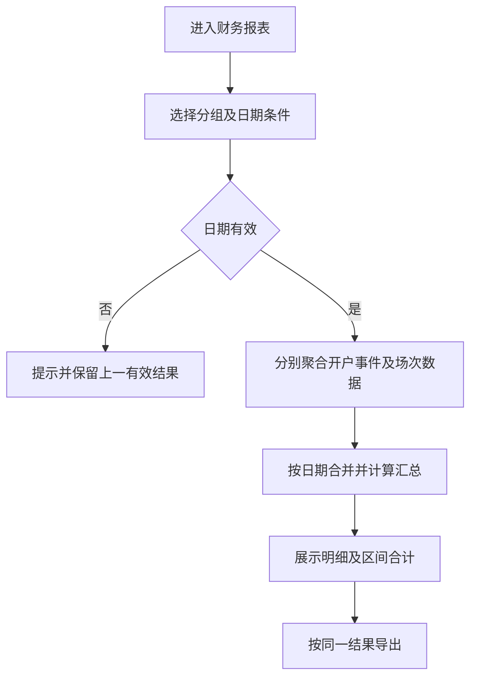
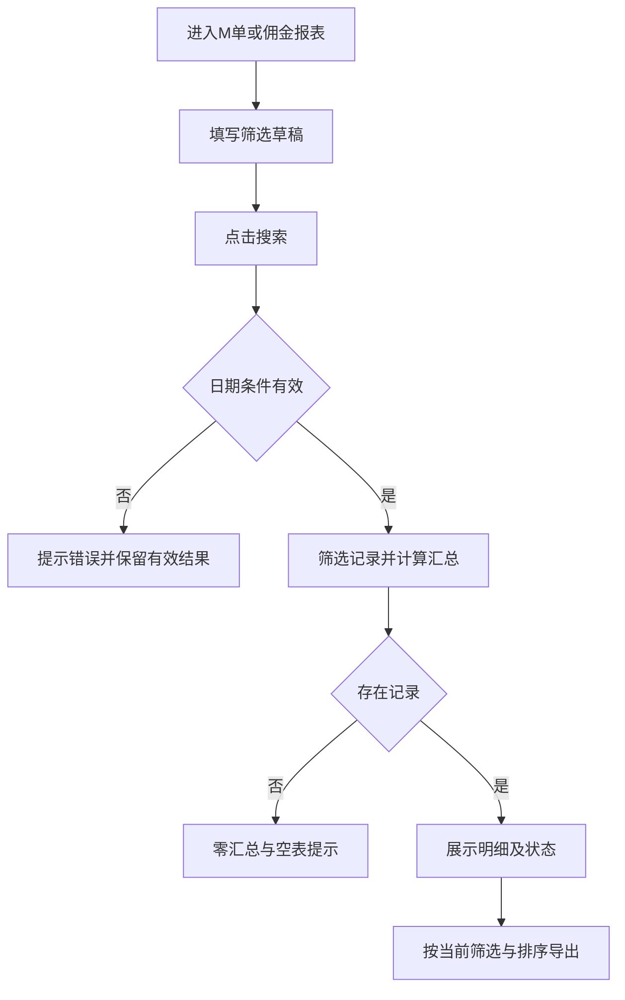

# 报表管理 PRD

## §1 修订追踪

| 版本 | 日期 | 状态 | 范围 |
|---|---|---|---|
| V1 | 2026-11-01 | 草稿，待业务确认 | M单报表、财务报表、佣金报表 |

本文件为独立的报表管理需求文档。范围为M单报表、财务报表和佣金报表；存取款及换汇开工等业务联动要求仍保留在户口管理文档。沿用现有文档七章结构，不增加功能结构图或权限矩阵。

## §2 背景与目标

- 复刻提供的财务报表截图，统一开户、开工、上下数和转码的统计展示。
- 使用与户口管理、开工管理一致的视觉风格，保留筛选区、区间汇总、日期明细表。
- 用户为账房、业务管理和财务核对人员；这是业务运营报表，不能直接等同公司会计利润表。
- 已确认：上下数与转码仅统计已收工场次，按收工日期归属；跨币种不折算，直接合计数字。

## §3 功能清单

| 页面 | 功能 | 来源 |
|---|---|---|
| P1 财务报表 [MOD] | 日期筛选、分组、区间汇总、明细、导出 | 财务报表参考页面 |
| P2 M单报表 [NEW] | 户口、类型、币种、厅级与日期筛选；借还款汇总及明细导出 | M单报表参考页面 |
| P3 佣金报表 [NEW] | 户口、类型、币种、结算状态与日期筛选；佣金汇总、排序及导出 | 佣金报表参考页面 |

## §4 页面与统计口径

### 4.1 P1 财务报表

- 菜单：报表管理 → 财务报表，页面标题“财务报表”。
- 顶部保留按日/按月选择、今天/昨天/本周/上周/本月/上月/自定义、开始/结束日期和导出Excel。
- 日期快捷项或日历确认仅更新筛选草稿；点击搜索应用范围，按日/按月分组保留，不再提供独立月份输入。
- 开始日期晚于结束日期时提示错误并保留上一有效结果；空条件表示不限制日期。日期包含首尾日，按业务时区Asia/Shanghai解释；生产数据存储时区转换必须一致。
- 区间汇总显示“筛选区间：X户 / Y场，上下数合计：Z万，转码合计：R万”。
- 明细字段：日期（按月时为月份）、开户数、开工数、上下数(万)、转码(万)。日期倒序，金额四位小数；上下数负值红色，零和正值绿色。
- 无数据时汇总显示零、明细显示暂无记录；不显示虚构日期记录。默认仅显示存在开户或场次记录的日期，纯空日期不补行。

### 字段定义

| 字段 | 统计对象与去重键 | 统计口径 | 不计入范围 |
|---|---|---|---|
| 日期/月份 | 业务时间分组 | 开户数按创建成功时间，开工数按开工成功时间，上下数及转码按收工成功时间；按月聚合自然月 | 编辑资料时间不作为开户时间 |
| 开户数 | 唯一户口稳定ID | 分组内成功新建户口数；姓名/编号修改仍为原户口 | 草稿、失败、取消、编辑、冻结/解冻、重复提交 |
| 开工数 | 唯一场次ID | 分组内成功开工场次数；同户多场分别计数 | 预览、失败、取消、加彩及场中操作 |
| 上下数 | 已收工场次最终上下数 | 按收工日期汇总已收工场次最终上下数；保留正负，进行中场次不纳入 | 不叠加同场多条快照，不再次扣初始本金，小费已在最终上下数中计入，报表不重复加小费 |
| 转码 | 已收工场次实际转码 | 按收工日期汇总最终实际转码；进行中场次不纳入 | 不将每条累计转码相加，不使用佣金金额代替转码 |

- 上下数正值表示客户赢、负值表示客户输，沿用场次业务方向；不是公司利润方向，不取绝对值。
- 区间开户数为开户事件去重数量，不是有开工户口的去重人数。汇总场数与逐行开工数之和一致。
- 户口与场次分别聚合后按日期合并，避免一户多场连接造成开户数重复。仅开户而无开工的日期也展示。
- 跨币种金额不折算，直接将各币种数字相加；不读取或应用汇率。该合计不标注为任何单一币种金额。
- 开工数与收工指标分别归属各自日期：跨日场次开工当天只增加开工数，收工当天计入最终上下数和转码；不得回写到开工日。

### 业务影响矩阵

场中操作仅改变场次数据，不实时增加报表上下数或转码；下表涉及金额变动均在成功收工后以最终值一次计入。

| 业务动作 | 开户数 | 开工数 | 上下数/转码影响 |
|---|---|---|---|
| 成功新开户 | +1 | 不变 | 不变 |
| 编辑户口资料、卡号或冻结/解冻 | 不变 | 不变 | 不因该动作重算历史场次 |
| 成功开工（含固定/即时汇率） | 不变 | +1 | 不立即计入上下数与转码，待成功收工后计入收工日期 |
| 转码 | 不变 | 不变 | 仅更新场次值；报表待收工后计入最终值 |
| 加彩 | 不变 | 不变 | 全部泥码追加对应转码；本金另计，不增加场数 |
| 中途存/中途取 | 不变 | 不变 | 使用场次已提交结果；泥码影响转码，现金码不影响转码 |
| 暂存 | 不变 | 不变 | 泥码及现金码均减少上下数，只有泥码减少转码 |
| K现 | 不变 | 不变 | 读取场次最终确认值，不能把银头现金变化再次作为转码 |
| 小费 | 不变 | 不变 | 操作时记录，收工时包含在最终上下数中，不改变转码 |
| 收工 | 不变 | 不变 | 按收工日期计入最终上下数和实际转码，不增加开工数 |
| 存款、取款、转账、单独换汇 | 不变 | 不变 | 不直接影响本报表指标，除非另有成功场次业务事件 |

- 失败、密码校验不通过或取消操作不影响统计。正式系统同一业务请求只提交一次。
- 撤销/冲正必须有可审计事件，不允许直接删除历史指标；业务范围和期间调整方式未确认前不提供撤销按钮。
- 仅成功提交的开工场次计入开工数；固定或即时汇率开工均使用已落地场次记录。

### 导出

- 导出使用当前有效筛选、分组和日期顺序，包含五个明细字段；金额与页面同源，保留正负和精度。
- 空结果不导出；查询失败不得展示旧结果为新结果。正式采用标准.xlsx，避免文本格式误识别及公式注入。

### 4.2 P2 M单报表

- 入口：报表管理 → M单报表。用于查看M单借还情况及关联场次，报表内不直接办理还款。
- 筛选区提供户口号/姓名、操作类型多选、币种、厅级及日期范围；户口同时匹配批额户口、使用批额户口与姓名。日期按签M日期筛选，包含首尾日。
- 汇总区展示合计笔数、签M总额、还款总额、开工场次和收工场次；场次按唯一场次去重，同场多张M单不得重复计场。
- 明细顺序：M单号、批额户口号、使用批额户口号、厅、签M操作员、币种、签M(万)、已还(万)、尚欠(万)、状态、场次号、上下数(万)、转码(万)、佣金(万)、备注、签M时间。
- 明细签M金额以负数展示；汇总签M总额展示借款规模。已还展示累计成功还款，尚欠展示未归还金额；全部归还后展示已还清。
- 进行中还M成功后更新已还、尚欠和状态；不改变关联场次转码和上下数。收工优先还M后，报表读取同一张M单的累计归还结果。
- 无关联场次时场次相关字段显示“—”；无备注时显示“—”。多个M单可以关联同一场次，行内场次指标是引用信息，不可逐行重复求和。
- 搜索应用筛选，重置恢复全部；无结果时汇总为零、表格显示暂无记录。日期无效保留上一有效结果；导出只包含有效筛选下的明细。

### 4.3 P3 佣金报表

- 入口：报表管理 → 佣金报表；副标题“场次佣金记录浏览及汇出”。
- 筛选区提供户口号模糊搜索、开工类型、币种、结算状态及日期范围；日期按开工日期筛选。
- 五个汇总卡片依次为总转码(万)、总佣金(万)、已结算佣金(万)、未结算佣金(万)、记录数。
- 明细顺序：开工时间、场次号、收工时间、户口号、姓名、角色、类型、币种、有效转码(万)、佣金(万)、结算状态、结算时间。
- 默认按户口号升序；开工时间、户口号、姓名、角色支持点击表头切换升降序，当前排序方向可见。
- 按场次展示记录，进行中场次收工时间为空；结算时间只在已结算记录中展示，不能以收工成功自动认定佣金已结算。
- 汇总与明细使用相同筛选结果；已结算及未结算佣金分别汇总，记录数与展示结果一致。报表读取场次佣金，不在报表内改变佣金方案或发起结算。
- 搜索后更新结果，重置恢复全部；无结果显示零汇总与暂无记录。无效日期保留上一有效结果；导出沿用当前筛选和排序。

### 4.4 三个报表共用视觉与交互

- 与户口管理、开工管理共用Tidewell视觉：浅灰页面、白色卡片、深青主按钮、柔和边框与圆角，不另设报表主题。
- 筛选字段采用上方标签、下方输入框；控件高度、字号及间距统一。日期条件单独成行，以细分隔线与业务筛选区分。
- 使用整站Havenest双月日历及快捷日期；确认日期仅修改草稿，搜索后生效。财务保留按日/按月，不增加独立月份输入。
- 财务与M单汇总采用浅色汇总条；佣金五张等宽指标卡片同开工指标样式，窄屏自动换行。
- 表格统一表头底色、字重、行高、内边距、悬停反馈和状态标签。金额四位小数，正数不加“+”，负数保留“-”，语义颜色使用整站颜色。
- 宽表允许在表格容器内横向滚动，不撑宽整页；筛选控件和指标卡片在窄屏换行，不裁切字段。

## §5 核心流程

### P2 / P3 查询与导出流程

## §6 异常与边界

| 场景 | 处理 |
|---|---|
| 一户多场 | 开户按户口ID去重，开工按场次ID计数 |
| 修改户口编号/姓名 | 不增加开户数，不断开历史场次关联 |
| 跨日未收工 | 开工数归开工日；上下数和转码在收工日统计，未收工不纳入金额指标 |
| 正负抵消 | 按带符号值求和，允许合计为零 |
| 负转码调整 | 沿用场次合法结果，不擅自清零或改成正数 |
| 仅开户日期 | 显示开户数，其他列为零 |
| 多币种 | 直接合计数字，不折算、不套用汇率 |
| 更改汇率 | 不回算历史交易；使用已经落地的场次金额 |
| 时区/零点/月末 | 起止日包含，分组边界统一业务时区 |
| 并发查询/导出 | 基于同一数据版本或快照，避免汇总与明细不一致 |

## §7 验收清单

| 编号 | 验收项 |
|---|---|
| AC-01 | 字段、筛选与截图一致，按日/按月切换可用 |
| AC-02 | 仅开户日期保留；一户多场不重复增加开户数 |
| AC-03 | 截图样例三行合计为6户、7场、上下数-37.2340万、转码98.2000万 |
| AC-04 | 新开户成功加1户，编辑资料、失败与取消不增加 |
| AC-05 | 开工成功加1场，收工、加彩和转码不增加场数 |
| AC-06 | 场次上下数及转码只累计一次，收工使用最终值 |
| AC-07 | 日期倒置有提示；快捷日期、月份、分组、空结果可验证 |
| AC-08 | 导出字段、金额、排序及筛选范围与页面一致 |
| AC-09 | 所有金额方向与场次一致，小费及普通资金流水不直接计入 |
| AC-10 | 只计已收工上下数/转码、按收工日期归属、跨币种直接数字合计；开工数仍按开工日期 |

| AC-11 | M单报表16列顺序完整，户口、类型、币种、厅级、日期可组合筛选；无匹配记录时汇总为零 |
| AC-12 | 一张M单借款10万、归还4万时已还4万、尚欠6万、状态部分还款；还款不改变场次转码与上下数 |
| AC-13 | 同场两张M单计2笔、开工场次只计1场；场次金额不重复纳入M单借还汇总 |
| AC-14 | 佣金报表12列与5个指标完整，结算状态筛选、四个表头排序、重置均可用 |
| AC-15 | 已结算与未结算佣金合计等于总佣金；收工不会自行将佣金状态改为已结算 |
| AC-16 | 三报表导出字段、顺序、精度及筛选与页面一致，空结果不给空文件 |
| AC-17 | 三报表控件、卡片、表格与户口及开工模块使用相同视觉；窄屏指标换行、宽表滚动限于表格容器 |

## §10 增量同步（2026-11-02）

- 财务报表仅汇总已收工场次的最终上下数和实际转码，日期归属仍为收工日，跨币种仍直接数字合计。
- 最终上下数已包含本场小费；报表不可再次叠加小费。还M是筹码分配，不单独作为盈亏再次加减。
- 现金余额加彩影响存取款报表，记取款并标识业务来源；存卡加彩仍沿用原类型。
- 换汇开工报表显示输入的对手户口、兑换方案和换入金额，保持本次汇率快照。
- 验收：小费和还M不造成财务重复计数；日期筛选与导出范围一致；正数无加号、负数保留减号。

### 通用视觉与日期筛选 [MOD]（2026-11-02）

- 整站保持 Tidewell 浅灰画布、白色卡片和深青主色；日期范围控件采用 Havenest 白色、翠绿色及圆角样式。
- 开工列表、冻结列表、存取款报表、换汇开工报表、财务报表共用双月日历；窄屏上下排列两个月，避免横向滚动。
- 保留今天、昨天、本周、上周、本月、上月、自定义；快捷项仅填入日期，点击搜索后应用。重置清空筛选。
- 选定开始与结束日后确认；支持跨月、跨年、同日。反向点选自动整理先后顺序；只选一个端点时不能确认；关闭不提交草稿。
- 日期范围包含首尾日，按上海时区解释；清空并确认表示不限制日期。围数结次仍为年/月，开户生日不改为范围控件。
- 金额正数不加符号、负数保留减号；零不带符号。上下数不再用箭头及“上/下”前缀，颜色提示保留。
- 弹窗内容可换行；宽屏收工仍使用左侧录入、右侧预览，窄屏上下排列。M单表格随可用宽度换行，不以裁切隐藏内容。
