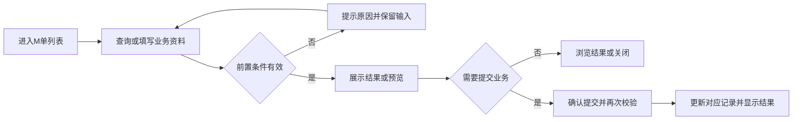
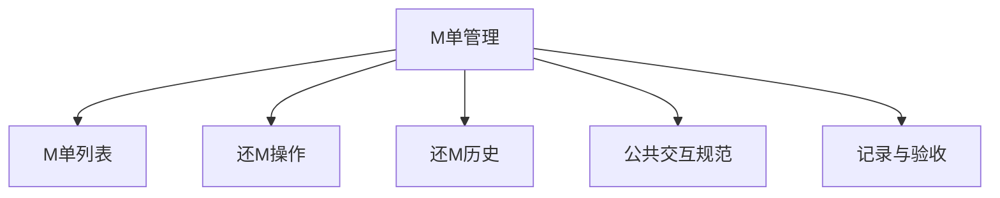

# M单管理

## 目录

- [§1 修订追踪表](#1-修订追踪表)
- [§2 背景与目标](#2-背景与目标)
- [§3 功能清单](#3-功能清单)
- [§4 功能细节规格](#4-功能细节规格)
- [§5 功能流程图](#5-功能流程图)
- [§6 功能结构图](#6-功能结构图)
- [§7 页面设计](#7-页面设计)
- [§8 边界与异常](#8-边界与异常)
- [§9 验收清单](#9-验收清单)

## 本文件使用说明

- 本文件按单个菜单整理本轮已确认需求，供设计、开发、测试使用；不是对未讨论历史功能的全量重写。
- 需求依据：本会话用户的最终说明及截图；冲突以最后确认内容为准。
- [MOD] 参考历史基线：[既有文档](../户口管理PRD/PRD_户口管理调整_20261031.md)。历史内容与本文件冲突时，本轮调整以本文件为准。
- 配套：[PRD_M单管理_20261109_appendix](PRD_M%E5%8D%95%E7%AE%A1%E7%90%86_20261109_appendix.md)、[公共交互与展示规范](%E5%85%AC%E5%85%B1%E4%BA%A4%E4%BA%92%E4%B8%8E%E5%B1%95%E7%A4%BA%E8%A7%84%E8%8C%83.md)、[业务计算与开发交接](%E4%B8%9A%E5%8A%A1%E8%AE%A1%E7%AE%97%E4%B8%8E%E5%BC%80%E5%8F%91%E4%BA%A4%E6%8E%A5.md)。
- 开放问题见附录 A9；未确认项不得当成已验收需求。

## §1 修订追踪表

| 版本 | 日期 | 说明 |
|---|---|---|
| V1 | 2026-11-09 | 初稿，未送审 |

## §2 背景与目标

- 目标：提供完整M单筛选、直接还M及可追溯的多来源还款。
- 使用者：账房操作人员、业务复核人员及获授权的管理人员。
- 范围：本菜单页面及关联弹窗；公共检索、时间控件、币种规范引用公共文档。
- 当前原型边界：还M改变额度演示债务及额度占用；尚未扣减四类来源对应的真实账户资金。

## §3 功能清单

| 页面 | 页面名称 | 变更类别 | 业务结果 |
|---|---|---|---|
| P1 | M单列表 | [MOD] | 支持到期、还款、厅别、户口、借款户口、币种、方式、单号、提案和时间筛选；未还清记录可直接还M。 |
| P2 | 还M操作 | [MOD] | 来源包括现金、存卡、换汇资金、余额；按所选列表顺序归还。批量限制同户口、同币种及同方式，方式须满足批量范围。 |
| P3 | 还M历史 | [MOD] | 记录须能追溯每次归还；历史不提供打印；“存款还款”统一显示“余额还款”。 |

## §4 功能细节规格

### 4.1 P1 M单列表

- 界面：列表参考截图字段，右侧操作固定；不提供新增或加签M单入口；不显示打印。
- 页面逻辑：支持到期、还款、厅别、户口、借款户口、币种、方式、单号、提案和时间筛选；未还清记录可直接还M。
- 业务处理：查询、预览不产生资金变动；只有合法提交才能产生业务记录。取消关闭不得记成功；此规则为正式交付要求，原型覆盖范围以 §2 为准。
- 正向流程：操作人进入页面，完成有效查询或填写，核对结果后执行对应操作，看到列表或记录更新。
- 异常流程：查询无结果时显示空态，不新增借款记录。
- 边界：已还清仅查看历史；修改查询不应改变债务金额。
- 联动范围：只更新对应户口、币种及关联业务；本轮未授权跨菜单数据变更不自动扩大。

- 筛选区不展示占成比，搜索、重置及导出结果均不应用占成比过滤；提案资讯中已有占成数据的展示不受影响。

- 列表已填写的人工单号、户口号、借款户口、提案资讯及借款/还款/剩余借款金额提供本笔 M 单详情入口；操作栏同时提供“详情”。零金额仍可查看，无值的人工单号显示横线。
- 详情显示当前单号、户口及户名、币种和金额单位，展示三项借还款金额、厅别、方式、签 M 时间、到期日期与状态、还款状态、提案、关联批额单及备注。
- 详情包含本单还款资金明细（现金、存卡、换汇资金、余额及其他还款来源）、还款户口、操作人、时间、备注和操作记录。缺失信息显示横线，初始演示金额不伪造流水。
- 查看和关闭详情不改变 M 单、额度或勾选状态；筛选或排序后仍打开所点击的原单，缺失单据提示刷新，正式数据访问沿用户口权限。

- 点击“单号”打开简洁 M 单详情弹窗，标题为“[户口号/户名] M单详情”；仅展示单号、批额种类、借款总额(万)、还款总额(万)、剩余借款(万)五列及底部总计行，金额右对齐并保留四位小数。
- 单号弹窗数据来自所点 M 单及其关联批额；单笔总计与本行一致，批额种类缺失显示横线。支持右上角关闭和底部“关闭”，不展示打印操作。借款总额、剩余借款与操作栏详情保留完整资料查看；还款总额使用专用还款详情。

- 点击“还款总额”打开“[户口号/户名] 还款详情”，采用居中纵向标签和值布局，展示现金、余额、存卡、换汇资金、泥码、现码、电投还款金额、汇率、开工币别、提案号及累计还款总额；金额单位为万、四位小数，币种使用字母代码。
- 分项按本单已记录还款汇总；未还款时金额为零，未知汇率及提案号显示横线，多种汇率不能简单相加或显示为一笔汇率。历史来源缺失须提示分项不完整，不得将差额随意归入某种资金来源。支持关闭，不提供打印或提交操作。

### 4.2 P2 还M操作

- 界面：显示户口、币种、来源金额及所选M还款预览；保留操作与确认密码及备注。
- 页面逻辑：来源包括现金、存卡、换汇资金、余额；按所选列表顺序归还。批量限制同户口、同币种及同方式，方式须满足批量范围。
- 业务处理：查询、预览不产生资金变动；只有合法提交才能产生业务记录。取消关闭不得记成功；此规则为正式交付要求，原型覆盖范围以 §2 为准。
- 正向流程：操作人进入页面，完成有效查询或填写，核对结果后执行对应操作，看到列表或记录更新。
- 异常流程：总还款不得为零或超过未还金额；混币种或不同户口批量拦截。
- 边界：未填写来源按零；换汇金额录入已折合本单币种的金额。移除电话、语言、分机、取款密码及外部验证区域。
- 联动范围：只更新对应户口、币种及关联业务；本轮未授权跨菜单数据变更不自动扩大。

### 4.3 P3 还M历史

- 界面：展示人工输入单号、各来源金额、还款总额、还款户口、操作人、确认人及完成状态。
- 页面逻辑：记录须能追溯每次归还；历史不提供打印；“存款还款”统一显示“余额还款”。
- 业务处理：查询、预览不产生资金变动；只有合法提交才能产生业务记录。取消关闭不得记成功；此规则为正式交付要求，原型覆盖范围以 §2 为准。
- 正向流程：操作人进入页面，完成有效查询或填写，核对结果后执行对应操作，看到列表或记录更新。
- 异常流程：无历史显示空态，不能把初始债务当作历史还款。
- 边界：退股还M记录应能识别其来源及备注。
- 联动范围：只更新对应户口、币种及关联业务；本轮未授权跨菜单数据变更不自动扩大。

## §5 功能流程图

### 5.1 P1 M单列表

### 5.2 P2 还M操作

### 5.3 P3 还M历史

## §6 功能结构图

## §7 页面设计

### 7.1 P1 M单列表

- 布局：列表参考截图字段，右侧操作固定；不提供新增或加签M单入口；不显示打印。
- 表现：采用账房管理的白底卡片、青色主操作、统一表单高度；金额与表头对齐。
- 反馈：区分未填写、无结果、校验失败、成功；不得用零值替代加载失败。

### 7.2 P2 还M操作

- 布局：显示户口、币种、来源金额及所选M还款预览；保留操作与确认密码及备注。
- 表现：采用账房管理的白底卡片、青色主操作、统一表单高度；金额与表头对齐。
- 反馈：区分未填写、无结果、校验失败、成功；不得用零值替代加载失败。

### 7.3 P3 还M历史

- 布局：展示人工输入单号、各来源金额、还款总额、还款户口、操作人、确认人及完成状态。
- 表现：采用账房管理的白底卡片、青色主操作、统一表单高度；金额与表头对齐。
- 反馈：区分未填写、无结果、校验失败、成功；不得用零值替代加载失败。

## §8 边界与异常

| 编号 | 场景及处理 |
|---|---|
| CC-01 / P1 | 已还清仅查看历史；修改查询不应改变债务金额。 查询无结果时显示空态，不新增借款记录。 |
| CC-02 / P2 | 未填写来源按零；换汇金额录入已折合本单币种的金额。移除电话、语言、分机、取款密码及外部验证区域。 总还款不得为零或超过未还金额；混币种或不同户口批量拦截。 |
| CC-03 / P3 | 退股还M记录应能识别其来源及备注。 无历史显示空态，不能把初始债务当作历史还款。 |

## §9 验收清单

### 9.1 功能验收

| 编号 | 页面 | 验收标准 | 状态 |
|---|---|---|---|
| AC-01 | P1 | 操作列横向滚动时仍可见；无新增或加签M单入口；现有单据可查询、查看详情和还款，无打印入口。 | 待验收 |
| AC-02 | P2 | 四种来源可组合，逐单预览和提交结果一致；还款后额度占用下降。 | 待验收 |
| AC-03 | P3 | 历史金额与还款提交一致，无打印或提交打印按钮。 | 待验收 |
| AC-M-DETAIL | P1 | 单号打开五列表格及总计的简洁弹窗；三项金额打开完整详情，零值可点击；排序后无错单，查看不改变借还款数据；资金明细只包含当前单据记录。 | 待验收 |

### 9.2 非功能验收

- 详见配套附录 A4；金额、户口和操作历史必须可辨识，控件不互相遮挡。
- 带权限的正式操作必须验证执行人身份；演示密码非空检查不能作为生产权限验收。

### 9.3 异常验收

- 对 §8 每个案例验证：失败不产生新资金记录，已有业务状态不被部分修改。
- 取消、重复点击、返回后重新打开的结果与既有成功记录一致；需持久化的正式业务重载后不丢失。

### 9.4 本菜单专项验收

- 按 §2 原型边界区分“原型交互可用”与“生产账务已验收”，不得混签。
- 逐项解决附录 A9，再执行正式账务、权限和异常测试；所有适用验收项通过后才能签收。

## 下一步建议

- 业务方确认附录 A9，设计与测试按 P 编号逐页评审。
