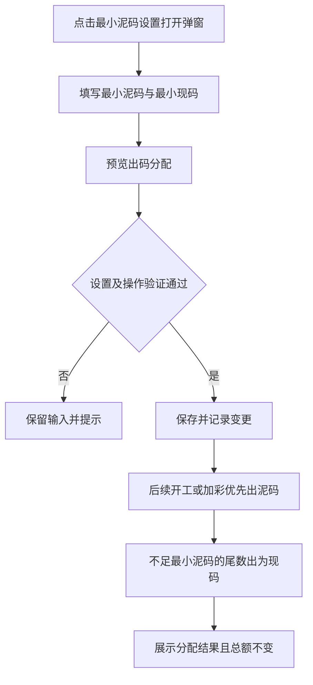
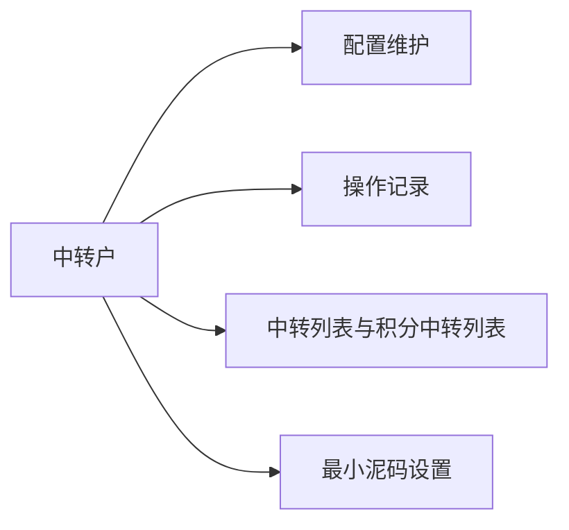

# 中转户

## 目录

- [§1 修订追踪表](#1-修订追踪表)
- [§2 背景与目标](#2-背景与目标)
- [§3 功能清单](#3-功能清单)
- [§4 功能细节规格](#4-功能细节规格)
- [§5 功能流程图](#5-功能流程图)
- [§6 功能结构图](#6-功能结构图)
- [§7 页面设计](#7-页面设计)
- [§8 边界与异常](#8-边界与异常)
- [§9 验收清单](#9-验收清单)

## 本文件使用说明

- 本文为中转户模块独立需求文档，包含中转户绑定、资金与积分流水、最小泥码设置及操作记录。
- 配套说明：[PRD_中转户_20261110_appendix](PRD_%E4%B8%AD%E8%BD%AC%E6%88%B7_20261110_appendix.md)；其中 A9 列出待确认事项。
- 原型完成情况与正式系统验收要求分开描述，截图中的户口和金额仅作界面参考。

## §1 修订追踪表

|版本|日期|说明|
|---|---|---|
|V1|2026-11-10|初稿，未送审|

## §2 背景与目标

- 本菜单提供业务配置与可查询的操作记录，统一沿用账房样式和权限校验。

## §3 功能清单

|页面|功能|变更|
|---|---|---|
|P1|中转户配置|[NEW]|
|P2|操作记录查询|[NEW]|
|P3|中转流水列表|[NEW]|
|P4|最小泥码设置与出码预览|[NEW]|

## §4 功能细节规格

### 4.1 P1 配置

- 固定五类：码量派发户口、占成派发户口、外币开工户口、积分中转户口、股金户口，类型名称不可编辑或删除。
- 点击行内“编辑”打开弹窗，展示当前绑定；户口输入框右侧仅保留一个“检索”按钮，输入框与按钮同一行显示。检索结果选中前不能保存，选中后回显户口号及户口名。
- 检索已开户的户口并回显户名后绑定；类型与户口号、户口名关联，业务不能通过改名改变类型逻辑。
- 码量派发户用于派发码量，业务负向累计；占成派发户用于占成方案结算，其余类型分别用于外币开工、积分与股金。
- 绑定和更换需要操作验证，记录类型、变更前后户口、操作人和时间；可按类型、户口号或操作人查询。
- 未找到户口不能保存；改检索内容立即清除旧选择。新绑定不转移历史资金或改写既有业务记录。

### 4.2 P2 操作记录

- 各中转户操作栏提供独立“操作记录”按钮，按当前固定类型限定范围，显示时间、类型、变更前后内容与操作人；关键词查询仅在该范围内进行，无记录显示空态。最小泥码设置的操作记录仅查询出码设置变更。
- 当前仅有配置操作记录；不虚构中转资金流水。正式记录应持久保存，并按权限访问。

### 4.3 P3 中转流水列表

- 中转户列表页上方直接展示五类固定中转户绑定表，包含类型、中转户口号、中转户口名、业务用途及“编辑”操作。编辑弹窗显示当前绑定，支持检索并更换已注册户口，类型名称保持只读。列表页同时提供“最小泥码设置”入口，维护最小泥码及最小现码。未绑定类型仍显示，不允许改名或删除类型。
- 下方展示中转列表，支持切换积分中转列表；顶部不再提供单独的中转户口设置入口，通过各行编辑维护绑定；操作记录放在各中转户行的操作栏，与编辑并列，点击仅展示该固定类型的绑定及更换记录，包含其历史绑定户口。
- 筛选包含中转户口号、交收厅、方式、币别、中转户厅、创建时间；日期沿用公共控件且精确到秒，查询应用条件，重置清空条件。
- 列表按截图展示序号、单号、方式、交收厅、中转户厅、中转户口号、中转户口姓名、币别、变更金额(万)、出款方、收款方、操作人、确认人、创建时间；户口号可点击查看详情。
- 积分列表以积分为单位，金额及积分不得混合汇总。支持20/50/100行和翻页，查询或切换页签后回到第一页。
- 当前无已接入的中转资金流水时展示空态，不使用绑定配置记录充当资金流水，不复制截图中的客户与金额。

### 4.4 P4 最小泥码设置

- 提供最小泥码与最小现码两个输入，单位万、正数、最多四位小数；不增加截图划掉的投注倍数设置。
- 出码优先泥码，低于最小泥码的尾数全部出为现码，总额保持不变，不舍入或丢弃尾数。
- 最小泥码0.05万、出码10.0005万时，泥码10.0000万、现码0.0005万。
- 当前原型设置统一应用于开工及加彩；保存前可预览，保存需操作验证并记录变更前后配置、操作人及时间。
- 最小现码保留配置，不额外推定低于最小现码必须拦截；未来确认用途后细化。已发生出码保留原有金额，不按新配置追改。

- 点击中转户列表顶部“最小泥码设置”打开弹窗，不跳转独立页面；左侧无独立菜单。预览仅展示拆分结果，不保存配置。
- 保存通过输入和操作验证后关闭弹窗；取消或右上角关闭不保存。关闭后保留中转户列表筛选条件及页码，校验失败留在弹窗并保留输入。

## §5 功能流程图

### 5.1 P1 配置

### 5.2 P2 操作记录

### 5.3 P3 中转流水列表

### 5.4 P4 最小泥码设置

## §6 功能结构图

## §7 页面设计

- 最小泥码设置归属中转户模块，从中转户页面进入；左侧不再设置独立菜单，点击后以弹窗操作，背景保留中转户列表、筛选与页码；保存或取消关闭弹窗，不跳转页面。

### 7.1 P1 配置

- 编辑弹窗依次展示固定类型、当前绑定、户口检索、选中户口及操作验证。输入框右侧仅一个检索按钮，底部为取消和保存。
- 五类绑定表的操作栏统一显示“编辑｜操作记录”；顶部不显示“中转户口设置”或统一操作记录按钮。

### 7.2 P2 操作记录

- 查询在上、记录在下；长内容换行，关闭返回原页面。

### 7.3 P3 中转流水列表

- 页签在上，筛选网格排列，显示行数靠右；宽表可横向滚动，日期控件与账房模块一致。

### 7.4 P4 最小泥码设置

- 上方配置最小泥码、最小现码，均标注单位万；下方独立展示出码预览，不增加投注倍数设置。
- 显示泥码、现码及出码总额；弹窗提供预览、保存设置和取消操作；保存须通过操作验证，取消不修改设置。

## §8 边界与异常

|编号|场景|处理要求|
|---|---|---|
|CC-01|户口不存在或修改检索内容|不可保存旧选择，重新检索并选择有效户口。|
|CC-02|身份验证失败、取消、重复点击|失败及取消不写入，重复提交不得重复产生成功记录。|
|CC-03|更换绑定|历史流水保留当时户口和户名，不转移历史资金。|
|CC-04|时间倒置或查询无结果|倒置提示错误；无结果显示空态，不构造交易。|
|CC-05|出码金额恰为最小泥码单位的整数倍|全部为泥码，现码尾数为零。|
|CC-06|出码金额小于最小泥码单位|全部出为现码，总额保持不变。|
|CC-07|尾数小于最小现码或非其整数倍|仍遵循尾数自动出现码，不擅自舍入或拦截；最小现码后续用途见附录。|
|CC-08|保存新的最小出码设置|仅后续出码使用新设置，既有记录不重算。|

## §9 验收清单

### 9.1 功能验收

|编号|页面|明确通过标准|
|---|---|---|
|AC-01|P1|五类业务名称不可编辑或删除；户口检索选中后回显正确户名。|
|AC-02|P1|不存在的户口不能绑定；成功绑定或更换产生一条变更记录。|
|AC-03|P2|点击某类型行内操作记录，仅显示该类型的历史变更；关键词筛选不越出该范围。|
|AC-04|P3|资金与积分分开显示；资金列表包含截图的全部十四列。|
|AC-05|P3|户口号、交收厅、方式、币别、中转户厅和时间筛选生效；重置清空条件。|
|AC-06|P3|支持20、50、100行及分页；查询和切换页签返回第一页；户口号跳转对应详情。|
|AC-07|P4|最小泥码和最小现码均可输入；零、负数、超过四位小数不能保存。|
|AC-08|P4|最小泥码0.05万，出码10.0005万，结果为泥码10.0000万、现码0.0005万。|
|AC-09|P4|开工、加彩使用已保存设置；泥码与现码合计等于原出码金额；成功保存可查操作记录。|

|AC-10|P1|每次打开编辑弹窗，输入框右侧恰有一个检索按钮；成功选中后可保存，修改输入后旧选择失效。|
|AC-11|P3|五类各有编辑和操作记录；顶部无中转户口设置、统一操作记录按钮，保留最小泥码设置。|
|AC-12|P4|点击设置出现弹窗；取消、关闭不保存；验证失败保持弹窗；保存成功关闭且记录一次，列表筛选和页码不变。|

### 9.2 非功能性验收

- 正式系统重新登录后仍可查询已保存配置和记录。
- 无配置权限者不得保存；失败操作不得改变配置或资金。
- 金额以万展示四位小数，积分单独展示，不进行跨币别或资金与积分混合汇总。

### 9.3 边界验收

- CC-01至CC-08逐项通过；取消不产生成功记录，无匹配流水显示空态。
- 当前泥码部分为零时，现码正常保留，不因零泥码阻断出码。

### 9.4 业务专项验收

- 中转资金流水与设置操作记录分开；只有真实业务成功产生的交易才进入流水列表。
- 码量派发户承担负向派发用途；零余额、撤销及冲正规则须先明确，不能以任意改写余额方式满足“永远负数”。
- 当前原型为会话演示，尚未完成正式持久化、权限及五类中转交易串接，不能作为这些验收项已通过的证据。

## 下一步建议

- 确认附录 A9 中的业务边界后，完成中转业务串接与正式验收。
