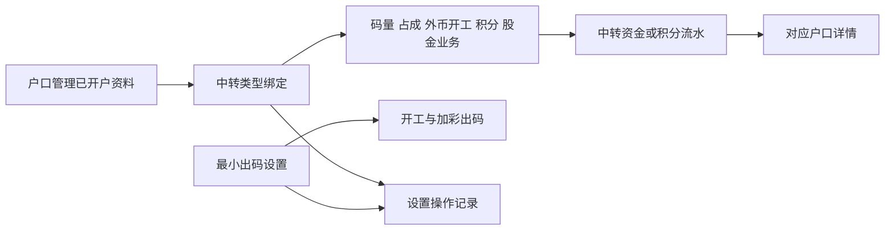
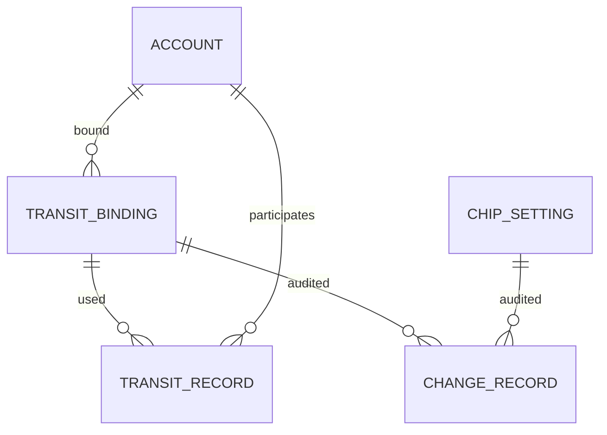

# 中转户模块附录

## A2 目标用户与角色

- 账房操作人员：查询流水、查看户口详情、按授权维护绑定与出码设置。
- 确认人员：按现有操作验证要求确认业务。
- 管理人员：查看设置变更，管理功能权限。具体角色授权范围待确认。

## A3 资料流与系统串接

- 历史流水保留交易发生时的户口信息、方式、厅、币别或积分单位、金额、双方户口、操作人、确认人和时间。
- 修改绑定不回写历史交易，不自动划转资金。

## A7 业务实体关系

- 同一户口能否绑定多个类型待确认；图中关系不代表已批准重复绑定。
- 资金流水与配置操作记录分别查询，不相互替代。

## A9 待确认事项

|事项|当前处理边界|
|---|---|
|码量派发户“永远负数”的零余额、撤销及冲正|负向派发方向已确定，特殊情况不可自行定义。|
|同一户口是否可绑定多个类型|待确认。|
|中转绑定、最小单位是否按厅或币别配置|原型统一设置，正式范围待确认。|
|最小现码具体限制用途|提供输入和保存；不以其限制自动转为现码的尾数。|
|开工和加彩之外的出码入口|接入范围待确认。|
|流水方式选项与具体业务映射|不得直接将户口类型名称当作交易方式，完整选项待业务确认。|

## A10 名词定义

- 中转户：已注册户口与固定中转用途绑定后的业务户口。
- 中转列表：记录资金变动的流水列表；金额以万展示。
- 积分中转列表：记录积分变动，不能与资金合并计算。
- 最小泥码：出码拆分时使用的泥码最小单位。
- 最小现码：可维护的现码最小单位，额外限制用途尚待确认。
