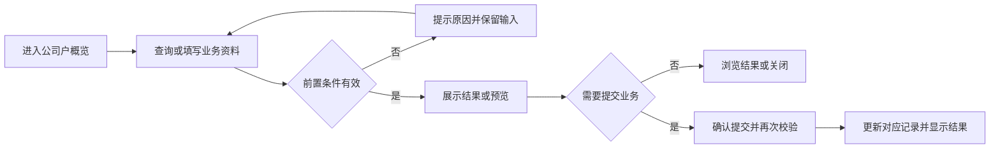
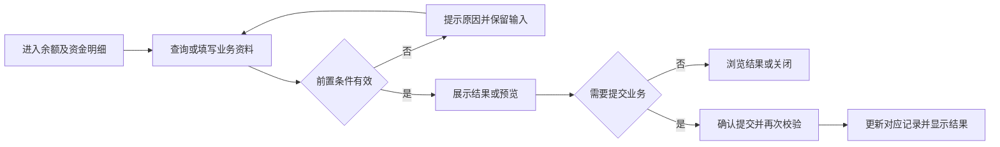
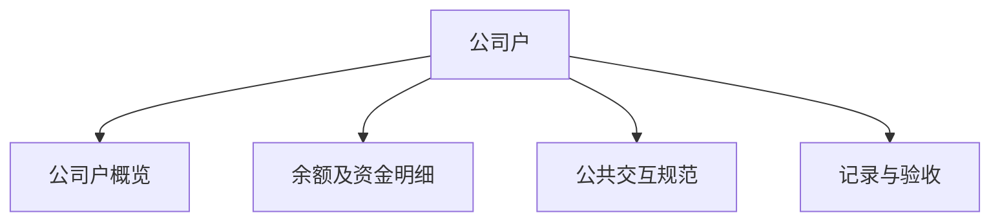

# 公司户

## 目录

- [§1 修订追踪表](#1-修订追踪表)
- [§2 背景与目标](#2-背景与目标)
- [§3 功能清单](#3-功能清单)
- [§4 功能细节规格](#4-功能细节规格)
- [§5 功能流程图](#5-功能流程图)
- [§6 功能结构图](#6-功能结构图)
- [§7 页面设计](#7-页面设计)
- [§8 边界与异常](#8-边界与异常)
- [§9 验收清单](#9-验收清单)

## 本文件使用说明

- 本文件按单个菜单整理本轮已确认需求，供设计、开发、测试使用；不是对未讨论历史功能的全量重写。
- 需求依据：本会话用户的最终说明及截图；冲突以最后确认内容为准。
- [MOD] 参考历史基线：[既有文档](../户口管理PRD/PRD_户口管理调整_20261031.md)。历史内容与本文件冲突时，本轮调整以本文件为准。
- 配套：[PRD_公司户_20261109_appendix](PRD_%E5%85%AC%E5%8F%B8%E6%88%B7_20261109_appendix.md)、[公共交互与展示规范](%E5%85%AC%E5%85%B1%E4%BA%A4%E4%BA%92%E4%B8%8E%E5%B1%95%E7%A4%BA%E8%A7%84%E8%8C%83.md)、[业务计算与开发交接](%E4%B8%9A%E5%8A%A1%E8%AE%A1%E7%AE%97%E4%B8%8E%E5%BC%80%E5%8F%91%E4%BA%A4%E6%8E%A5.md)。
- 开放问题见附录 A9；未确认项不得当成已验收需求。

## §1 修订追踪表

| 版本 | 日期 | 说明 |
|---|---|---|
| V1 | 2026-11-09 | 初稿，未送审 |

## §2 背景与目标

- 目标：统一公司资金、股本和资金流水的浏览方式。
- 使用者：账房操作人员、业务复核人员及获授权的管理人员。
- 范围：本菜单页面及关联弹窗；公共检索、时间控件、币种规范引用公共文档。
- 当前原型边界：明细展示当前原型会话产生的资金变动，初始余额没有历史流水。

## §3 功能清单

| 页面 | 页面名称 | 变更类别 | 业务结果 |
|---|---|---|---|
| P1 | 公司户概览 | [MOD] | 不显示审核列表入口；提案管理相关命名统一为开工管理。金额与表头对齐，USDT只显示一项，其余币种用字母。 |
| P2 | 余额及资金明细 | [MOD] | 点击余额进入对应公司、币种及资金类型明细；导出与列表使用相同查询条件；改变行数重置第一页。 |

## §4 功能细节规格

### 4.1 P1 公司户概览

- 柜台现金流水与客户余额分别记载；存取款、入退股、现金开工／加彩按资金流水对照表联动，不能以客户余额变化直接替代柜台现金变化。存款回M及现金回M均已确认：存款回M银头不变，现金回M增加银头；退股回M最新分录待确认：柜台现金增加、财务保险柜减少，分别展示及追溯。入股现金部分增加银头，退股现金部分减少银头。

- 界面：保留集团股本资讯、公司户资金、账房额度等数据区；移除整组快捷入口。
- 页面逻辑：不显示审核列表入口；提案管理相关命名统一为开工管理。金额与表头对齐，USDT只显示一项，其余币种用字母。
- 业务处理：查询、预览不产生资金变动；只有合法提交才能产生业务记录。取消关闭不得记成功；此规则为正式交付要求，原型覆盖范围以 §2 为准。
- 正向流程：操作人进入页面，完成有效查询或填写，核对结果后执行对应操作，看到列表或记录更新。
- 异常流程：无数据展示空态，不能隐藏仍有金额的币种记录。
- 边界：USDT合并展示不丢弃TRC/ERC原金额；USD与USDT相邻。
- 联动范围：只更新对应户口、币种及关联业务；本轮未授权跨菜单数据变更不自动扩大。

### 4.2 P2 余额及资金明细

- 界面：时间筛选下方设工具栏：导出左对齐，显示行数与下拉框右对齐；表格下方分页。
- 页面逻辑：点击余额进入对应公司、币种及资金类型明细；导出与列表使用相同查询条件；改变行数重置第一页。
- 业务处理：查询、预览不产生资金变动；只有合法提交才能产生业务记录。取消关闭不得记成功；此规则为正式交付要求，原型覆盖范围以 §2 为准。
- 正向流程：操作人进入页面，完成有效查询或填写，核对结果后执行对应操作，看到列表或记录更新。
- 异常流程：开始时间晚于结束时间禁止查询；无资金流水说明原型初始余额不含历史流水。
- 边界：零条仍保留筛选和分页；USDT合并口径与概览一致。
- 联动范围：只更新对应户口、币种及关联业务；本轮未授权跨菜单数据变更不自动扩大。

#### 公司户与厅别识别

- WBYD、WBYDAGS、WBYDBANK 为同一公司户口下的不同厅别，不作为三个独立公司户口。
- 户口检索仅展示一条公司户候选，标注关联三厅；输入任一厅标识均可找到该公司户，选择后回填统一公司户号 WBYD。
- 涉及厅别的业务单独保留厅别维度与原有分厅金额，不因户口候选合并而合并或转移资金。负数资格按当前户口维度识别，不按厅别重复创建。

## §5 功能流程图

### 5.1 P1 公司户概览

### 5.2 P2 余额及资金明细

## §6 功能结构图

## §7 页面设计

### 7.1 P1 公司户概览

- 布局：保留集团股本资讯、公司户资金、账房额度等数据区；移除整组快捷入口。
- 表现：采用账房管理的白底卡片、青色主操作、统一表单高度；金额与表头对齐。
- 反馈：区分未填写、无结果、校验失败、成功；不得用零值替代加载失败。

### 7.2 P2 余额及资金明细

- 布局：时间筛选下方设工具栏：导出左对齐，显示行数与下拉框右对齐；表格下方分页。
- 表现：采用账房管理的白底卡片、青色主操作、统一表单高度；金额与表头对齐。
- 反馈：区分未填写、无结果、校验失败、成功；不得用零值替代加载失败。

## §8 边界与异常

| 编号 | 场景及处理 |
|---|---|
| CC-01 / P1 | USDT合并展示不丢弃TRC/ERC原金额；USD与USDT相邻。 无数据展示空态，不能隐藏仍有金额的币种记录。 |
| CC-02 / P2 | 零条仍保留筛选和分页；USDT合并口径与概览一致。 开始时间晚于结束时间禁止查询；无资金流水说明原型初始余额不含历史流水。 |

## §9 验收清单

- 资金联动专项：按[资金流水变动对照](资金流水变动对照_20261112.md)中适用的FL编号及AC-FL案例验收；待确认项不得视为通过。

### 9.1 功能验收

| 编号 | 页面 | 验收标准 | 状态 |
|---|---|---|---|
| AC-01 | P1 | 不再出现围数/结数等六按钮快捷条；币种统一且USDT只一行。 | 待验收 |
| AC-02 | P2 | 导出与行数控件同排且同高；切换行数后页码回到第一页。 | 待验收 |

### 9.2 非功能验收

- 详见配套附录 A4；金额、户口和操作历史必须可辨识，控件不互相遮挡。
- 带权限的正式操作必须验证执行人身份；演示密码非空检查不能作为生产权限验收。

### 9.3 异常验收

- 对 §8 每个案例验证：失败不产生新资金记录，已有业务状态不被部分修改。
- 取消、重复点击、返回后重新打开的结果与既有成功记录一致；需持久化的正式业务重载后不丢失。

### 9.4 本菜单专项验收

- 按 §2 原型边界区分“原型交互可用”与“生产账务已验收”，不得混签。
- 逐项解决附录 A9，再执行正式账务、权限和异常测试；所有适用验收项通过后才能签收。

## 下一步建议

- 业务方确认附录 A9，设计与测试按 P 编号逐页评审。

## 收工结算资金流水补充（2026-11-13）

收工结算采用[资金流水变动对照](资金流水变动对照_20261112.md)“收工结算资金变动”中的CL-01～CL-07：覆盖A数和本户B数客上／客下、M本金及混合本金。分别记录客户余额、柜台现金、欠M、可用批额、泥码、现码、码量派发和占成交收；先回M，再分配，已发生的开工及中途流水不得在收工重复记账。截图分录与说明冲突按CL-Q01～CL-Q05保留标注，不能据此写死错误金额方向或户口绑定。本次仅更新需求文档。
