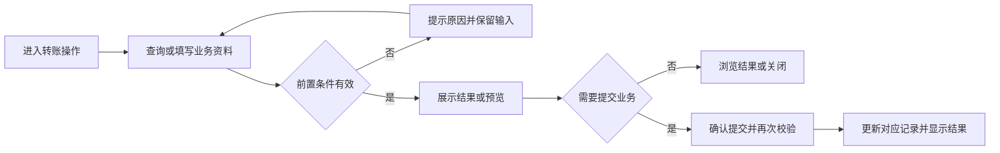
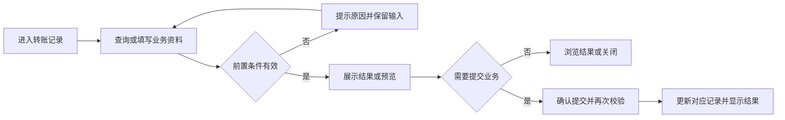
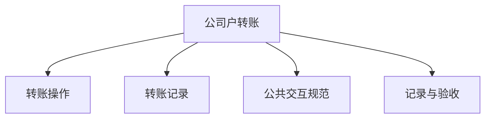

# 公司户转账

## 目录

- [§1 修订追踪表](#1-修订追踪表)
- [§2 背景与目标](#2-背景与目标)
- [§3 功能清单](#3-功能清单)
- [§4 功能细节规格](#4-功能细节规格)
- [§5 功能流程图](#5-功能流程图)
- [§6 功能结构图](#6-功能结构图)
- [§7 页面设计](#7-页面设计)
- [§8 边界与异常](#8-边界与异常)
- [§9 验收清单](#9-验收清单)

## 本文件使用说明

- 本文件按单个菜单整理本轮已确认需求，供设计、开发、测试使用；不是对未讨论历史功能的全量重写。
- 需求依据：本会话用户的最终说明及截图；冲突以最后确认内容为准。
- [MOD] 参考历史基线：[既有文档](../户口管理PRD/PRD_户口管理调整_20261031.md)。历史内容与本文件冲突时，本轮调整以本文件为准。
- 配套：[PRD_公司户转账_20261109_appendix](PRD_%E5%85%AC%E5%8F%B8%E6%88%B7%E8%BD%AC%E8%B4%A6_20261109_appendix.md)、[公共交互与展示规范](%E5%85%AC%E5%85%B1%E4%BA%A4%E4%BA%92%E4%B8%8E%E5%B1%95%E7%A4%BA%E8%A7%84%E8%8C%83.md)、[业务计算与开发交接](%E4%B8%9A%E5%8A%A1%E8%AE%A1%E7%AE%97%E4%B8%8E%E5%BC%80%E5%8F%91%E4%BA%A4%E6%8E%A5.md)。
- 开放问题见附录 A9；未确认项不得当成已验收需求。

## §1 修订追踪表

| 版本 | 日期 | 说明 |
|---|---|---|
| V1 | 2026-11-09 | 初稿，未送审 |

## §2 背景与目标

- 目标：保持公司间转账的资金上下文明确，统一户口检索与币种显示。
- 使用者：账房操作人员、业务复核人员及获授权的管理人员。
- 范围：本菜单页面及关联弹窗；公共检索、时间控件、币种规范引用公共文档。
- 当前原型边界：本次仅记录公共交互调整；不宣称增加新的转账入账能力。

## §3 功能清单

| 页面 | 页面名称 | 变更类别 | 业务结果 |
|---|---|---|---|
| P1 | 转账操作 | [MOD] | 本次调整为户口检索、币种代码与排序一致性，不改变既有转账业务口径。 |
| P2 | 转账记录 | [MOD] | 时间范围到秒；币种仅一项USDT，USD相邻；导出范围沿用当前筛选。 |

## §4 功能细节规格

### 4.1 P1 转账操作

- 界面：保留现有转账表单，付款与收款户口使用可检索控件。
- 页面逻辑：本次调整为户口检索、币种代码与排序一致性，不改变既有转账业务口径。
- 业务处理：查询、预览不产生资金变动；只有合法提交才能产生业务记录。取消关闭不得记成功；此规则为正式交付要求，原型覆盖范围以 §2 为准。
- 正向流程：操作人进入页面，完成有效查询或填写，核对结果后执行对应操作，看到列表或记录更新。
- 异常流程：无效户口不能提交；不能将查询关键词直接作为收款户口。
- 边界：同名户口展示不同户口号供选择；公司户候选须受原业务可选范围约束。
- 联动范围：只更新对应户口、币种及关联业务；本轮未授权跨菜单数据变更不自动扩大。

### 4.2 P2 转账记录

- 界面：列表查询、时间范围、金额展示与账房管理保持一致。
- 页面逻辑：时间范围到秒；币种仅一项USDT，USD相邻；导出范围沿用当前筛选。
- 业务处理：查询、预览不产生资金变动；只有合法提交才能产生业务记录。取消关闭不得记成功；此规则为正式交付要求，原型覆盖范围以 §2 为准。
- 正向流程：操作人进入页面，完成有效查询或填写，核对结果后执行对应操作，看到列表或记录更新。
- 异常流程：查询范围错误保留原记录并提示。
- 边界：历史不同网络USDT仍可追溯，聚合展示不等于删除历史。
- 联动范围：只更新对应户口、币种及关联业务；本轮未授权跨菜单数据变更不自动扩大。

## §5 功能流程图

### 5.1 P1 转账操作

### 5.2 P2 转账记录

## §6 功能结构图

## §7 页面设计

### 7.1 P1 转账操作

- 布局：保留现有转账表单，付款与收款户口使用可检索控件。
- 表现：采用账房管理的白底卡片、青色主操作、统一表单高度；金额与表头对齐。
- 反馈：区分未填写、无结果、校验失败、成功；不得用零值替代加载失败。

### 7.2 P2 转账记录

- 布局：列表查询、时间范围、金额展示与账房管理保持一致。
- 表现：采用账房管理的白底卡片、青色主操作、统一表单高度；金额与表头对齐。
- 反馈：区分未填写、无结果、校验失败、成功；不得用零值替代加载失败。

## §8 边界与异常

| 编号 | 场景及处理 |
|---|---|
| CC-01 / P1 | 同名户口展示不同户口号供选择；公司户候选须受原业务可选范围约束。 无效户口不能提交；不能将查询关键词直接作为收款户口。 |
| CC-02 / P2 | 历史不同网络USDT仍可追溯，聚合展示不等于删除历史。 查询范围错误保留原记录并提示。 |

## §9 验收清单

### 9.1 功能验收

| 编号 | 页面 | 验收标准 | 状态 |
|---|---|---|---|
| AC-01 | P1 | 检索选择后保留原有联动校验；开户不受影响。 | 待验收 |
| AC-02 | P2 | 查询与列表所显示币种相符，时间选择样式与开工列表一致。 | 待验收 |

### 9.2 非功能验收

- 详见配套附录 A4；金额、户口和操作历史必须可辨识，控件不互相遮挡。
- 带权限的正式操作必须验证执行人身份；演示密码非空检查不能作为生产权限验收。

### 9.3 异常验收

- 对 §8 每个案例验证：失败不产生新资金记录，已有业务状态不被部分修改。
- 取消、重复点击、返回后重新打开的结果与既有成功记录一致；需持久化的正式业务重载后不丢失。

### 9.4 本菜单专项验收

- 按 §2 原型边界区分“原型交互可用”与“生产账务已验收”，不得混签。
- 逐项解决附录 A9，再执行正式账务、权限和异常测试；所有适用验收项通过后才能签收。

## 下一步建议

- 业务方确认附录 A9，设计与测试按 P 编号逐页评审。
