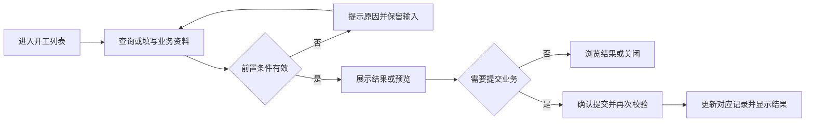
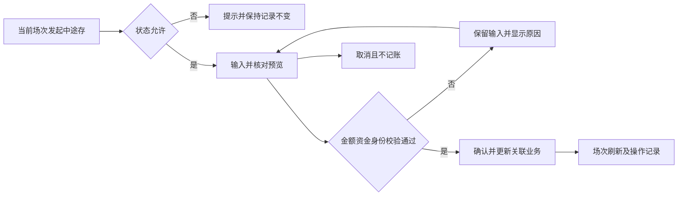
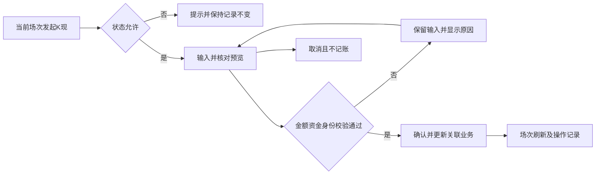
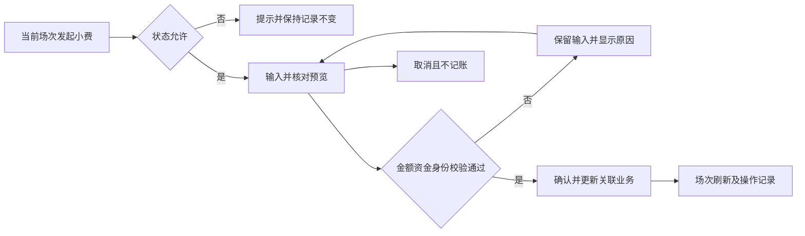
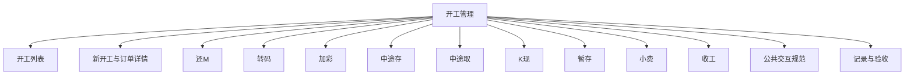

# 开工管理

## 目录

- [§1 修订追踪表](#1-修订追踪表)
- [§2 背景与目标](#2-背景与目标)
- [§3 功能清单](#3-功能清单)
- [§4 功能细节规格](#4-功能细节规格)
- [§5 功能流程图](#5-功能流程图)
- [§6 功能结构图](#6-功能结构图)
- [§7 页面设计](#7-页面设计)
- [§8 边界与异常](#8-边界与异常)
- [§9 验收清单](#9-验收清单)

## 本文件使用说明

- 本文件按单个菜单整理本轮已确认需求，供设计、开发、测试使用；不是对未讨论历史功能的全量重写。
- 需求依据：本会话用户的最终说明及截图；冲突以最后确认内容为准。
- [MOD] 参考历史基线：[既有文档](../开工管理PRD/PRD_开工管理调整_20261031.md)。历史内容与本文件冲突时，本轮调整以本文件为准。
- 配套：[PRD_开工管理_20261109_appendix](PRD_%E5%BC%80%E5%B7%A5%E7%AE%A1%E7%90%86_20261109_appendix.md)、[公共交互与展示规范](%E5%85%AC%E5%85%B1%E4%BA%A4%E4%BA%92%E4%B8%8E%E5%B1%95%E7%A4%BA%E8%A7%84%E8%8C%83.md)、[业务计算与开发交接](%E4%B8%9A%E5%8A%A1%E8%AE%A1%E7%AE%97%E4%B8%8E%E5%BC%80%E5%8F%91%E4%BA%A4%E6%8E%A5.md)。
- 开放问题见附录 A9；未确认项不得当成已验收需求。

## §1 修订追踪表

| 版本 | 日期 | 说明 |
|---|---|---|
| V1 | 2026-11-09 | 初稿，未送审 |

## §2 背景与目标

- 目标：让开工、场中操作、收工资金分配在同一场次中可追溯。
- 使用者：账房操作人员、业务复核人员及获授权的管理人员。
- 范围：本菜单页面及关联弹窗；公共检索、时间控件、币种规范引用公共文档。
- 当前原型边界：场次计算及部分账户回写已在原型演示；开工签M与额度管理的统一额度账本尚未完整贯通。上下数最终对账口径仍需正式业务签收。

## §3 功能清单

| 页面 | 页面名称 | 变更类别 | 业务结果 |
|---|---|---|---|
| P1 | 开工列表 | [MOD] | 支持户口、姓名、占成户口、状态及币种筛选；时间范围精确到秒。点击菜单回到列表，详情独立打开。 |
| P2 | 新开工与订单详情 | [MOD] | 去掉独立现金统计卡，但保留本金来源中的现金；中途存取卡不显示公式说明。玩家码粮、当场码粮占成、隐藏占成设置三块并排。 |
| P3 | 还M | [MOD] | 删除公司M单展示区；对当前场次开工及加彩关联M单分别填写归还金额。已还清M输入禁用，无M显示空态。 |
| P4 | 转码 | [MOD] | 本次变动允许正数或负数，分别增加或扣减累计转码；零金额不形成有效操作。 |
| P5 | 加彩 | [MOD] | “现金余额加彩”改名“余额加彩”，保留独立现金来源；同一笔可组合多个来源。 |
| P6 | 中途存 | [MOD] | 泥码存入减少累计转码，增加中途存泥码余额；现码存入只增加中途存现码余额，不改变累计转码。 |
| P7 | 中途取 | [MOD] | 泥码取出增加累计转码并减少中途存泥码余额；现码取出只减少中途存现码余额。 |
| P8 | K现 | [MOD] | 两类筹码合计形成K现，泥码部分扣减累计转码，两类合计增加当前上下数和累计K现。 |
| P9 | 暂存 | [MOD] | 泥码不能超过当前累计转码；本次暂存筹码合计必须大于零。暂存泥码扣减转码，两类合计计入暂存及相应存卡记录。 |
| P10 | 小费 | [MOD] | 四项均为非负，两组总额必须大于零；记录须分别保留员工、荷官及各筹码种类，不能只保存总额。 |
| P11 | 收工 | [MOD] | 先根据实收筹码及可用中途净存处理关联M，再分配剩余资金；不足归还的债务保留未还，不标成已清。 |

## §4 功能细节规格

### 4.1 P1 开工列表

- 新开工后缀支持A～Z，按户口独立占用，不按玩家姓名、币种或厅拆分；同一户口所有未收工场次（含暂存）不能重复使用后缀。AA11的A未收工时，另一客户使用AA11开工只能选择B～Z中未占用项。
- 切换户口重新加载可选后缀；提交再次校验占用。全部26个后缀已占用时禁止新开工并提示先收工释放；收工后后缀可再次使用，取消或失败不占用。
- 验收：同户口重复A被拦截，另一户口可用A；原场次收工后A恢复可选，刷新后仍按已保存场次判定占用。

- 开工及加彩按资金来源分别记账：存款来源减少客户户口余额，现金来源增加公司柜台现金；签M增加实际借款户口欠M并减少对应额度记录。分别关联FL-07、FL-11、FL-12。

- 界面：查询区、汇总区、订单表格与底部紧凑合计；操作列固定右侧。
- 页面逻辑：支持户口、姓名、占成户口、状态及币种筛选；时间范围精确到秒。点击菜单回到列表，详情独立打开。
- 业务处理：查询、预览不产生资金变动；只有合法提交才能产生业务记录。取消关闭不得记成功；此规则为正式交付要求，原型覆盖范围以 §2 为准。
- 正向流程：操作人进入页面，完成有效查询或填写，核对结果后执行对应操作，看到列表或记录更新。
- 异常流程：开始时间晚于结束时间时提示并拒绝搜索。
- 边界：无记录展示空态；汇总针对全部筛选结果，翻页不改变汇总。
- 联动范围：只更新对应户口、币种及关联业务；本轮未授权跨菜单数据变更不自动扩大。

### 4.2 P2 新开工与订单详情

- 界面：户口检索后带出资料；详情展示本金来源、转码、佣金、上下数、加彩、中途存取等。
- 页面逻辑：去掉独立现金统计卡，但保留本金来源中的现金；中途存取卡不显示公式说明。玩家码粮、当场码粮占成、隐藏占成设置三块并排。
- 业务处理：查询、预览不产生资金变动；只有合法提交才能产生业务记录。取消关闭不得记成功；此规则为正式交付要求，原型覆盖范围以 §2 为准。
- 正向流程：操作人进入页面，完成有效查询或填写，核对结果后执行对应操作，看到列表或记录更新。
- 异常流程：未找到有效户口不得签M或提交开工。
- 边界：窄屏允许换行，不能遮挡金额；新签M支持输入户口号或姓名检索。
- 联动范围：只更新对应户口、币种及关联业务；本轮未授权跨菜单数据变更不自动扩大。

### 4.3 P3 还M

- 界面：展示当前场次、客户、币种、出码总额、上下数、转码和未还M；下方按一般M单列出借款、已还、未还及泥码/现码还款输入。
- 删除公司M单展示区；对当前场次开工及加彩关联M单分别填写归还金额。已还清M输入禁用，无M显示空态。
- 每单泥码及现码金额不得为负，合计不得超过该单未还；全部归还合计须大于零。实时展示还款合计，提供重置及双密码确认。
- 成功后减少M未还、恢复对应户口同币种可用额度，并保留每单泥码、现码构成及备注。当前场内还M口径为两种筹码归还都增加公司泥码、减少公司Marker。
- 公司现金、公司现码、累计转码、上下数和户口存卡不因该还M操作改变。提交前核验公司Marker及M户口有效性。
- 这是场次内的筹码还M，与M单管理菜单的现金、存卡、换汇资金、余额还款分开描述，不能混用资金来源。
- 正向流程：填写、核对预览、确认身份、提交成功并刷新场次及记录。
- 异常：无M、总额零、负金额、超单未还、M户口缺失或公司Marker不足时不提交。
- 边界：只允许进行中场次；同一还款请求只执行一次，部分还款后保留未还余额。

### 4.4 P4 转码

- 界面：输入本次转码变动金额，展示当前累计及变动后累计，保留备注和操作确认。
- 本次变动允许正数或负数，分别增加或扣减累计转码；零金额不形成有效操作。
- 只调整本场累计转码，不自动改变本金、加彩、存卡、现金或M未还。
- 成功记录变动前后转码、带符号金额、操作人、时间及备注，刷新详情。取消预览不记录变动。
- 负调整后是否允许累计转码小于零，当前原型未加统一下限，应作为正式业务待确认，不以本次PRD擅自新增限制。
- 正向流程：填写、核对预览、确认身份、提交成功并刷新场次及记录。
- 异常：空值、非数字、零金额、场次状态不允许时不提交。
- 边界：正负调整必须显示方向；不能因负数被通用非负金额处理误拦截。

### 4.5 P5 加彩

- 界面：展示现金、余额加彩、提存卡、换汇加彩及新签M区域；右侧提供追加金额和资金影响预览。
- “现金余额加彩”改名“余额加彩”，保留独立现金来源；同一笔可组合多个来源。
- 余额、存卡分别展示对应可用额；换汇使用系统币种对汇率及算法，不允许业务页随意改价。新签M户口支持号或姓名检索并带出名字与可用额度。
- 各来源金额非负，合计大于零；余额和存卡不能超可用，新签M须合法、未被使用、币种相符且额度足够。
- 成功后累计加彩增加，原始开工本金单独保留；当前原型全部追加资金以泥码给出并增加累计转码。按来源分别扣减余额、存卡或占用M额度。
- 形成一条加彩记录，保存各来源、换汇快照和所用M单；通知仅预览或复制，不代表真实发送。
- 正向流程：填写、核对预览、确认身份、提交成功并刷新场次及记录。
- 异常：无有效追加金额、资金不足、M已用或户口冻结、币种不符、缺系统汇率时阻止。
- 边界：换汇资金只能计入一次；不能把加彩再次并入原始本金后重复扣减盈亏。

### 4.6 P6 中途存

- 界面：显示当前转码与上下数；分别输入泥码、现码，展示本次变动预览。
- 泥码存入减少累计转码，增加中途存泥码余额；现码存入只增加中途存现码余额，不改变累计转码。
- 两类存入的合计增加当前上下数；中途存不是户口存卡，不直接增加可提现余额。
- 成功保存币种、两类筹码金额、操作人、时间、备注及结果，刷新“中途存取”统计卡；卡片不展示公式说明。
- 可以只填一种筹码，另一项留空按零；总额须大于零。
- 正向流程：填写、核对预览、确认身份、提交成功并刷新场次及记录。
- 异常：负数、非法格式、合计零或场次已收工时拦截。
- 边界：正式需明确是否允许泥码存入使累计转码为负，原型当前没有统一该下限。

### 4.7 P7 中途取

- 界面：显示中途存余额合计及泥码、现码分项可取额；分别输入两类取出金额。
- 泥码取出增加累计转码并减少中途存泥码余额；现码取出只减少中途存现码余额。
- 本次合计减少当前上下数；取出并非户口现金取款，也不改变原始本金。
- 泥码与现码各自不能超出对应存量，不能以另一类余额抵补；实时预览并保留操作记录。
- 多次取出按最新剩余量校验；只有成功才减少可取额，取消或失败不能耗用。
- 正向流程：填写、核对预览、确认身份、提交成功并刷新场次及记录。
- 异常：任一类超可取额、合计零、负数或无存量时阻止。
- 边界：两类余额不互相转换；取至零后再次取出被拦截。

### 4.8 P8 K现

- 界面：输入泥码及现码，预览本次兑换现金、累计K现与公司银头变化。
- 两类筹码合计形成K现，泥码部分扣减累计转码，两类合计增加当前上下数和累计K现。
- 当前原型公司银头收回对应泥码、现码，并支付等额现金；原始开工本金保持不变。
- 提交前检查公司银头配置和可用现金，成功后保存银头前后变化及筹码构成。
- 收工仅处理本次收工K现金；场中已发生的K现不得再次扣减公司现金。
- 正向流程：填写、核对预览、确认身份、提交成功并刷新场次及记录。
- 异常：合计零、负数、银头未配置或公司现金不足时拦截。
- 边界：只输入现码不改变转码；累计转码负值边界待统一确认。

### 4.9 P9 暂存

- 界面：输入暂存泥码、现码并预览转码、暂存金额、存卡及场次状态；暂存后提供恢复开工或收工入口。
- 泥码不能超过当前累计转码；本次暂存筹码合计必须大于零。暂存泥码扣减转码，两类合计计入暂存及相应存卡记录。
- 成功后场次标为暂存，普通场中操作不再可用；可恢复开工或收工。恢复开工应关联原暂存记录，不能把同一笔暂存余额重复用于新场次。
- 多次暂存/恢复按对应记录剩余可用金额处理，不能把整笔历史金额反复计入。
- 暂存上下数按当前原型的筹码、已有中途净存、K现、小费及本金计算；该总口径仍需正式对账签收，不沿用旧文档单纯“上下数减暂存”的冲突描述。
- 正向流程：填写、核对预览、确认身份、提交成功并刷新场次及记录。
- 异常：泥码超当前转码、合计零或已被使用的暂存资金不能再次提交。
- 边界：已暂存场次仅允许恢复和收工；取消恢复不扣减暂存可用额。

### 4.10 P10 小费

- 界面：员工与荷官两组，每组都包含泥码及现码输入，支持一次提交；空项目可留空。
- 四项均为非负，两组总额必须大于零；记录须分别保留员工、荷官及各筹码种类，不能只保存总额。
- 员工泥码扣减累计转码；员工泥码及现码收回公司银头，并扣等额公司现金。员工小费本身不直接调整当前上下数。
- 荷官泥码及现码合计增加当前上下数与离台数，当前原型不改变公司银头和累计转码；该处理需与正式账务对账。
- 两组均计入本场小费合计；收工按既定盈亏公式计入一次，避免员工与荷官被重复加回。
- 若存在员工小费，提交前检查公司现金银头；无员工小费时不能因员工未填而阻止仅荷官小费。
- 正向流程：填写、核对预览、确认身份、提交成功并刷新场次及记录。
- 异常：负数、四项总额零或员工小费所需公司现金不足时阻止。
- 边界：只给荷官泥码、只给荷官现码及员工荷官同时给均支持。

### 4.11 P11 收工

- 界面：展示离台泥码/现码、实际转码、上下数、预计佣金、小费、优先还M及资金分配；存卡、存现、K现金三个金额均可编辑。
- 先根据实收筹码及可用中途净存处理关联M，再分配剩余资金；不足归还的债务保留未还，不标成已清。
- 剩余默认全部存卡，存现和K现金为零；不再依据A数/B数或有无未还M切换默认去向。修改分配后必须守恒。
- 离台泥码不得大于当前累计转码；本次K现金不得超过可分配金额或公司现金银头；所有分配项非负。
- 成功后写入收工时间、实收筹码、盈亏、实际转码、还M结果和资金去向；状态变为收工，普通场中操作不可再执行。
- 收工预计佣金展示不等于已经支付；实际佣金交收由结算管理承担。隐藏占成子订单由结算管理展示，主订单数据保留。
- 原型对存在占成的平局场次阻止收工并提示结算方向待确认；正式零盈亏场次处理需业务签收。
- 正向流程：填写、核对预览、确认身份、提交成功并刷新场次及记录。
- 异常：离台泥码超转码、分配不守恒、超可分配金额、公司银头不足或占成平局未定时不收工。
- 边界：零剩余分配均零；再次点击不能重复还M或记入存卡；荷官小费计离台展示但不作为可分配实收资金。

## §5 功能流程图

### 5.1 P1 开工列表

### 5.2 P2 新开工与订单详情

### 5.3 P3 还M

### 5.4 P4 转码

### 5.5 P5 加彩

### 5.6 P6 中途存

### 5.7 P7 中途取

### 5.8 P8 K现

### 5.9 P9 暂存

### 5.10 P10 小费

### 5.11 P11 收工

## §6 功能结构图

## §7 页面设计

### 7.1 P1 开工列表

- 布局：查询区、汇总区、订单表格与底部紧凑合计；操作列固定右侧。
- 表现：采用账房管理的白底卡片、青色主操作、统一表单高度；金额与表头对齐。
- 反馈：区分未填写、无结果、校验失败、成功；不得用零值替代加载失败。

### 7.2 P2 新开工与订单详情

- 布局：户口检索后带出资料；详情展示本金来源、转码、佣金、上下数、加彩、中途存取等。
- 表现：采用账房管理的白底卡片、青色主操作、统一表单高度；金额与表头对齐。
- 反馈：区分未填写、无结果、校验失败、成功；不得用零值替代加载失败。

### 7.3 P3 还M

- 展示当前场次、客户、币种、出码总额、上下数、转码和未还M；下方按一般M单列出借款、已还、未还及泥码/现码还款输入。
- 标明当前场次、户口及币种，金额单位统一；详情保留各项目预览，窄屏可滚动查看确认按钮。

### 7.4 P4 转码

- 输入本次转码变动金额，展示当前累计及变动后累计，保留备注和操作确认。
- 标明当前场次、户口及币种，金额单位统一；详情保留各项目预览，窄屏可滚动查看确认按钮。

### 7.5 P5 加彩

- 展示现金、余额加彩、提存卡、换汇加彩及新签M区域；右侧提供追加金额和资金影响预览。
- 标明当前场次、户口及币种，金额单位统一；详情保留各项目预览，窄屏可滚动查看确认按钮。

### 7.6 P6 中途存

- 显示当前转码与上下数；分别输入泥码、现码，展示本次变动预览。
- 标明当前场次、户口及币种，金额单位统一；详情保留各项目预览，窄屏可滚动查看确认按钮。

### 7.7 P7 中途取

- 显示中途存余额合计及泥码、现码分项可取额；分别输入两类取出金额。
- 标明当前场次、户口及币种，金额单位统一；详情保留各项目预览，窄屏可滚动查看确认按钮。

### 7.8 P8 K现

- 输入泥码及现码，预览本次兑换现金、累计K现与公司银头变化。
- 标明当前场次、户口及币种，金额单位统一；详情保留各项目预览，窄屏可滚动查看确认按钮。

### 7.9 P9 暂存

- 输入暂存泥码、现码并预览转码、暂存金额、存卡及场次状态；暂存后提供恢复开工或收工入口。
- 标明当前场次、户口及币种，金额单位统一；详情保留各项目预览，窄屏可滚动查看确认按钮。

### 7.10 P10 小费

- 员工与荷官两组，每组都包含泥码及现码输入，支持一次提交；空项目可留空。
- 标明当前场次、户口及币种，金额单位统一；详情保留各项目预览，窄屏可滚动查看确认按钮。

### 7.11 P11 收工

- 展示离台泥码/现码、实际转码、上下数、预计佣金、小费、优先还M及资金分配；存卡、存现、K现金三个金额均可编辑。
- 标明当前场次、户口及币种，金额单位统一；详情保留各项目预览，窄屏可滚动查看确认按钮。

## §8 边界与异常

| 编号 | 场景及处理 |
|---|---|
| CC-01 / P1 | 无记录展示空态；汇总针对全部筛选结果，翻页不改变汇总。 开始时间晚于结束时间时提示并拒绝搜索。 |
| CC-02 / P2 | 窄屏允许换行，不能遮挡金额；新签M支持输入户口号或姓名检索。 未找到有效户口不得签M或提交开工。 |
| CC-03 / P3 | 无M、总额零、负金额、超单未还、M户口缺失或公司Marker不足时不提交。 只允许进行中场次；同一还款请求只执行一次，部分还款后保留未还余额。 |
| CC-04 / P4 | 空值、非数字、零金额、场次状态不允许时不提交。 正负调整必须显示方向；不能因负数被通用非负金额处理误拦截。 |
| CC-05 / P5 | 无有效追加金额、资金不足、M已用或户口冻结、币种不符、缺系统汇率时阻止。 换汇资金只能计入一次；不能把加彩再次并入原始本金后重复扣减盈亏。 |
| CC-06 / P6 | 负数、非法格式、合计零或场次已收工时拦截。 正式需明确是否允许泥码存入使累计转码为负，原型当前没有统一该下限。 |
| CC-07 / P7 | 任一类超可取额、合计零、负数或无存量时阻止。 两类余额不互相转换；取至零后再次取出被拦截。 |
| CC-08 / P8 | 合计零、负数、银头未配置或公司现金不足时拦截。 只输入现码不改变转码；累计转码负值边界待统一确认。 |
| CC-09 / P9 | 泥码超当前转码、合计零或已被使用的暂存资金不能再次提交。 已暂存场次仅允许恢复和收工；取消恢复不扣减暂存可用额。 |
| CC-10 / P10 | 负数、四项总额零或员工小费所需公司现金不足时阻止。 只给荷官泥码、只给荷官现码及员工荷官同时给均支持。 |
| CC-11 / P11 | 离台泥码超转码、分配不守恒、超可分配金额、公司银头不足或占成平局未定时不收工。 零剩余分配均零；再次点击不能重复还M或记入存卡；荷官小费计离台展示但不作为可分配实收资金。 |

## §9 验收清单

- 资金联动专项：按[资金流水变动对照](资金流水变动对照_20261112.md)中适用的FL编号及AC-FL案例验收；待确认项不得视为通过。

### 9.1 功能验收

| 编号 | 页面 | 验收标准 | 状态 |
|---|---|---|---|
| AC-01 | P1 | 秒级起止筛选生效；翻页前后同一筛选条件下合计一致。 | 待验收 |
| AC-02 | P2 | 现金独立卡及中途存取说明隐藏；三项设置在宽屏同排。 | 待验收 |
| AC-03 | P3 | 对一笔未还5万M归还泥码2万、现码1万后未还2万、额度恢复3万；转码及上下数不变。 | 待验收 |
| AC-04 | P4 | 累计40万输入负3.25万后显示36.7500万，其他资金项不变；输入零被拦截。 | 待验收 |
| AC-05 | P5 | 组合来源金额与追加合计一致；余额加彩文案正确；提交后加彩累计和转码增加且来源扣减可追溯。 | 待验收 |
| AC-06 | P6 | 转码40万时存泥3万、现2万，转码37万、中途存净额增5万；户口存卡不变。 | 待验收 |
| AC-07 | P7 | 中途存泥3万现2万，取泥1万现1万后剩泥2万现1万，累计转码增1万。 | 待验收 |
| AC-08 | P8 | 仅现码K现2万，转码不变，累计K现增2万，公司现码增2万、现金减2万。 | 待验收 |
| AC-09 | P9 | 暂存成功后普通按钮不能继续办理；同一暂存资金无法重复恢复开工；恢复单可追溯原场次。 | 待验收 |
| AC-10 | P10 | 员工泥1万现3万、荷官泥2万现1万，记录总小费7万并保留四项构成；收工不重复计入。 | 待验收 |
| AC-11 | P11 | 三个分配输入可编辑；默认剩余进存卡；分配不等时拦截，成功后订单仅收工一次并进入结算列表。 | 待验收 |

### 9.2 非功能验收

- 详见配套附录 A4；金额、户口和操作历史必须可辨识，控件不互相遮挡。
- 带权限的正式操作必须验证执行人身份；演示密码非空检查不能作为生产权限验收。

### 9.3 异常验收

- 对 §8 每个案例验证：失败不产生新资金记录，已有业务状态不被部分修改。
- 取消、重复点击、返回后重新打开的结果与既有成功记录一致；需持久化的正式业务重载后不丢失。

### 9.4 本菜单专项验收

- 按 §2 原型边界区分“原型交互可用”与“生产账务已验收”，不得混签。
- 逐项解决附录 A9，再执行正式账务、权限和异常测试；所有适用验收项通过后才能签收。

### 9.5 操作区完整性与状态验收

- 进行中场次依次核验还M、转码、加彩、中途存、中途取、K现、暂存、小费、收工，对应P3至P11。
- 暂存后仅恢复开工或收工；收工后不能继续执行场中资金操作。
- 失败、取消和重复提交不得留下部分资金变化、重复M归还或额外通知成功记录。
- 通知原型仅生成预览或可复制内容，不视为已发送至客户。

## 下一步建议

- 业务方确认附录 A9，设计与测试按 P 编号逐页评审。

## 新签M批额来源补充

- 输入并选定签M户口后，展示该户口适用的公司批额、授予公司批额、股本批额及授予股本批额；显示批额单号、类型、币种、总额、占用、可用额和到期日。
- 公司批额显示不分币种，股本批额仅展示与当前开工币种匹配的记录。失效、已收回记录不能选择，无适用额度时显示空态。
- 签M必须选择具体批额；金额不得超过该来源可用额度，多张本次新签M累计校验；提交开工或加彩时再次校验。M单保留批额来源，欠款归实际开工户口。

## 收工结算资金流水补充（2026-11-13）

收工结算采用[资金流水变动对照](资金流水变动对照_20261112.md)“收工结算资金变动”中的CL-01～CL-07：覆盖A数和本户B数客上／客下、M本金及混合本金。分别记录客户余额、柜台现金、欠M、可用批额、泥码、现码、码量派发和占成交收；先回M，再分配，已发生的开工及中途流水不得在收工重复记账。截图分录与说明冲突按CL-Q01～CL-Q05保留标注，不能据此写死错误金额方向或户口绑定。本次仅更新需求文档。

## 现金与余额、可编辑回M（最新规则）

- 移除所有面向用户的存卡入口、输入项及独立列表列。普通资金项仅保留现金和余额；M借款、换汇资金及泥码／现码仍保留各自业务含义，不作为第三个存款钱包。
- 新开工、加彩使用现金或户口余额；换汇从对应币种余额扣款；暂存新入账进入余额，恢复开工扣相应余额。收工剩余金额默认存入余额，也可分配现金。
- M开工收工：客上默认回本场尚未归还的M本金，客下默认用收工可用金额回M，且不得超过本场未还M；已中途归还的部分不重复还。
- 本次回M可手动编辑，支持0；不得为负、超过未还M或超过收工可用金额。更改回M后即时更新剩余欠M与可分配金额，并重算默认余额分配；现金与余额之和必须等于可分配金额。
- 示例：M本金100、客上50，收工可用150，默认回M100，可分配50；改为回M90，可分配60、尚欠M10。客下40，可用60，默认回M60、可分配0、尚欠M40。
- 成功收工只归还输入金额并恢复对应签额额度；余额入账与现金支出分别记录。非法金额、分配不符或重复提交不得产生部分或重复入账。
- 验收：默认100→50、修改90→60、客下60→0、回M0、超限和负数拒绝、部分中途回M、多M单顺序分配均需通过；刷新后可恢复实际回M、剩余欠M及收工分配记录。
- 本节替代旧版“默认存卡”“存卡交收转余额”及“不可调整自动还M”的表述。已有历史存卡数据保留用于核对，不自动增加或删除客户现有余额；历史资金迁移需另行核对，不能仅改显示名称就视为已入余额。
