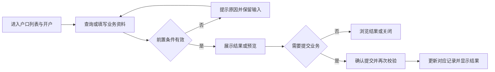
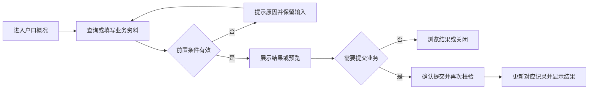
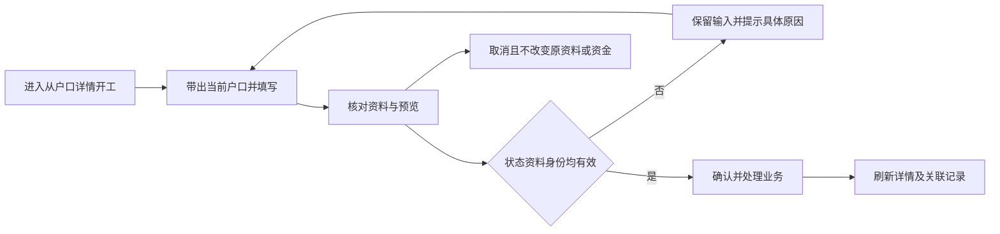
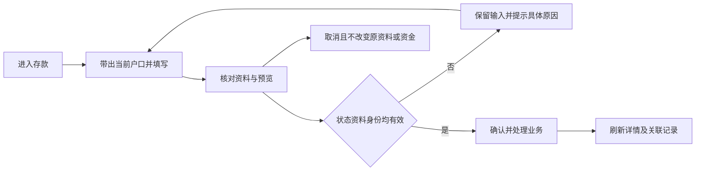
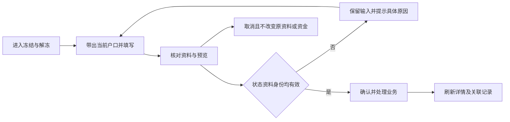
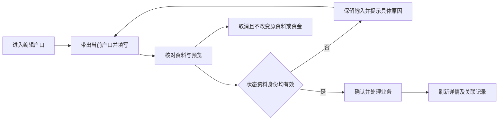
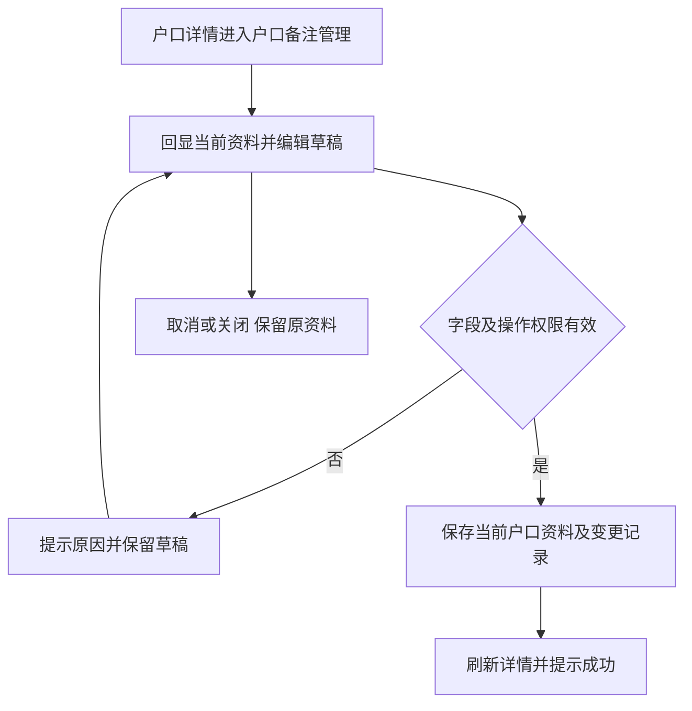
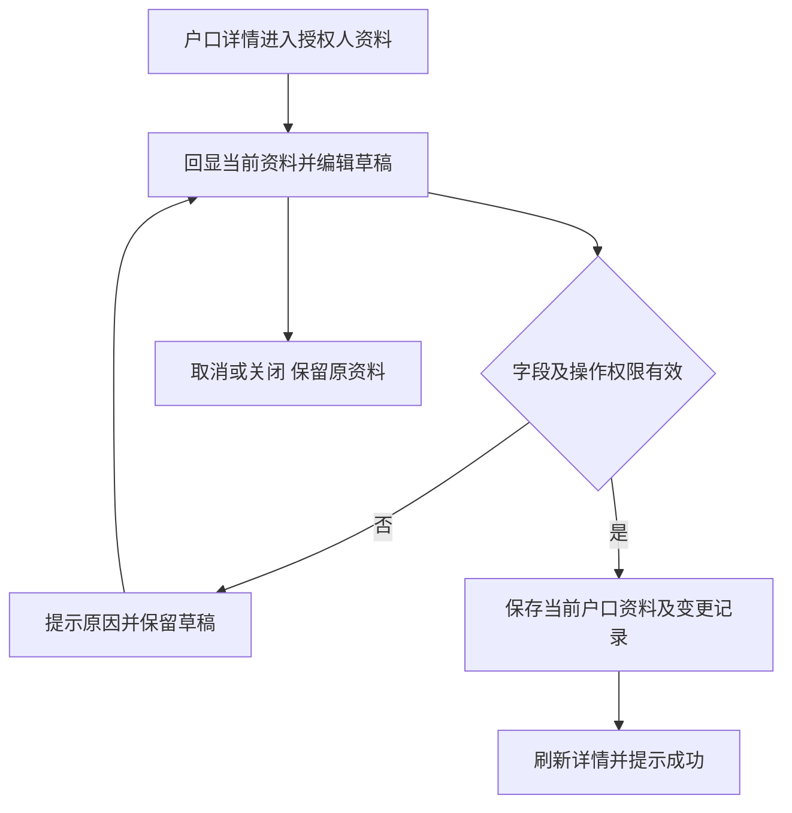
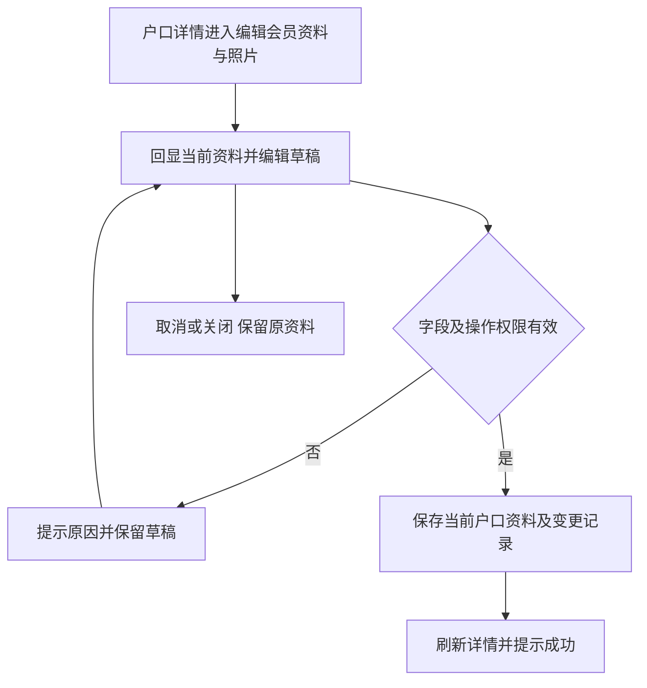
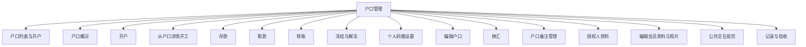

# 户口管理

## 目录

- [§1 修订追踪表](#1-修订追踪表)
- [§2 背景与目标](#2-背景与目标)
- [§3 功能清单](#3-功能清单)
- [§4 功能细节规格](#4-功能细节规格)
- [§5 功能流程图](#5-功能流程图)
- [§6 功能结构图](#6-功能结构图)
- [§7 页面设计](#7-页面设计)
- [§8 边界与异常](#8-边界与异常)
- [§9 验收清单](#9-验收清单)

## 本文件使用说明

- 本文件按单个菜单整理本轮已确认需求，供设计、开发、测试使用；不是对未讨论历史功能的全量重写。
- 需求依据：本会话用户的最终说明及截图；冲突以最后确认内容为准。
- [MOD] 参考历史基线：[既有文档](../户口管理PRD/PRD_户口管理调整_20261031.md)。历史内容与本文件冲突时，本轮调整以本文件为准。
- 配套：[PRD_户口管理_20261109_appendix](PRD_%E6%88%B7%E5%8F%A3%E7%AE%A1%E7%90%86_20261109_appendix.md)、[公共交互与展示规范](%E5%85%AC%E5%85%B1%E4%BA%A4%E4%BA%92%E4%B8%8E%E5%B1%95%E7%A4%BA%E8%A7%84%E8%8C%83.md)、[业务计算与开发交接](%E4%B8%9A%E5%8A%A1%E8%AE%A1%E7%AE%97%E4%B8%8E%E5%BC%80%E5%8F%91%E4%BA%A4%E6%8E%A5.md)。
- 开放问题见附录 A9；未确认项不得当成已验收需求。

## §1 修订追踪表

| 版本 | 日期 | 说明 |
|---|---|---|
| V1 | 2026-11-09 | 初稿，未送审 |

## §2 背景与目标

- 目标：统一户口资料与按币种资产展示，避免公司批额与股本批额混淆。
- 使用者：账房操作人员、业务复核人员及获授权的管理人员。
- 范围：本菜单页面及关联弹窗；公共检索、时间控件、币种规范引用公共文档。
- 当前原型边界：开户、资料编辑、存取款、转账、冻结与普通换汇具备本地会话演示；概况与额度使用本地数据，刷新恢复。真实鉴权、持久化及生产账务未完成，不能据此认定正式交易已发生。

## §3 功能清单

| 页面 | 页面名称 | 变更类别 | 业务结果 |
|---|---|---|---|
| P1 | 户口列表 | [MOD] | 查询支持户口号或姓名；选择结果回填规范户口号。开户组别代码、编号等新标识不查询已有户口。 |
| P2 | 户口概况 | [MOD] | 公司批额行的批额、可用批额对齐对应列，欠M显示横线；余额、存卡、垫付等不适用项显示横线。股本额度在各币种行显示，列名保留“批额”。 |
| P3 | 开户 | [MOD] | 户口信息包括组别代码、户口编号、姓名、别名、角色、上线户口、介绍人、开户厅；组别、编号和姓名为必填，编号保留前导零。新户口标识自由录入，不套用已有户口检索。 |
| P4 | 从户口详情开工 | [MOD] | 携带当前户口号、姓名及可用资金等上下文，由开工管理页面完成资金来源、码粮方案和场次信息填写；不能跳转后自动变成另一户口。 |
| P5 | 存款 | [MOD] | 当前户口不可在弹窗里无提示更换；资金单位明确为万，按选中币种增加可用余额，不记入存卡或冻结。 |
| P6 | 取款 | [MOD] | 默认使用当前户口可用余额，不得使用尚未交收的存卡或已冻结金额弥补现金不足。 |
| P7 | 转账 | [MOD] | 移除转入厅选择，使用唯一户口定位收款方；候选展示姓名及编号，选中后资料只读回显。更改输入立即清除旧匹配资料。 |
| P8 | 冻结与解冻 | [MOD] | 金额冻结：选币种和金额，显示当前可用、冻结及处理后金额；冻结减少可用余额并增加冻结，不改变账户正常状态。 |
| P9 | 个人码粮设置 | [MOD] | 移除A数码粮、现金码粮、M码粮、积分比、代理佣差等旧输入，只保留本次明确的两个比例维度。 |
| P10 | 编辑户口 | [MOD] | 组别、编号、姓名、联系资料、会员资料、备注可按现有权限编辑；会员卡使用可留空文本输入，去首尾空格保存。 |
| P11 | 换汇 | [MOD] | 必须定位不同于本户口的有效对手，两个币种不能相同；原型由系统汇率配置读取对应币种对，不允许在业务弹窗修改汇率或算法。 |
| P12 | 户口备注管理 | [MOD] | 新增、编辑户口备注，维护可见范围并保留修改历史。 |
| P13 | 授权人资料 | [MOD] | 维护当前户口的多位授权人及各自授权范围。 |
| P14 | 编辑会员资料与照片 | [MOD] | 从会员资料卡进入编辑并回显会员身份、联系资料和照片。 |

## §4 功能细节规格

### 4.1 P1 户口列表

- 新开户成功后追加至户口集合，不覆盖已有户口；默认列表显示全部已成功创建的户口，允许分页。开户成功返回列表并清空旧筛选，避免新户口被隐藏。
- 查询、数量、各币种合计及导出均基于全部匹配户口；点击户口号或详情进入对应户口，余额、备注及操作数据相互隔离。

- 界面：业务查询输入提供户口检索；开户编号保留自由录入。
- 页面逻辑：查询支持户口号或姓名；选择结果回填规范户口号。开户组别代码、编号等新标识不查询已有户口。
- 业务处理：查询、预览不产生资金变动；只有合法提交才能产生业务记录。取消关闭不得记成功；此规则为正式交付要求，原型覆盖范围以 §2 为准。
- 正向流程：操作人进入页面，完成有效查询或填写，核对结果后执行对应操作，看到列表或记录更新。
- 异常流程：检索无结果显示明确提示；不可把未找到的业务户口当新户口创建。
- 边界：只读户口信息不增加检索按钮；已有检索不得重复。
- 联动范围：只更新对应户口、币种及关联业务；本轮未授权跨菜单数据变更不自动扩大。

- 查询区移除“余额口径”下拉项；查询与重置不再携带该条件。列表各币种余额、余额汇总及导出统一沿用现金余额口径，存卡继续在独立列展示。

### 4.2 P2 户口概况

- 额度来源与去向表的“来源”按实际类型显示：公司批额、授予公司批额、股本批额、授予股本批额，不再显示笼统的原始批额或授予批额。

- 欠M归属实际开工借款户口：A将公司批额授予B，C使用B的获授批额签M，欠款显示在C，不因额度来源为B而记作B的欠款；还款后C的欠M减少。
- 公司批额行的欠M支持点击查看欠款、还款记录，显示M单号、批额户口、币种、时间和金额；不同币种分别显示。未实际用于开工的签M草稿不计为已借款。
- 点击可用批额打开该户口的批额使用弹窗，按公司批额、股本批额、授予公司批额、授予股本批额展示批额、Marker占用和可用批额，零额度亦可打开。

- 界面：公司批额融入资产表格首行，标明“不分币种”；其余各币种逐行展示。
- 页面逻辑：公司批额行的批额、可用批额对齐对应列，欠M显示横线；余额、存卡、垫付等不适用项显示横线。股本额度在各币种行显示，列名保留“批额”。
- 业务处理：查询、预览不产生资金变动；只有合法提交才能产生业务记录。取消关闭不得记成功；此规则为正式交付要求，原型覆盖范围以 §2 为准。
- 正向流程：操作人进入页面，完成有效查询或填写，核对结果后执行对应操作，看到列表或记录更新。
- 异常流程：缺失或加载失败不应伪装成零余额。
- 边界：公司批额不可复制到每个币种；不同币种股本不直接相加。
- 联动范围：只更新对应户口、币种及关联业务；本轮未授权跨菜单数据变更不自动扩大。

- 公司批额行的批额、可用批额数字均为明细入口，包括零值；点击打开当前户口对应指标的数据走向弹窗，不适用的横线不提供入口。
- 弹窗显示当前户口、指标、当前数值及“公司批额不分币种”，列出额度来源、已签占用、已授予去向、可用额度和有效状态；通过批额单号关联 M 单的借款、已还、尚欠及借款币种。
- 变动记录须展示关联业务单、业务原因、来源/去向户口、变动前、变动额、变动后、操作人和时间。正式流水覆盖新增、调整、授予、收回、签 M、还 M 和到期影响；当前原型仅有部分文字记录，缺失数值显示横线，初始余额不得伪造成交易。
- 正式验收需保证指标和相同口径的明细核对一致；取消或关闭只退出查看，不改变资金或额度；无记录与加载失败分别提示，权限沿用户口数据访问范围。

#### 欠M与批额归属

- 户口概况“Marker”更名“欠M”，按实际借款户口与币种汇总未还本金；公司批额不分币种行的欠M显示横线，借款在对应币种行显示，避免跨币种累计。
- 点击欠M显示欠款、还款两类记录，含M单号、批额所属户口、时间、金额和说明。欠款增加借款方欠M，归还后减少借款方欠M并恢复原批额可用额度。
- 例：A公司批额100，B使用A批额借款20，A可用批额80，B欠M20；A不因提供批额被记为欠款人。B还款5后，A可用85、B欠M15（假定无其他占用）。
- 原型按实际借款户口识别欠M；开工来源未载入逐笔还款时标明累计还款，不能虚构还款时间。正式账本需同时关联批额持有人与借款人。

#### 可用批额的使用明细

- 点击户口概况可用批额，打开“[户口号/户名] 批额使用”弹窗，展示种类、批额(万)、Marker(万)、可用批额(万)及总计行，提供关闭。
- 类型沿用公司批额、股本批额、授予公司批额、授予股本批额；公司批额范围不分币种，币种行展示该币种股本范围，其他类型显示零，不跨币种相加。
- Marker 表示自己开工签用的批额数加上下放给别人的 M 数，属于批额占用，区别于借款户口的欠M。可用批额为批额减占用，总计与各项一致。
- 原型下放占用取已授予额度，避免再次叠加被授予人签用造成重复扣减；有效批额纳入汇总，过期、收回记录不计入。

### 4.3 P3 开户

- 组别代码中的英文字母固定大写：输入或粘贴小写字母即时转为大写，保存时再次统一转换；数字保持不变，户口编号及其他户口号输入字段中的英文同样固定大写。重复户口校验使用规范化后的代码。

- 连续创建多个不同户口后，全部可在列表查到；重复户口号应拦截，失败或取消不新增记录。新户口不得继承上一户口余额及资料。

- 界面：户口列表“＋开户”进入，按户口信息、联系资料、会员证件、照片、备注、操作验证分区；宽屏多列，窄屏单列。
- 户口信息包括组别代码、户口编号、姓名、别名、角色、上线户口、介绍人、开户厅；组别、编号和姓名为必填，编号保留前导零。新户口标识自由录入，不套用已有户口检索。
- 联系资料包括区号、手机号、备用电话、邮箱、短信语言；填写手机号时需有效区号并校验格式，区号纯数字可规范为带加号；不发送短信验证码。
- 会员资料包含会员卡号、国籍、性别、生日、证件类型和号码；会员卡号选填，去除首尾空格后保存。内部、公开备注选填。
- 仅保留一个“照片信息”上传区，最多两张，可追加、预览和删除；不再单列证件正反面上传入口。当前原型允许零张保存。旧文档至少一张要求与选填冲突，正式是否必传列为待确认，不在本次擅自改成必传。
- 确认开户时校验双密码、必填资料、编号格式与唯一性、电话格式、照片数量；失败保持输入并显示原因。成功后进入新户口详情。
- 新户口初始状态为正常，资金及冻结金额从零开始；不得继承上一户口的余额、冻结状态、照片、授权、码粮或备注，也不得删除上一户口历史。正式身份、资料保存和审计需持久化。
- 正向流程：填写并核对必要资料，通过校验后提交，查看结果与关联记录。
- 异常：重复户口、缺少姓名或编号、电话格式不正确、照片超两张、密码缺失均不创建户口。
- 边界：手机号留空时不强制补区号；零照片的正式准入规则未定；图片加载失败不能假装有效上传。

### 4.4 P4 从户口详情开工

- 界面：详情顶部“开工”作为当前户口的业务快捷入口；进入新开工页面并带出该户口资料。
- 携带当前户口号、姓名及可用资金等上下文，由开工管理页面完成资金来源、码粮方案和场次信息填写；不能跳转后自动变成另一户口。
- 允许按公共检索规则选择其他合法户口时，必须清除原户口的余额与方案，重新带出新户口资料。
- 点击按钮仅导航，不扣款、不签M、不生成场次；确认开工成功后才形成订单及相应资金、额度记录。
- 账户冻结时阻止入口；正式系统仍需在提交开工时再次检查状态和权限。完整开工流程引用开工管理菜单PRD。
- 正向流程：填写并核对必要资料，通过校验后提交，查看结果与关联记录。
- 异常：冻结、找不到或无权限的户口不得发起开工；加载资料失败要保留明确错误。
- 边界：多次点击进入表单不应生成多笔订单；取消应回到原户口上下文。

### 4.5 P5 存款

- 存款按FL-01联动客户存款余额与公司柜台现金；取款按FL-02同步减少两项。转账按FL-03减少转出户、增加对手户，不改变柜台现金。换汇按FL-04A／B分币种记录客户与对手户的双向变动。

- 界面：详情顶部“存款”打开当前户口弹窗，展示币种、金额、选填备注和双密码验证。
- 当前户口不可在弹窗里无提示更换；资金单位明确为万，按选中币种增加可用余额，不记入存卡或冻结。
- 确认前校验账户状态、合法币种、正金额及身份；金额处理后为零不能提交。正式超精度输入应展示实际处理金额供核对。
- 成功后刷新详情余额与资金流水，记录业务号、币种、变动金额、变动后余额、时间、操作人和备注。原型会打开存款消息预览，可复制文案，未自动发送。
- 密码及内部备注不能进入客户通知；消息复制或关闭不重复办理存款。
- 正向流程：填写并核对必要资料，通过校验后提交，查看结果与关联记录。
- 异常：冻结账户、无效金额、空密码时阻止；失败不增加余额或流水。
- 边界：同币种连续两次合法存款应各有记录；重复确认同一业务请求不得重复入账。

### 4.6 P6 取款

- 界面：详情顶部“取款”打开当前户口弹窗，展示币种、金额、取款人、取款人手机号、备注及双密码。
- 默认使用当前户口可用余额，不得使用尚未交收的存卡或已冻结金额弥补现金不足。
- 提交前确认正金额且不超过所选币种可用余额；取款人及手机号当前原型未设必填，正式是否必填及授权核验需业务确认。
- 成功后减少对应币种余额并生成取款记录，保存实际取款资料；展示可复制的取款消息预览，不自动向外部发送。
- 正式取款需校验操作者和取款人授权；密码非空演示不能代替真实授权认证。
- 正向流程：填写并核对必要资料，通过校验后提交，查看结果与关联记录。
- 异常：余额不足、账户冻结、金额非法或身份失败不扣款、不产生成功流水。
- 边界：可用余额恰好等于取款金额时允许清零；被冻结金额不能重复从可用余额中再扣一次。

### 4.7 P7 转账

- 界面：左侧为当前转出户口、可检索的收款户口、币种、金额、备注与双密码；右侧显示收款资料、额度、余额、查看及证件预览。
- 移除转入厅选择，使用唯一户口定位收款方；候选展示姓名及编号，选中后资料只读回显。更改输入立即清除旧匹配资料。
- 收款人查看和证件预览在弹窗内展开，保留尚未提交的金额和备注；资料和备注受查看权限约束。
- 本操作为同币种余额转账；不同币种走换汇入口，不隐式换汇。提交核对收款户口、币种、金额及可用余额。
- 成功时转出方减少、收款方增加，生成关联的转出和转入记录；两端应同时成功。取消或任一校验失败不动两端余额。
- 正式需明确禁止本人转本人、收款方冻结/停用与无权交易的处理；当前本地收款资料集合限制不能代替生产校验。
- 正向流程：填写并核对必要资料，通过校验后提交，查看结果与关联记录。
- 异常：未唯一定位收款户口、金额非法、余额不足或收款方不允许交易时阻止。
- 边界：同名收款人必须按户口号区分；用户修改户口输入后不能继续使用旧收款人身份提交。

### 4.8 P8 冻结与解冻

- 界面：仅一个冻结类型选择，按类型显示金额区或整户状态区；全部操作保留双密码和选填备注。
- 金额冻结：选币种和金额，显示当前可用、冻结及处理后金额；冻结减少可用余额并增加冻结，不改变账户正常状态。
- 整户冻结：不填写币种金额，显示红色警示，明确所有业务操作受限制；确认后状态为冻结，不扣余额，也不改变既有金额冻结。
- 金额解冻：只选择币种，自动展示该币种全部冻结金额，不能选冻结单、不能输入部分解冻；完成后恢复可用余额。
- 解冻账户：只有账户已冻结时可用；恢复正常状态但不释放各币种冻结资金。金额解冻也不自动解除整户状态冻结。
- 原型对整户冻结限制开工、存款、取款、转账和换汇，仍允许查看和解冻；正式是否允许入款、在途交易如何处理需业务签收。
- 成功记录区分金额变动与状态变动，同步详情及冻结列表；不把整户冻结作为金额计入合计。
- 正向流程：填写并核对必要资料，通过校验后提交，查看结果与关联记录。
- 异常：冻结金额超过可用余额、解冻金额为零、重复冻结/解冻或状态已变化时拦截。
- 边界：一个币种多笔冻结仍一次全额释放；存在整户冻结时单独解冻金额不能解锁户口。

### 4.9 P9 个人码粮设置

- 界面：多币种配置矩阵，每个币种分别显示即结、月结，两行都保留占成比与对应码粮比；底部双密码和保存全部配置。
- 移除A数码粮、现金码粮、M码粮、积分比、代理佣差等旧输入，只保留本次明确的两个比例维度。
- 留空表示沿用角色默认，明确填零表示覆盖为零；页面回显实际来源，不把空值与零混淆。
- 即结与月结配置同时保存，切换或重开后分别回显；本次不再沿用旧文档“每币种只能保留一种结算方式”的冲突描述。
- 点击保存全部前验证所有币种和周期，任一项非法均不保存，提示具体币种、周期和项目；取消不改原配置。
- 配置变更记录操作人、时间和变更内容；密码不入日志。对未来场次生效及进行中场次的配置快照策略，正式仍需明确，不能追改已结历史。
- 正向流程：填写并核对必要资料，通过校验后提交，查看结果与关联记录。
- 异常：超范围、负比例、格式错误或密码缺失时阻止全部保存，不允许仅保存部分行。
- 边界：一个周期留空另一个填零均需正确回显；旧配置迁移不能删除已结历史。

### 4.10 P10 编辑户口

- 界面：详情顶部“编辑”进入与开户同分区表单，回显当前资料、照片与会员卡。
- 组别、编号、姓名、联系资料、会员资料、备注可按现有权限编辑；会员卡使用可留空文本输入，去首尾空格保存。
- 照片信息仍为一个上传区，最多两张；可删除替换和预览，不新增正反面单独上传区。
- 当前原型组别及编号直接编辑保存，不显示申请审批入口；正式最高授权人审批是否取消未确认，不把直接保存认定为生产审批规则。
- 修改户口号必须维持同一稳定户口关联，余额、场次、冻结、授权、额度和历史不应变成新账户。历史操作快照保留，当前列表和检索展示新资料。
- 双密码与资料校验通过后保存，取消保留原资料；不得因编辑清零现有资金或初始化其他新户口数据。
- 正向流程：填写并核对必要资料，通过校验后提交，查看结果与关联记录。
- 异常：新标识重复、必填缺失、电话不合法、照片超限或身份失败时不保存。
- 边界：编辑会员卡为空允许保留空值；修改户口号后相关记录仍可查，不能生成第二个户口。

### 4.11 P11 换汇

- 界面：左侧对手户口检索、只读户名、转出和转入币种、金额、只读系统汇率及双密码；右侧换算过程与余额预览。
- 必须定位不同于本户口的有效对手，两个币种不能相同；原型由系统汇率配置读取对应币种对，不允许在业务弹窗修改汇率或算法。
- 缺少汇率时明确提示并阻止；不会自动反推其他币种对。系统配置乘法或除法，保存成功交易的汇率及算法快照，后续改价不影响历史。
- 本户口向对手支付来源币种，对手向本户口支付目标币种；同时核验双方各自支付币种可用余额。预览不扣款。
- 成功后双方两种币种资产同时更新，形成一笔换汇单和四条关联资金流水；失败或取消不能部分入账。
- 提交前重新校验账户状态、余额和汇率；若与预览不同，应重算并要求重新核对。当前原型普通换汇已有本地四向变动，但真实幂等和报价变更确认待完善。
- 换汇开工、换汇加彩由开工流程处理，不把普通换汇四向流水直接套用造成重复投入场次。
- 正向流程：填写并核对必要资料，通过校验后提交，查看结果与关联记录。
- 异常：同币种、同户口、汇率未配置、无效金额、结果为零、任一方余额不足时禁止。
- 边界：改币种必须重读系统汇率；预览后状态或汇率改变不得静默沿用旧结果。

### 4.12 P12 户口备注管理

- 入口与展示：户口详情的“户口备注”显示备注内容、创建时间及创建人；无记录显示“暂无备注”。内容超出紧凑区域时提供展开、收起；“管理备注”打开管理弹窗。
- 表单包含部门、可见范围、指定人员、备注内容、操作人密码及确认人密码。默认内部可见；范围可选内部（仅同部门）、所有人、指定人员。正式部门与人员来自获授权组织范围，演示中的单一部门和三名人员不是固定业务名单。
- 选择指定人员时展示多选名单且至少选一人；切换为内部或所有人后不保留指定人员作为生效范围。“所有人”指有相应系统访问权限的公司人员，不代表对外公开。
- 新增成功后显示一条新备注；编辑回显内容、部门和可见范围，保存前保留旧版本，原创建人和创建时间不覆盖；记录最近编辑时间、编辑人及变更前后内容和范围。
- 备注记录按最近新增或修改时间倒序，支持编辑及展开修改记录；取消编辑返回新增模式，关闭弹窗不保存未提交内容。当前不增加删除备注功能。
- 备注正文沿用原型为选填，去首尾空格保存；空备注能否正式创建及字数上限见附录 A9。开户/编辑中的内部、公开备注与此处多条备注目前分开维护，未确认前不得自动合并或覆盖。
- 正式查看、编辑和历史版本均需校验可见范围；原型当前是管理员展示，不能代表部门隔离已完成。范围收窄后，未授权人员也不得通过旧版本或其他页面摘要读取内容。
- 异常：未选部门、指定人员为空或操作验证失败时不新增、不覆盖历史，保留输入并显示原因。
- 边界：长文本及换行完整显示；展示用户文本不执行其中的代码。切换户口后只显示对应户口备注；重复提交同一次保存不得产生两条记录。

### 4.13 P13 授权人资料

- 入口与展示：详情“授权人资料”卡片的“编辑”打开弹窗；无记录显示“尚未设置授权人”。已保存人员按姓名、电话、会员卡号、授权种类标签、备注及照片展示。
- 每位授权人包括姓名（必填）、区号、电话、会员卡号、授权种类、照片和备注；姓名去首尾空格，其他资料沿用原型为选填。授权人是被授权业务人员，不等同于系统操作人或确认人。
- 支持新增多位授权人、修改及移除，全部在草稿中操作；仅保存成功后整体替换当前户口配置。移除最后一人后允许保存为空并恢复空态；取消或关闭保留原授权名单。
- 授权种类可多选：取款、出佣金、消费、订务、签贷款、数据查询、开工。每人独立配置，不能把甲的授权用于乙。无授权种类时当前原型允许保存，展示“未设置授权种类”，不代表取得全部权限。
- 每人可保存一张照片，再次选择替换草稿照片；支持 PNG、JPG、WebP，单张不超过10 MB。非法文件提示原因并保留原照片；详情支持放大查看，加载失败显示失败提示。
- 保存需填写操作人密码及确认人密码；当前原型要求两项非空且不能相同。正式须核验身份及授权，不能用密码文本不相同证明是两个人；密码不得进入历史、导出或资料展示。
- 正式保存后记录执行人、确认人、时间和名单及授权范围变更，详情立即刷新。被移除或取消的授权不得继续用于新业务，历史业务的当时授权事实保留；在途业务处理见附录 A9。
- 异常：任一人员姓名为空、照片超限、身份验证失败时整批不保存，指出对应人员或字段。
- 边界：同名人员不能仅按姓名合并；重复识别、电话完整校验、授权有效期及限额规则未确认，不虚构已实现。新增授权人不会创建新户口，也不改资金和批额。

### 4.14 P14 编辑会员资料与照片

- 入口：户口详情“会员资料”卡片提供“编辑资料 / 上传图片”，与顶部编辑共用 P10 表单和同一户口资料，不创建另一套会员记录。
- 详情展示会员卡号、姓名、角色、上线户口、介绍人、区号/电话、开户厅、开户时间、国籍、性别、生日及积分概况。会员卡空值显示“未绑定”，一般未填写资料显示“未填写”；积分为零时明确显示0。
- 编辑回显会员卡号、姓名、别名、角色、上线户口、介绍人、开户厅；联系资料包括区号、手机号、两个备用电话、邮箱、短信语言；会员证件包括国籍、性别、生日、证件类型与号码。组别编号等基础身份修改沿用 P10。
- 会员卡号为可留空文本，去首尾空格保存；不能用固定下拉选项替代。填写已有上线户口时沿用公共检索规范；不得因为修改会员资料而新建户口。手机号选填，填写后按区号校验；无需短信验证码。
- 照片为单一上传区域，最多两张，PNG、JPG、WebP且每张不超过10 MB；可增加、删除和替换草稿图片，保存前不改正式资料。不拆分正反面上传控件；是否至少一张仍见附录 A9。
- 详情照片显示数量、缩略图和文件名，点击放大；存在相邻图片时提供上一张、下一张，关闭回到详情。无照片显示上传引导；读取或加载失败不得显示为上传成功。
- 开户时间及当前可用、已兑换、30天内到期积分为只读信息，本表单不得直接改积分或产生资金流水。双密码与 P10 校验通过后保存，详情和户口检索回显最新资料。
- 异常：必填缺失、电话不合法、照片格式/大小/数量不合规或身份失败均不保存，保留可修正的草稿；上传成功与资料保存成功分别反馈。
- 边界：取消后原资料及照片不变；保存不改变余额、存卡、冻结、批额、授权人和多条备注历史。会员卡重复绑定、证件完整性和生日范围见附录 A9；原型仅本地预览，真实图片持久保存待实现。

## §5 功能流程图

### 5.1 P1 户口列表

### 5.2 P2 户口概况

### 5.3 P3 开户

### 5.4 P4 从户口详情开工

### 5.5 P5 存款

### 5.6 P6 取款

### 5.7 P7 转账

### 5.8 P8 冻结与解冻

### 5.9 P9 个人码粮设置

### 5.10 P10 编辑户口

### 5.11 P11 换汇

### 5.12 P12 户口备注管理

### 5.13 P13 授权人资料

### 5.14 P14 编辑会员资料与照片

## §6 功能结构图

## §7 页面设计

### 7.1 P1 户口列表

- 布局：业务查询输入提供户口检索；开户编号保留自由录入。
- 表现：采用账房管理的白底卡片、青色主操作、统一表单高度；金额与表头对齐。
- 反馈：区分未填写、无结果、校验失败、成功；不得用零值替代加载失败。

### 7.2 P2 户口概况

- 布局：公司批额融入资产表格首行，标明“不分币种”；其余各币种逐行展示。
- 表现：采用账房管理的白底卡片、青色主操作、统一表单高度；金额与表头对齐。
- 反馈：区分未填写、无结果、校验失败、成功；不得用零值替代加载失败。

### 7.3 P3 开户

- 户口列表“＋开户”进入，按户口信息、联系资料、会员证件、照片、备注、操作验证分区；宽屏多列，窄屏单列。
- 表单标明必填与选填，错误信息贴近输入；金额需明确币种和单位。
- 成功反馈与取消动作可区分，窄屏不得隐藏确认、金额或户口身份。

### 7.4 P4 从户口详情开工

- 详情顶部“开工”作为当前户口的业务快捷入口；进入新开工页面并带出该户口资料。
- 表单标明必填与选填，错误信息贴近输入；金额需明确币种和单位。
- 成功反馈与取消动作可区分，窄屏不得隐藏确认、金额或户口身份。

### 7.5 P5 存款

- 详情顶部“存款”打开当前户口弹窗，展示币种、金额、选填备注和双密码验证。
- 表单标明必填与选填，错误信息贴近输入；金额需明确币种和单位。
- 成功反馈与取消动作可区分，窄屏不得隐藏确认、金额或户口身份。

### 7.6 P6 取款

- 详情顶部“取款”打开当前户口弹窗，展示币种、金额、取款人、取款人手机号、备注及双密码。
- 表单标明必填与选填，错误信息贴近输入；金额需明确币种和单位。
- 成功反馈与取消动作可区分，窄屏不得隐藏确认、金额或户口身份。

### 7.7 P7 转账

- 左侧为当前转出户口、可检索的收款户口、币种、金额、备注与双密码；右侧显示收款资料、额度、余额、查看及证件预览。
- 表单标明必填与选填，错误信息贴近输入；金额需明确币种和单位。
- 成功反馈与取消动作可区分，窄屏不得隐藏确认、金额或户口身份。

### 7.8 P8 冻结与解冻

- 仅一个冻结类型选择，按类型显示金额区或整户状态区；全部操作保留双密码和选填备注。
- 表单标明必填与选填，错误信息贴近输入；金额需明确币种和单位。
- 成功反馈与取消动作可区分，窄屏不得隐藏确认、金额或户口身份。

### 7.9 P9 个人码粮设置

- 多币种配置矩阵，每个币种分别显示即结、月结，两行都保留占成比与对应码粮比；底部双密码和保存全部配置。
- 表单标明必填与选填，错误信息贴近输入；金额需明确币种和单位。
- 成功反馈与取消动作可区分，窄屏不得隐藏确认、金额或户口身份。

### 7.10 P10 编辑户口

- 详情顶部“编辑”进入与开户同分区表单，回显当前资料、照片与会员卡。
- 表单标明必填与选填，错误信息贴近输入；金额需明确币种和单位。
- 成功反馈与取消动作可区分，窄屏不得隐藏确认、金额或户口身份。

### 7.11 P11 换汇

- 左侧对手户口检索、只读户名、转出和转入币种、金额、只读系统汇率及双密码；右侧换算过程与余额预览。
- 表单标明必填与选填，错误信息贴近输入；金额需明确币种和单位。
- 成功反馈与取消动作可区分，窄屏不得隐藏确认、金额或户口身份。

### 7.12 P12 户口备注管理

- 备注区保持紧凑，管理弹窗上方表单、下方时间线；内容与权限标签分层，长记录可滚动。

### 7.13 P13 授权人资料

- 多人表单按人员分组，姓名与移除按钮同组；权限复选框可换行；底部统一验证与保存。

### 7.14 P14 编辑会员资料与照片

- 沿用 P10 分区表单；详情资料网格与照片区组合，窄屏折行，照片预览保持比例。

## §8 边界与异常

| 编号 | 场景及处理 |
|---|---|
| CC-01 / P1 | 只读户口信息不增加检索按钮；已有检索不得重复。 检索无结果显示明确提示；不可把未找到的业务户口当新户口创建。 |
| CC-02 / P2 | 公司批额不可复制到每个币种；不同币种股本不直接相加。 缺失或加载失败不应伪装成零余额。 |
| CC-03 / P3 | 重复户口、缺少姓名或编号、电话格式不正确、照片超两张、密码缺失均不创建户口。 手机号留空时不强制补区号；零照片的正式准入规则未定；图片加载失败不能假装有效上传。 |
| CC-04 / P4 | 冻结、找不到或无权限的户口不得发起开工；加载资料失败要保留明确错误。 多次点击进入表单不应生成多笔订单；取消应回到原户口上下文。 |
| CC-05 / P5 | 冻结账户、无效金额、空密码时阻止；失败不增加余额或流水。 同币种连续两次合法存款应各有记录；重复确认同一业务请求不得重复入账。 |
| CC-06 / P6 | 余额不足、账户冻结、金额非法或身份失败不扣款、不产生成功流水。 可用余额恰好等于取款金额时允许清零；被冻结金额不能重复从可用余额中再扣一次。 |
| CC-07 / P7 | 未唯一定位收款户口、金额非法、余额不足或收款方不允许交易时阻止。 同名收款人必须按户口号区分；用户修改户口输入后不能继续使用旧收款人身份提交。 |
| CC-08 / P8 | 冻结金额超过可用余额、解冻金额为零、重复冻结/解冻或状态已变化时拦截。 一个币种多笔冻结仍一次全额释放；存在整户冻结时单独解冻金额不能解锁户口。 |
| CC-09 / P9 | 超范围、负比例、格式错误或密码缺失时阻止全部保存，不允许仅保存部分行。 一个周期留空另一个填零均需正确回显；旧配置迁移不能删除已结历史。 |
| CC-10 / P10 | 新标识重复、必填缺失、电话不合法、照片超限或身份失败时不保存。 编辑会员卡为空允许保留空值；修改户口号后相关记录仍可查，不能生成第二个户口。 |
| CC-11 / P11 | 同币种、同户口、汇率未配置、无效金额、结果为零、任一方余额不足时禁止。 改币种必须重读系统汇率；预览后状态或汇率改变不得静默沿用旧结果。 |
| CC-12 / P12 | 异常：未选部门、指定人员为空或操作验证失败时不新增、不覆盖历史，保留输入并显示原因。 边界：长文本及换行完整显示；展示用户文本不执行其中的代码。切换户口后只显示对应户口备注；重复提交同一次保存不得产生两条记录。 |
| CC-13 / P13 | 异常：任一人员姓名为空、照片超限、身份验证失败时整批不保存，指出对应人员或字段。 边界：同名人员不能仅按姓名合并；重复识别、电话完整校验、授权有效期及限额规则未确认，不虚构已实现。新增授权人不会创建新户口，也不改资金和批额。 |
| CC-14 / P14 | 异常：必填缺失、电话不合法、照片格式/大小/数量不合规或身份失败均不保存，保留可修正的草稿；上传成功与资料保存成功分别反馈。 边界：取消后原资料及照片不变；保存不改变余额、存卡、冻结、批额、授权人和多条备注历史。会员卡重复绑定、证件完整性和生日范围见附录 A9；原型仅本地预览，真实图片持久保存待实现。 |

## §9 验收清单

- 资金联动专项：按[资金流水变动对照](资金流水变动对照_20261112.md)中适用的FL编号及AC-FL案例验收；待确认项不得视为通过。

### 9.1 功能验收

| 编号 | 页面 | 验收标准 | 状态 |
|---|---|---|---|
| AC-01 | P1 | 可按姓名找到已有户口；开户编号输入不会弹出已有户口结果。 | 待验收 |
| AC-02 | P2 | 顶部不再出现大数字额度卡；公司批额仅一行，数值与对应表头对齐。 | 待验收 |
| AC-03 | P3 | 缺少必填项或重复户口提交失败；成功后新户口状态正常且资产为零；会员卡及联系资料保存后可回显。 | 待验收 |
| AC-04 | P4 | 从户口甲进入的新开工默认甲；点击入口或取消不改变余额与M额度；冻结户口无法进入可提交状态。 | 待验收 |
| AC-05 | P5 | 存入一笔后仅对应币种余额增加、存卡和冻结不变；出现一条存款记录；消息预览不等于已发送。 | 待验收 |
| AC-06 | P6 | 余额不足不能取款；合法取款后余额及流水一致；复制通知或重开记录不能再次扣款。 | 待验收 |
| AC-07 | P7 | 收款户口变化时旧信息清空；无转入厅控件；合法同币种转账两端金额相等且方向相反。 | 待验收 |
| AC-08 | P8 | 金额冻结前后可用与冻结合计不变；解冻账户不改变冻结金额；正常户口不可重复执行解冻账户。 | 待验收 |
| AC-09 | P9 | 同时填写即结和月结后重开均保留；非法一项不写任何新配置；取消无变更。 | 待验收 |
| AC-10 | P10 | 保存后详情回显；取消不变；修改姓名编号不改变余额及历史记录归属。 | 待验收 |
| AC-11 | P11 | 成功产生一单四流水且两端变化相符；缺汇率和余额不足无扣转；历史成交不随配置改价改变。 | 待验收 |
| AC-12 | P12 | 新增、编辑后重开回显；原创建信息不变且旧版本可查；指定人员为空无法保存；无权限用户无法看到正文或历史。 | 待验收 |
| AC-13 | P13 | 两人不同权限可独立回显；移除后取消仍保留原名单；空姓名整批失败；合法保存空名单显示空态；失败上传不覆盖原照片。 | 待验收 |
| AC-14 | P14 | 卡片入口和顶部编辑回显同一资料；会员卡清空后显示未绑定；两张照片能切换预览；第三张或超10 MB图片被拒绝；取消不改原资料及资产。 | 待验收 |
| AC-02a | P2 | 公司批额行批额与可用批额数字可打开当前户口明细，币种行欠M展示实际借款户口债务，含零值；可核对来源、占用及关联单据，缺失历史不伪造金额；查看或关闭不改额度。 | 待验收 |

### 9.2 非功能验收

- 详见配套附录 A4；金额、户口和操作历史必须可辨识，控件不互相遮挡。
- 带权限的正式操作必须验证执行人身份；演示密码非空检查不能作为生产权限验收。

### 9.3 异常验收

- 对 §8 每个案例验证：失败不产生新资金记录，已有业务状态不被部分修改。
- 取消、重复点击、返回后重新打开的结果与既有成功记录一致；需持久化的正式业务重载后不丢失。

### 9.4 本菜单专项验收

- 按 §2 原型边界区分“原型交互可用”与“生产账务已验收”，不得混签。
- 逐项解决附录 A9，再执行正式账务、权限和异常测试；所有适用验收项通过后才能签收。

### 9.5 操作区完整性验收

- 详情顶部依次包含开工、存款、取款、转账、冻结/解冻、个人码粮设置、编辑、换汇；各按钮与本文件P4至P11一一对应。
- 列表开户入口对应P3；各操作的当前户口、币种和权限上下文必须一致，不能因切换弹窗残留上次数据。
- 执行失败和取消分别测试，均不得留下成功记录；涉及双端资产的交易不能单边成功。

- 详情内的管理备注、授权人编辑、编辑资料 / 上传图片分别对应 P12、P13、P14，全部验证保存、取消、异常及户口切换。

## 下一步建议

- 业务方确认附录 A9，设计与测试按 P 编号逐页评审。

- 多户口专项验收：连续成功创建两个户口后，原有户口与两个新户口均出现在列表；分别打开详情资料正确，零余额新户不继承旧户资金；筛选、清空筛选、导出数量与列表一致。
