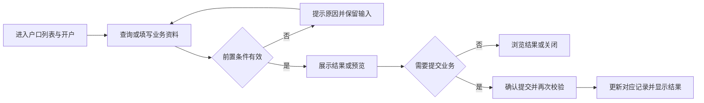
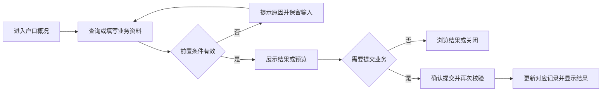
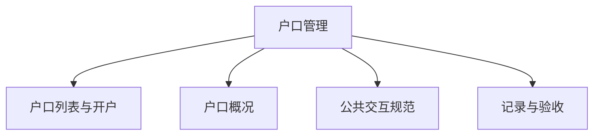

# 户口管理

## 目录

- [§1 修订追踪表](#1-修订追踪表)
- [§2 背景与目标](#2-背景与目标)
- [§3 功能清单](#3-功能清单)
- [§4 功能细节规格](#4-功能细节规格)
- [§5 功能流程图](#5-功能流程图)
- [§6 功能结构图](#6-功能结构图)
- [§7 页面设计](#7-页面设计)
- [§8 边界与异常](#8-边界与异常)
- [§9 验收清单](#9-验收清单)

## 本文件使用说明

- 本文件按单个菜单整理本轮已确认需求，供设计、开发、测试使用；不是对未讨论历史功能的全量重写。
- 需求依据：本会话用户的最终说明及截图；冲突以最后确认内容为准。
- [MOD] 参考历史基线：[既有文档](../户口管理PRD/PRD_户口管理调整_20261031.md)。历史内容与本文件冲突时，本轮调整以本文件为准。
- 配套：[PRD_户口管理_20261109_appendix](PRD_%E6%88%B7%E5%8F%A3%E7%AE%A1%E7%90%86_20261109_appendix.md)、[公共交互与展示规范](%E5%85%AC%E5%85%B1%E4%BA%A4%E4%BA%92%E4%B8%8E%E5%B1%95%E7%A4%BA%E8%A7%84%E8%8C%83.md)、[业务计算与开发交接](%E4%B8%9A%E5%8A%A1%E8%AE%A1%E7%AE%97%E4%B8%8E%E5%BC%80%E5%8F%91%E4%BA%A4%E6%8E%A5.md)。
- 开放问题见附录 A9；未确认项不得当成已验收需求。

## §1 修订追踪表

| 版本 | 日期 | 说明 |
|---|---|---|
| V1 | 2026-11-09 | 初稿，未送审 |

## §2 背景与目标

- 目标：统一户口资料与按币种资产展示，避免公司批额与股本批额混淆。
- 使用者：账房操作人员、业务复核人员及获授权的管理人员。
- 范围：本菜单页面及关联弹窗；公共检索、时间控件、币种规范引用公共文档。
- 当前原型边界：概况展示使用本地账户和额度演示数据；与正式统一账本的全量关联尚未完成。

## §3 功能清单

| 页面 | 页面名称 | 变更类别 | 业务结果 |
|---|---|---|---|
| P1 | 户口列表与开户 | [MOD] | 查询支持户口号或姓名；选择结果回填规范户口号。开户组别代码、编号等新标识不查询已有户口。 |
| P2 | 户口概况 | [MOD] | 公司批额行的Marker、批额、可用批额对齐对应列；余额、存卡、垫付等不适用项显示横线。股本额度在各币种行显示，列名保留“批额”。 |

## §4 功能细节规格

### 4.1 P1 户口列表与开户

- 界面：业务查询输入提供户口检索；开户编号保留自由录入。
- 页面逻辑：查询支持户口号或姓名；选择结果回填规范户口号。开户组别代码、编号等新标识不查询已有户口。
- 业务处理：查询、预览不产生资金变动；只有合法提交才能产生业务记录。取消关闭不得记成功；此规则为正式交付要求，原型覆盖范围以 §2 为准。
- 正向流程：操作人进入页面，完成有效查询或填写，核对结果后执行对应操作，看到列表或记录更新。
- 异常流程：检索无结果显示明确提示；不可把未找到的业务户口当新户口创建。
- 边界：只读户口信息不增加检索按钮；已有检索不得重复。
- 联动范围：只更新对应户口、币种及关联业务；本轮未授权跨菜单数据变更不自动扩大。

### 4.2 P2 户口概况

- 界面：公司批额融入资产表格首行，标明“不分币种”；其余各币种逐行展示。
- 页面逻辑：公司批额行的Marker、批额、可用批额对齐对应列；余额、存卡、垫付等不适用项显示横线。股本额度在各币种行显示，列名保留“批额”。
- 业务处理：查询、预览不产生资金变动；只有合法提交才能产生业务记录。取消关闭不得记成功；此规则为正式交付要求，原型覆盖范围以 §2 为准。
- 正向流程：操作人进入页面，完成有效查询或填写，核对结果后执行对应操作，看到列表或记录更新。
- 异常流程：缺失或加载失败不应伪装成零余额。
- 边界：公司批额不可复制到每个币种；不同币种股本不直接相加。
- 联动范围：只更新对应户口、币种及关联业务；本轮未授权跨菜单数据变更不自动扩大。

## §5 功能流程图

### 5.1 P1 户口列表与开户

### 5.2 P2 户口概况

## §6 功能结构图

## §7 页面设计

### 7.1 P1 户口列表与开户

- 布局：业务查询输入提供户口检索；开户编号保留自由录入。
- 表现：采用账房管理的白底卡片、青色主操作、统一表单高度；金额与表头对齐。
- 反馈：区分未填写、无结果、校验失败、成功；不得用零值替代加载失败。

### 7.2 P2 户口概况

- 布局：公司批额融入资产表格首行，标明“不分币种”；其余各币种逐行展示。
- 表现：采用账房管理的白底卡片、青色主操作、统一表单高度；金额与表头对齐。
- 反馈：区分未填写、无结果、校验失败、成功；不得用零值替代加载失败。

## §8 边界与异常

| 编号 | 场景及处理 |
|---|---|
| CC-01 / P1 | 只读户口信息不增加检索按钮；已有检索不得重复。 检索无结果显示明确提示；不可把未找到的业务户口当新户口创建。 |
| CC-02 / P2 | 公司批额不可复制到每个币种；不同币种股本不直接相加。 缺失或加载失败不应伪装成零余额。 |

## §9 验收清单

### 9.1 功能验收

| 编号 | 页面 | 验收标准 | 状态 |
|---|---|---|---|
| AC-01 | P1 | 可按姓名找到已有户口；开户编号输入不会弹出已有户口结果。 | 待验收 |
| AC-02 | P2 | 顶部不再出现大数字额度卡；公司批额仅一行，数值与对应表头对齐。 | 待验收 |

### 9.2 非功能验收

- 详见配套附录 A4；金额、户口和操作历史必须可辨识，控件不互相遮挡。
- 带权限的正式操作必须验证执行人身份；演示密码非空检查不能作为生产权限验收。

### 9.3 异常验收

- 对 §8 每个案例验证：失败不产生新资金记录，已有业务状态不被部分修改。
- 取消、重复点击、返回后重新打开的结果与既有成功记录一致；需持久化的正式业务重载后不丢失。

### 9.4 本菜单专项验收

- 按 §2 原型边界区分“原型交互可用”与“生产账务已验收”，不得混签。
- 逐项解决附录 A9，再执行正式账务、权限和异常测试；所有适用验收项通过后才能签收。

## 下一步建议

- 业务方确认附录 A9，设计与测试按 P 编号逐页评审。
