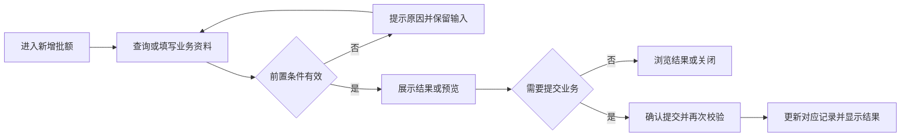
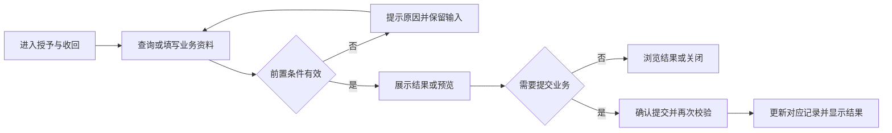
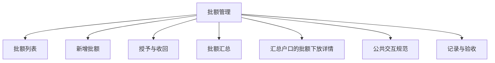

# 批额管理

## 目录

- [§1 修订追踪表](#1-修订追踪表)
- [§2 背景与目标](#2-背景与目标)
- [§3 功能清单](#3-功能清单)
- [§4 功能细节规格](#4-功能细节规格)
- [§5 功能流程图](#5-功能流程图)
- [§6 功能结构图](#6-功能结构图)
- [§7 页面设计](#7-页面设计)
- [§8 边界与异常](#8-边界与异常)
- [§9 验收清单](#9-验收清单)

## 本文件使用说明

- 本文件按单个菜单整理本轮已确认需求，供设计、开发、测试使用；不是对未讨论历史功能的全量重写。
- 需求依据：本会话用户的最终说明及截图；冲突以最后确认内容为准。
- [MOD] 参考历史基线：[既有文档](../户口管理PRD/PRD_户口管理调整_20261031.md)。历史内容与本文件冲突时，本轮调整以本文件为准。
- 配套：[PRD_批额管理_20261109_appendix](PRD_%E6%89%B9%E9%A2%9D%E7%AE%A1%E7%90%86_20261109_appendix.md)、[公共交互与展示规范](%E5%85%AC%E5%85%B1%E4%BA%A4%E4%BA%92%E4%B8%8E%E5%B1%95%E7%A4%BA%E8%A7%84%E8%8C%83.md)、[业务计算与开发交接](%E4%B8%9A%E5%8A%A1%E8%AE%A1%E7%AE%97%E4%B8%8E%E5%BC%80%E5%8F%91%E4%BA%A4%E6%8E%A5.md)。
- 开放问题见附录 A9；未确认项不得当成已验收需求。

## §1 修订追踪表

| 版本 | 日期 | 说明 |
|---|---|---|
| V1 | 2026-11-09 | 初稿，未送审 |

## §2 背景与目标

- 目标：区分不分币种的公司批额与按入股币种管理的股本批额。
- 使用者：账房操作人员、业务复核人员及获授权的管理人员。
- 范围：本菜单页面及关联弹窗；公共检索、时间控件、币种规范引用公共文档。
- 当前原型边界：独立额度模型支持新增、授予、收回及汇总；与开工签M全量联动尚未完成。

## §3 功能清单

| 页面 | 页面名称 | 变更类别 | 业务结果 |
|---|---|---|---|
| P1 | 批额列表 | [MOD] | 统一展示公司批额、股本批额、授予公司批额、授予股本批额；所有批额操作无需审核。 |
| P2 | 新增批额 | [MOD] | 一般批额统一改为公司批额，新增不选择币种。选定户口后右侧展示户口号、姓名、厅别、备注、查看和证件预览。 |
| P3 | 授予与收回 | [MOD] | 股本批额按原入股币种授予，受可用额约束；公司批额不选币种。授予占用来源可用额，签M占用受款方可用额；收回仅处理尚未使用的授予额度。 |
| P4 | 批额汇总 | [MOD] | 按户口查看四类额度、组成记录与下放时效。 |
| P5 | 汇总户口的批额下放详情 | [MOD] | 按户口查看四类额度、组成记录与下放时效。 |

## §4 功能细节规格

### 4.1 P1 批额列表

- 界面：分行或网格排列户口、四种类型、有效性及时间条件；时间筛选单独一行，避免挤压。
- 页面逻辑：统一展示公司批额、股本批额、授予公司批额、授予股本批额；所有批额操作无需审核。
- 业务处理：查询、预览不产生资金变动；只有合法提交才能产生业务记录。取消关闭不得记成功；此规则为正式交付要求，原型覆盖范围以 §2 为准。
- 正向流程：操作人进入页面，完成有效查询或填写，核对结果后执行对应操作，看到列表或记录更新。
- 异常流程：筛选时间反向时不执行；操作失败不新增记录。
- 边界：公司批额没有币种，不能因默认币种被误分类。
- 联动范围：只更新对应户口、币种及关联业务；本轮未授权跨菜单数据变更不自动扩大。

### 4.2 P2 新增批额

- 界面：左侧表单、右侧户口信息及额度；户口输入框后紧跟检索按钮。
- 页面逻辑：一般批额统一改为公司批额，新增不选择币种。选定户口后右侧展示户口号、姓名、厅别、备注、查看和证件预览。
- 业务处理：查询、预览不产生资金变动；只有合法提交才能产生业务记录。取消关闭不得记成功；此规则为正式交付要求，原型覆盖范围以 §2 为准。
- 正向流程：操作人进入页面，完成有效查询或填写，核对结果后执行对应操作，看到列表或记录更新。
- 异常流程：只输入文本但未确认有效户口时不能提交；金额必须有效。
- 边界：修改检索关键词后清除旧户口确认，防止提交到旧户口；缺少证件显示空态。
- 联动范围：只更新对应户口、币种及关联业务；本轮未授权跨菜单数据变更不自动扩大。

### 4.3 P3 授予与收回

- 界面：展示来源额度及可用额，检索选择目标户口，输入授予金额。
- 页面逻辑：股本批额按原入股币种授予，受可用额约束；公司批额不选币种。授予占用来源可用额，签M占用受款方可用额；收回仅处理尚未使用的授予额度。
- 业务处理：查询、预览不产生资金变动；只有合法提交才能产生业务记录。取消关闭不得记成功；此规则为正式交付要求，原型覆盖范围以 §2 为准。
- 正向流程：操作人进入页面，完成有效查询或填写，核对结果后执行对应操作，看到列表或记录更新。
- 异常流程：超可用、授予本人、已占用额度收回等不符合规则的操作拦截。
- 边界：当前原型只支持一层授予；到期与收回额度不能继续使用。
- 联动范围：只更新对应户口、币种及关联业务；本轮未授权跨菜单数据变更不自动扩大。

#### 授予方检索与批额类型统一

- 授予批额先输入授予方户口号并检索，回显户口名，列出该户口可授予的批额类型、币种、可授予金额及批额到期日；永久批额显示“永久”。
- 仅显示有效、未收回、可用额大于零的原始批额；已获授予的批额不能再次下放。选择一笔后填写被授予户口、金额、备注及操作验证。
- 更换授予方立即清除原批额选择；没有可用批额展示空态。提交时重新验证批额所属户口、有效状态及可用金额，不允许超额或授予自己；被授予批额沿用父批额币种与到期日。
- 批额列表将类型与来源合并，批额类型统一为公司批额、股本批额、授予公司批额、授予股本批额；移除独立来源筛选及来源列，保留授予方追溯。四种类型适用于展示、筛选与导出。
- 验收：更换授予方后不能提交旧批额；只显示该户口可授予记录；授予公司/股本批额可分别筛选，金额与到期日和父批额一致，不能二次授予。

#### 欠M与批额归属

- 户口概况“Marker”更名“欠M”，按实际借款户口与币种汇总未还本金；公司批额不分币种行的欠M显示横线，借款在对应币种行显示，避免跨币种累计。
- 点击欠M显示欠款、还款两类记录，含M单号、批额所属户口、时间、金额和说明。欠款增加借款方欠M，归还后减少借款方欠M并恢复原批额可用额度。
- 例：A公司批额100，B使用A批额借款20，A可用批额80，B欠M20；A不因提供批额被记为欠款人。B还款5后，A可用85、B欠M15（假定无其他占用）。
- 原型按实际借款户口识别欠M；开工来源未载入逐笔还款时标明累计还款，不能虚构还款时间。正式账本需同时关联批额持有人与借款人。

### 4.4 P4 批额汇总

- 批额管理提供“批额汇总”入口，可按户口号或姓名查询、重置及返回批额列表；户口号可打开对应户口详情。
- 展示户口号、户口名、币种/额度范围、股本批额、公司批额、授予股本批额、授予公司批额及可用批额，金额单位万、四位小数。
- 公司批额及授予公司批额在“不分币种”行展示；股本批额及授予股本批额按原币种逐行展示。不适用格显示横线，有效范围内无金额显示零；不跨币种合计。
- 汇总仅包含未收回且未过期的批额。授予类型指本户口从其他户口获授的额度；授予方自身的已授予占用扣减其可用批额，不把授出金额计为本户口获授。
- 四类金额均可点击查看组成明细：批额单号、授予方户口、批额、已签占用、已授予、可用额及到期日。明细金额应与点击的汇总数字一致，查看不改变额度。
- 验收覆盖同户口多笔、多币种、获授、收回、过期、零可用及查询无结果；公司批额不重复显示到各币种行，不产生跨户口或跨币种总计。

- 批额汇总四类数字点击后，采用记录列表弹窗：标题标明户口号、户口名和批额类型，顶部显示币别；列包含序号、单号、创建时间、原始批额、现有批额、操作人、确认人。现有批额沿用可用额度口径，原始批额为创建时金额，不随后续操作覆盖；缺失历史资料显示横线，不推测人员或原始金额。记录按创建时间倒序，提供关闭操作。

### 4.5 P5 汇总户口的批额下放详情

- 汇总操作列提供“详情”，按该户口及当前币种范围展示其下放批额，包括序号、单号、创建时间、被授予户口、种类、下放金额、到期日、操作人和确认人；无记录展示空态。
- 每笔未收回记录可变更时效，选择永久或限时日期并填写选填备注；保存刷新到期日和汇总。已收回记录仅查看编辑记录。
- 下放有效期不能超出父批额期限；限时日期不得早于当天，无变化不保存。父批额或下放批额被收回时阻止保存。变更期限不改变批额本金、已签占用和已授予金额。
- 编辑记录保留变更前后到期日、操作人、时间及备注，取消不生成记录；详情提供返回与关闭。正式身份验证沿用权限策略，原型操作人为演示身份。

## §5 功能流程图

### 5.1 P1 批额列表

### 5.2 P2 新增批额

### 5.3 P3 授予与收回

### 5.4 P4 批额汇总

### 5.5 P5 汇总户口的批额下放详情

## §6 功能结构图

## §7 页面设计

### 7.1 P1 批额列表

- 布局：分行或网格排列户口、四种类型、有效性及时间条件；时间筛选单独一行，避免挤压。
- 表现：采用账房管理的白底卡片、青色主操作、统一表单高度；金额与表头对齐。
- 反馈：区分未填写、无结果、校验失败、成功；不得用零值替代加载失败。

### 7.2 P2 新增批额

- 布局：左侧表单、右侧户口信息及额度；户口输入框后紧跟检索按钮。
- 表现：采用账房管理的白底卡片、青色主操作、统一表单高度；金额与表头对齐。
- 反馈：区分未填写、无结果、校验失败、成功；不得用零值替代加载失败。

### 7.3 P3 授予与收回

- 布局：展示来源额度及可用额，检索选择目标户口，输入授予金额。
- 表现：采用账房管理的白底卡片、青色主操作、统一表单高度；金额与表头对齐。
- 反馈：区分未填写、无结果、校验失败、成功；不得用零值替代加载失败。

### 7.4 P4 批额汇总

- 列表采用统一账房样式，金额与表头对齐；详情为可关闭弹窗，空记录明确提示。

### 7.5 P5 汇总户口的批额下放详情

- 列表采用统一账房样式，金额与表头对齐；详情为可关闭弹窗，空记录明确提示。

## §8 边界与异常

| 编号 | 场景及处理 |
|---|---|
| CC-01 / P1 | 公司批额没有币种，不能因默认币种被误分类。 筛选时间反向时不执行；操作失败不新增记录。 |
| CC-02 / P2 | 修改检索关键词后清除旧户口确认，防止提交到旧户口；缺少证件显示空态。 只输入文本但未确认有效户口时不能提交；金额必须有效。 |
| CC-03 / P3 | 当前原型只支持一层授予；到期与收回额度不能继续使用。 超可用、授予本人、已占用额度收回等不符合规则的操作拦截。 |

## §9 验收清单

### 9.1 功能验收

| 编号 | 页面 | 验收标准 | 状态 |
|---|---|---|---|
| AC-01 | P1 | 查询区在窄屏换行且不重叠；公司批额在无币种条件下可正确查询。 | 待验收 |
| AC-02 | P2 | 新增表单无币种选择；选择户口后右侧信息同步，查看资料不丢失填写内容。 | 待验收 |
| AC-03 | P3 | 授予后来源可用减少、目标可用增加；收回后恢复来源并使授予记录不可继续用。 | 待验收 |
| AC-04 | P4 | 汇总与组成记录一致，公司不分币种且不重复累计；变更时效保存后有前后值记录，取消不产生变更。 | 待验收 |
| AC-05 | P5 | 汇总与组成记录一致，公司不分币种且不重复累计；变更时效保存后有前后值记录，取消不产生变更。 | 待验收 |

### 9.2 非功能验收

- 详见配套附录 A4；金额、户口和操作历史必须可辨识，控件不互相遮挡。
- 带权限的正式操作必须验证执行人身份；演示密码非空检查不能作为生产权限验收。

### 9.3 异常验收

- 对 §8 每个案例验证：失败不产生新资金记录，已有业务状态不被部分修改。
- 取消、重复点击、返回后重新打开的结果与既有成功记录一致；需持久化的正式业务重载后不丢失。

### 9.4 本菜单专项验收

- 按 §2 原型边界区分“原型交互可用”与“生产账务已验收”，不得混签。
- 逐项解决附录 A9，再执行正式账务、权限和异常测试；所有适用验收项通过后才能签收。

## 下一步建议

- 业务方确认附录 A9，设计与测试按 P 编号逐页评审。

