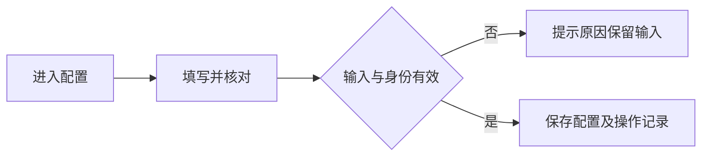
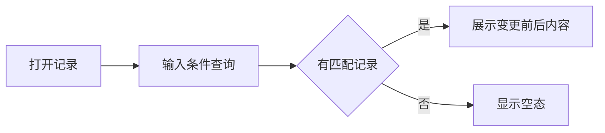
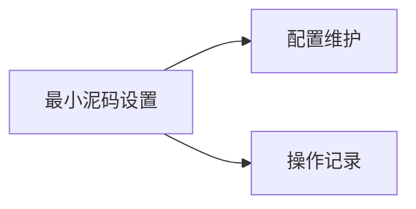

# 最小泥码设置

## 目录

- [§1 修订追踪表](#1-修订追踪表)
- [§2 背景与目标](#2-背景与目标)
- [§3 功能清单](#3-功能清单)
- [§4 功能细节规格](#4-功能细节规格)
- [§5 功能流程图](#5-功能流程图)
- [§6 功能结构图](#6-功能结构图)
- [§7 页面设计](#7-页面设计)
- [§8 边界与异常](#8-边界与异常)
- [§9 验收清单](#9-验收清单)

## §1 修订追踪表

|版本|日期|说明|
|---|---|---|
|V1|2026-11-10|初稿，未送审|

## §2 背景与目标

- 本菜单提供业务配置与可查询的操作记录，统一沿用账房样式和权限校验。

## §3 功能清单

|页面|功能|变更|
|---|---|---|
|P1|最小泥码设置配置|[NEW]|
|P2|操作记录查询|[NEW]|

## §4 功能细节规格

### 4.1 P1 配置

- 提供最小泥码与最小现码两个输入，单位万、正数、最多四位小数；不增加截图划掉的投注倍数设置。
- 出码优先泥码，低于最小泥码的尾数全部出为现码，总额保持不变，不舍入或丢弃尾数。
- 最小泥码0.05万、出码10.0005万时，泥码10.0000万、现码0.0005万。
- 当前原型设置统一应用于开工及加彩；保存前可预览，保存需操作验证并记录变更前后配置、操作人及时间。
- 最小现码保留配置，不额外推定低于最小现码必须拦截；未来确认用途后细化。已发生出码保留原有金额，不按新配置追改。

### 4.2 P2 操作记录

- 显示时间、类型、变更前后内容与操作人，支持关键词查询，无记录显示空态。
- 当前仅有配置操作记录；不虚构中转资金流水。正式记录应持久保存，并按权限访问。

## §5 功能流程图

### 5.1 P1 配置

### 5.2 P2 操作记录

## §6 功能结构图

## §7 页面设计

- 最小泥码设置归属系统设置模块，从系统设置页面进入；左侧不再设置独立菜单，点击后以弹窗操作，背景保留系统设置页面；保存或取消关闭弹窗，不跳转页面。

### 7.1 P1 配置

- 固定类型只读，输入字段与业务结果分区，金额单位明确。

### 7.2 P2 操作记录

- 查询在上、记录在下；长内容换行，关闭返回原页面。

## §8 边界与异常

- 验证失败不写入；重复点击不重复保存；未知资料不替换为其他户口。
- 待确认：按厅、币种设置的范围待确认，当前先统一配置。最小现码进一步用途尚未明确。当前接入开工和加彩；其他出码入口需确认范围。

## §9 验收清单

|编号|页面|标准|
|---|---|---|
|AC-01|P1|示例拆分为10.0000和0.0005；拆分总额相等；负数、零和超四位小数配置不能保存；取消不变更配置。|
|AC-02|P2|成功保存可查一条变更，查询可定位记录，取消不生成记录。|

- 原型会话数据尚未持久化；操作验证不能代替生产身份权限。
