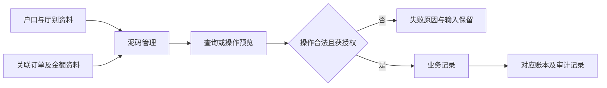

# 泥码管理配套附录

## A2 角色与使用范围

| 角色 | 范围 | 说明 |
|---|---|---|
| 账房操作人员 | 查询、填写及提交获授权操作 | 不因原型出现按钮而自动取得生产权限 |
| 确认人员 | 需要复核的操作身份确认 | 是否要求不同人员由正式权限策略确定 |
| 管理人员 | 查看数据和历史、维护获授权配置 | 数据范围遵循厅别及户口权限 |

## A3 资料流与系统串接



- 图示是正式交付目标，不代表原型已经完成真实账本串接。
- 当前边界：泥码操作仍沿用现有原型能力；业务候选检索并不代表所有候选均可发起泥码交易。
- 接口、持久化、幂等及鉴权方案由开发细化，不在本轮虚构已上线接口。

## A4 非功能性需求

- 正式资金操作需具备不可重复记账控制与全有或全无的处理机制。
- 密码及身份凭证不能进入日志、导出或客户可见信息。
- 对未授权户口的数据检索、记录访问及导出均应拦截，前端候选列表不能替代权限检查。
- 正式数据刷新后可恢复；原型内存重置已明确，不属于生产行为。
- 表格横向滚动、窄屏换行后仍可访问所有字段；合计、筛选与操作不得相互覆盖。

## A7 B端专项

### A7.1 权限原则

- 查询、导出、提交、查看历史需分别明确权限；当前截图不构成权限矩阵定稿。
- 按钮可见性、数据可见性与提交校验需保持一致。

### A7.3 业务实体关系

```mermaid
erDiagram
  Account ||--o{ BusinessRecord : belongs_to
  BusinessRecord ||--o{ OperationEvent : records
  Account {o--o{ Hall : authorized_scope
```

- 为业务关系图，不是数据库表设计。
- 一次操作可关联多笔记录；正式跨账户资金步骤须关联同一业务凭证。

## A9 待确认事项

- 非公司户泥码交易是否开放、正式银头账本及权限。
- 权限矩阵、真实账本串接、重试及历史数据迁移在正式开发阶段确认。

## A10 名词

- 户口：业务资金及额度归属对象；检索结果需以户口号消除同名歧义。
- 存卡：独立于余额的资金项，不能把两者混算。
- M单：借款及还款记录，未还金额影响相应可用额度。
- 原型：本地演示交互，不代表生产资金已发生扣转。

## A11 相关资源

- 主文档：[PRD_泥码管理_20261109](PRD_%E6%B3%A5%E7%A0%81%E7%AE%A1%E7%90%86_20261109.md)。
- 公共规范：[公共交互与展示规范](%E5%85%AC%E5%85%B1%E4%BA%A4%E4%BA%92%E4%B8%8E%E5%B1%95%E7%A4%BA%E8%A7%84%E8%8C%83.md)。
- 计算补充：[业务计算与开发交接](%E4%B8%9A%E5%8A%A1%E8%AE%A1%E7%AE%97%E4%B8%8E%E5%BC%80%E5%8F%91%E4%BA%A4%E6%8E%A5.md)。
- [发布快照](https://github.com/bala-luoluo/cashier-prototype/commit/9c67e8f330a61320ee94a8b014f891d4089fe6d6)。
