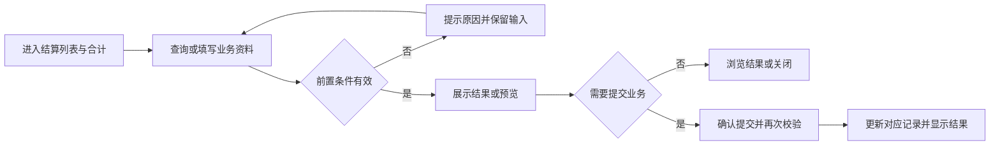
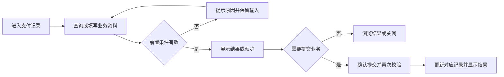
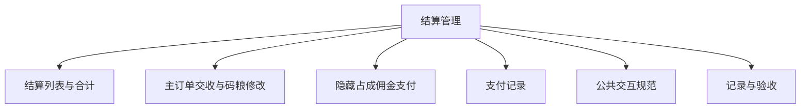

# 结算管理

## 目录

- [§1 修订追踪表](#1-修订追踪表)
- [§2 背景与目标](#2-背景与目标)
- [§3 功能清单](#3-功能清单)
- [§4 功能细节规格](#4-功能细节规格)
- [§5 功能流程图](#5-功能流程图)
- [§6 功能结构图](#6-功能结构图)
- [§7 页面设计](#7-页面设计)
- [§8 边界与异常](#8-边界与异常)
- [§9 验收清单](#9-验收清单)

## 本文件使用说明

- 本文件按单个菜单整理本轮已确认需求，供设计、开发、测试使用；不是对未讨论历史功能的全量重写。
- 需求依据：本会话用户的最终说明及截图；冲突以最后确认内容为准。
- [MOD] 参考历史基线：[既有文档](../开工管理PRD/PRD_开工管理调整_20261031.md)。历史内容与本文件冲突时，本轮调整以本文件为准。
- 配套：[PRD_结算管理_20261109_appendix](PRD_%E7%BB%93%E7%AE%97%E7%AE%A1%E7%90%86_20261109_appendix.md)、[公共交互与展示规范](%E5%85%AC%E5%85%B1%E4%BA%A4%E4%BA%92%E4%B8%8E%E5%B1%95%E7%A4%BA%E8%A7%84%E8%8C%83.md)、[业务计算与开发交接](%E4%B8%9A%E5%8A%A1%E8%AE%A1%E7%AE%97%E4%B8%8E%E5%BC%80%E5%8F%91%E4%BA%A4%E6%8E%A5.md)。
- 开放问题见附录 A9；未确认项不得当成已验收需求。

## §1 修订追踪表

| 版本 | 日期 | 说明 |
|---|---|---|
| V1 | 2026-11-09 | 初稿，未送审 |

## §2 背景与目标

- 目标：展示已收工主子订单，分项交收并支持隐藏占成佣金支付。
- 使用者：账房操作人员、业务复核人员及获授权的管理人员。
- 范围：本菜单页面及关联弹窗；公共检索、时间控件、币种规范引用公共文档。
- 当前原型边界：隐藏占成支付已生成独立演示变动及交收状态，但不扣真实公司/客户余额；普通主订单上下数、佣金及批量交收仍是入口。

## §3 功能清单

| 页面 | 页面名称 | 变更类别 | 业务结果 |
|---|---|---|---|
| P1 | 结算列表与合计 | [MOD] | 主订单保留原开工数据，子订单关联主订单。移除通用状态列，筛选增加上下数和佣金交收状态；隐藏占成列名改为占成比，增加码粮比例。 |
| P2 | 主订单交收与码粮修改 | [MOD] | 有隐藏占成时佣金仅从子订单支付；本户占成从主订单结算。取消自定义交收户口绑定。上下数结算目标为存卡转余额；佣金结算目标为开工户口余额。已交收佣金不能修改码粮比。 |
| P3 | 隐藏占成佣金支付 | [MOD] | 客户应得佣金取主订单佣金；承担金额自动计算规则待业务补充；当前仅预览三种支付方向，金额待计算，禁止确认支付。 |
| P4 | 支付记录 | [MOD] | 记录与原主订单关联，可从已交收子订单查看；历史支付结果只读回显；新支付待自动计算规则确认后接入。 |

## §4 功能细节规格

### 4.1 P1 结算列表与合计

- 界面：仅显示收工订单；隐藏占成拆为子订单，用缩进、连接线、子订单标识和浅色背景表现。
- 页面逻辑：主订单保留原开工数据，子订单关联主订单。移除通用状态列，筛选增加上下数和佣金交收状态；隐藏占成列名改为占成比，增加码粮比例。
- 业务处理：查询、预览不产生资金变动；只有合法提交才能产生业务记录。取消关闭不得记成功；此规则为正式交付要求，原型覆盖范围以 §2 为准。
- 正向流程：操作人进入页面，完成有效查询或填写，核对结果后执行对应操作，看到列表或记录更新。
- 异常流程：无收工记录显示空态；范围错误不查询。
- 边界：合计在列表下方独立区域，紧凑字号、字段金额并排，不随横向滚动隐藏；支持显示开关与子订单纳入选项。
- 联动范围：只更新对应户口、币种及关联业务；本轮未授权跨菜单数据变更不自动扩大。

### 4.2 P2 主订单交收与码粮修改

- 界面：主订单提供结算上下数、修改码粮比；仅无隐藏占成子订单时提供结算佣金；上方保留批量操作。
- 页面逻辑：有隐藏占成时佣金仅从子订单支付；本户占成从主订单结算。取消自定义交收户口绑定。上下数结算目标为存卡转余额；佣金结算目标为开工户口余额。已交收佣金不能修改码粮比。
- 业务处理：查询、预览不产生资金变动；只有合法提交才能产生业务记录。取消关闭不得记成功；此规则为正式交付要求，原型覆盖范围以 §2 为准。
- 正向流程：操作人进入页面，完成有效查询或填写，核对结果后执行对应操作，看到列表或记录更新。
- 异常流程：未选择或所选项目均已交收时提示；未明确真实资金口径时不得假装完成入账。
- 边界：普通主订单交收目前仍为操作入口；与隐藏占成支付的可执行演示逻辑区分。
- 联动范围：只更新对应户口、币种及关联业务；本轮未授权跨菜单数据变更不自动扩大。

#### 隐藏占成子订单修改码粮比

- 隐藏占成待交收子订单操作栏同时保留五个操作：“修改码粮比”“结算佣金”“公司全额垫付”“代理全额垫付”“各自支付”。新增结算佣金不得替换或移除原有操作。
- 弹窗回显当前子订单比例，允许0至100%，最多四位小数；保存仅修改该子订单并按其转码重算佣金交收及合计，不修改主订单或其他子订单。
- 佣金已交收的子订单不可修改；提交时再次检查交收状态。取消、校验失败不改变数据；承担金额自动规则尚未确定，不直接把子订单佣金作为代理承担。

- 隐藏占成的佣金结算仅在子订单通过结算佣金或三种支付方式入口办理，主订单不重复显示结算佣金；本户占成仅主订单，佣金入口位于主订单操作栏。判定依据完整订单关系，不因筛选隐藏子订单而恢复主订单佣金按钮。
- 批量佣金选择包含隐藏占成主单或子单时提示从子订单支付入口办理，不绕过分配预览、不重复结算；其他已确认的待计算限制继续生效。

### 4.3 P3 隐藏占成佣金支付

- “结算佣金”打开统一佣金分配预览弹窗，初始选中公司全额垫付，允许切换支付方式；三种支付快捷按钮打开同一弹窗并选中对应方式。打开弹窗不直接付款，也不生成另一笔佣金。
- 各入口使用同一订单交收状态及支付记录；已交收后显示查看支付记录，不允许重复结算。承担金额计算规则未确认前，所有入口均只预览，确认支付不可用。

- 界面：仅隐藏占成子订单同时展示结算佣金、公司全额垫付、代理全额垫付、各自支付，并保留修改码粮比；弹窗只读展示承担金额及划款步骤，不提供金额输入。
- 页面逻辑：客户应得佣金取主订单佣金；承担金额自动计算规则待业务补充；当前仅预览三种支付方向，金额待计算，禁止确认支付。
- 业务处理：查询、预览不产生资金变动；只有合法提交才能产生业务记录。取消关闭不得记成功；此规则为正式交付要求，原型覆盖范围以 §2 为准。
- 正向流程：操作人进入页面，完成有效查询或填写，核对结果后执行对应操作，看到列表或记录更新。
- 异常流程：自动金额未确定、为负或超过客户佣金时禁止提交；已交收不能重复支付。
- 边界：零承担不生成零额划款；多代理当前演示会统一处理主订单佣金，需按待确认规则自动分配各代理金额，不重复付客户。上下数状态不随佣金支付改变。
- 联动范围：只更新对应户口、币种及关联业务；本轮未授权跨菜单数据变更不自动扩大。

#### 佣金分配自动预览（当前规则）

- 三种隐藏占成支付入口不再要求输入代理或公司承担金额，展示只读分配结果；切换方式立即展示付款户口、收款户口、金额、步骤说明及最终净变动。
- 公司垫付：公司先付客户全部佣金，代理向公司支付各自承担部分。代理垫付：代理先付全部佣金，公司向代理支付自身承担部分。各自支付：公司和代理分别向客户支付自身承担部分。
- 承担金额自动计算公式由业务补充，明确不能直接采用隐藏占成子订单佣金作为代理承担金额。此前手动输入代理承担金额的规则停用。
- 公式确认前，客户应得佣金沿用订单已知值，公司和代理承担显示“待计算”；仅提供走向预览，确认支付禁用，不生成支付记录、不改变交收状态。公式确认后再接入自动计算与支付校验。

### 4.4 P4 支付记录

- 界面：记录方式、时间、币种、客户、公司、代理和逐步金额，并展示最终净变动。
- 页面逻辑：记录与原主订单关联，可从已交收子订单查看；历史支付结果只读回显；新支付待自动计算规则确认后接入。
- 业务处理：查询、预览不产生资金变动；只有合法提交才能产生业务记录。取消关闭不得记成功；此规则为正式交付要求，原型覆盖范围以 §2 为准。
- 正向流程：操作人进入页面，完成有效查询或填写，核对结果后执行对应操作，看到列表或记录更新。
- 异常流程：记录不存在时不得显示伪造成功信息。
- 边界：刷新会清除当前演示支付记录；上线必须持久化。
- 联动范围：只更新对应户口、币种及关联业务；本轮未授权跨菜单数据变更不自动扩大。

## §5 功能流程图

### 5.1 P1 结算列表与合计

### 5.2 P2 主订单交收与码粮修改

### 5.3 P3 隐藏占成佣金支付

### 5.4 P4 支付记录

## §6 功能结构图

## §7 页面设计

### 7.1 P1 结算列表与合计

- 布局：仅显示收工订单；隐藏占成拆为子订单，用缩进、连接线、子订单标识和浅色背景表现。
- 表现：采用账房管理的白底卡片、青色主操作、统一表单高度；金额与表头对齐。
- 反馈：区分未填写、无结果、校验失败、成功；不得用零值替代加载失败。

### 7.2 P2 主订单交收与码粮修改

- 布局：主订单提供结算上下数、修改码粮比；仅无隐藏占成子订单时提供结算佣金；上方保留批量操作。
- 表现：采用账房管理的白底卡片、青色主操作、统一表单高度；金额与表头对齐。
- 反馈：区分未填写、无结果、校验失败、成功；不得用零值替代加载失败。

### 7.3 P3 隐藏占成佣金支付

- 布局：仅隐藏占成子订单同时展示结算佣金、公司全额垫付、代理全额垫付、各自支付，并保留修改码粮比；弹窗只读展示承担金额及划款步骤，不提供金额输入。
- 表现：采用账房管理的白底卡片、青色主操作、统一表单高度；金额与表头对齐。
- 反馈：区分未填写、无结果、校验失败、成功；不得用零值替代加载失败。

### 7.4 P4 支付记录

- 布局：记录方式、时间、币种、客户、公司、代理和逐步金额，并展示最终净变动。
- 表现：采用账房管理的白底卡片、青色主操作、统一表单高度；金额与表头对齐。
- 反馈：区分未填写、无结果、校验失败、成功；不得用零值替代加载失败。

## §8 边界与异常

| 编号 | 场景及处理 |
|---|---|
| CC-01 / P1 | 合计在列表下方独立区域，紧凑字号、字段金额并排，不随横向滚动隐藏；支持显示开关与子订单纳入选项。 无收工记录显示空态；范围错误不查询。 |
| CC-02 / P2 | 普通主订单交收目前仍为操作入口；与隐藏占成支付的可执行演示逻辑区分。 未选择或所选项目均已交收时提示；未明确真实资金口径时不得假装完成入账。 |
| CC-03 / P3 | 零承担不生成零额划款；多代理当前演示会统一处理主订单佣金，需按待确认规则自动分配各代理金额，不重复付客户。上下数状态不随佣金支付改变。 自动金额未确定、为负或超过客户佣金时禁止提交；已交收不能重复支付。 |
| CC-04 / P4 | 刷新会清除当前演示支付记录；上线必须持久化。 记录不存在时不得显示伪造成功信息。 |

## §9 验收清单

### 9.1 功能验收

| 编号 | 页面 | 验收标准 | 状态 |
|---|---|---|---|
| AC-01 | P1 | 未收工单不出现；主订单数值不因拆子单而减少；合计字段无需横向滚动即可看到。 | 待验收 |
| AC-02 | P2 | 有隐藏占成时主订单无结算佣金，只有上下数结算和码粮修改；本户占成无子订单时主订单保留结算佣金；隐藏占成待交收子订单同时显示修改码粮比、结算佣金、公司全额垫付、代理全额垫付、各自支付五个操作，不提供普通上下数结算；未实现资金流转不能变为虚假成功。 | 待验收 |
| AC-03 | P3 | 无金额输入；三种方式按确认的方向展示，未知金额显示待计算且支付禁用；未来自动计算接入后三种方式最终净变动一致。 | 待验收 |
| AC-04 | P4 | 完成后可查看相同划款明细；子订单状态与记录一致。 | 待验收 |
| AC-05 | P2/P3 | 筛选隐藏子订单后主订单仍无佣金按钮；批量选择隐藏占成订单提示从子订单办理且不改变状态；本户占成主订单有佣金入口。 | 待验收 |

### 9.2 非功能验收

- 详见配套附录 A4；金额、户口和操作历史必须可辨识，控件不互相遮挡。
- 带权限的正式操作必须验证执行人身份；演示密码非空检查不能作为生产权限验收。

### 9.3 异常验收

- 对 §8 每个案例验证：失败不产生新资金记录，已有业务状态不被部分修改。
- 取消、重复点击、返回后重新打开的结果与既有成功记录一致；需持久化的正式业务重载后不丢失。

### 9.4 本菜单专项验收

- 按 §2 原型边界区分“原型交互可用”与“生产账务已验收”，不得混签。
- 逐项解决附录 A9，再执行正式账务、权限和异常测试；所有适用验收项通过后才能签收。

## 下一步建议

- 业务方确认附录 A9，设计与测试按 P 编号逐页评审。

