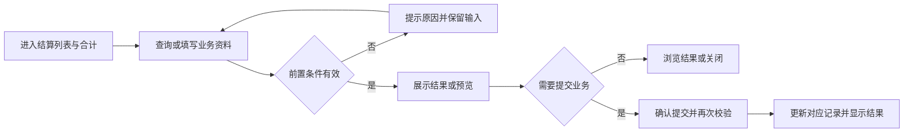
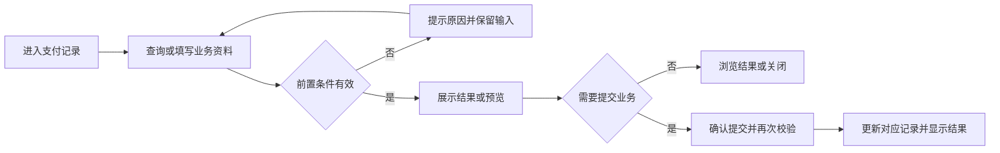
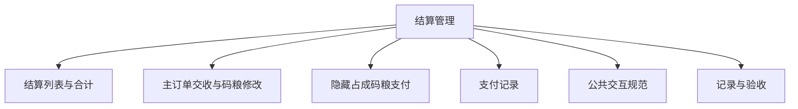

# 结算管理

## 目录

- [§1 修订追踪表](#1-修订追踪表)
- [§2 背景与目标](#2-背景与目标)
- [§3 功能清单](#3-功能清单)
- [§4 功能细节规格](#4-功能细节规格)
- [§5 功能流程图](#5-功能流程图)
- [§6 功能结构图](#6-功能结构图)
- [§7 页面设计](#7-页面设计)
- [§8 边界与异常](#8-边界与异常)
- [§9 验收清单](#9-验收清单)

## 本文件使用说明

- 本文件按单个菜单整理本轮已确认需求，供设计、开发、测试使用；不是对未讨论历史功能的全量重写。
- 需求依据：本会话用户的最终说明及截图；冲突以最后确认内容为准。
- [MOD] 参考历史基线：[既有文档](../开工管理PRD/PRD_开工管理调整_20261031.md)。历史内容与本文件冲突时，本轮调整以本文件为准。
- 配套：[PRD_结算管理_20261109_appendix](PRD_%E7%BB%93%E7%AE%97%E7%AE%A1%E7%90%86_20261109_appendix.md)、[公共交互与展示规范](%E5%85%AC%E5%85%B1%E4%BA%A4%E4%BA%92%E4%B8%8E%E5%B1%95%E7%A4%BA%E8%A7%84%E8%8C%83.md)、[业务计算与开发交接](%E4%B8%9A%E5%8A%A1%E8%AE%A1%E7%AE%97%E4%B8%8E%E5%BC%80%E5%8F%91%E4%BA%A4%E6%8E%A5.md)。
- 开放问题见附录 A9；未确认项不得当成已验收需求。

## §1 修订追踪表

| 版本 | 日期 | 说明 |
|---|---|---|
| V1 | 2026-11-09 | 初稿，未送审 |

## §2 背景与目标

- 目标：展示已收工主子订单，分项交收并支持隐藏占成码粮支付。
- 使用者：账房操作人员、业务复核人员及获授权的管理人员。
- 范围：本菜单页面及关联弹窗；公共检索、时间控件、币种规范引用公共文档。
- 当前原型边界：隐藏占成支付已生成独立演示变动及交收状态，但不扣真实公司/客户余额；普通主订单上下数、码粮及批量交收仍是入口。

## §3 功能清单

| 页面 | 页面名称 | 变更类别 | 业务结果 |
|---|---|---|---|
| P1 | 结算列表与合计 | [MOD] | 主订单保留原开工数据，子订单关联主订单。移除通用状态列，筛选增加上下数和码粮交收状态；隐藏占成列名改为占成比，增加码粮比例。 |
| P2 | 主订单交收与码粮修改 | [MOD] | 有隐藏占成时码粮仅从子订单支付；本户占成从主订单结算。取消自定义交收户口绑定。上下数结算目标为存卡转余额；码粮结算目标为开工户口余额。已交收码粮不能修改码粮比。 |
| P3 | 隐藏占成码粮支付 | [MOD] | 客户应得码粮取主订单码粮；承担金额自动计算规则待业务补充；当前仅预览三种支付方向，金额待计算，禁止确认支付。 |
| P4 | 支付记录 | [MOD] | 记录与原主订单关联，可从已交收子订单查看；历史支付结果只读回显；垫付款保留原付款及独立还款记录。 |

## §4 功能细节规格

### 4.1 P1 结算列表与合计

- 界面：仅显示收工订单；隐藏占成拆为子订单，用缩进、连接线、子订单标识和浅色背景表现。
- 页面逻辑：主订单保留原开工数据，子订单关联主订单。移除通用状态列，筛选增加上下数和码粮交收状态；隐藏占成列名改为占成比，增加码粮比例。
- 业务处理：查询、预览不产生资金变动；只有合法提交才能产生业务记录。取消关闭不得记成功；此规则为正式交付要求，原型覆盖范围以 §2 为准。
- 正向流程：操作人进入页面，完成有效查询或填写，核对结果后执行对应操作，看到列表或记录更新。
- 异常流程：无收工记录显示空态；范围错误不查询。
- 边界：合计在列表下方独立区域，紧凑字号、字段金额并排，不随横向滚动隐藏；支持显示开关与子订单纳入选项。
- 联动范围：只更新对应户口、币种及关联业务；本轮未授权跨菜单数据变更不自动扩大。

### 4.2 P2 主订单交收与码粮修改

- 界面：主订单提供结算上下数、修改码粮比；仅无隐藏占成子订单时提供结算码粮；上方保留批量操作。
- 页面逻辑：有隐藏占成时码粮仅从子订单支付；本户占成从主订单结算。取消自定义交收户口绑定。上下数结算目标为存卡转余额；码粮结算目标为开工户口余额。已交收码粮不能修改码粮比。
- 业务处理：查询、预览不产生资金变动；只有合法提交才能产生业务记录。取消关闭不得记成功；此规则为正式交付要求，原型覆盖范围以 §2 为准。
- 正向流程：操作人进入页面，完成有效查询或填写，核对结果后执行对应操作，看到列表或记录更新。
- 异常流程：未选择或所选项目均已交收时提示；未明确真实资金口径时不得假装完成入账。
- 边界：普通主订单交收目前仍为操作入口；与隐藏占成支付的可执行演示逻辑区分。
- 联动范围：只更新对应户口、币种及关联业务；本轮未授权跨菜单数据变更不自动扩大。

#### 隐藏占成子订单修改码粮比

- 隐藏占成待交收子订单操作栏同时保留五个操作：“修改码粮比”“结算码粮”“公司全额垫付”“代理全额垫付”“各自支付”。新增结算码粮不得替换或移除原有操作。
- 弹窗回显当前子订单比例，允许0至100%，最多四位小数；保存仅修改该子订单并按其转码重算码粮交收及合计，不修改主订单或其他子订单。
- 码粮已交收的子订单不可修改；提交时再次检查交收状态。取消、校验失败不改变数据；承担金额自动规则尚未确定，不直接把子订单码粮作为代理承担。

- 隐藏占成的码粮结算仅在子订单通过结算码粮或三种支付方式入口办理，主订单不重复显示结算码粮；本户占成仅主订单，码粮入口位于主订单操作栏。判定依据完整订单关系，不因筛选隐藏子订单而恢复主订单码粮按钮。
- 批量码粮选择包含隐藏占成主单或子单时提示从子订单支付入口办理，不绕过分配预览、不重复结算；其他已确认的待计算限制继续生效。

### 4.3 P3 隐藏占成码粮支付

以《客户帐户记账规则对照表 (3).xlsx》“记账规则”A28:P33及A39:A45为准；金额单位为万。

- 客户应得码粮＝转码量×台面码粮比例；代理承担＝转码量×隐藏子单码粮比例；公司承担＝客户码粮−代理承担合计。承担额自动只读，负数或超过客户码粮时禁止执行。
- 公司全额垫付：码量中转户扣全部码粮、客户加全部码粮；代理承担额生成“代理欠公司”的未还欠款，当下不扣代理余额。
- 代理全额垫付：代理扣全部码粮、客户加全部码粮；公司承担额生成“公司欠代理”的未还欠款，当下不从公司付回代理。
- 各自支付：代理扣其承担额、码量中转户扣公司承担额、客户加全部码粮，不生成欠款。
- 每种方式都先预览。扣代理款项时核对当前可用余额、本次扣款、扣款后余额；余额不足不得扣成负数。提交重新校验并防重复。成功后同步户口、状态、流水及结算记录。
- 多代理公司垫付／各自支付按提案统一计算，客户只收一次；代理全额垫付当前仅开放单隐藏代理提案，多代理提示核对垫付户口，不能任取一人扣全款。
- 码粮结算与占成交收状态独立；客户对外文案不显示代理占成或码粮承担。内部操作员仍可核对主子单。

### 4.4 P4 支付记录

- 界面：记录方式、时间、币种、客户、公司、代理和逐步金额，并展示最终净变动。
- 页面逻辑：记录与原主订单关联，可从已交收子订单查看；历史支付结果只读回显；垫付款保留原付款及独立还款记录。
- 业务处理：查询、预览不产生资金变动；只有合法提交才能产生业务记录。取消关闭不得记成功；此规则为正式交付要求，原型覆盖范围以 §2 为准。
- 正向流程：操作人进入页面，完成有效查询或填写，核对结果后执行对应操作，看到列表或记录更新。
- 异常流程：记录不存在时不得显示伪造成功信息。
- 边界：原型在当前浏览器本地保存，刷新后恢复支付、未还／已还状态及还款日期；不同浏览器不共享。
- 联动范围：只更新对应户口、币种及关联业务；本轮未授权跨菜单数据变更不自动扩大。

## §5 功能流程图

### 5.1 P1 结算列表与合计

### 5.2 P2 主订单交收与码粮修改

### 5.3 P3 隐藏占成码粮支付

### 5.4 P4 支付记录

## §6 功能结构图

## §7 页面设计

### 7.1 P1 结算列表与合计

- 布局：仅显示收工订单；隐藏占成拆为子订单，用缩进、连接线、子订单标识和浅色背景表现。
- 表现：采用账房管理的白底卡片、青色主操作、统一表单高度；金额与表头对齐。
- 反馈：区分未填写、无结果、校验失败、成功；不得用零值替代加载失败。

### 7.2 P2 主订单交收与码粮修改

- 布局：主订单提供结算上下数、修改码粮比；仅无隐藏占成子订单时提供结算码粮；上方保留批量操作。
- 表现：采用账房管理的白底卡片、青色主操作、统一表单高度；金额与表头对齐。
- 反馈：区分未填写、无结果、校验失败、成功；不得用零值替代加载失败。

### 7.3 P3 隐藏占成码粮支付

- 布局：仅隐藏占成子订单同时展示结算码粮、公司全额垫付、代理全额垫付、各自支付，并保留修改码粮比；弹窗只读展示承担金额及划款步骤，不提供金额输入。
- 表现：采用账房管理的白底卡片、青色主操作、统一表单高度；金额与表头对齐。
- 反馈：区分未填写、无结果、校验失败、成功；不得用零值替代加载失败。

### 7.4 P4 支付记录

- 布局：记录方式、时间、币种、客户、公司、代理和逐步金额，并展示最终净变动。
- 表现：采用账房管理的白底卡片、青色主操作、统一表单高度；金额与表头对齐。
- 反馈：区分未填写、无结果、校验失败、成功；不得用零值替代加载失败。

## §8 边界与异常

| 编号 | 场景及处理 |
|---|---|
| CC-01 / P1 | 合计在列表下方独立区域，紧凑字号、字段金额并排，不随横向滚动隐藏；支持显示开关与子订单纳入选项。 无收工记录显示空态；范围错误不查询。 |
| CC-02 / P2 | 普通主订单交收目前仍为操作入口；与隐藏占成支付的可执行演示逻辑区分。 未选择或所选项目均已交收时提示；未明确真实资金口径时不得假装完成入账。 |
| CC-03 / P3 | 零承担不生成零额划款；多代理当前演示会统一处理主订单码粮，需按待确认规则自动分配各代理金额，不重复付客户。上下数状态不随码粮支付改变。 自动金额未确定、为负或超过客户码粮时禁止提交；已交收不能重复支付。 |
| CC-04 / P4 | 原型在当前浏览器本地保存，刷新后恢复支付、未还／已还状态及还款日期；不同浏览器不共享。 记录不存在时不得显示伪造成功信息。 |

## §9 验收清单

### 9.1 功能验收

| 编号 | 页面 | 验收标准 | 状态 |
|---|---|---|---|
| AC-01 | P1 | 未收工单不出现；主订单数值不因拆子单而减少；合计字段无需横向滚动即可看到。 | 待验收 |
| AC-02 | P2 | 有隐藏占成时主订单无结算码粮，只有上下数结算和码粮修改；本户占成无子订单时主订单保留结算码粮；隐藏占成待交收子订单同时显示修改码粮比、结算码粮、公司全额垫付、代理全额垫付、各自支付五个操作，不提供普通上下数结算；未实现资金流转不能变为虚假成功。 | 待验收 |
| AC-03 | P3 | 无金额输入；三种方式按确认的方向展示，未知金额显示待计算且支付禁用；未来自动计算接入后三种方式最终净变动一致。 | 待验收 |
| AC-04 | P4 | 完成后可查看相同划款明细；子订单状态与记录一致。 | 待验收 |
| AC-05 | P2/P3 | 筛选隐藏子订单后主订单仍无码粮按钮；批量选择隐藏占成订单提示从子订单办理且不改变状态；本户占成主订单有码粮入口。 | 待验收 |

### 9.2 非功能验收

- 详见配套附录 A4；金额、户口和操作历史必须可辨识，控件不互相遮挡。
- 带权限的正式操作必须验证执行人身份；演示密码非空检查不能作为生产权限验收。

### 9.3 异常验收

- 对 §8 每个案例验证：失败不产生新资金记录，已有业务状态不被部分修改。
- 取消、重复点击、返回后重新打开的结果与既有成功记录一致；需持久化的正式业务重载后不丢失。

### 9.4 本菜单专项验收

- 按 §2 原型边界区分“原型交互可用”与“生产账务已验收”，不得混签。
- 逐项解决附录 A9，再执行正式账务、权限和异常测试；所有适用验收项通过后才能签收。

## 下一步建议

- 业务方确认附录 A9，设计与测试按 P 编号逐页评审。

## 收工结算资金流水补充（2026-11-13）

收工结算采用[资金流水变动对照](资金流水变动对照_20261112.md)“收工结算资金变动”中的CL-01～CL-07：覆盖A数和本户B数客上／客下、M本金及混合本金。分别记录客户余额、柜台现金、欠M、可用批额、泥码、现码、码量派发和占成交收；先回M，再分配，已发生的开工及中途流水不得在收工重复记账。截图分录与说明冲突按CL-Q01～CL-Q05保留标注，不能据此写死错误金额方向或户口绑定。本次仅更新需求文档。

## §10 预计交收展示范围更正

- 结算管理列表恢复原字段、原合计及原操作，不增加“预计未交收”列或额外预计总计。
- 最新要求已隐藏取款、转账弹窗中的逐提案预计表及总计；结算管理列表继续保持原状。

## 现金与余额、可编辑回M（最新规则）

- 移除所有面向用户的存卡入口、输入项及独立列表列。普通资金项仅保留现金和余额；M借款、换汇资金及泥码／现码仍保留各自业务含义，不作为第三个存款钱包。
- 新开工、加彩使用现金或户口余额；换汇从对应币种余额扣款；暂存新入账进入余额，恢复开工扣相应余额。收工剩余金额默认存入余额，也可分配现金。
- M开工收工：客上默认回本场尚未归还的M本金，客下默认用收工可用金额回M，且不得超过本场未还M；已中途归还的部分不重复还。
- 本次回M可手动编辑，支持0；不得为负、超过未还M或超过收工可用金额。更改回M后即时更新剩余欠M与可分配金额，并重算默认余额分配；现金与余额之和必须等于可分配金额。
- 示例：M本金100、客上50，收工可用150，默认回M100，可分配50；改为回M90，可分配60、尚欠M10。客下40，可用60，默认回M60、可分配0、尚欠M40。
- 成功收工只归还输入金额并恢复对应签额额度；余额入账与现金支出分别记录。非法金额、分配不符或重复提交不得产生部分或重复入账。
- 验收：默认100→50、修改90→60、客下60→0、回M0、超限和负数拒绝、部分中途回M、多M单顺序分配均需通过；刷新后可恢复实际回M、剩余欠M及收工分配记录。
- 本节替代旧版“默认存卡”“存卡交收转余额”及“不可调整自动还M”的表述。已有历史存卡数据保留用于核对，不自动增加或删除客户现有余额；历史资金迁移需另行核对，不能仅改显示名称就视为已入余额。

## 结算管理页面布局调整（截图版）

- 顶部增加订单结算、码粮垫付、结算记录页签；数量取当前数据；顶部代理余额卡片隐藏，不显示DEMO-H01／DEMO-H02代理余额。
- 筛选区为户口号／户名／提案ID、币种、占成交收状态、码粮交收状态；另列类型快捷筛选和时间快捷筛选（含全部）、搜索及重置。
- 列表上方提供待结算／已结算／全部切换、按结算户口分组、勾选主单连同子单及合计包含隐藏占成子单选项。
- 批量操作区显示已选主单及子单笔数：占成交收、一般码粮结算、隐藏子单公司全额垫付／代理全额垫付／各自支付；无适用记录时禁用对应按钮。行内保留修改码粮比入口，支付操作移入选中操作区。
- 隐藏子单缩进展示主提案ID及代理户口；按所属主单A数／B数显示A面B底／B面B底类型。查询及分组不改变实际结算归属或计算。
- 底部原有合计结构与计算保持不变：按币种显示笔数、上下数交收合计、码粮交收合计、合计交收，是否包含隐藏子单仍由原选项控制。
- 交收与支付按本文件4.3及最新表格规则执行；页签只展示已存在的记录。
- 验收：筛选及空态、主子单联动、多户口分组、选择计数与按钮禁用、原支付预览入口和底部合计均可正常使用；样本HKD原合计-1.2000保持一致。

## 批量交收弹窗（最新截图及确认规则）

- 四种弹窗：批量占成交收、公司全额垫付、码粮各自支付、一般码粮结算。统一展示提案ID、结算户口、金额（万）、代理余额前后、户口变动、结果；币种随提案显示，跨币种不混算。
- 保留全部勾选记录逐条预览，结果分可执行、跳过（无需交收／已交收／类型不适用）及余额不足。底部显示可执行与跳过笔数、不可撤销提示、取消及确认结算按钮。无可执行记录时禁用确认。
- 占成交收：A数上下数收工已入余额，跳过；B数主单按上下数乘占成比例反向交收，隐藏子单按其占成交收金额入扣对应户口，占成派发户口记相反数。负数扣款须满足可用余额。
- 已确认代理承担码粮公式：转码金额 × 隐藏占成子单码粮比例；公司承担客户总码粮减去代理承担合计。代理合计大于客户应得码粮时不执行，提示检查比例。
- 公司全额垫付：码量派发户口扣客户全部码粮，客户余额增加全部码粮；代理承担部分记入垫付欠款（代理欠公司），不即时扣代理余额。
- 各自支付：代理扣各自承担额，公司码量派发户口扣剩余承担额，客户增加全部码粮；代理余额不足则跳过该提案，不部分扣款。
- 一般码粮结算：仅无隐藏占成的A数／B数主单适用，客户增加码粮，码量派发户口记相反数。
- 多代理同提案须全部勾选，统一计算、只支付客户一次；同户口同币种多条按预览顺序累计校验余额。冻结金额不计可用余额。中转户口未绑定或户口不存在时提示且不执行。
- 提交时重新校验整批余额、金额及交收状态；变化时要求重新预览。成功后同步余额、交收状态、资金流水及结算记录，浏览器本地保存；重复提交不得重复入扣账。
- 本节替代上述“只预览、承担规则待确认”的限制，适用于本次四种弹窗；代理全额垫付已按最新Excel第三部分接入欠款与还款流程。底部合计与顶部代理余额卡片隐藏规则不变。

## 第三部分收工结算规则同步（2026-11-13）

来源：《客户帐户记账规则对照表 (3).xlsx》“记账规则”A28:P33、A39:A45，以及“码粮垫付列表”Q27:S59。仅按本次指定第三部分修订隐藏占成，不用表中第一部分覆盖此前已确认的入退股规则。

- 隐藏占成默认月结，可在新开工每个隐藏户口设置即结。月结收工进入订单待结，不立即动代理与占成中转户；实际交收按上下数×占成比例反向记代理，另一方记占成中转户。即结收工触发同一套校验，失败保留待结并说明原因。
- 码粮独立选择即结或月结；本场隐藏码粮支付方式三选一。即结收工执行对应方式，月结留待结算管理处理。不会因为隐藏代理收到占成而自动归还客户M。
- 码粮垫付列表按开工客户、隐藏代理及未还／已还筛选，按币种和欠款方向分别汇总未还额；显示原提案、方式、欠款额、状态和还款日期。
- 代理欠公司还款：代理余额减少、原码量中转户增加；公司欠代理还款：原码量中转户减少、代理余额增加。还款使用原债权债务户口，不随之后重新绑定中转户而改变。
- 代理还款余额不足继续挂账，不更新已还状态；成功还款写日期和独立流水。再次还款和预览后余额变动均拦截。
- 收工回收泥码、现码分别按实际离台输入入账，不能用回M金额替代泥码回收。客户M本金100、客下70、离台30时默认回M30、仍欠70；代理月结占成+35属于代理，不抵客户M。

| 表格案例 | 客户 | 代理 | 码量中转 | 欠款 |
|---|---|---|---|---|
| A30 公司垫付，转码100、台面1.6%、代理1% | +1.6 | 当下0 | -1.6 | 代理欠公司1；还款时代理-1、中转+1 |
| A31 代理垫付 | +1.6 | -1.6 | 当下0 | 公司欠代理0.6；还款时中转-0.6、代理+0.6 |
| A32 各自支付 | +1.6 | -1 | -0.6 | 无 |
| A33 客下M，各自支付，转码140 | +2.24 | 码粮-1.4；占成另于月结+35 | -0.84 | 无 |

A29客上100、隐藏占成50%：月结代理-50、占成中转+50。以用户最新确认为准：收工转码量＝已累计转码量－离台泥码。本金100＋中途转码50、离台泥码10，转码量为140；本金100、中途无转码、离台泥码100、现码100，转码量为0，码粮为0，客户收工入余额200。现码不额外计入转码量。上述A30～A32的1.6／1／0.6码粮分担示例以实际转码量100为前提，不能套用到这个无中途转码案例。通用公式保持不变，不补造中途转码记录。

### 2026-11-17 [MOD] 联动与计算口径更新

- B数主订单及隐藏占成子订单操作栏增加“修改占成比”；允许0至100%，最多四位小数。
- 保存占成比后重新计算本笔占成交收及合计，码粮比例保持不变；已完成占成交收的订单禁止修改，提交时再次检查状态。
- 本地演示提供3H-EXAMPLE-001主订单及关联DEMO-H01隐藏占成子订单。本金12万HKD（出码10万、加彩2万）；示例不自动改变账户余额，重载不重复添加。
- 公司全额垫付、代理全额垫付、各自支付及批量占成交收弹窗显示实际绑定的派发户口；演示默认DEMO003，保留已有绑定。
- 验收：修改主单或子单占成比后，列表、合计及确认交收金额一致；占成已交收、比例为空、负数或超过100%时拒绝。
