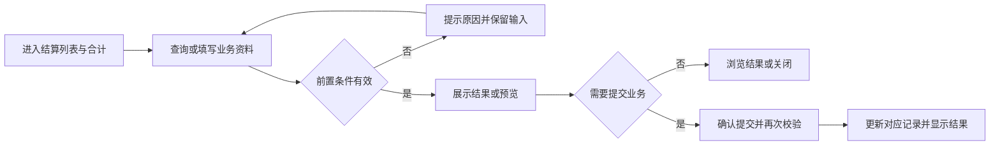
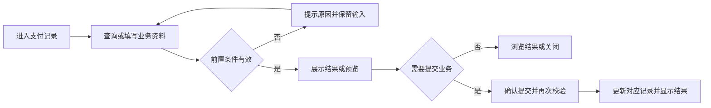
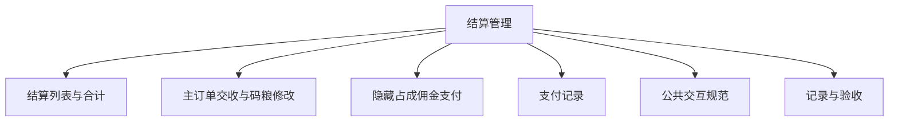

# 结算管理

## 目录

- [§1 修订追踪表](#1-修订追踪表)
- [§2 背景与目标](#2-背景与目标)
- [§3 功能清单](#3-功能清单)
- [§4 功能细节规格](#4-功能细节规格)
- [§5 功能流程图](#5-功能流程图)
- [§6 功能结构图](#6-功能结构图)
- [§7 页面设计](#7-页面设计)
- [§8 边界与异常](#8-边界与异常)
- [§9 验收清单](#9-验收清单)

## 本文件使用说明

- 本文件按单个菜单整理本轮已确认需求，供设计、开发、测试使用；不是对未讨论历史功能的全量重写。
- 需求依据：本会话用户的最终说明及截图；冲突以最后确认内容为准。
- [MOD] 参考历史基线：[既有文档](../开工管理PRD/PRD_开工管理调整_20261031.md)。历史内容与本文件冲突时，本轮调整以本文件为准。
- 配套：[PRD_结算管理_20261109_appendix](PRD_%E7%BB%93%E7%AE%97%E7%AE%A1%E7%90%86_20261109_appendix.md)、[公共交互与展示规范](%E5%85%AC%E5%85%B1%E4%BA%A4%E4%BA%92%E4%B8%8E%E5%B1%95%E7%A4%BA%E8%A7%84%E8%8C%83.md)、[业务计算与开发交接](%E4%B8%9A%E5%8A%A1%E8%AE%A1%E7%AE%97%E4%B8%8E%E5%BC%80%E5%8F%91%E4%BA%A4%E6%8E%A5.md)。
- 开放问题见附录 A9；未确认项不得当成已验收需求。

## §1 修订追踪表

| 版本 | 日期 | 说明 |
|---|---|---|
| V1 | 2026-11-09 | 初稿，未送审 |

## §2 背景与目标

- 目标：展示已收工主子订单，分项交收并支持隐藏占成佣金支付。
- 使用者：账房操作人员、业务复核人员及获授权的管理人员。
- 范围：本菜单页面及关联弹窗；公共检索、时间控件、币种规范引用公共文档。
- 当前原型边界：隐藏占成支付已生成独立演示变动及交收状态，但不扣真实公司/客户余额；普通主订单上下数、佣金及批量交收仍是入口。

## §3 功能清单

| 页面 | 页面名称 | 变更类别 | 业务结果 |
|---|---|---|---|
| P1 | 结算列表与合计 | [MOD] | 主订单保留原开工数据，子订单关联主订单。移除通用状态列，筛选增加上下数和佣金交收状态；隐藏占成列名改为占成比，增加码粮比例。 |
| P2 | 主订单交收与码粮修改 | [MOD] | 取消自定义交收户口绑定。上下数结算目标为存卡转余额；佣金结算目标为开工户口余额。已交收佣金不能修改码粮比。 |
| P3 | 隐藏占成佣金支付 | [MOD] | 客户应得佣金取主订单佣金；代理承担先手填，公司承担自动计算。确认后记录两端变动并将该场次佣金交收更新，支付按钮改为查看支付记录。 |
| P4 | 支付记录 | [MOD] | 记录与原主订单关联，可从已交收子订单查看；手填承担额回显到子订单佣金交收金额。 |

## §4 功能细节规格

### 4.1 P1 结算列表与合计

- 界面：仅显示收工订单；隐藏占成拆为子订单，用缩进、连接线、子订单标识和浅色背景表现。
- 页面逻辑：主订单保留原开工数据，子订单关联主订单。移除通用状态列，筛选增加上下数和佣金交收状态；隐藏占成列名改为占成比，增加码粮比例。
- 业务处理：查询、预览不产生资金变动；只有合法提交才能产生业务记录。取消关闭不得记成功；此规则为正式交付要求，原型覆盖范围以 §2 为准。
- 正向流程：操作人进入页面，完成有效查询或填写，核对结果后执行对应操作，看到列表或记录更新。
- 异常流程：无收工记录显示空态；范围错误不查询。
- 边界：合计在列表下方独立区域，紧凑字号、字段金额并排，不随横向滚动隐藏；支持显示开关与子订单纳入选项。
- 联动范围：只更新对应户口、币种及关联业务；本轮未授权跨菜单数据变更不自动扩大。

### 4.2 P2 主订单交收与码粮修改

- 界面：主订单提供结算上下数、结算佣金、修改码粮比；上方保留批量操作。
- 页面逻辑：取消自定义交收户口绑定。上下数结算目标为存卡转余额；佣金结算目标为开工户口余额。已交收佣金不能修改码粮比。
- 业务处理：查询、预览不产生资金变动；只有合法提交才能产生业务记录。取消关闭不得记成功；此规则为正式交付要求，原型覆盖范围以 §2 为准。
- 正向流程：操作人进入页面，完成有效查询或填写，核对结果后执行对应操作，看到列表或记录更新。
- 异常流程：未选择或所选项目均已交收时提示；未明确真实资金口径时不得假装完成入账。
- 边界：普通主订单交收目前仍为操作入口；与隐藏占成支付的可执行演示逻辑区分。
- 联动范围：只更新对应户口、币种及关联业务；本轮未授权跨菜单数据变更不自动扩大。

### 4.3 P3 隐藏占成佣金支付

- 界面：仅隐藏占成子订单展示公司全额垫付、代理全额垫付、各自支付；弹窗填写代理承担金额，展示公司承担及划款步骤。
- 页面逻辑：客户应得佣金取主订单佣金；代理承担先手填，公司承担自动计算。确认后记录两端变动并将该场次佣金交收更新，支付按钮改为查看支付记录。
- 业务处理：查询、预览不产生资金变动；只有合法提交才能产生业务记录。取消关闭不得记成功；此规则为正式交付要求，原型覆盖范围以 §2 为准。
- 正向流程：操作人进入页面，完成有效查询或填写，核对结果后执行对应操作，看到列表或记录更新。
- 异常流程：代理承担为负、格式错误或超过客户佣金时拦截；已交收不能重复支付。
- 边界：零承担不生成零额划款；多代理当前演示会统一处理主订单佣金，需逐代理填金额，不重复付客户。上下数状态不随佣金支付改变。
- 联动范围：只更新对应户口、币种及关联业务；本轮未授权跨菜单数据变更不自动扩大。

### 4.4 P4 支付记录

- 界面：记录方式、时间、币种、客户、公司、代理和逐步金额，并展示最终净变动。
- 页面逻辑：记录与原主订单关联，可从已交收子订单查看；手填承担额回显到子订单佣金交收金额。
- 业务处理：查询、预览不产生资金变动；只有合法提交才能产生业务记录。取消关闭不得记成功；此规则为正式交付要求，原型覆盖范围以 §2 为准。
- 正向流程：操作人进入页面，完成有效查询或填写，核对结果后执行对应操作，看到列表或记录更新。
- 异常流程：记录不存在时不得显示伪造成功信息。
- 边界：刷新会清除当前演示支付记录；上线必须持久化。
- 联动范围：只更新对应户口、币种及关联业务；本轮未授权跨菜单数据变更不自动扩大。

## §5 功能流程图

### 5.1 P1 结算列表与合计

### 5.2 P2 主订单交收与码粮修改

### 5.3 P3 隐藏占成佣金支付

### 5.4 P4 支付记录

## §6 功能结构图

## §7 页面设计

### 7.1 P1 结算列表与合计

- 布局：仅显示收工订单；隐藏占成拆为子订单，用缩进、连接线、子订单标识和浅色背景表现。
- 表现：采用账房管理的白底卡片、青色主操作、统一表单高度；金额与表头对齐。
- 反馈：区分未填写、无结果、校验失败、成功；不得用零值替代加载失败。

### 7.2 P2 主订单交收与码粮修改

- 布局：主订单提供结算上下数、结算佣金、修改码粮比；上方保留批量操作。
- 表现：采用账房管理的白底卡片、青色主操作、统一表单高度；金额与表头对齐。
- 反馈：区分未填写、无结果、校验失败、成功；不得用零值替代加载失败。

### 7.3 P3 隐藏占成佣金支付

- 布局：仅隐藏占成子订单展示公司全额垫付、代理全额垫付、各自支付；弹窗填写代理承担金额，展示公司承担及划款步骤。
- 表现：采用账房管理的白底卡片、青色主操作、统一表单高度；金额与表头对齐。
- 反馈：区分未填写、无结果、校验失败、成功；不得用零值替代加载失败。

### 7.4 P4 支付记录

- 布局：记录方式、时间、币种、客户、公司、代理和逐步金额，并展示最终净变动。
- 表现：采用账房管理的白底卡片、青色主操作、统一表单高度；金额与表头对齐。
- 反馈：区分未填写、无结果、校验失败、成功；不得用零值替代加载失败。

## §8 边界与异常

| 编号 | 场景及处理 |
|---|---|
| CC-01 / P1 | 合计在列表下方独立区域，紧凑字号、字段金额并排，不随横向滚动隐藏；支持显示开关与子订单纳入选项。 无收工记录显示空态；范围错误不查询。 |
| CC-02 / P2 | 普通主订单交收目前仍为操作入口；与隐藏占成支付的可执行演示逻辑区分。 未选择或所选项目均已交收时提示；未明确真实资金口径时不得假装完成入账。 |
| CC-03 / P3 | 零承担不生成零额划款；多代理当前演示会统一处理主订单佣金，需逐代理填金额，不重复付客户。上下数状态不随佣金支付改变。 代理承担为负、格式错误或超过客户佣金时拦截；已交收不能重复支付。 |
| CC-04 / P4 | 刷新会清除当前演示支付记录；上线必须持久化。 记录不存在时不得显示伪造成功信息。 |

## §9 验收清单

### 9.1 功能验收

| 编号 | 页面 | 验收标准 | 状态 |
|---|---|---|---|
| AC-01 | P1 | 未收工单不出现；主订单数值不因拆子单而减少；合计字段无需横向滚动即可看到。 | 待验收 |
| AC-02 | P2 | 主订单有三个操作；子订单不显示这三个按钮；未实现资金流转不能变为虚假成功。 | 待验收 |
| AC-03 | P3 | 三种方式客户最终所得一致，公司及代理最终承担一致；重复确认只生成一次支付记录。 | 待验收 |
| AC-04 | P4 | 完成后可查看相同划款明细；子订单状态与记录一致。 | 待验收 |

### 9.2 非功能验收

- 详见配套附录 A4；金额、户口和操作历史必须可辨识，控件不互相遮挡。
- 带权限的正式操作必须验证执行人身份；演示密码非空检查不能作为生产权限验收。

### 9.3 异常验收

- 对 §8 每个案例验证：失败不产生新资金记录，已有业务状态不被部分修改。
- 取消、重复点击、返回后重新打开的结果与既有成功记录一致；需持久化的正式业务重载后不丢失。

### 9.4 本菜单专项验收

- 按 §2 原型边界区分“原型交互可用”与“生产账务已验收”，不得混签。
- 逐项解决附录 A9，再执行正式账务、权限和异常测试；所有适用验收项通过后才能签收。

## 下一步建议

- 业务方确认附录 A9，设计与测试按 P 编号逐页评审。
