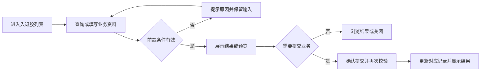
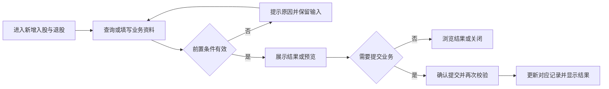
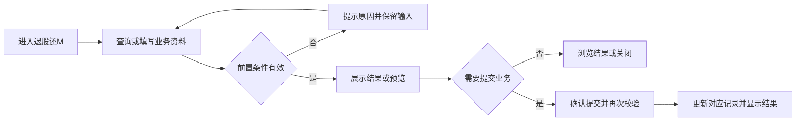
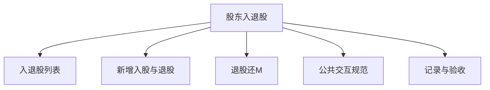

# 股东入退股

## 目录

- [§1 修订追踪表](#1-修订追踪表)
- [§2 背景与目标](#2-背景与目标)
- [§3 功能清单](#3-功能清单)
- [§4 功能细节规格](#4-功能细节规格)
- [§5 功能流程图](#5-功能流程图)
- [§6 功能结构图](#6-功能结构图)
- [§7 页面设计](#7-页面设计)
- [§8 边界与异常](#8-边界与异常)
- [§9 验收清单](#9-验收清单)

## 本文件使用说明

- 本文件按单个菜单整理本轮已确认需求，供设计、开发、测试使用；不是对未讨论历史功能的全量重写。
- 需求依据：本会话用户的最终说明及截图；冲突以最后确认内容为准。
- [MOD] 参考历史基线：[既有文档](../户口管理PRD/PRD_户口管理调整_20261031.md)。历史内容与本文件冲突时，本轮调整以本文件为准。
- 配套：[PRD_股东入退股_20261109_appendix](PRD_%E8%82%A1%E4%B8%9C%E5%85%A5%E9%80%80%E8%82%A1_20261109_appendix.md)、[公共交互与展示规范](%E5%85%AC%E5%85%B1%E4%BA%A4%E4%BA%92%E4%B8%8E%E5%B1%95%E7%A4%BA%E8%A7%84%E8%8C%83.md)、[业务计算与开发交接](%E4%B8%9A%E5%8A%A1%E8%AE%A1%E7%AE%97%E4%B8%8E%E5%BC%80%E5%8F%91%E4%BA%A4%E6%8E%A5.md)。
- 开放问题见附录 A9；未确认项不得当成已验收需求。

## §1 修订追踪表

| 版本 | 日期 | 说明 |
|---|---|---|
| V1 | 2026-11-09 | 初稿，未送审 |

## §2 背景与目标

- 目标：支持入股、退股及用退股资金归还M单，保持股本额度联动。
- 使用者：账房操作人员、业务复核人员及获授权的管理人员。
- 范围：本菜单页面及关联弹窗；公共检索、时间控件、币种规范引用公共文档。
- 当前原型边界：额度管理内股本与M演示数据已联动，刷新恢复；非统一生产账本。

## §3 功能清单

| 页面 | 页面名称 | 变更类别 | 业务结果 |
|---|---|---|---|
| P1 | 入退股列表 | [MOD] | 展示业务类型、户口、币种、股价、股数、变动金额、操作信息；时间范围精确到秒。 |
| P2 | 新增入股与退股 | [MOD] | 入股输入股数股价并自动计算金额，增加对应币种股本批额。退股沿用入股股价并锁定，支持现金与存款组合及付款/退款户口。 |
| P3 | 退股还M | [MOD] | 勾选后逐单分配退股金额，允许部分还款；隐藏普通支付方式，增加还M备注。完成后更新M未还金额和相应额度占用，再减少退出股本。 |

## §4 功能细节规格

### 4.1 P1 入退股列表

- 界面：查询条件、时间筛选、列表与其他账房页面一致；列表不显示状态字段。
- 页面逻辑：展示业务类型、户口、币种、股价、股数、变动金额、操作信息；时间范围精确到秒。
- 业务处理：查询、预览不产生资金变动；只有合法提交才能产生业务记录。取消关闭不得记成功；此规则为正式交付要求，原型覆盖范围以 §2 为准。
- 正向流程：操作人进入页面，完成有效查询或填写，核对结果后执行对应操作，看到列表或记录更新。
- 异常流程：开始时间超过结束时间时阻止查询。
- 边界：无结果不产生虚构记录，分页不得改变汇总范围。
- 联动范围：只更新对应户口、币种及关联业务；本轮未授权跨菜单数据变更不自动扩大。

### 4.2 P2 新增入股与退股

- 入股、退股支持现金与存款组合，分别展示各来源金额与股金户口变动，详见FL-05／FL-06；不得将现金腿与存款腿合并成单一支付方式。入股现金部分增加公司银头，存款部分减少客人余额，股金增加总额；退股现金部分减少公司银头，存款部分增加客人余额，股金减少总额。

- 界面：三种操作使用单选；户口默认本户口，可输入户口号或姓名检索；展示持有股数与剩余股本。
- 页面逻辑：入股输入股数股价并自动计算金额，增加对应币种股本批额。退股沿用入股股价并锁定，支持现金与存款组合及付款/退款户口。
- 业务处理：查询、预览不产生资金变动；只有合法提交才能产生业务记录。取消关闭不得记成功；此规则为正式交付要求，原型覆盖范围以 §2 为准。
- 正向流程：操作人进入页面，完成有效查询或填写，核对结果后执行对应操作，看到列表或记录更新。
- 异常流程：退股股数不能超过持股，金额不能超过剩余股本及可释放批额；无效户口不得提交。
- 边界：已签M或授予占用的股本不能直接退；多个入股价当前原型取最近一笔，正式批次策略待定。
- 联动范围：只更新对应户口、币种及关联业务；本轮未授权跨菜单数据变更不自动扩大。

### 4.3 P3 退股还M

- 退股回M按已确认的FL-10记账：直接使用股金户口存款还M，股金减少、客户欠M减少、对应签额户口记录增加；客人余额、公司银头及对手户口不变。

- 界面：展示所选户口和币种的未还清M单表：勾选、单号、借款、已还、未还、本次还款；保留退股股数与金额便于确定还款资金。
- 页面逻辑：勾选后逐单分配退股金额，允许部分还款；隐藏普通支付方式，增加还M备注。完成后更新M未还金额和相应额度占用，再减少退出股本。
- 业务处理：查询、预览不产生资金变动；只有合法提交才能产生业务记录。取消关闭不得记成功；此规则为正式交付要求，原型覆盖范围以 §2 为准。
- 正向流程：操作人进入页面，完成有效查询或填写，核对结果后执行对应操作，看到列表或记录更新。
- 异常流程：未勾选、无可还M、退股金额超过勾选未还合计时拦截。
- 边界：切换户口或币种清空不匹配选择；已还清M不显示。原型M列表不代表已接通所有开工M。
- 联动范围：只更新对应户口、币种及关联业务；本轮未授权跨菜单数据变更不自动扩大。

## §5 功能流程图

### 5.1 P1 入退股列表

### 5.2 P2 新增入股与退股

### 5.3 P3 退股还M

## §6 功能结构图

## §7 页面设计

### 7.1 P1 入退股列表

- 布局：查询条件、时间筛选、列表与其他账房页面一致；列表不显示状态字段。
- 表现：采用账房管理的白底卡片、青色主操作、统一表单高度；金额与表头对齐。
- 反馈：区分未填写、无结果、校验失败、成功；不得用零值替代加载失败。

### 7.2 P2 新增入股与退股

- 布局：三种操作使用单选；户口默认本户口，可输入户口号或姓名检索；展示持有股数与剩余股本。
- 表现：采用账房管理的白底卡片、青色主操作、统一表单高度；金额与表头对齐。
- 反馈：区分未填写、无结果、校验失败、成功；不得用零值替代加载失败。

### 7.3 P3 退股还M

- 布局：展示所选户口和币种的未还清M单表：勾选、单号、借款、已还、未还、本次还款；保留退股股数与金额便于确定还款资金。
- 表现：采用账房管理的白底卡片、青色主操作、统一表单高度；金额与表头对齐。
- 反馈：区分未填写、无结果、校验失败、成功；不得用零值替代加载失败。

## §8 边界与异常

| 编号 | 场景及处理 |
|---|---|
| CC-01 / P1 | 无结果不产生虚构记录，分页不得改变汇总范围。 开始时间超过结束时间时阻止查询。 |
| CC-02 / P2 | 已签M或授予占用的股本不能直接退；多个入股价当前原型取最近一笔，正式批次策略待定。 退股股数不能超过持股，金额不能超过剩余股本及可释放批额；无效户口不得提交。 |
| CC-03 / P3 | 切换户口或币种清空不匹配选择；已还清M不显示。原型M列表不代表已接通所有开工M。 未勾选、无可还M、退股金额超过勾选未还合计时拦截。 |

## §9 验收清单

- 资金联动专项：按[资金流水变动对照](资金流水变动对照_20261112.md)中适用的FL编号及AC-FL案例验收；待确认项不得视为通过。

### 9.1 功能验收

| 编号 | 页面 | 验收标准 | 状态 |
|---|---|---|---|
| AC-01 | P1 | 列表无状态列；时间控件样式及秒级能力与开工管理一致。 | 待验收 |
| AC-02 | P2 | 入股后同户口同币种股本批额增加；超持股或超剩余金额提交失败且数据不变。 | 待验收 |
| AC-03 | P3 | 选中M出现本次还款预览；还款后未还金额准确变化，股本批额同步减少，不能重复归还已还清单。 | 待验收 |

### 9.2 非功能验收

- 详见配套附录 A4；金额、户口和操作历史必须可辨识，控件不互相遮挡。
- 带权限的正式操作必须验证执行人身份；演示密码非空检查不能作为生产权限验收。

### 9.3 异常验收

- 对 §8 每个案例验证：失败不产生新资金记录，已有业务状态不被部分修改。
- 取消、重复点击、返回后重新打开的结果与既有成功记录一致；需持久化的正式业务重载后不丢失。

### 9.4 本菜单专项验收

- 按 §2 原型边界区分“原型交互可用”与“生产账务已验收”，不得混签。
- 逐项解决附录 A9，再执行正式账务、权限和异常测试；所有适用验收项通过后才能签收。

## 下一步建议

- 业务方确认附录 A9，设计与测试按 P 编号逐页评审。
