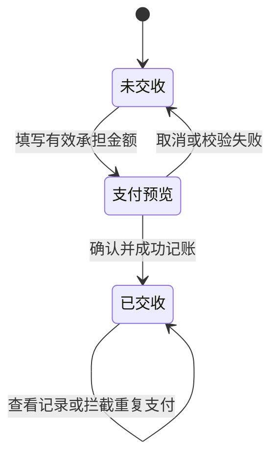

# 业务计算与开发交接

日期：2026-11-09。此文件承载计算、数据边界及开发验收补充；主菜单PRD仍为业务阅读文档。

## 1 数据与金额精度

- 当前原型金额单位为万，展示四位小数，内部以基础货币单位整数处理；最小步长为0.0001万。
- 额度管理新增金额、还款来源、手填代理承担等超过四位小数的输入会拒绝；不可把历史文档的自动截断建议误写为当前所有表单行为。
- 当前百分比计算采用整数运算，结果向零截断；正式系统需另行签收跨币种与最小货币单位精度。
- 真实提交应保证事务完整与幂等。原型中的内存成功不能替代服务端资金凭证。

## 2 开工与收工

- 中途存取展示金额＝累计中途存泥码及现码－累计中途取泥码及现码；卡片隐藏公式文案。
- 收工先处理本场M还款，再分配剩余资金；默认存卡＝剩余可分配金额，存现和K现金默认零。
- 手动存卡＋存现＋本次K现金必须等于剩余可分配资金，各项不得为负。
- 原型沿用的收工盈亏总公式与客户消息等，请参考旧开工管理交接文件；未经对账签收，不在本文件重新宣布为正式合同。
- 荷官泥码与现码均可输入，不能沿用旧文档“荷官仅现码”的限制。

## 3 股本及批额

- 入股金额＝股数×股价，股数为正整数。
- 持股＝累计入股股数－累计退出股数；剩余入股金额＝入股金额合计－已退出金额合计。
- 入股增加同户口、同币种的原始股本批额；退股不得超过剩余股数、剩余入股金额及可释放股本批额。
- 当前原型退出股价使用最近一笔该币种入股价格；多批次成本及允许退出金额的完整处理需业务确认，不默认先进先出。
- 有效额度可用＝批额－已授予占用－未还M占用。过期或收回额度当前不再可用。
- 公司批额没有币种；股本授予必须沿用来源币种。公司批额跨币种借款的等值占用未定，不能直接相加不同货币的债务。
- 收回授予仅允许未被签M等占用的授予记录，恢复来源可用额。
- 户口概况中的列名为“批额”；公司批额整行不分币种，其他行表示各币种股本批额。

## 4 退股还M

- 候选：当前户口、当前币种、借款大于已还的M单。
- 只处理勾选项；按当前候选记录顺序分配，单笔还款不超过该笔未还。
- 退出金额不得大于勾选未还合计，不把多余款项隐式转成存款。
- 还M先释放对应额度占用，再扣减退出股本；两者应作为同一业务事务。
- 切换户口或币种清除失效勾选；所有未还单已清偿时展示空态。
- 样例：剩余股本100万，退出10万，所选M尚欠6万和8万，本次归还6万和4万，后者剩4万。
- 当前候选来自额度管理M演示集合，不能宣称已经汇入所有开工新签M单。

## 5 M单多来源还款

- 本次总还款＝现金＋存卡＋换汇资金＋余额；空来源按零。
- 当前按列表顺序归还M，来源依次分配现金、存卡、换汇资金、余额。
- 总额必须大于零，且不超过所选未还合计；各来源非负。
- 批量须同户口、同币种、同方式，方式限现场或电投；单笔入口不受批量方式限制。
- 换汇资金输入已折合本单币种金额；汇率计算及换汇凭证关联未在此自动完成。
- 现阶段更新债务及额度占用，不扣真实现金、存卡或余额；上线需核验各来源可用金额并原子扣转。

## 6 隐藏占成佣金支付

### 6.1 金额来源

- 客户应得佣金C取主订单当前佣金。
- 每个代理承担Ai由支付弹窗手动输入，允许零但不能空白或负数。
- 公司承担B＝C－全部代理承担合计；代理合计大于客户应得时禁止提交。
- 当前客户应得佣金不大于零时不能支付，零佣金是否自动交收仍需确认。
- 客户只能收到一次完整佣金；不能每个隐藏占成子单分别再付一次全额。

### 6.2 单代理资金步骤

| 方式 | 第一步 | 第二步 |
|---|---|---|
| 公司全额垫付 | 公司向客户支付C | 代理向公司支付A |
| 代理全额垫付 | 代理向客户支付C | 公司向代理支付B |
| 各自支付 | 公司向客户支付B | 代理向客户支付A |

- 三种方式净结果均为客户+C、公司－B、代理－A；零金额步骤省略。
- 用户截图基础单位算例：C＝1600.0、A＝1230.8、B＝369.2，以上步骤均成立。
- 精度边界：截图金额不是万。如果按万、四位小数输入，1230.8基础单位需要五位小数，当前原型不能精确承载该例小数部分。正式最小单位需业务确认，不能暗中取整。
- 原型可复核样例采用C＝1.6000万、A＝1.2308万、B＝0.3692万，用于验证相同分摊关系，不冒称与截图基础金额相同。

### 6.3 状态与防重复

- 当前按主订单防重复；一次支付后该场次主订单及关联子订单佣金标为已交收。
- 上下数交收状态不受佣金支付影响；已交收佣金不能修改码粮比。
- 保存支付方式、逐步转出转入、币种、金额、最终净变动及时间；子订单展示手填代理承担形成的负向佣金交收金额。
- 多代理当前演示：公司垫付时各代理补公司；代理垫付时选中代理先付，其他代理与公司补给该代理；各自支付时分别给客户。此推广逻辑尚未收到独立业务签收。
- 支付使用独立演示变动记录，不改变真实公司户或客户余额；刷新恢复。生产验收应测试资金不足、回滚、重复请求和状态重载。

## 7 结算展示及合计

- 只从收工场次生成结算主记录；主订单保持原本金、上下数、转码及佣金数据。
- 每笔隐藏占成拆为关联子订单，类型显示隐藏占成，不能从主订单扣走相同展示数据。
- 原型子单上下数交收为主上下数乘占成比例后反向；子单佣金交收在支付前用对应码粮比估计，支付后以手填承担额替换。正式占成款方向与总对账规则需确认。
- 底部按币种统计上下数交收、佣金交收及两者合计；选择是否纳入子订单时三个数字与笔数均遵守同一范围。
- 这是交收金额合计，不是再次把主子订单本金或转码加总。不得恢复已删除的顶部大数字汇总卡。

## 8 原型到正式系统差距清单

| 范围 | 原型现状 | 正式交付必须补齐 |
|---|---|---|
| 统一户口检索 | 按本地资料生成候选并回填 | 权限候选、分页、准确匹配、逐字段覆盖验收 |
| 股本与批额 | 额度管理内存联动 | 真实资金账本及开工签M联动 |
| M还款 | 债务及额度更新 | 四类资金来源余额检查、扣转及凭证 |
| 隐藏占成佣金 | 步骤、净变动、状态、防重复 | 真实账户资金转账、原子性和持久化 |
| 普通结算与批量 | 操作入口 | 明确扣转金额、付款来源与落账逻辑 |
| 围数厅别 | 上下文切换及草稿分隔 | 真实分厅余额与围数记账 |
