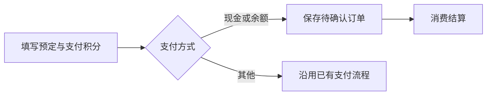
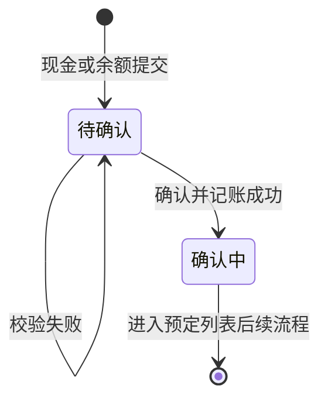
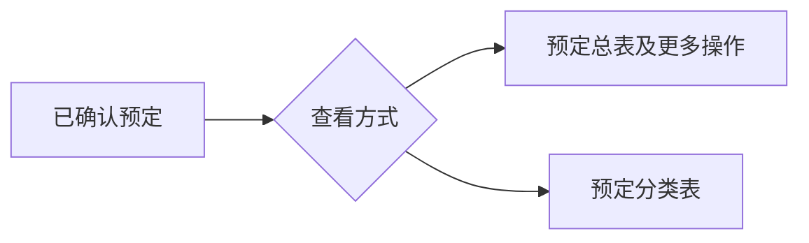
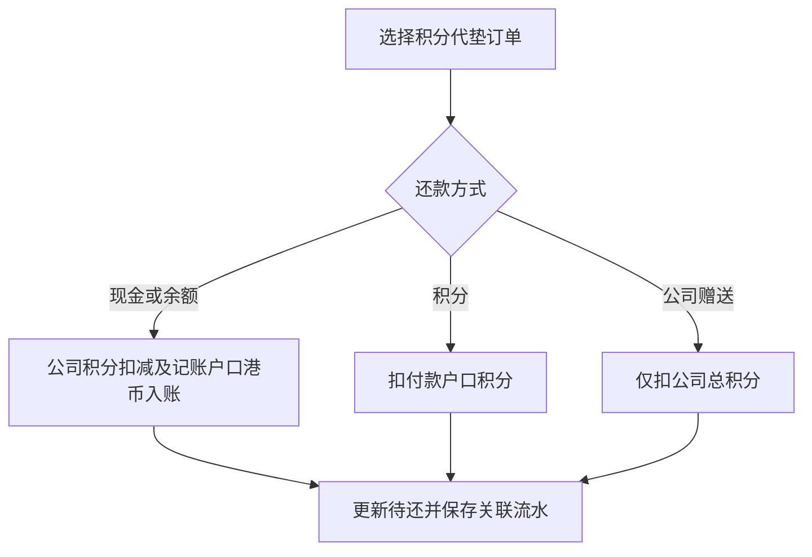
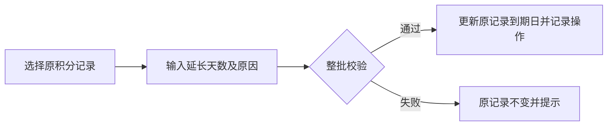
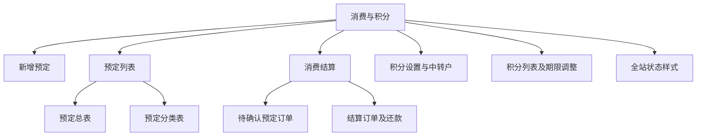

# 消费结算与积分本轮更新

## 目录
- [[#§1 修订追踪表]]
- [[#§2 背景与目标]]
- [[#§3 功能清单]]
- [[#§4 功能细节规格]]
- [[#§5 功能流程图]]
- [[#§6 功能结构图]]
- [[#§7 页面设计]]
- [[#§8 边界情况]]
- [[#§9 验收清单]]

## 本文件使用说明
- 本文为本轮独立需求文档，描述最终业务规则，不替代未涉及模块的原需求。
- 与[既有今日增量PRD](https://bala-luoluo.github.io/cashier-prototype/prd/today-20261127.html)存在冲突的本轮明确变更，以本文为准。
- 原型基线：[本轮原型提交](https://github.com/bala-luoluo/cashier-prototype/commit/e207a8806f7e83b87fe01e2497373a267a3f01ed)。原型实现不等同于生产验收通过。
- 附录：[[PRD_消费结算与积分本轮更新_20261127_appendix]]。待确认边界见附录 A9。

## §1 修订追踪表
|版本|日期|说明|
|---|---|---|
|V1|2026-11-27|本轮独立需求初稿，待业务验收|

## §2 背景与目标
- 让现金和余额预定先确认后进入预定列表，明确结算责任与确认时间。
- 将待确认预定与代垫还款分开，减少重复导航和操作按钮。
- 将积分代垫现金回收与公司积分记账户口统一对应，支持追溯。
- 统一积分整数展示、期限调整和订单状态背景色。
- 使用对象：预定操作人员、结算确认人员、财务人员。

## §3 功能清单
|页面|变更|范围|
|---|---|---|
|P1 新增预定|[MOD]|支付积分可编辑；余额命名；现金和余额提交待确认|
|P2 消费结算|[MOD]|独立菜单；待确认预定订单、结算订单两个页签；筛选与确认|
|P3 预定列表|[MOD]|保留预定总表与预定分类表；审核信息；精简操作栏|
|P4 还款弹窗|[MOD]|还款方式、积分整数、按方式显示余额、公司积分扣减与现金入账|
|P5 积分设置与中转户|[NEW]/[MOD]|公司积分记账户口绑定；各币种余额；公司总积分流水展示|
|P6 积分列表|[MOD]|原记录到期日延长；重复与批量操作|
|P7 全站列表|[MOD]|统一订单状态背景色|

## §4 功能细节规格
### P1 新增预定
- 支付方式中的“扣存款”显示为“余额”。
- 支付积分默认读取对应预定价格，允许手动编辑；修改仅作用于本单。
- 改变房型、入住退房日期、季节、早餐或签证类型等定价条件后重新带出默认价格；切换支付方式等非定价条件不得无故覆盖已输入积分。
- 现金、余额支付提交后保存为待确认，不进行收款或扣款，不进入预定列表。
- 其他支付方式保留已有提交流程。历史已记账订单不追溯改为待确认。
- 必填资料、金额及户口校验失败时，保留输入并提示原因。

### P2 消费结算
- 左侧保留“消费结算”独立菜单，页面仅设置“待确认预定订单”“结算订单”两个页签。
- 待确认预定订单只显示现金、余额支付且未确认的预定，不重复显示同名副标题。
- 筛选支持预定单号、户口号或户名、消费类别、支付方式及预定日期起止；查询后生效，重置恢复无条件筛选。
- 列表展示订单基本信息、支付金额、币种、状态、操作人、确认人、确认时间及确认操作。
- 点击确认后核对订单，确认成功才执行收款或余额扣款，并进入预定列表；预定业务状态为确认中。
- 资金或配置校验失败时，订单仍待确认；允许修正后再次确认，已成功确认不可重复记账。
- 结算订单页签保留原代垫还款列表、筛选、统计、详情、单笔及批量还款。

### P3 预定列表
- 左侧“预定列表”与“消费结算”分别保留，各自进入对应页面。
- 预定列表内部仅保留预定总表、预定分类表，不再叠加“预定订单／结算订单”导航。
- 待确认订单不出现在预定总表与分类表；已确认订单按原消费分类展示。
- 公司垫付订单显示代垫类型，其他订单显示占位符。
- 展示操作人、确认人、确认时间。尚未确认或历史未留存信息显示“—”，不补造人员或时间。
- 总表固定右侧操作栏：详情、修改状态、更多；取消／退款、杂费、修改支付方式收进更多菜单。不可操作项目沿用禁用规则。
- 分类表不显示操作栏。

### P4 还款弹窗
- 积分代垫支持现金、积分、余额、他人余额、他人积分、公司赠送；默认积分。
- 本人余额或积分从本户扣除；他人方式必须选择有效且不同于本户的扣款户口。
- 选择积分只显示扣款户口积分余额；选择余额只显示所选币种余额；现金和公司赠送不显示客户余额提示。
- 积分使用整数展示，数字后不附“点”或“个”；标题为“客户应还积分”“本次还款积分”。现金仍按万显示并保留四位小数。
- 保留本次抵还、还后待还及全额／部分还款提示；移除底部分配预览。
- 积分代垫用现金或余额还款，按本次实际抵还积分减少公司总积分，对应现金金额增加到公司积分记账户口的港币余额；公司总积分流水关联该记账户口与原订单。
- 余额还款同时扣除付款户口余额；外币余额沿用先换汇为港币的规则。现金还款沿用银头收入登记，不扣客户余额。
- 积分代垫用公司赠送还款，扣减公司总积分，不增加现金余额，不扣客户积分或余额。
- 用客户积分还款扣客户积分，沿用兑换不影响公司总积分的例外，不再额外扣减公司总积分。
- 支持部分还款；批量还款仅允许同户口、同代垫类型，按预定时间先后分配，合计记账不得重复。
- 公司总积分扣除纳入已使用积分，避免同笔业务多次计入；公司总积分负数沿用仅警示、不阻止的既有口径。

### P5 积分设置与中转户
- 中转户新增公司积分记账户口，支持搜索已开户户口、编辑绑定、操作记录；允许与其他中转类型绑定同一户口。
- 积分设置展示该绑定户口的各币种余额；金额以万显示、保留四位小数；未绑定明确提示设置，不虚构余额。
- 积分代垫回收现金或余额使用公司积分记账户口；普通消费的消费中转户规则保持独立。
- 公司总积分、客户总积分、已使用积分沿用对应统计卡片。已使用积分仍按既有当月口径。
- 公司总积分说明显示“还款收回现金减池，逾期收回入池”；移除“转码发放减池”说明，不将文案删除解读为撤销既有转码记账规则。
- 公司总积分流水去掉期初、流入、流出、期末汇总横栏，保留明细及余额列。
- 已完成的历史入账保留原关联户口，不自动迁移到新绑定户口。

### P6 积分列表
- 获取列表支持单条、批量调整有效期，允许对同一记录持续操作。
- 输入延长天数，在每条原记录当前到期日上延长，直接更新该条记录；不从调整时间重新起算，不新增积分流水或积分批次。
- 保留原派发时间、数量和余额；每次调整记录操作时间、调整前后日期、原因与操作人员。
- 永久有效记录无需延长；可选择永久有效。已使用或已逾期收回积分不因调整期限恢复余额。
- 批量涉及不同到期日，分别计算；无效输入导致整批不保存。

### P7 全站列表
- 状态保留文字并增加背景标签，金额和普通文本不着色。
- 待确认、待审核、未还款使用黄色；确认中、已入住、部分还款使用蓝色。
- 已确认、已完成、已结清使用绿色；失败、驳回、冻结使用红色；取消、作废、过期使用灰色。
- 页面切换、筛选、弹窗及嵌入模块重新渲染后继续保持样式。

## §5 功能流程图
### P1 新增预定

### P2 消费结算

### P3 预定列表

### P4 还款

### P5 记账户口

### P6 有效期

### P7 状态标签

## §6 功能结构图

## §7 页面设计
|页面|自上而下布局|
|---|---|
|P1|消费信息、客人信息、可编辑金额与积分、支付方式、确认信息、提交|
|P2|页面标题、两个页签、对应筛选区、对应订单表；还款页签保留统计及批量按钮|
|P3|页面标题、总表／分类表、筛选、列表；总表操作固定右侧|
|P4|弹窗标题、订单摘要、还款方式、对应余额、应还与本次金额、备注、密码、提交|
|P5|积分统计卡、记账户口各币种余额、日期筛选、财务记录／公司总积分流水|
|P6|查询与批量操作、获取列表；弹窗显示原数量及日期、延长天数、原因|
|P7|在原状态单元格内显示带背景色标签，保持系统字号及圆角|

## §8 边界情况
|编号|场景|处理|
|---|---|---|
|CC-1|确认时余额已被其他业务使用|再次校验，不记账，保留待确认|
|CC-2|重复点击确认或还款|同笔业务不得重复记账|
|CC-3|公司积分记账户口未绑定|现金回收不得扣公司积分后单独失败，应整笔阻止|
|CC-4|付款户与收款记账户口相同|余额还款阻止并提示|
|CC-5|多笔还款类型或户口不一致|不可批量提交|
|CC-6|旧订单缺少操作人员信息|显示“—”，不生成虚假确认时间|
|CC-7|永久有效或已使用完记录调整|可保留期限操作记录，不恢复积分余额|
|CC-8|日期范围反向|提示错误，不应用筛选|
|CC-9|绑定变更前已完成入账|保留历史真实户口，不重复补款|
|CC-10|输入积分出现小数|不得静默四舍五入后实际扣另一数额；提交口径需按附录明确|

## §9 验收清单
### 9.1 功能验收
|编号|页面|可判定标准|
|---|---|---|
|AC-1|P1|手改支付积分后提交，订单积分与输入一致；改定价条件重新带出默认值|
|AC-2|P1/P2|现金、余额新订单在确认前不记账、不进入预定列表|
|AC-3|P2|六类筛选可组合，重置后恢复全部待确认记录|
|AC-4|P2|确认成功仅产生一次记账，订单从待确认移入预定列表|
|AC-5|P3|总表与分类表排除待确认记录；三列人员时间信息展示正确|
|AC-6|P3|总表仅直接显示详情、修改状态、更多；分类表无操作栏|
|AC-7|P4|积分代垫抵还16000，现金回收时公司积分减少16000，记账户口港币增加1.6000万|
|AC-8|P4|余额回收增加记账户口港币，同时扣付款余额；客户积分不变|
|AC-9|P4|公司赠送仅减少公司积分；积分还款仅减少付款客户积分|
|AC-10|P4|余额提示只显示对应资产，底部分配预览不出现，积分无四位小数及数量后缀|
|AC-11|P5|绑定可编辑且留痕，各币种余额对应同一绑定户口；历史流水不迁移|
|AC-12|P5|无期初流入流出期末汇总横栏，指定说明文案正确|
|AC-13|P6|原到期日连续延长10天、5天后累计延长15天；积分流水和批次数不增加|
|AC-14|P6|批量分别延长原到期日，积分数量及公司积分不因期限操作改变|
|AC-15|P7|待确认黄、确认中蓝、已完成绿、失败红、取消灰；文字清晰可读|

### 9.2 非功能性验收
- 见附录 A4；刷新后订单、绑定及操作记录保持一致。
- 桌面常用宽度下操作栏可见，更多菜单不被表格裁剪，弹窗可滚动且提交按钮可达。

### 9.3 边界验收
- 逐一验证 CC-1 至 CC-10；资金校验失败不得产生部分资金变更。
- 验证多人操作与重复提交，不以本地界面按钮禁用代替业务防重。

### 9.4 专项与交付边界
- 当前原型为演示数据与本地存储，演示操作人、确认人不代表真实员工认证。
- 已执行部分脚本级检查：确认防重、积分扣减、现金换算、原记录有效期延长；不能据此宣布全部验收通过。
- 生产交付前完成真实身份、资金原子性、各币种流水对账及界面回归。

## 下一步建议
以本文验收清单执行整轮业务复测，并逐项记录结果；对附录待确认项形成独立决策记录。
