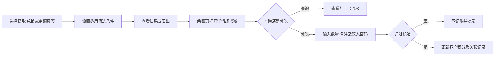
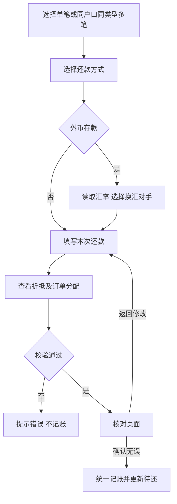
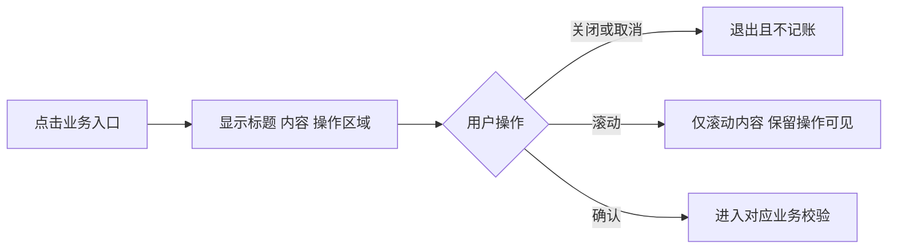
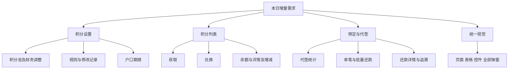

# 账房系统—积分与预定今日更新需求

## 目录

- [[#§1 修订追踪表]]
- [[#§2 背景与目标]]
- [[#§3 功能清单]]
- [[#§4 功能细节规格]]
- [[#§5 功能流程图]]
- [[#§6 功能结构图]]
- [[#§7 页面设计]]
- [[#§8 边界场景]]
- [[#§9 验收清单]]

本文件使用说明：

- 本文单独描述 **2026-11-27** 更新，不覆盖全系统历史需求；今日明确调整的部分以本文为准。
- 业务依据为《積分系統定版說明（含代墊還款） (2).pdf》及当天页面、弹窗调整要求。
- 原有范围参考[积分模块既有需求](../积分模块PRD_20261126/PRD_积分模块_20261126.md)。
- 权限、数据关联、交付边界见 [[PRD_积分与预定今日更新_20261127_appendix]]；精确换算与舍入口径见 [[计算规则补充_20261127]]。
- 本文的验收清单是正式交付要求，不等于线上验证已通过。

## §1 修订追踪表

| 版本 | 日期 | 编写 | 说明 |
|---|---|---|---|
| V1 | 2026-11-27 | 产品整理 | 独立增量初稿，未送审 |

## §2 背景与目标

- 将积分定版规则落入现有原型，明确积分池、客户持有、兑换消耗之间的关系。
- 将代垫拆为现金债务与积分债务，支持部分、批量及他人代还，并提供提交前核对。
- 将积分、预定、代垫页面统一为账房系统视觉风格，解决表格拥挤、弹窗过长及按钮不易找到的问题。
- 目标用户：财务、具备业务权限的账房操作人员及确认人员。
- 本轮不改动酒店定价、签证配置等既有业务含义；不把截图示例金额写成固定业务数据。

## §3 功能清单

以下均为 [MOD] 改版；旧版参见前述既有需求链接。

| 页面 | 名称 | 今日变化 |
|---|---|---|
| P1 | 积分设置—积分池 | 三项统计、财务记录／积分池流水页签、日期查询及汇出、增减弹窗 |
| P2 | 积分设置—规则配置 | 还款折数、修改记录入口和弹窗、配置生效范围 |
| P3 | 户口期限设置 | 期限来源、详情弹窗及记录空状态 |
| P4 | 积分获取列表 | 户口分栏、期限展示、日期查询、汇出及统一布局 |
| P5 | 积分兑换列表 | 兑换方式查询、逾期展示与消耗统计区分 |
| P6 | 积分户口余额 | 最近到期数量、流水详情、手动添加／扣除 |
| P7 | 代垫明细 | 现金／积分双行统计、同户口同类型批量选择、还款详情 |
| P8 | 代垫还款 | 六种还款方式、换算、换汇、部分还款、确认后记账 |
| P9 | 预定与积分公共界面 | 标题、页签、表格、输入框、统计卡片、全部相关弹窗统一 |

## §4 功能细节规格

### P1 积分池

- 页面显示积分池余额、客户持有积分和本月兑换；不显示“本月发放”统计。
- 积分池为持续累计的总池，不按月重置；负数允许存在，不因不足阻止正常发放。
- 本月兑换包含预定支付、垫付还款及手动扣除，不包含积分逾期退回。
- 日期范围用于查询下方记录；统计卡片的“本月”含义不随任意日期范围改变。
- 财务操作记录与积分池流水为两个页签。新增／扣除按钮放在页签栏右侧。
- 财务记录只显示财务直接调整积分池的记录；流水展示全部积分池收支、户口信息及逐笔余额。
- 流水页显示期初、流入、流出、期末及记录笔数；汇出当前页签符合条件的全部记录，不限当前可见行。
- 新增／扣除弹窗显示当前池余额、数量、对应日期、原因及双人密码。数量和日期并排，原因支持多行。
- 正常：确认后更新余额和两类相关记录。异常：数量无效、原因或日期缺失、密码校验失败均阻止提交。边界：关闭弹窗不产生记录。

### P2 积分规则配置

- 设置入口保留积分池、积分设置、户口期限设置三个页签。
- 积分配置包含币种换算、获取条件、默认期限和现金代垫以积分还款的折数。
- 现金代垫以积分还款默认按六折折抵；配置修改仅作用于之后的还款。
- 设置修改不追溯改变已发积分到期日、已发生还款金额或已记录换算依据。
- “修改记录”按钮放在配置区域右上角。
- 修改记录弹窗显示修改时间、项目、修改前后内容、原因及修改人员；无记录显示明确空状态。
- 正常：保存后产生可追溯修改记录。异常：无效配置或双人确认失败不生效。边界：默认期限为永久时，后续新增积分采用永久期限。

### P3 户口期限设置

- 支持按户口号查找并设置专属使用期限；未设置的户口采用默认期限。
- 每个户口展示户口号、户口名、期限来源和当前适用期限。
- 详情标题显示户口号和户口名；下方展示当前期限及默认／专属来源，再展示该户口修改记录。
- 未设置过专属期限且无历史记录时，提示一直使用默认期限；已有专属配置但无可用历史时，不误称从未设置。
- 正常：设置影响后续新增积分。异常：未选有效户口或期限无效不得保存。边界：永久期限以“永久”展示，不显示虚构日期。

### P4 积分获取列表

- 顶部为获取列表、兑换列表、户口余额三个页签，统一显示三项积分统计。
- 户口号查询后带出只读户口名；提供日期范围、本月／上月／近三个月和汇出。
- 列表展示单号、户口号、户口名、获取原因、金额、期限、到期日、备注、创建时间、操作人。
- 到期日按日期显示；永久积分显示永久。取消在本页展示批次已兑换、批次剩余及影响位置。
- 手动添加的获取原因明确标注；收工自动发放与手动添加可区分。
- 正常：筛选与汇出一致。异常：无匹配结果显示空状态。边界：只读示例不参与统计、导出或业务操作。

### P5 积分兑换列表

- 筛选顺序为户口、日期范围、快捷日期、兑换方式及汇出；记录按创建时间由新到旧显示。
- 列表展示单号、户口号、户口名、兑换方式、金额、备注、创建时间、操作人。
- 兑换方式可区分具体预定消费、垫付还款、手动扣除及积分逾期。
- 逾期记录可查询，但不计入本月兑换消耗；不得直接把本页金额合计当作本月兑换统计。
- 新业务不产生积分自动撤销或负数兑换记录；预定取消需补回积分时通过手动添加办理。
- 正常：金额清晰突出，长备注换行。异常：筛选无结果不显示虚构业务。边界：历史撤销记录保留，不改写历史。

### P6 户口余额与积分操作

- 主列表仅保留户口查询、自动带出户口名和汇出，不提供无意义的日期余额筛选。
- 展示当前剩余、最近到期日期及当天到期积分数量、适用期限，以及详情／添加／扣除操作。
- 同一天到期的多笔剩余积分合并显示；仅有永久积分时显示永久有效；无有效积分显示空值提示。
- 详情弹窗顶部显示户口信息、汇出及关闭；日期筛选支持快捷范围及全部。
- 详情显示当前剩余、查询笔数及流水；收入为绿色正数，支出为红色负数，按时间倒序。
- 手动添加从积分池拨给所选客户，进入获取列表；备注和双人密码必填。
- 手动扣除显示当前客户及可用积分，作为消耗进入兑换列表，不返回积分池；积分逾期由自动到期机制办理。
- 正常：余额、流水及列表一致。异常：超出可用积分的扣除被阻止。边界：取消／关闭不记账；添加时可选择目标户口，扣除固定当前户口。

### P7 代垫明细

- 代垫按现金债务和积分债务分别展示，不将不同单位直接相加。
- 累计代垫、累计还款、待还三项卡片均分现金与积分两行。
- 完整户口查询可展示该户口整体待还信息，明确与当前列表筛选统计的区别。
- 批量还款仅允许同一户口、同一债务类型；按预定时间先后分配还款。
- 表头全选仅能形成满足批量条件的选择，不允许跨户口、跨类型混还。
- 详情显示预定单、客户、类型、原代垫、待还和逐笔还款；还款记录展示扣款户口、实际扣除、备注、创建时间及操作人。
- 正常：部分还款后仍可继续还款。异常：混选时阻止批量提交。边界：无还款记录时明确显示空状态。

### P8 代垫还款

- 支持现金、积分抵扣、扣存款、公司赠送、扣他人积分、扣他人存款。
- 现金收款不扣客户存款；公司赠送不扣客户余额；他人代还须明确实际扣款户口。
- 现金债务以积分偿还采用配置折数；积分债务以现金或存款偿还按对应港币价值处理。
- 外币存款还款先按系统汇率与指定对手户换为港币，再用于偿还；汇率只读。
- 默认填入应还数量；余额不足时预填可用数量，支持改为部分还款。
- 页面展示客户应还、应收／应扣、本次抵还、还后待还及各订单分配预览。
- 首次确认进入核对，核对时展示实际扣除及折抵依据；仅最终确认执行记账。
- 返回修改不记账；成功后保存使用的折数、汇率及实际扣除记录，后续设置变化不改变原记录。
- 正常：更新债务、客户资金／积分及关联流水。异常：超额、余额不足、缺少换汇对手或双人确认失败均阻止记账。边界：重复提交不得重复扣款。

### P9 公共样式与弹窗

- 页面统一采用主系统深青色主操作、浅灰背景、浅色卡片、紧凑表格和一致文字层级。
- 参考截图用于结构，具体视觉以主系统为准，不照搬截图中的放大字号或示例数据。
- 所有积分弹窗统一标题栏、边框、圆角、背景遮罩、标签、输入框及按钮。
- 积分弹窗内容区独立滚动，标题栏和底部操作保持可见；详情中的汇出放在标题右侧。
- 双人密码在宽屏并排，窄屏允许换行；备注、原因采用多行输入。
- 代垫还款弹窗适度加宽，金额信息并排，缩短纵向留白，提交操作在滚动时可见。
- 列表横向滚动时操作栏固定右侧；弹窗内表格允许局部横向滚动。
- 正常：各模块操作样式一致。异常：长文字不能覆盖按钮。边界：小屏、长表格和空状态均须可读、可关闭。

## §5 功能流程图

### P1 积分池调整

### P2—P3 配置与期限

### P4—P6 查询及客户积分操作

### P7—P8 代垫还款

### P9 弹窗交互

## §6 功能结构图

## §7 页面设计

| 页面 | 自上而下布局 | 关键设计要求 |
|---|---|---|
| P1 | 设置页签、统计卡片、日期筛选、记录页签及增减按钮、列表 | 流水独有余额核对条；取消重复“积分池”小标题 |
| P2 | 页签、右侧修改记录、配置表单、确认区 | 历史记录宽表；无记录有说明 |
| P3 | 户口期限表单、户口查询、期限列表 | 详情先展示当前配置，再展示历史 |
| P4 | 三页签、三卡片、户口与日期查询、笔数、列表 | 到期日按日期显示，金额突出 |
| P5 | 与获取列表一致，增加兑换方式 | 方式在快捷日期右侧，长备注换行 |
| P6 | 三页签、三卡片、户口查询及汇出、余额列表 | 操作右侧固定；详情头部汇出与关闭 |
| P7 | 条件筛选、三项双单位统计、批量操作、明细表 | 金额与积分单位明确分开 |
| P8 | 标题、债务摘要、方式及扣款信息、金额区、备注、密码、分配、底部操作 | 内容滚动、提交持续可见 |
| P9 | 主系统统一样式 | 深青色主按钮；卡片圆角12px、控件8px；表单弹窗标题18px |

## §8 边界场景

| 编号 | 场景 | 预期 |
|---|---|---|
| CC-01 | 积分池负数 | 允许正常发放，不把池不足当作客户积分不足 |
| CC-02 | 零数量、负数量、超出允许精度 | 阻止增减或还款，不产生流水 |
| CC-03 | 取消预定积分支付 | 不自动返还；需要补偿时走手动添加 |
| CC-04 | 已过期或永久积分 | 到期退池；永久积分不自动到期 |
| CC-05 | 多笔积分同日到期 | 最近到期栏合并当天剩余数量 |
| CC-06 | 日期起晚于止 | 明确提示，不更新查询结果 |
| CC-07 | 同户口但债务类型不同 | 不允许合并还款 |
| CC-08 | 他人积分不足或换汇对手不合法 | 阻止记账并保留可修改输入 |
| CC-09 | 中途返回、关闭、重复确认 | 前两者无记账；重复确认不得重复扣款 |
| CC-10 | 长备注、小屏、长列表 | 内容可滚动，关闭及提交可访问 |
| CC-11 | 历史非港币现金代垫 | 不擅自按港币处理；基准待明确前阻止错误换算 |
| CC-12 | 只读示例行 | 不计入真实笔数、余额、汇出及业务选择 |

## §9 验收清单

### 9.1 页面与业务验收

| 编号 | 页面 | 明确验收标准 |
|---|---|---|
| AC-01 | P1 | 仅显示三项统计；财务记录和流水可切换，汇出对应筛选结果 |
| AC-02 | P1 | 财务增减后池余额与流水一致；取消不生成记录 |
| AC-03 | P2 | 修改记录位于配置右上角，记录前后值；新折数不改变历史还款 |
| AC-04 | P3 | 默认、专属、永久展示正确；不同历史情况的空状态不误导 |
| AC-05 | P4 | 户口名自动带出，十项展示内容完整，导出不含示例 |
| AC-06 | P5 | 方式筛选有效；逾期可见但不计入本月兑换；记录倒序 |
| AC-07 | P6 | 同日到期数量正确；手动添加减池，手动扣除不回池 |
| AC-08 | P6 | 详情正负号、颜色、日期筛选、记录数及汇出一致 |
| AC-09 | P7 | 现金与积分分开汇总；混合户口或类型不可批量提交 |
| AC-10 | P8 | 六种方式逐项验证；部分还款、余额预填及分配预览一致 |
| AC-11 | P8 | 外币双币种双方流水完整；核对前不记账；成功后待还正确 |
| AC-12 | P9 | 所有相关弹窗统一风格，滚动不遮挡操作，关闭取消正常 |

### 9.2 非功能验收

- 长备注、窄屏和大量记录下不得出现按钮被内容覆盖、无法关闭或不可到达的输入项。
- 正式环境须由可信服务进行权限、双人身份和余额校验，不依赖原型演示密码判断。
- 记账失败不得留下只扣款、不更新债务或只更新部分订单的结果。
- 列表、统计、导出采用相同业务口径及上海时区；数值不得因格式化丢失有效精度。

### 9.3 边界验收

- CC-01 至 CC-12 逐项验证，实际结果及证据单独登记。
- 仅通过构建不代表完成业务验收；线上结果不得直接引用本地演示结论。

### 9.4 专项交付验收

- 本地原型已同步代码至 GitHub；对应提交：[14c2349](https://github.com/bala-luoluo/cashier-prototype/commit/14c2349515d961ca23e86478cc76549dcb505459)。
- 本地积分账本、还款换算、舍入、重复处理及脚本语法检查已有通过记录。
- 当前仍为本地交互原型；正式定时到期、真实权限、多端并发事务和线上端到端测试另行验收。
- 全部适用验收项通过后，才可认定正式系统满足本需求。

下一步建议：以本文件组织业务评审，确认历史非港币代垫换算基准，再开展正式系统验收。
