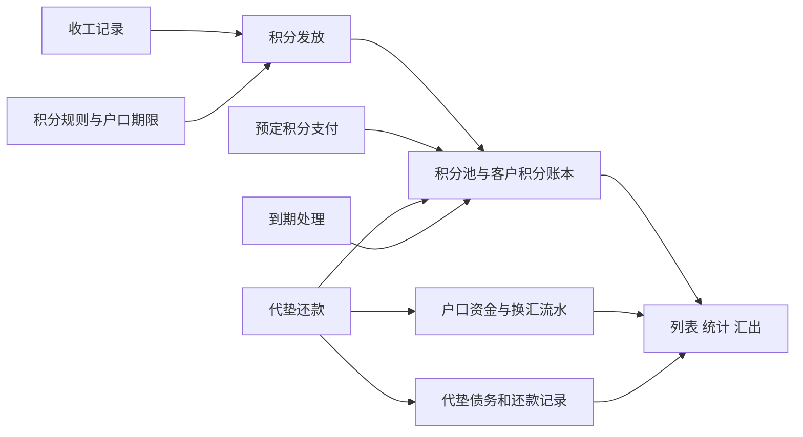
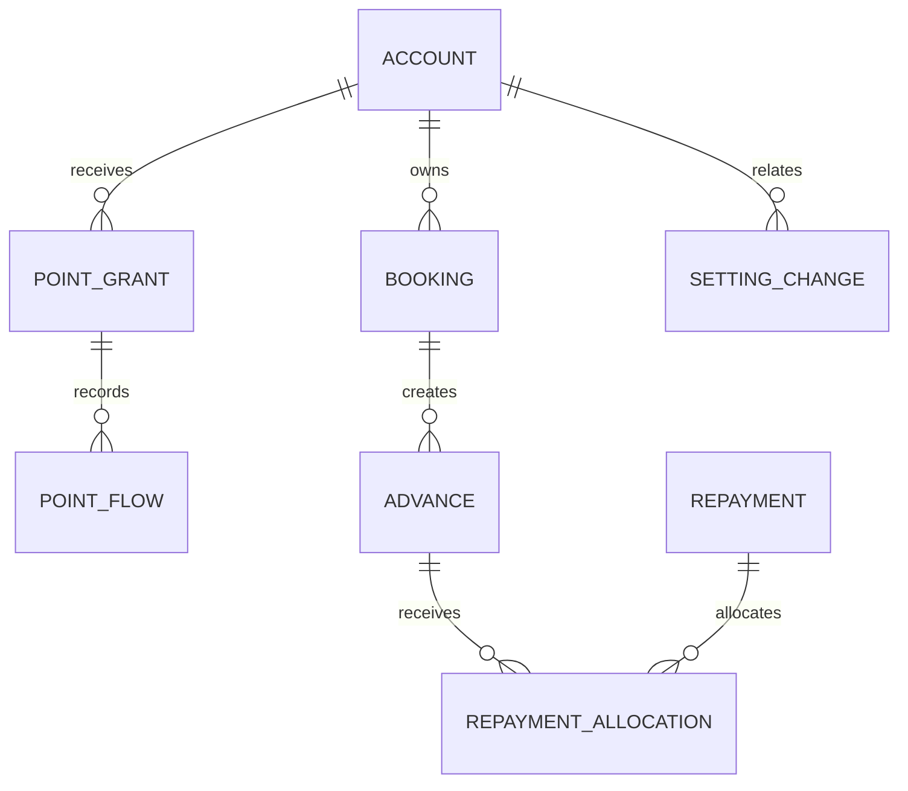

# 积分与预定今日更新—附录

## A2 用户与角色

| 角色 | 工作范围 | 边界 |
|---|---|---|
| 财务 | 积分池调整、规则配置、业务核对 | 原型固定展示财务视角，不代表正式环境免权限 |
| 业务操作人员 | 预定、代垫查询和获授权的还款操作 | 正式权限应遵循已有系统授权 |
| 确认人员 | 对资金或积分修改进行第二人确认 | 不得由同一身份替代双人确认 |

## A3 数据流与系统联动

- 每次还款保留原债务、实际扣款人、扣款币种、实际扣除、折数、汇率及订单分配结果。
- 配置修改仅影响后续业务，历史还款使用保存的依据进行追溯。
- 余额与还款状态必须在同一业务结果中保持一致；失败不允许留下部分扣款。
- 本地原型使用浏览器存储及演示双密码校验；正式系统需要真实身份认证和原子记账。
- 原型到期处理随本地账本读取触发；正式系统必须有可靠的自动到期任务，支持防重复处理。

## A4 非功能要求

- 个人密码不进入业务记录、汇出或前端持久化配置。
- 同一业务重复提交不得重复扣款、重复发放或重复到期扣除。
- 日期展示和按月统计统一使用上海时区。
- 查询结果与汇出一致，示例行明确标识并排除。
- 资金／积分数值采用约定精度，严禁依赖页面显示值重新推导已发生记账金额。
- 弹窗具备可辨识标题，键盘可到达所有输入与关闭操作；错误提示靠近表单。
- 正式性能指标应结合数据量与运行环境制定，本轮不虚构时延承诺。

## A7 业务关联

- 户口可关联多笔发放、预定及配置记录。
- 单次还款可分配到多笔代垫，前提为同户口、同类型。
- 各订单分配金额合计应与该次实际抵还一致。
- 最近到期积分来自有效发放批次的剩余部分，不能用原始发放数量代替。

## A9 待确认及交付限制

| 事项 | 当前处理 |
|---|---|
| 历史非港币现金代垫的港币债务基准 | 待明确；不按同数额港币默默折算 |
| 正式各角色权限与真实双人确认 | 原型未替代正式系统授权，需另行实现与验收 |
| 生产自动到期与并发记账 | 本地演示不构成生产保障 |
| 今日全部弹窗逐页视觉回归 | 已构建与同步；仍需在目标屏幕和真实数据下验收 |

## A10 名词

- 积分池：随客户积分增减同向等额变化、并支持财务直接调整的持续累计积分池。
- 客户持有：客户当前有效剩余积分合计。
- 本月兑换：本月实际兑换消耗，排除自动逾期。
- 现金代垫：以货币金额计量的客户欠款。
- 积分代垫：以积分数量计量的客户欠款。
- 实际扣除：从付款方收取或扣减的原币金额／积分。
- 本次抵还：实际扣除换算后用于减少债务的数量。

## A11 依据

- 《積分系統定版說明（含代墊還款） (2).pdf》，用户于本轮提供。
- 2026-11-27 本对话的页面及弹窗调整截图、系统统一风格要求。
- [[../积分模块PRD_20261126/PRD_积分模块_20261126]]
- [本轮原型提交](https://github.com/bala-luoluo/cashier-prototype/commit/14c2349515d961ca23e86478cc76549dcb505459)
- 本地验证记录：work/points-20261127/调整与验证说明.txt。
