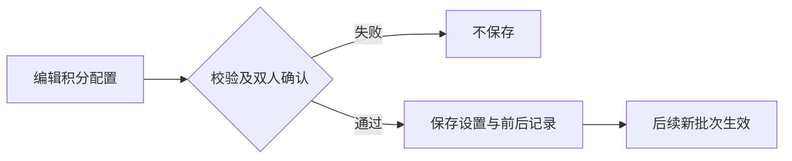
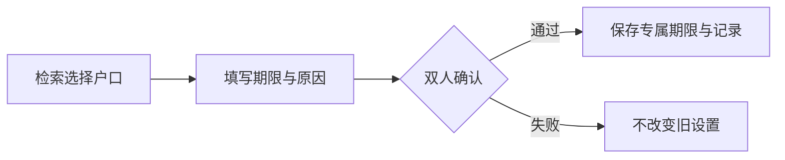
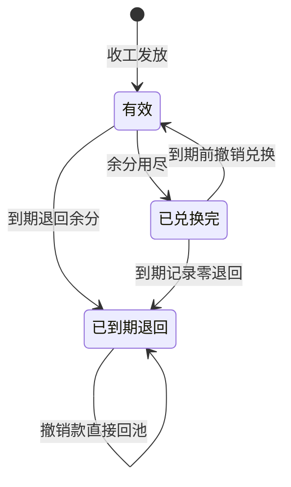
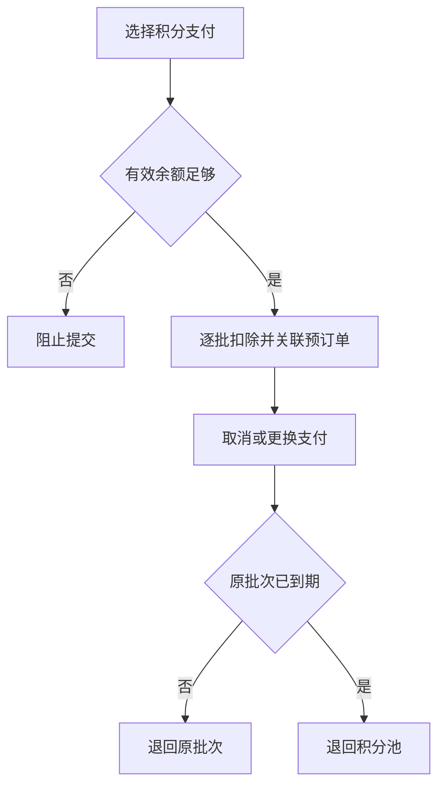
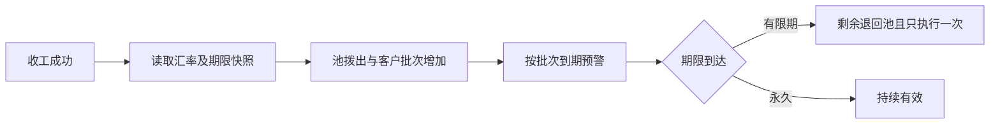
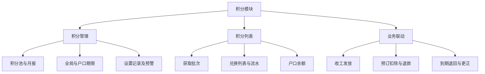

# 积分模块产品需求文档

## 目录

- [[#§1 修订追踪表]]
- [[#§2 背景与目标]]
- [[#§3 功能清单]]
- [[#§4 功能细节规格]]
- [[#§5 功能流程图]]
- [[#§6 功能结构图]]
- [[#§7 页面设计]]
- [[#§8 边界情况]]
- [[#§9 验收清单]]

## 本文件使用说明

- 依据《積分系統業務規則規格_3.docx》及2026-11-26用户确认整理。
- 已确认：到期预警默认提前30天；负数上限仅警示、不阻止发放。
- 本文描述目标业务；原型交付边界见 [[原型实现与验证说明]]，不能把原型演示视为生产验收通过。
- 计算与字段合同见 [[ai-handoff]]；角色、资料流和开放事项见 [[PRD_积分模块_20261126_appendix]]。

## §1 修订追踪表

| 版本 | 日期 | 编写 | 说明 |
|---|---|---|---|
| V1 | 2026-11-26 | Codex | 初稿，未送审 |

## §2 背景与目标

- 积分只保留两个存放位置：永久积分池、按收工场次建立的客户批次。
- 收工从积分池拨发；兑换直接消耗；过期余分回池。取消兑换应追溯原批次。
- 财务按月人工新增积分，并依据兑换报表在系统外向酒店付款；不另在系统扣分。
- 目标用户：财务、账房操作员、确认人、只读核查人员。客户仅查看自身可用积分与兑换结果。
- 范围：积分池、设置、期限、批次、流水、兑换报表、预订支付与退款、收工发放。
- 不在本模块实现酒店实际付款、自动按月预算补池或未经确认的客户负积分。

## §3 功能清单

| 页面 | 标记 | 入口 | 主要能力 |
|---|---|---|---|
| P1 积分池 | [NEW] | 系统→积分管理→积分池 | 总览、财务新增/扣除、负数警示、期初导入 |
| P2 积分设置 | [MOD] | 系统→积分管理→积分设置 | 币种换算、获取条件、默认期限、预警、负数警示上限 |
| P3 户口期限与设置记录 | [MOD] | 积分管理对应页签 | 户口检索、专属期限、变更前后、原因与双人确认 |
| P4 客户批次与户口余额 | [MOD] | 系统→积分列表 | 获取批次、客户余额、详情、独立到期 |
| P5 兑换及流水报表 | [MOD] | 积分列表/积分池月报 | 兑换明细、冲销、来源追溯、按月汇总与导出 |
| P6 预订积分支付 | [MOD] | 消费管理→新增预订/预定总表 | 可用余额提示、按到期顺序扣分、原批次退回 |
| P7 收工发放与到期预警 | [MOD] | 开工管理收工/积分池预警 | 收工发放、到期退回、批次预警、差额更正 |

旧版依据：[积分与中转设置PRD](../菜单PRD_20261124/PRD_积分与中转设置_20261124.md)。本次预订积分直接消耗，替代旧版转入积分消费中转户的处理；不改变其他现金业务中转配置。

## §4 功能细节规格

### 4.1 P1 积分池

- 页面上方显示池余额、客户持有及当月发放、兑换、到期退回；负余额用红色警示。
- 财务可新增或手动扣除积分，填写数量、对应日期、原因并由两人确认；其他角色不得办理。
- 成功后生成财务操作流水；取消、不完整输入、重复提交不改变积分。
- 积分池只有一个余额，不按财务月份拆成到期批次；负余额不阻止收工发放。
- 期初导入保留客户原到期日，明确导入来源和原因，防止重复导入；不能覆盖旧流水。
- 财务新增按页面规划记录“对应日期”；由日期归属的月份供查询，不再只保留月份。

### 4.2 P2 积分设置

- 展示各币种折合港币（越）的配置和获取条件；港币（越）本币换算固定。
- 默认每满1,000港币（越）转码获得1点，不足部分不累计到下一场；获取条件设为零停止计算。
- 默认有效期90天，零表示永久；预警默认30天，可配置。
- 负数警示上限为零时不设阈值；设置正数后越过阈值加强警示，仍不拦截发放。
- 修改须原因及双人确认；新期限仅影响之后新增的批次，旧批次不追改。
- 非法期限、汇率或预警天数不保存；原设置保持不变。

### 4.3 P3 户口期限及设置记录

- 输入户口号检索并选择有效户口；列表支持户口号查询。
- 专属期限优先于默认期限；零为永久。保留“保存户口期限”，不恢复已移除的“恢复默认期限”操作。
- 设置记录显示修改时间、修改对象、修改项目、修改前后、原因、修改人与确认人、生效时间。
- 按户口、类型、字段及时间查询；错误日期范围给出提示。
- 双人确认失败不得新增记录；相同值保存提示无变化。

### 4.4 P4 客户批次与户口余额

- 每次有效收工独立生成批次，不合并同户口多场期限。
- 获取列表显示批次、户口、场次、收工时间、获得、兑换、剩余、期限来源、到期日、状态及退回信息。
- 户口余额为当前有效批次剩余合计，可打开批次详情追溯；永久批次明确显示“永久”。
- 收工当天为第1天，到期日当天结束后不可使用；天数按日历计算，覆盖闰年。
- 空余额不允许客户负数支付；已兑换完批次仍保留，便于核对其到期零退回记录。

### 4.5 P5 兑换及流水报表

- 兑换列表显示预订单、客户、扣除批次、发生时间和数量；一次跨批次支付逐批展示。
- 月报展示当月发放、兑换净额、到期退回，可筛客户和预订单并导出明细。
- 取消预订的兑换撤销按负数列入撤销发生月，不覆盖原兑换。
- 流水显示类型、影响位置、正负数量、批次、户口、关联单、操作人、确认人与原因。
- 获取列表、兑换列表、积分流水分别提供导出按钮，导出当前查询条件下全部业务记录，CSV保留中文列名，示例行及操作栏不导出。
- 旧流水不得编辑删除；纠错只追加可追溯的反向或差额记录。
- 酒店外部付款不改变任何积分余额；不提供“支付酒店扣积分”按钮。

### 4.6 P6 预订积分支付

- 选择积分支付时显示当前户口有效余额及最近到期日；更换户口后同步更新。
- 超过可用积分时阻止提交；通过后优先扣最早到期批次，同日到期按收工时间先后，永久批次排后。
- 扣分直接消耗，不增加积分池或积分消费中转户；不要求为积分兑换绑定现金消费中转户。
- 取消或改支付方式时沿原兑换明细退还；未到期回原批次，已到期回池，不新建延长期限。
- 同笔跨多个批次退款分别处理，不允许超过原单未退积分；失败不留下部分扣分。
- 更换支付方式需原支付撤销和新支付一起完成；任一失败保持原订单及原积分。

### 4.7 P7 收工发放与到期预警

- 正式收工成功时依积分设置换算并发放，不需要再点人工新增；暂存不视为正式收工。
- 同一收工不得重复发放；客户批次扣发与池变动同时记录。
- 到期任务将未用余额退回池，剩余为零也保留一次零退回；永久批次不参与。
- 预警按批次展示户口、余分、到期日和剩余天数；正式消息渠道及重复提醒策略另行确认。
- 收工转码更正追加同批次差额，不改变期限；客户余额不足扣回时转人工核实，不擅自生成负客户余额。

## §5 功能流程图

### 5.1 P1 财务操作

### 5.2 P2 全局设置

### 5.3 P3 户口期限

### 5.4 P4 批次状态

### 5.5 P5 兑换报表

### 5.6 P6 预订支付与退款

### 5.7 P7 自动业务

## §6 功能结构图

## §7 页面设计

| 页面 | 布局与交互 |
|---|---|
| P1 | 顶部统计卡；财务操作按钮；日期原因双人确认弹窗；操作记录表 |
| P2 | 汇率区域；获取条件、期限、预警及负数阈值；原因和双人密码；保存 |
| P3 | 户口与期限双列；原因及双人确认；下方可搜索使用列表；设置记录另页签 |
| P4 | 获取/兑换/流水/户口余额页签；查询区；宽表；详情弹窗；操作列固定右侧 |
| P5 | 月份与客户单号筛选；汇总卡；明细表；导出当前条件 |
| P6 | 支付积分旁显示有效余额及最近到期；错误就近提示；沿用整站按钮与弹窗 |
| P7 | 保持现有收工操作；积分批次可追溯场次；预警独立列表 |

## §8 边界情况

| 编号 | 情境 | 处理 |
|---|---|---|
| CC-01 | 积分池不足或超过警示阈值 | 继续发放并警示 |
| CC-02 | 客户积分不足 | 整笔拒绝，不扣部分批次 |
| CC-03 | 期限零 | 永久，无到期退回和预警 |
| CC-04 | 零剩余到期 | 保留一笔零退回，不重复执行 |
| CC-05 | 同到期日或跨批次 | 按收工时间排序并逐批记录 |
| CC-06 | 退款时部分原批次已到期 | 未到期回客户，已到期回池 |
| CC-07 | 重复收工/导入/退回 | 不重复产生积分 |
| CC-08 | 配置修改 | 原批次期限快照不变 |
| CC-09 | 转码更正扣回不足 | 不执行，交人工确认处理方案 |
| CC-10 | 跨午夜/交易跨到期时刻 | 归日和发起时刻规则见附录待确认项 |
| CC-11 | 负转码收工 | 文档未定义负积分，原型暂不发负积分，待确认 |

## §9 验收清单

### 9.1 功能验收

| 编号 | 页面 | 明确标准 |
|---|---|---|
| AC-01 | P1 | 池500发1,000后为-500，客户增加1,000；仍能继续发放 |
| AC-02 | P1 | 财务新增/扣除缺原因或缺双人确认不得提交；流水可追溯对应日期 |
| AC-03 | P2 | 2,500港币（越）转码产生2点；条件零不发分；配置修改留前后值 |
| AC-04 | P3 | 默认90、户口120时新批次用120；再改期限不改变已有批次 |
| AC-05 | P4 | 非闰年1月1日收工、90天到3月31日23:59:59；永久批次不退回 |
| AC-06 | P5 | 当月撤销在明细为负数，净额与逐笔相加一致；导出同筛选范围 |
| AC-07 | P6 | 早到期1,000、晚到期800，兑换1,200后分别剩0与600，池不变 |
| AC-08 | P6 | 取消兑换分别按原批次有效性退回；不能多退或重复退 |
| AC-09 | P7 | 收工重复回调只发一次；到期余分只回池一次，零余分也有记录 |
| AC-10 | P7 | 预警默认30天；永久和零剩余批次不提醒 |

### 9.2 非功能验收

- 所有列表金额和流水加总一致；刷新后数据持久保存；没有编辑/删除旧流水入口。
- 正式系统必须服务端校验财务权限与不同确认人员，密码不出现在业务记录或导出中。
- 原型本地角色切换和两组密码仅演示，不能作为安全验收证据。

### 9.3 边界验收

- CC-01至CC-09逐项通过；CC-10、CC-11规则确认后补齐生产测试。
- 文档完整算例最终：池8,300、客户持有0、累计兑换1,700，与期初及财务变动一致。

### 9.4 账务专项验收

- 扣分、订单保存、退款与新支付必须整体成功或整体不变；生产验证并发、断网、重试及跨到期交易。
- 收工批次、预订兑换、退款和到期流水关联完整，不允许以旧余额覆盖流水。
- 全部验收项通过且待确认规则完成后才可签收上线；本原型不代表该条件已满足。

## 下一步建议

- 确认附录A9的日历、归月、负转码及更正规则，再按开发交接及验收用例进行生产实现。
