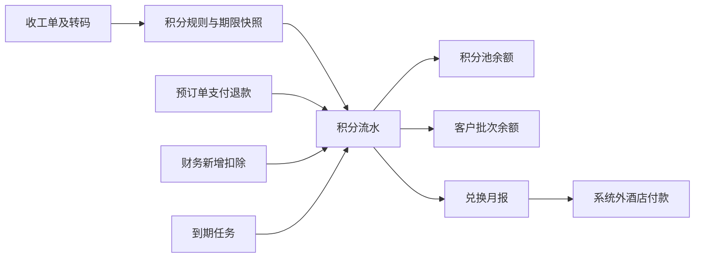
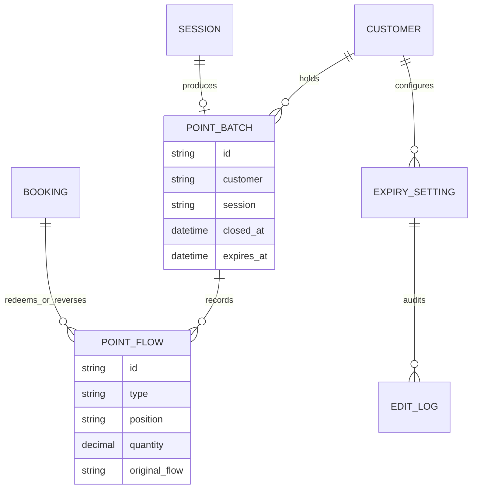

# 积分模块附录

## A2 目标用户与角色

| 角色 | 允许 | 不允许 |
|---|---|---|
| 财务 | 池新增扣除、报表及导出、对账 | 覆盖历史流水 |
| 账房操作员 | 收工、预订、退款、查看客户批次 | 未授权池调整 |
| 确认人 | 核实人工操作、期限变更 | 与同一操作人自确认 |
| 系统 | 收工自动发放、到期退回 | 无业务来源任意调余额 |
| 客户 | 自身可用积分及预订支付 | 查看其他户口及池管理 |

## A3 资料流与系统串接

- 积分池不暂定绑定COMPANY_STOCK，也不沿用现金公司户余额。
- 原型收工和预订使用共同本地积分账；正式系统需统一事务边界及幂等键。
- 独立本地存储与生产不可变流水、安全权限不是同一能力。

## A4 非功能需求

- 正式后台定时退回，断线补跑及任务重试不重复；页面关闭仍应执行。
- 正式交易保存发起时间，按到期前发起可完成的规则预留批次，防止排程抢先退回。
- 密码只用于校验，不写业务流水；记录真实操作人和确认人。
- 导出遵循权限、筛选及时区，不得自动披露其他户口。
- 积分与订单以及资金混合交易使用同一业务事务；本地原型不具备服务端并发保证。

## A7 B端专项

### A7.3 实体关系

- 同一户口允许多个独立批次；一次兑换允许多笔批次流水。
- 每个退款关联原兑换流水，不允许只按客户总余额加回。

## A9 待确认事项及原型暂定口径

| 事项 | 原文状态 | 当前处理 |
|---|---|---|
| 预警默认值冲突 | 7/3/1与30/14/7并存 | 用户最新确认提前30天，已落地 |
| 负数阈值是否停发 | 待确认 | 用户已确认只警示、不阻止 |
| 午夜收工归日 | 待确认 | 原型暂按实际收工自然日，非业务日切换 |
| 统一时区 | 待确认 | 原型暂用Asia/Shanghai，生产待业务确认 |
| 报表归月 | 待确认 | 原型暂按兑换/撤销发生时间归月，不按入住日 |
| 扣回不足 | 待确认 | 整笔阻止，提示人工核实，不生成负客户余额 |
| COMPANY_STOCK代表池 | 待确认 | 使用独立积分池，不套客户期限、不自动绑定此户口 |
| 负转码收工积分 | 未定义 | 原型暂发0，不能照负码粮规则自动推导负积分 |
| 已过期批次转码更正 | 未明确 | 原型阻止并提示规则待确认 |
| 预警消息渠道与重复频次 | 未定义 | 原型批次列表提醒，无外部消息发送 |
| 旧预订退款迁移 | 未给逐批来源 | 无原流水的旧订单不合成虚假退款；需补齐迁移对照 |

## A10 名词

- 积分池：永久、单一、可负的待拨发积分余额。
- 客户持有：尚有效、尚未兑换或退回的批次余分。
- 兑换净额：已兑换减已撤销；不是酒店实际付款额。
- 到期退回：将未使用客户积分回池，不含已经兑换部分。
- 最早到期先扣：原文称FIFO，实际排序为到期优先，再按收工时间。

## A11 相关资源

- 来源：用户提供《積分系統業務規則規格_3.docx》，2026-11-25。
- [[ai-handoff]]：计算、记录及实现合同。
- [[原型实现与验证说明]]：本轮交付与生产差距。
- 旧需求：[积分与中转设置](../菜单PRD_20261124/PRD_积分与中转设置_20261124.md)。
