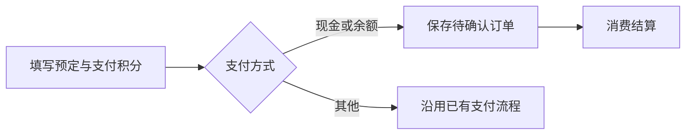
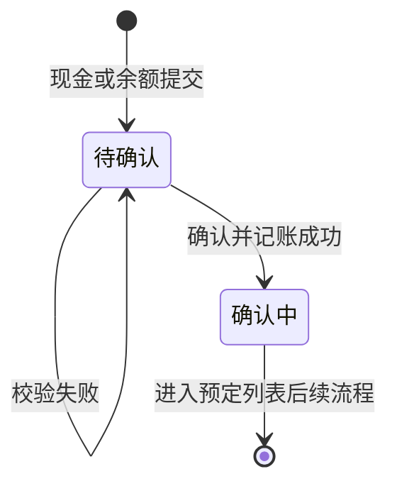
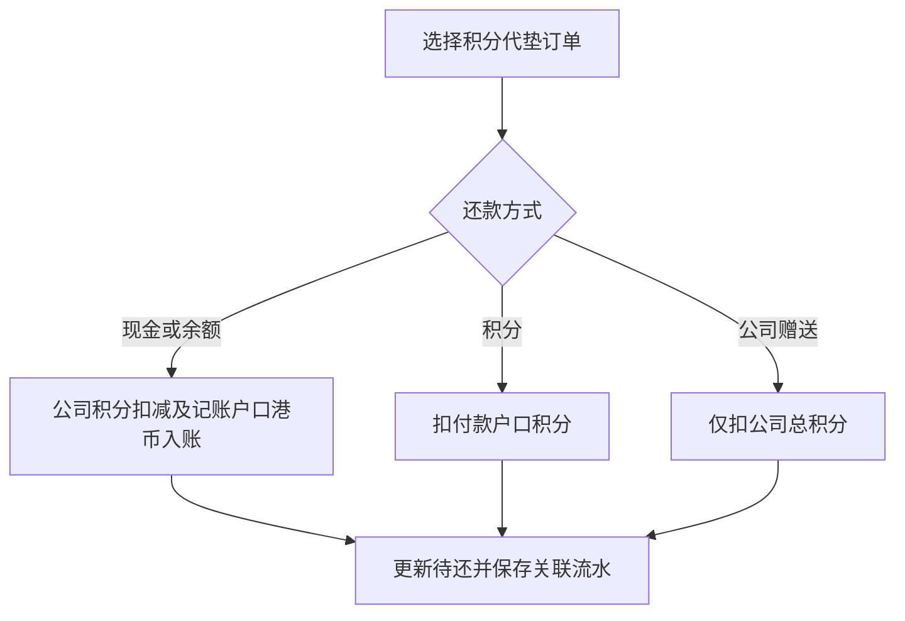
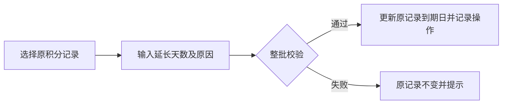
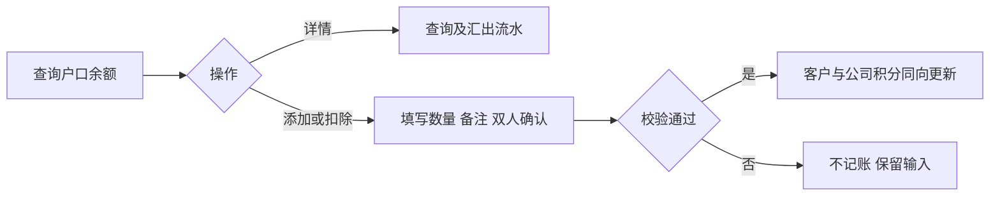
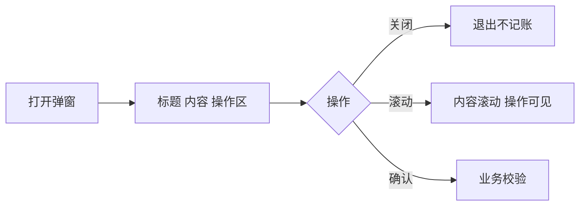
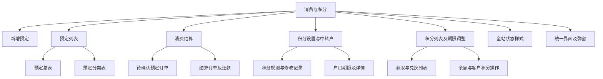

# 积分、预定与消费结算统一需求

## 目录
- [[#§1 修订追踪表]]
- [[#§2 背景与目标]]
- [[#§3 功能清单]]
- [[#§4 功能细节规格]]
- [[#§5 功能流程图]]
- [[#§6 功能结构图]]
- [[#§7 页面设计]]
- [[#§8 边界情况]]
- [[#§9 验收清单]]

## 本文件使用说明
- 本文合并 2026-11-27 今日更新与本轮更新，统一描述积分、预定、消费结算的最终需求；不替代未涉及模块的原需求。
- 两份原文中的重复内容已归并，冲突项按用户最后确认的规则统一；阅读时无需交叉判断两份文档。
- 原型基线：[本轮原型提交](https://github.com/bala-luoluo/cashier-prototype/commit/e207a8806f7e83b87fe01e2497373a267a3f01ed)。原型实现不等同于生产验收通过。
- 附录：[[PRD_积分预定与消费结算_20261127_appendix]]。待确认边界见附录 A9。

## §1 修订追踪表
|版本|日期|说明|
|---|---|---|
|V1|2026-11-27|合并需求初稿，未送审|

## §2 背景与目标
- 让现金和余额预定先确认后进入预定列表，明确结算责任与确认时间。
- 将待确认预定与代垫还款分开，减少重复导航和操作按钮。
- 将积分代垫现金回收与公司积分记账户口统一对应，支持追溯。
- 统一积分整数展示、期限调整和订单状态背景色。
- 使用对象：预定操作人员、结算确认人员、财务人员。

## §3 功能清单
|页面|变更|范围|
|---|---|---|
|P1 新增预定|[MOD]|支付积分可编辑；余额命名；现金和余额提交待确认|
|P2 消费结算|[MOD]|独立菜单；待确认预定订单、结算订单两个页签；筛选与确认|
|P3 预定列表|[MOD]|保留预定总表与预定分类表；审核信息；精简操作栏|
|P4 还款弹窗|[MOD]|还款方式、积分整数、按方式显示余额、公司积分扣减与现金入账|
|P5 积分设置与中转户|[NEW]/[MOD]|公司积分记账户口绑定；各币种余额；公司总积分流水展示|
|P6 积分列表|[MOD]|原记录到期日延长；重复与批量操作|
|P7 全站列表|[MOD]|统一订单状态背景色|
|P8 积分规则配置|[MOD]|获取条件、换算、默认期限、折数及修改记录|
|P9 户口期限设置|[MOD]|专属期限、搜索及详情记录|
|P10 积分户口余额|[MOD]|余额查询、最近到期、详情、手动增减|
|P11 公共界面与弹窗|[MOD]|积分、预定及结算界面统一风格|

## §4 功能细节规格
### P1 新增预定
- 消费金额与支付积分均按预定类型及定价条件带出默认值，允许手动编辑。
- 支付方式中的“扣存款”显示为“余额”。
- 支付积分默认读取对应预定价格，允许手动编辑；修改仅作用于本单。
- 改变房型、入住退房日期、季节、早餐或签证类型等定价条件后重新带出默认价格；切换支付方式等非定价条件不得无故覆盖已输入积分。
- 现金、余额支付提交后保存为待确认，不进行收款或扣款，不进入预定列表。
- 其他支付方式保留已有提交流程。历史已记账订单不追溯改为待确认。
- 必填资料、金额及户口校验失败时，保留输入并提示原因。

### P2 消费结算
- 左侧保留“消费结算”独立菜单，页面仅设置“待确认预定订单”“结算订单”两个页签。
- 待确认预定订单只显示现金、余额支付且未确认的预定，不重复显示同名副标题。
- 筛选支持预定单号、户口号或户名、消费类别、支付方式及预定日期起止；查询后生效，重置恢复无条件筛选。
- 列表展示订单基本信息、支付金额、币种、状态、操作人、确认人、确认时间及确认操作。
- 点击确认后核对订单，确认成功才执行收款或余额扣款，并进入预定列表；预定业务状态为确认中。
- 资金或配置校验失败时，订单仍待确认；允许修正后再次确认，已成功确认不可重复记账。
- 结算订单页签保留原代垫还款列表、筛选、统计、详情、单笔及批量还款。
- 累计代垫、累计还款、待还分别分现金与积分两行统计，不相加不同单位；明确当前筛选统计与户口整体待还的区别。
- 详情展示预定单、户口、代垫类型、原代垫、待还及还款记录；逐笔展示还款方式、扣款户口、实际扣除、备注、时间及操作人；无记录显示空状态。
- 表头全选及批量选择遵循同户口、同债务类型约束，混选不可提交。

### P3 预定列表
- 左侧“预定列表”与“消费结算”分别保留，各自进入对应页面。
- 预定列表内部仅保留预定总表、预定分类表，不再叠加“预定订单／结算订单”导航。
- 待确认订单不出现在预定总表与分类表；已确认订单按原消费分类展示。
- 公司垫付订单显示代垫类型，其他订单显示占位符。
- 展示操作人、确认人、确认时间。尚未确认或历史未留存信息显示“—”，不补造人员或时间。
- 总表固定右侧操作栏：详情、修改状态、更多；取消／退款、杂费、修改支付方式收进更多菜单。不可操作项目沿用禁用规则。
- 分类表不显示操作栏。

### P4 还款弹窗
- 支持现金、积分、余额、他人余额、他人积分、公司赠送；积分代垫默认积分。
- 现金代垫用积分还款采用配置折数，积分代垫用现金或余额按对应港币价值偿还；外币余额先按系统汇率与指定对手换汇为港币，汇率只读。
- 默认填应还数量；付款余额不足时预填可用数量，允许改为部分还款。提交核对展示实际扣除与折抵依据，最终确认后记账；返回或关闭不记账。
- 保存成交时的折数、汇率、扣款币种及分配结果，后续配置变化不改变历史还款；超额、余额不足、无效对手户口或密码校验失败时保留输入并阻止记账。
- 本人余额或积分从本户扣除；他人方式必须选择有效且不同于本户的扣款户口。
- 选择积分只显示扣款户口积分余额；选择余额只显示所选币种余额；现金和公司赠送不显示客户余额提示。
- 积分使用整数展示，数字后不附“点”或“个”；标题为“客户应还积分”“本次还款积分”。现金仍按万显示并保留四位小数。
- 保留本次抵还、还后待还及全额／部分还款提示；移除底部分配预览。
- 积分代垫用现金或余额还款，按本次实际抵还积分减少公司总积分，对应现金金额增加到公司积分记账户口的港币余额；公司总积分流水关联该记账户口与原订单。
- 余额还款同时扣除付款户口余额；外币余额沿用先换汇为港币的规则。现金还款沿用银头收入登记，不扣客户余额。
- 积分代垫用公司赠送还款，扣减公司总积分，不增加现金余额，不扣客户积分或余额。
- 用客户积分还款扣客户积分，沿用兑换不影响公司总积分的例外，不再额外扣减公司总积分。
- 支持部分还款；批量还款仅允许同户口、同代垫类型，按预定时间先后分配，合计记账不得重复。
- 公司总积分扣除纳入已使用积分，避免同笔业务多次计入；公司总积分负数沿用仅警示、不阻止的既有口径。

### P5 积分设置与中转户
- 中转户新增公司积分记账户口，支持搜索已开户户口、编辑绑定、操作记录；允许与其他中转类型绑定同一户口。
- 积分设置展示该绑定户口的各币种余额；金额以万显示、保留四位小数；未绑定明确提示设置，不虚构余额。
- 积分代垫回收现金或余额使用公司积分记账户口；普通消费的消费中转户规则保持独立。
- 仅显示公司总积分、客户总积分、已使用积分三项统计，不显示本月发放。公司总积分持续累计，客户总积分为当前有效剩余合计，已使用积分按本月发生时间统计。
- 已使用积分包含预定支付、垫付还款、手动扣除客户积分余额及公司总积分扣除；排除逾期、转码发放、更正及同业务重复联动。日期筛选仅作用于下方记录，不改变统计卡片本月含义。
- 手动增减客户积分与公司总积分同向等额变动；转码发放客户增加、公司减少；兑换扣客户积分但公司不变；逾期收回客户减少、公司增加；财务直接调整公司积分不改变客户余额。
- 公司总积分允许为负，仅警示不阻止正常发放；历史流水不自动改写或补记。
- 财务操作记录仅显示财务直接新增／扣除，公司总积分流水显示全部收支、户口和逐笔余额；两个页签共用日期筛选，新增／扣除按钮位于页签栏右侧。
- 汇出当前页签符合筛选的全部记录，不限当前可见行。新增／扣除弹窗展示当前余额、数量、对应日期、原因和双人密码；必填缺失或数量无效阻止提交，关闭不记账。
- 删除积分消费中转户口绑定行及编辑入口，保留历史绑定与记录；不删除实际客户户口，其他业务类型编辑对象不因行位置改变。
- 公司总积分说明显示“还款收回现金减池，逾期收回入池”；移除“转码发放减池”说明，不将文案删除解读为撤销既有转码记账规则。
- 公司总积分流水去掉期初、流入、流出、期末汇总横栏，保留明细及余额列。
- 已完成的历史入账保留原关联户口，不自动迁移到新绑定户口。

### P6 积分列表
- 获取、兑换、户口余额三个页签均有重置：清空户口号及只读户口名，日期恢复本月月初至当天，兑换方式恢复全部方式，并立即刷新当前页签；余额页不显示日期筛选。
#### 获取列表

- 顶部为获取列表、兑换列表、户口余额三个页签，统一显示三项积分统计。
- 户口号查询后带出只读户口名；提供日期范围、本月／上月／近三个月和汇出。
- 列表展示单号、户口号、户口名、获取原因、金额、期限、到期日、备注、创建时间、操作人。
- 到期日按日期显示；永久积分显示永久。取消在本页展示批次已兑换、批次剩余及影响位置。
- 手动添加的获取原因明确标注；收工自动发放与手动添加可区分。
- 正常：筛选与汇出一致。异常：无匹配结果显示空状态。边界：只读示例不参与统计、导出或业务操作。

#### 兑换列表

- 筛选顺序为户口、日期范围、快捷日期、兑换方式及汇出；记录按创建时间由新到旧显示。
- 列表展示单号、户口号、户口名、兑换方式、金额、备注、创建时间、操作人。
- 兑换方式可区分具体预定消费、垫付还款、手动扣除及积分逾期。
- 逾期记录可查询，但不计入已使用积分消耗；不得直接把本页金额合计当作已使用积分统计。
- 新业务不产生积分自动撤销或负数兑换记录；预定取消需补回积分时通过手动添加办理。
- 正常：金额清晰突出，长备注换行。异常：筛选无结果不显示虚构业务。边界：历史撤销记录保留，不改写历史。

#### 获取记录有效期调整
- 弹窗逐条显示原派发时间、派发数量、当前剩余及当前到期日，汇总涉及的剩余积分；调整仅作用于所选记录，不改其他批次或户口默认期限。
- 提供调整记录入口，保存前后日期、原因、操作人、确认人和时间；调整原因及双人确认必填，筛选或切换页签后清空勾选。
- 批量可跨户口，各记录按自身当前到期日计算；关闭不保存。只读示例不可操作，另提供明确标识的可操作演示记录用于验证单笔及批量调整。
- 获取列表支持单条、批量调整有效期，允许对同一记录持续操作。
- 输入延长天数，在每条原记录当前到期日上延长，直接更新该条记录；不从调整时间重新起算，不新增积分流水或积分批次。
- 保留原派发时间、数量和余额；每次调整记录操作时间、调整前后日期、原因与操作人员。
- 永久有效记录无需延长；可选择永久有效。已使用或已逾期收回积分不因调整期限恢复余额。
- 批量涉及不同到期日，分别计算；无效输入导致整批不保存。

### P7 全站列表
- 状态保留文字并增加背景标签，金额和普通文本不着色。
- 待确认、待审核、未还款使用黄色；确认中、已入住、部分还款使用蓝色。
- 已确认、已完成、已结清使用绿色；失败、驳回、冻结使用红色；取消、作废、过期使用灰色。
- 页面切换、筛选、弹窗及嵌入模块重新渲染后继续保持样式。

### P8 积分规则配置

- 设置入口保留公司总积分、积分设置、户口期限设置三个页签。
- 积分配置包含币种换算、获取条件、默认期限和现金代垫以积分还款的折数。
- 现金代垫以积分还款默认按六折折抵；配置修改仅作用于之后的还款。
- 设置修改不追溯改变已发积分到期日、已发生还款金额或已记录换算依据。
- “修改记录”按钮放在配置区域右上角。
- 修改记录弹窗显示修改时间、项目、修改前后内容、原因及修改人员；无记录显示明确空状态。
- 正常：保存后产生可追溯修改记录。异常：无效配置或双人确认失败不生效。边界：默认期限为永久时，后续新增积分采用永久期限。

### P9 户口期限设置

- 支持按户口号查找并设置专属使用期限；未设置的户口采用默认期限。下方期限使用列表支持户口号搜索，不提供恢复默认期限按钮。
- 每个户口展示户口号、户口名、期限来源和当前适用期限。
- 详情标题显示户口号和户口名；下方展示当前期限及默认／专属来源，再展示该户口修改记录。
- 未设置过专属期限且无历史记录时，提示一直使用默认期限；已有专属配置但无可用历史时，不误称从未设置。
- 正常：设置影响后续新增积分。异常：未选有效户口或期限无效不得保存。边界：永久期限以“永久”展示，不显示虚构日期。

### P10 户口余额与积分操作

- 主列表仅保留户口查询、自动带出户口名和汇出，不提供无意义的日期余额筛选。
- 展示当前剩余、最近到期日期及当天到期积分数量、适用期限，以及详情／添加／扣除操作。
- 同一天到期的多笔剩余积分合并显示；仅有永久积分时显示永久有效；无有效积分显示空值提示。
- 详情弹窗顶部显示户口信息、汇出及关闭；日期筛选支持快捷范围及全部。
- 详情显示当前剩余、查询笔数及流水；收入为绿色正数，支出为红色负数，按时间倒序。
- 手动添加使所选客户积分与公司总积分同步等额增加，进入获取列表；备注和双人密码必填。
- 手动扣除显示当前客户及可用积分，作为消耗进入兑换列表，公司总积分同步等额减少；积分逾期由自动到期机制办理。
- 正常：余额、流水及列表一致。异常：超出可用积分的扣除被阻止。边界：取消／关闭不记账；添加时可选择目标户口，扣除固定当前户口。

### P11 公共样式与弹窗

- 页面统一采用主系统深青色主操作、浅灰背景、浅色卡片、紧凑表格和一致文字层级。
- 参考截图用于结构，具体视觉以主系统为准，不照搬截图中的放大字号或示例数据。
- 所有积分弹窗统一标题栏、边框、圆角、背景遮罩、标签、输入框及按钮。
- 积分弹窗内容区独立滚动，标题栏和底部操作保持可见；详情中的汇出放在标题右侧。
- 双人密码在宽屏并排，窄屏允许换行；备注、原因采用多行输入。
- 代垫还款弹窗适度加宽，金额信息并排，缩短纵向留白，提交操作在滚动时可见。
- 列表横向滚动时操作栏固定右侧；弹窗内表格允许局部横向滚动。
- 正常：各模块操作样式一致。异常：长文字不能覆盖按钮。边界：小屏、长表格和空状态均须可读、可关闭。

## §5 功能流程图
### P1 新增预定
- 消费金额与支付积分均按预定类型及定价条件带出默认值，允许手动编辑。

### P2 消费结算

### P3 预定列表

### P4 还款

### P5 记账户口

### P6 有效期

### P7 状态标签

### P8—P9 规则及户口期限

### P10 客户积分操作

### P11 公共弹窗

## §6 功能结构图

## §7 页面设计
|页面|自上而下布局|
|---|---|
|P1|消费信息、客人信息、可编辑金额与积分、支付方式、确认信息、提交|
|P2|页面标题、两个页签、对应筛选区、对应订单表；还款页签保留统计及批量按钮|
|P3|页面标题、总表／分类表、筛选、列表；总表操作固定右侧|
|P4|弹窗标题、订单摘要、还款方式、对应余额、应还与本次金额、备注、密码、提交|
|P5|积分统计卡、记账户口各币种余额、日期筛选、财务记录／公司总积分流水|
|P6|查询与批量操作、获取列表；弹窗显示原数量及日期、延长天数、原因|
|P7|在原状态单元格内显示带背景色标签，保持系统字号及圆角|
|P8|页签、右上角修改记录、规则配置、确认区|
|P9|户口期限表单、户口号查询、期限使用列表；详情先当前期限后历史|
|P10|统计、户口查询与重置汇出、余额列表；详情提供日期筛选与流水|
|P11|主系统深青色操作、浅灰背景、紧凑表格；弹窗标题及底部操作持续可见|

## §8 边界情况
|编号|场景|处理|
|---|---|---|
|CC-1|确认时余额已被其他业务使用|再次校验，不记账，保留待确认|
|CC-2|重复点击确认或还款|同笔业务不得重复记账|
|CC-3|公司积分记账户口未绑定|现金回收不得扣公司积分后单独失败，应整笔阻止|
|CC-4|付款户与收款记账户口相同|余额还款阻止并提示|
|CC-5|多笔还款类型或户口不一致|不可批量提交|
|CC-6|旧订单缺少操作人员信息|显示“—”，不生成虚假确认时间|
|CC-7|永久有效或已使用完记录调整|可保留期限操作记录，不恢复积分余额|
|CC-8|日期范围反向|提示错误，不应用筛选|
|CC-9|绑定变更前已完成入账|保留历史真实户口，不重复补款|
|CC-10|输入积分出现小数|不得静默四舍五入后实际扣另一数额；提交口径需按附录明确|

|CC-11|只读示例行|不参与真实统计、导出或业务选择；可操作演示数据明确区分|
|CC-12|公司总积分负数|仅警示，不因公司不足阻止正常发放|
|CC-13|取消积分支付预定|不自动生成负数兑换或返还，补偿走手动添加|
|CC-14|同日多笔积分到期|最近到期展示当天有效剩余合计；永久不自动过期|
|CC-15|历史非港币现金代垫|未明确港币债务基准前不得擅自按同数额港币折算|

## §9 验收清单
### 9.1 功能验收
|编号|页面|可判定标准|
|---|---|---|
|AC-1|P1|手改支付积分后提交，订单积分与输入一致；改定价条件重新带出默认值|
|AC-2|P1/P2|现金、余额新订单在确认前不记账、不进入预定列表|
|AC-3|P2|六类筛选可组合，重置后恢复全部待确认记录|
|AC-4|P2|确认成功仅产生一次记账，订单从待确认移入预定列表|
|AC-5|P3|总表与分类表排除待确认记录；三列人员时间信息展示正确|
|AC-6|P3|总表仅直接显示详情、修改状态、更多；分类表无操作栏|
|AC-7|P4|积分代垫抵还16000，现金回收时公司积分减少16000，记账户口港币增加1.6000万|
|AC-8|P4|余额回收增加记账户口港币，同时扣付款余额；客户积分不变|
|AC-9|P4|公司赠送仅减少公司积分；积分还款仅减少付款客户积分|
|AC-10|P4|余额提示只显示对应资产，底部分配预览不出现，积分无四位小数及数量后缀|
|AC-11|P5|绑定可编辑且留痕，各币种余额对应同一绑定户口；历史流水不迁移|
|AC-12|P5|无期初流入流出期末汇总横栏，指定说明文案正确|
|AC-13|P6|原到期日连续延长10天、5天后累计延长15天；积分流水和批次数不增加|
|AC-14|P6|批量分别延长原到期日，积分数量及公司积分不因期限操作改变|
|AC-15|P7|待确认黄、确认中蓝、已完成绿、失败红、取消灰；文字清晰可读|

|AC-16|P5|三卡片名称及口径正确；财务增减、客户手动增减、转码、兑换、逾期分别按附录记账，无重复联动|
|AC-17|P5|财务记录与公司流水分别查询汇出；无本月发放、无旧积分消费中转绑定项|
|AC-18|P6/P10|三个页签重置后清空户口，适用日期恢复月初至当天，兑换恢复全部方式，不切换页签|
|AC-19|P6|获取十项资料及操作完整，兑换方式可筛选，逾期不计已使用积分，示例不混入导出|
|AC-20|P8|配置修改记录可追溯，新折数与默认期限不改变历史还款或已发积分|
|AC-21|P9|户口搜索、默认专属永久来源、详情空状态正确，不出现恢复默认期限按钮|
|AC-22|P10|同日最近到期数量正确，详情倒序及正负颜色正确；手动增减联动公司积分，超额扣除阻止|
|AC-23|P11|全部积分预定结算弹窗统一，窄屏长内容可滚动，关闭与提交可达，双人密码可输入|
|AC-24|P4|六种方式、部分与批量、外币换汇、成交依据保存分别验证；分配结果内部正确但不显示分配预览区|

### 9.2 非功能性验收
- 见附录 A4；刷新后订单、绑定及操作记录保持一致。
- 桌面常用宽度下操作栏可见，更多菜单不被表格裁剪，弹窗可滚动且提交按钮可达。

### 9.3 边界验收
- 逐一验证 CC-1 至 CC-15；资金校验失败不得产生部分资金变更。
- 验证多人操作与重复提交，不以本地界面按钮禁用代替业务防重。

### 9.4 专项与交付边界
- 当前原型为演示数据与本地存储，演示操作人、确认人不代表真实员工认证。
- 已执行部分脚本级检查：确认防重、积分扣减、现金换算、原记录有效期延长；不能据此宣布全部验收通过。
- 生产交付前完成真实身份、资金原子性、各币种流水对账及界面回归。

## 下一步建议
以本文验收清单执行整轮业务复测，并逐项记录结果；对附录待确认项形成独立决策记录。
