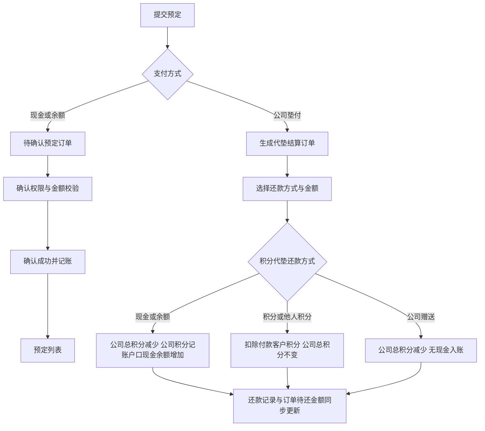
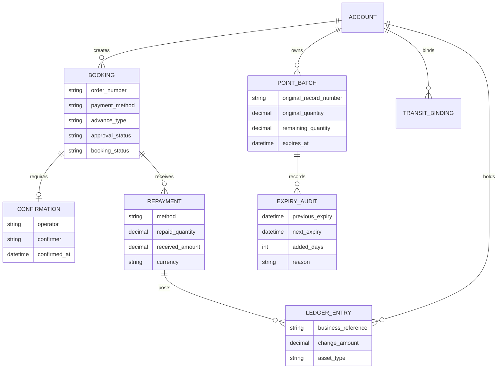

# 积分、预定与消费结算统一需求附录

主文档：[[PRD_积分预定与消费结算_20261127]]。

## A2 权限与审计

| 操作 | 权限要求 | 审计内容 |
| --- | --- | --- |
| 确认现金、余额预定 | 有消费结算确认权限 | 原订单、操作人、确认人、确认时间、支付方式及金额 |
| 单笔、批量还款 | 有还款权限，完成操作及确认验证 | 每单抵还、实际扣款、付款户口、收款记账户口、币种、备注 |
| 调整积分有效期 | 有积分期限调整权限 | 原记录、原到期日、新到期日、增加天数、原因、操作人及时间 |
| 配置公司积分记账户口 | 有中转户配置权限 | 修改前后绑定户口及操作人员 |

原型中的演示身份及密码校验不能视为生产权限实现。生产角色映射、双人验证及接口授权须在上线前确认。

## A3 记账与数据流

| 场景 | 客户积分 | 公司总积分 | 现金余额 |
| --- | --- | --- | --- |
| 转码获得积分 | 增加 | 减少 | 不因积分发放变动 |
| 未用积分逾期收回 | 减少 | 增加 | 不变 |
| 客户积分兑换，包括预定支付及积分还款 | 减少 | 不变 | 按业务规则处理，不虚构现金 |
| 手动调整客户积分 | 同操作增减 | 同向等额增减 | 不变 |
| 直接增减公司总积分 | 不变 | 同操作增减 | 不变 |
| 积分代垫以现金偿还 | 不扣客户积分 | 按本次抵还积分减少 | 公司积分记账户口增加实收金额 |
| 积分代垫以本人或他人余额偿还 | 不扣客户积分 | 按本次抵还积分减少 | 扣付款户口对应余额，增加公司积分记账户口实收金额 |
| 积分代垫以公司赠送偿还 | 不扣客户积分 | 按本次抵还积分减少 | 不收现金、不扣客户余额 |

现金与积分不可直接相加。积分还款使用配置的换算规则，记录换算结果及规则快照；余额涉及外币时保留来源币种、来源扣款和记账币种信息。当前原型以 HKD 入账的路径应按实际配置验收，不能自行推定所有币种均一比一。

已使用积分包含预定支付、垫付还款、手动扣除客户积分余额、公司总积分扣除；同一业务产生多条关联记录时应防止重复计入。

### 有效期规则

有限期记录的新到期日 = 调整前到期日 + 本次增加天数。连续操作使用上次更新后的到期日。原积分记录直接更新，不新增获取、兑换或公司积分流水。审计日志独立记录。

调整有效期不增加积分数量，不恢复已消费或已失效扣除的余额。永久有效记录不执行按天延长。

### 积分计算

- 积分获取默认每 1,000 HKD 转码获得 1 ，按完整积分向下取整；获取条件设为 0 时不计算。
- 外币转码先按积分配置汇率折为 HKD；与系统资金换汇汇率区分。
- 默认有效期 90 天；0 为永久；专属期限优先。默认期限按包含发放当日计算，90 天到期日为发放日后第 89 天。
- 消耗按最早到期优先，再按发放时间与稳定顺序处理；永久积分排在有限期之后。
- 公司总积分期末 = 期初 + 财务新增 − 财务扣除 + 客户普通增加 − 客户普通减少 − 转码发放 + 逾期收回 − 积分代垫现金或余额回收抵还积分 − 积分代垫公司赠送抵还积分；客户积分兑换不计入公司总积分变动。
- 手动扣除及负向更正同步减少公司总积分；手动添加和正向更正同步增加公司总积分；收工转码发放扣减公司总积分；预定支付及客户积分偿还代垫不影响公司总积分；到期收回增加池。
- 已使用积分 = 预定积分支付 + 垫付积分还款 + 手动扣除客户积分余额 + 公司总积分业务扣除。同笔联动不重复计算；仍按本月发生时间统计，不含到期、转码发放或更正；客户扣除的公司联动流水不重复计入。
- 最近到期数量为最近到期日各有效批次剩余之和。
- 日期边界、创建时间及统计月份采用 Asia/Shanghai。

### 代垫换算

| 债务类型 | 还款来源 | 换算 |
|---|---|---|
| 现金 | 现金、HKD余额、他人HKD余额 | 1 HKD抵还1 HKD |
| 现金 | 本人或他人积分 | 积分 × 折数 = 抵还HKD；所需积分向上取整 |
| 积分 | 本人或他人积分 | 1抵还1 |
| 积分 | 现金、余额、他人余额 | 1 HKD抵还1 |
| 任一 | 公司赠送 | 按债务原单位减免，不扣客户余额 |

- 现金代垫积分还款折数默认 0.6；设置允许 0—1。折数为 0 时不得以除零方式计算偿还数量，相关积分还现金路径应提示无法有效抵还。
- 货币界面采用“万”；1 万 = 10,000 原币单位。
- 外币余额需使用系统配置汇率，与指定对手换 HKD 后还款；源币扣款按四位小数向上取整。
- 折抵不得超过待还；积分整数进位带来的尾差不得使债务变成负数。
- 预填值不得超过付款方可用余额；可手动修改为有效部分还款。
- 多笔分配按预定时间由早到晚，逐笔抵还至耗尽本次额度。
- 确认页必须展示折数、币种与实际扣除，最终提交保存当时依据。

### 核对示例

| 情况 | 预期 |
|---|---|
| 现金欠款1万，以0.6折积分偿还 | 需要16,667，抵还不超过1万 |
| 客户使用50，以0.6折偿还现金欠款 | 抵还30 HKD，即0.0030万 |
| 100积分债务用HKD现金偿还 | 收取100 HKD，即0.0100万 |
| 100积分债务用积分偿还 | 扣100 |
| 同一日两批分别剩余10与20 | 最近到期显示该日期及30 |

### 防重复与追溯

- 核对前、返回修改和关闭均不得记账。
- 最终提交失败时，不产生局部扣减或部分订单还款。
- 同一提交重复处理不得新增第二次扣减。
- 历史非HKD现金欠款需要明确换算基准后处理，不自动沿用本轮新增HKD债务口径。

## A4 一致性及异常处理

- 确认订单、余额扣款、收款记账、积分扣减及状态变更应作为同一业务事务；任一步失败，不得仅完成其中一部分。
- 重复点击、网络重试不得重复确认、扣款、记账或生成还款记录。
- 提交时重新校验待还金额、余额、绑定户口及订单状态，避免使用弹窗打开时的旧数据。
- 批量还款按同户口、同代垫类型约束分配；显示总额，逐单保存实际抵还金额，不恢复已移除的分配预览区域。
- 历史流水保留原始归属；本轮改为公司积分记账户口不自动追溯迁移历史收款。历史差异另行核对，不能重复补记。
- 金额保持四位小数显示；积分显示不带四位小数或“点”“个”后缀。显示格式调整不应静默改变存储数量。

## A7.3 核心资料关系

本图用于表达业务关联，不要求采用上述数据库表名。订单审核状态与预定履行状态为不同概念。

- 日期及月份统一采用上海时区；到期任务防重复，永久积分不自动到期。
- 密码不进入持久化、业务日志及汇出。只读示例不计真实结果，汇出覆盖全部匹配记录。

## A9 待确认及验收边界

| 项目 | 边界与处理 |
| --- | --- |
| 积分小数输入 | 用户明确了显示不带四位小数，但未完整定义所有来源的小数入账与取整规则；上线前统一精度，避免显示和实际扣减不一致 |
| 历史收款归属 | 消费中转户与公司积分记账户口切换前的流水需对账；本次不自动迁移 |
| 权限与密码 | 原型演示不等于真实身份验证；生产端需补齐角色与双人确认约束 |
| 换算与多币种 | 使用现有配置；逐币种验证扣款、收款和兑换精度，不凭界面展示推定换算规则 |
| 历史非港币现金债务 | 港币债务基准未明确时阻止错误折算 |
| 生产验证 | 本文整理需求及原型基线，不宣称线上全量验收已通过；按主文档 §9 执行验收 |

## A10 名词统一

| 名称 | 含义 |
| --- | --- |
| 公司总积分 | 原“积分池”统计及流水口径 |
| 客户总积分 | 客户当前剩余积分合计 |
| 已使用积分 | 本轮明确的使用及扣除业务统计 |
| 消费结算 | 待确认预定订单与原代垫还款订单所在菜单 |
| 公司积分记账户口 | 积分代垫现金或余额还款最终指定的收款记账户口 |

## A11 需求依据

依据本轮用户对积分、消费结算、预定审核及展示的连续修订，以后续明确指令优先；原型基线为 [e207a88](https://github.com/bala-luoluo/cashier-prototype/commit/e207a8806f7e83b87fe01e2497373a267a3f01ed)。之前文档保留于阅读索引，发生冲突时以本轮明确修订为准。
