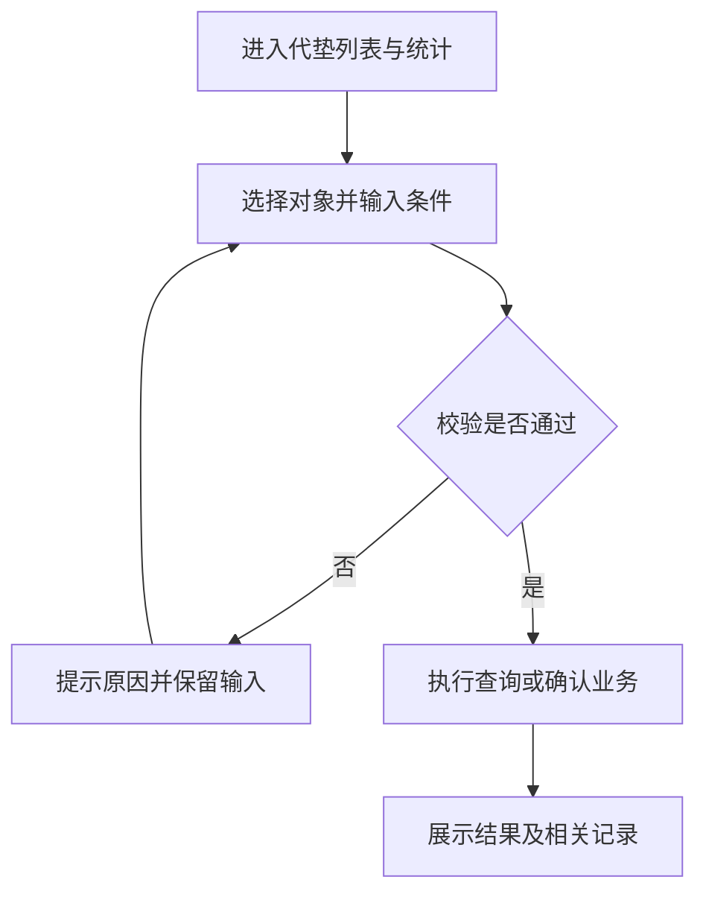
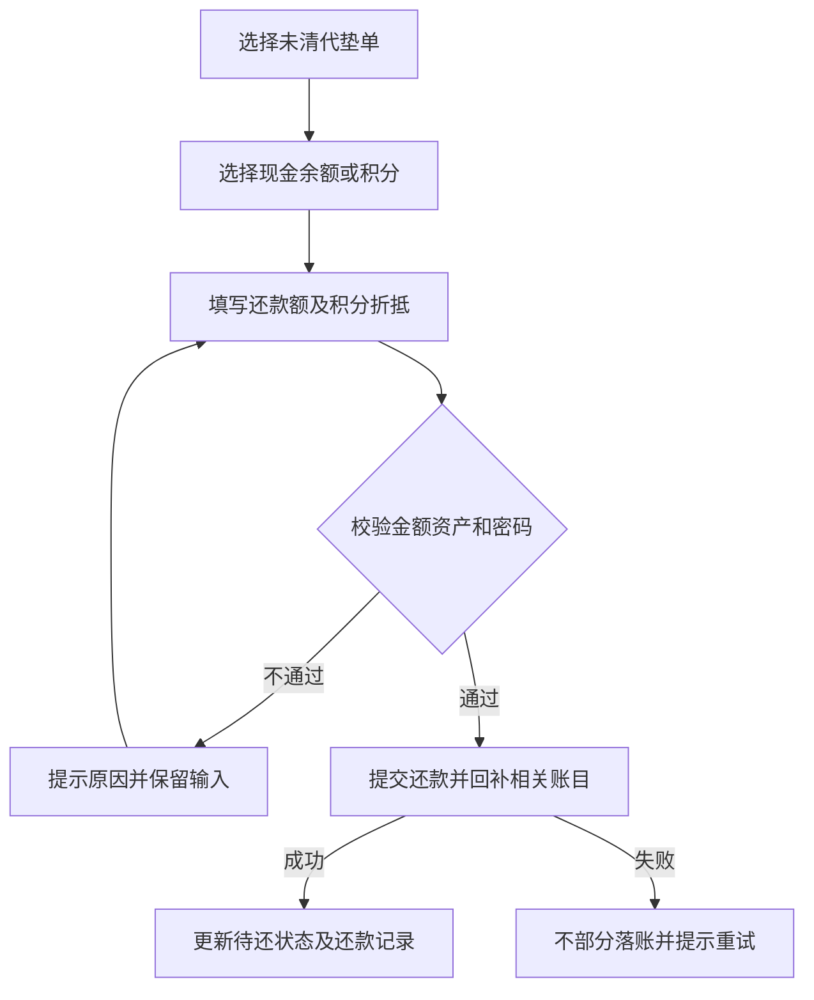
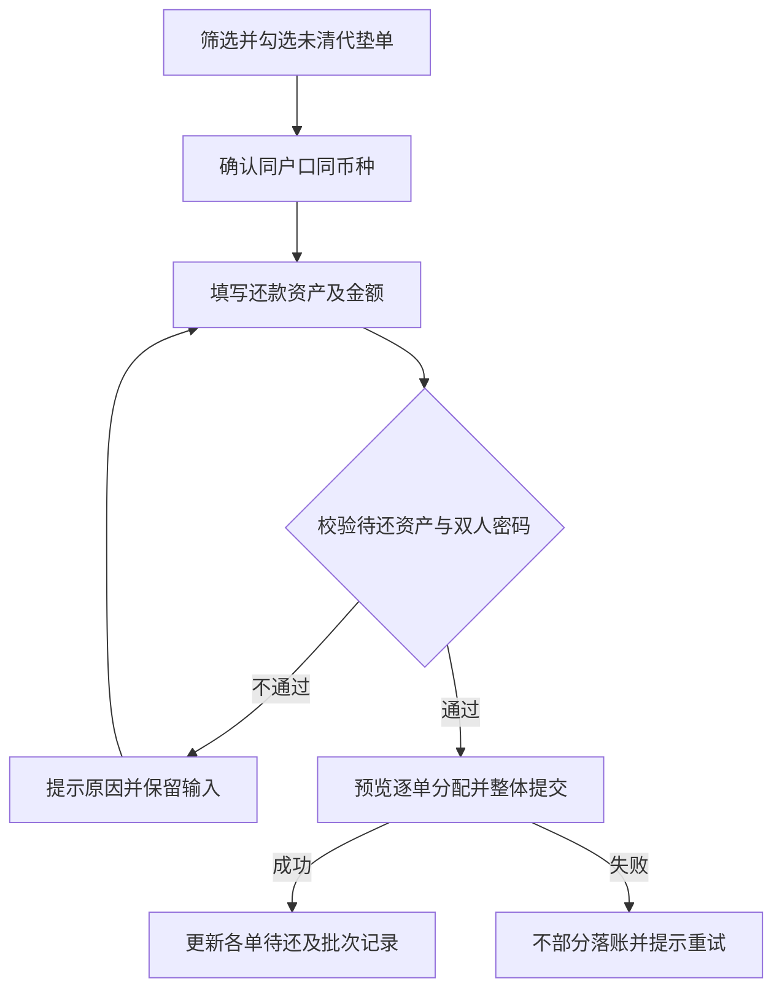
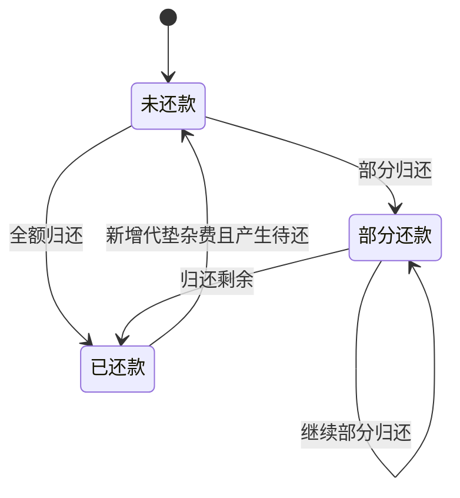
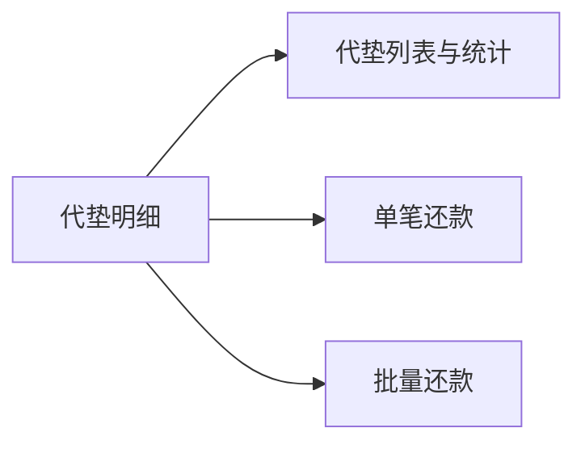

# 代垫明细

## 目录

- [[#§1 修订追踪表]]
- [[#§2 背景与目标]]
- [[#§3 功能清单]]
- [[#§4 功能细节规格]]
- [[#§5 功能流程图]]
- [[#§6 功能结构图]]
- [[#§7 页面设计]]
- [[#§8 边界与异常]]
- [[#§9 验收清单]]

## 本文件使用说明

- 范围为 2026-11-23 至 2026-11-24 本会话新增、调整的需求，按最终说明归并，不重写全部账房需求。
- 本文件是新编菜单分册，不表示生产验收通过。原型可操作、脚本测试和真实业务验收是不同状态。
- 配套：[公共附录_20261124](公共附录_20261124.md)、[业务计算与开发交接_20261124](业务计算与开发交接_20261124.md)、[交付状态与验收差距_20261124](交付状态与验收差距_20261124.md)。
- [MOD] 历史基线：[此前菜单文档](../菜单PRD_20261109/00_阅读索引.md)及[本期原型基线](https://github.com/bala-luoluo/cashier-prototype/commit/0904c7edd8d79829ada53a1b2c7a75c82d531597)。新增业务页标记 [NEW]，其本期交互调整一并写入最终规格。
- 权限、生产记账和待确认业务细节见公共附录；开放项不应按默认假设验收。

## §1 修订追踪表

| 版本 | 日期 | 说明 |
|---|---|---|
| V1 | 2026-11-24 | 初稿，未送审 |

## §2 背景与目标

- 面向账房操作人员、复核人员和配置管理员，形成配置、预定、支付、还款、积分记录可追溯的业务流程。
- 将原型中的最终交互与业务要求转为开发和验收依据，保留真实缺口，不将演示行为当作生产能力。
- 本期隐藏消费记录、车辆设置、接送预订管理、预订月结名单管理入口；隐藏不等于删除历史数据。

## §3 功能清单

| 页面 | 名称 | 类别 | 目标 |
|---|---|---|---|
| P1 | 代垫列表与统计 | [NEW] | 查询公司替客户垫付形成的欠款。 |
| P2 | 单笔还款 | [NEW] | 使用现金、户口余额或积分归还代垫。 |
| P3 | 批量还款 | [NEW] | 同户口多笔订单一次确认还款。 |

## §4 功能细节规格

### 4.1 P1 代垫列表与统计

- 左侧消费管理下独立设置代垫明细，不嵌入预定总表页签。
- 展示单号、户口、户名、类别、预定日期、币种、代垫金额、已还、待还、还款状态、最近还款日期及操作。
- 查询支持单号、户口、预定日期、类别、还款状态和还款日期；查询后统计对应全部匹配订单，不限当前显示部分。
- 统计采用卡片：累计代垫金额、累计还款金额、待还金额；每个币种单独一组，不混算。
- 已结清订单不显示还款入口，保留详情；订单详情和操作历史可追溯还款。
- 主消费与杂费均可能产生代垫；非代垫主消费退款不能抵扣另行代垫的杂费欠款。

- 正常结果：筛选某户口后列表与三张统计卡片一致。
- 异常结果：无数据时展示空态，不能沿用上一查询统计。
- 边界情况：同户口多币种独立统计；已取消但仍有未归还垫付时不能直接清除欠款。

### 4.2 P2 单笔还款

- 还款弹窗展示当前待还、币种，填写方式、还款或折抵金额、积分及备注。
- 积分还款由操作人手动填写积分数和折抵金额，不使用积分获取条件推算还款汇率。
- 余额还款扣客户相应币种余额；现金还款记录实收并影响开单厅现金银头；积分还款扣客户积分并记入积分消费中转户。
- 允许部分还款；每次成功后更新已还、待还、状态和还款记录。
- 金额必须有效且不超过当前待还，余额或积分不足不部分落账。
- 保存需要两组操作密码；生产权限与身份校验不等同于本地演示的非空校验。

- 正常结果：先部分还款，再结清，状态和统计逐次准确变化。
- 异常结果：零额、负数、超过待还或无可用资产时拦截。
- 边界情况：现金实收与中转余额的分录关系需按实际公司资金口径确认，见附录。

### 4.3 P3 批量还款

- 未结清订单可勾选，按钮显示选中笔数；未选择时按钮不可提交。
- 当前批量范围限定同一户口、同一币种；不同户口或不同币种混选时提示分别处理。
- 弹窗展示户口、币种、笔数、待还合计、方式、还款总额和备注，支持余额、现金及积分。
- 按创建时间从早到晚分配还款，显示每笔待还、本次分配及还后待还；可只覆盖前几笔或部分结清某一笔。
- 一次填写密码并确认，整批校验后统一执行；余额不足时所有订单均不变。
- 每笔实际分配金额形成还款记录，关联同一批次；未分配订单不生成空还款记录。
- 积分总数按折抵分配落到每笔，合计不得丢失精度；现金按各订单对应厅别记账。跨厅现金处理方式须见待确认项。

- 正常结果：两笔同币种订单，输入不足全清的总额，预览与实际分配一致。
- 异常结果：混户口、混币种、超额或任一记账失败时整批阻止。
- 边界情况：同一笔不得重复选择；提交前若欠款已变化应重算或要求重新确认。

## §5 功能流程图

### 5.1 P1 代垫列表与统计

### 5.2 P2 单笔还款

### 5.3 P3 批量还款

## §6 功能结构图

## §7 页面设计

### 7.1 P1 代垫列表与统计

- 使用账房统一浅色界面、青色主按钮、卡片及表格。页面标题与菜单名称明确对应。
- 查询区、业务内容区、操作确认区按顺序排列；详情弹窗居中，长内容可滚动，关闭按钮可见。
- 列表操作栏固定右侧；预定分类表明确无操作栏。窄屏可换行，不遮挡输入和提交。

### 7.2 P2 单笔还款

- 使用账房统一浅色界面、青色主按钮、卡片及表格。页面标题与菜单名称明确对应。
- 查询区、业务内容区、操作确认区按顺序排列；详情弹窗居中，长内容可滚动，关闭按钮可见。
- 列表操作栏固定右侧；预定分类表明确无操作栏。窄屏可换行，不遮挡输入和提交。

### 7.3 P3 批量还款

- 使用账房统一浅色界面、青色主按钮、卡片及表格。页面标题与菜单名称明确对应。
- 查询区、业务内容区、操作确认区按顺序排列；详情弹窗居中，长内容可滚动，关闭按钮可见。
- 列表操作栏固定右侧；预定分类表明确无操作栏。窄屏可换行，不遮挡输入和提交。

## §8 边界与异常

| 编号 | 页面 | 场景与处理 |
|---|---|---|
| CC-01 | P1 | 同户口多币种独立统计；已取消但仍有未归还垫付时不能直接清除欠款。 |
| CC-02 | P2 | 现金实收与中转余额的分录关系需按实际公司资金口径确认，见附录。 |
| CC-03 | P3 | 同一笔不得重复选择；提交前若欠款已变化应重算或要求重新确认。 |

## §9 验收清单

### 9.1 功能验收

| 编号 | 页面 | 判定标准 |
|---|---|---|
| AC-P1-01 | P1 | 筛选某户口后列表与三张统计卡片一致。 |
| AC-P1-02 | P1 | 无数据时展示空态，不能沿用上一查询统计。 |
| AC-P2-01 | P2 | 先部分还款，再结清，状态和统计逐次准确变化。 |
| AC-P2-02 | P2 | 零额、负数、超过待还或无可用资产时拦截。 |
| AC-P3-01 | P3 | 两笔同币种订单，输入不足全清的总额，预览与实际分配一致。 |
| AC-P3-02 | P3 | 混户口、混币种、超额或任一记账失败时整批阻止。 |

### 9.2 非功能验收

- 按 [[公共附录_20261124#A4 非功能要求]] 验证权限、密码保密、原子记账、重复提交及持久保存。
- 对照界面核验无代码裸露、无异常遮挡，浏览器刷新后的记录保持一致。

### 9.3 边界验收

- 逐项执行本文件 CC 编号用例，所有用例均应有明确结果，不得将待确认项标为通过。

### 9.4 专项验收

- 账目变化必须同时核对订单、客户、对应中转、厅别资金及操作记录，不能只凭成功提示。
- 需求签收要求所有适用项通过；当前验证覆盖见 [交付状态与验收差距_20261124](交付状态与验收差距_20261124.md)。

## 下一步建议

- 完成开放规则确认及缺口修复后，按页面执行正向、反向和边界验收。
