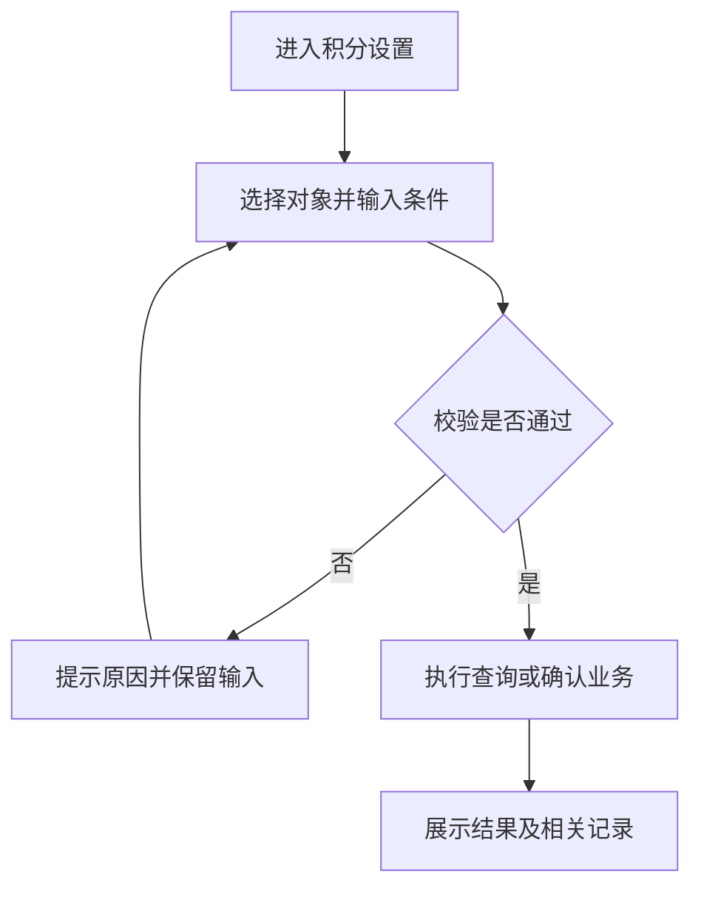
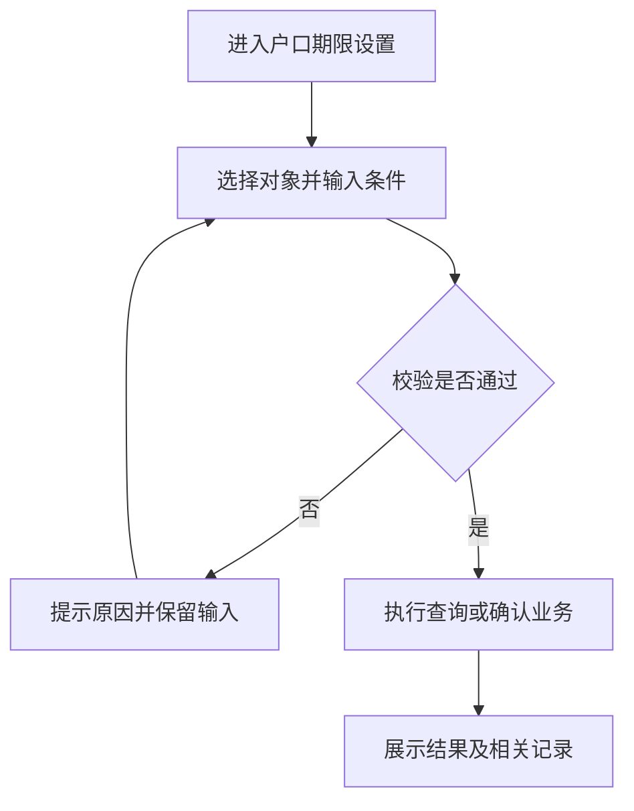
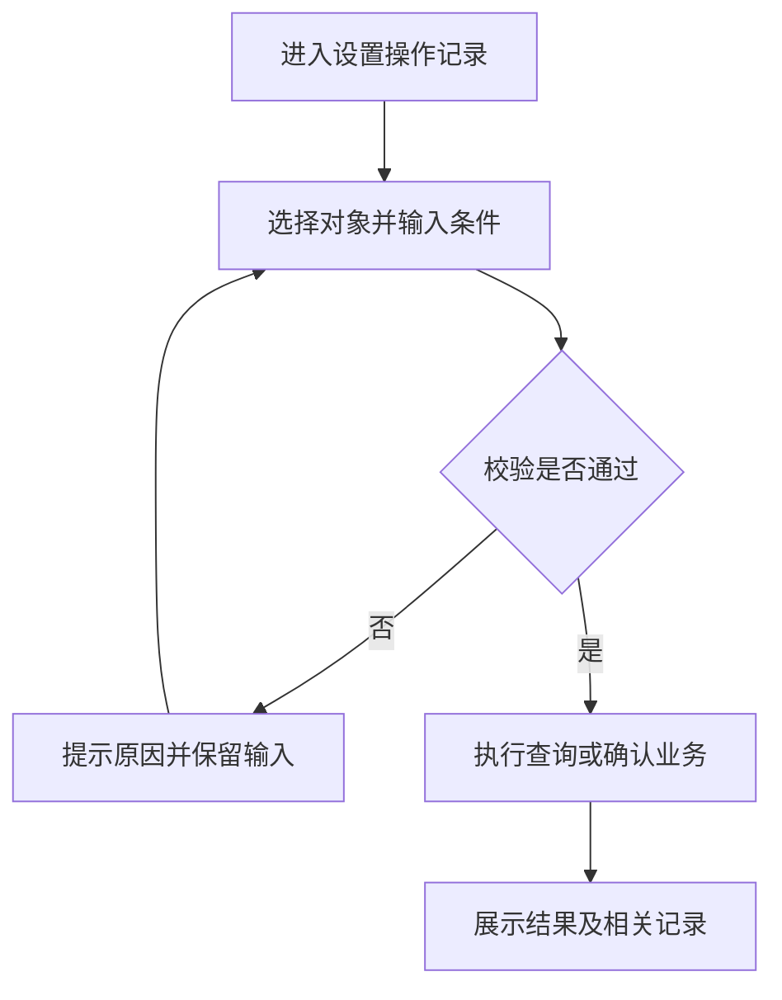
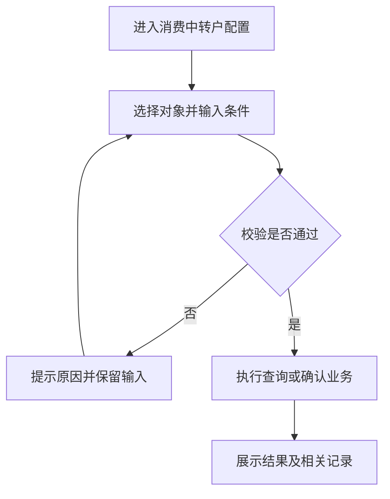
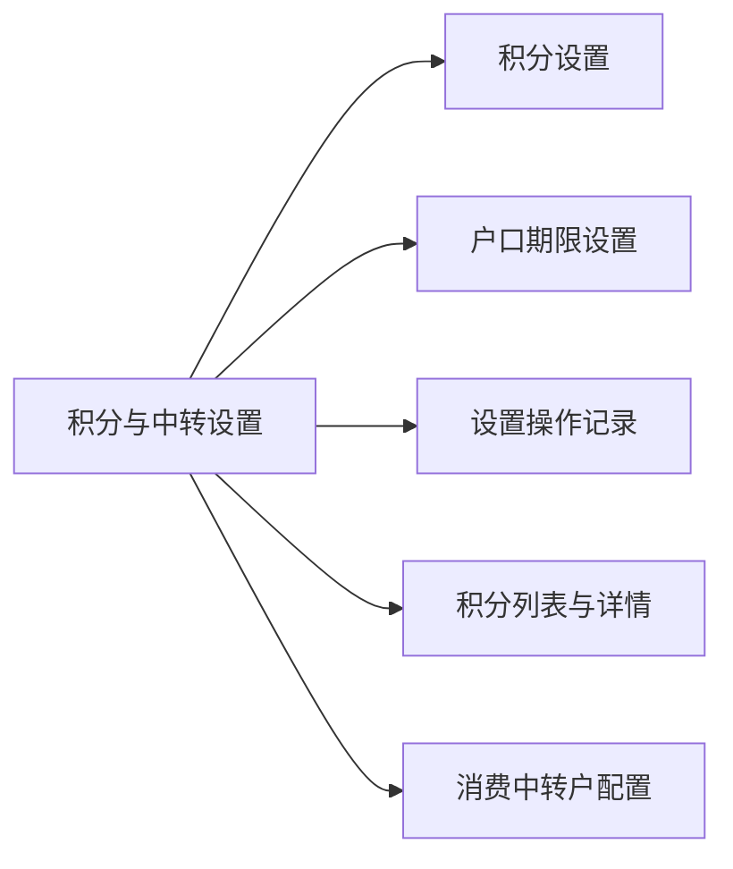

# 积分与中转设置

## 目录

- [[#§1 修订追踪表]]
- [[#§2 背景与目标]]
- [[#§3 功能清单]]
- [[#§4 功能细节规格]]
- [[#§5 功能流程图]]
- [[#§6 功能结构图]]
- [[#§7 页面设计]]
- [[#§8 边界与异常]]
- [[#§9 验收清单]]

## 本文件使用说明

- 范围为 2026-11-23 至 2026-11-24 本会话新增、调整的需求，按最终说明归并，不重写全部账房需求。
- 本文件是新编菜单分册，不表示生产验收通过。原型可操作、脚本测试和真实业务验收是不同状态。
- 配套：[公共附录_20261124](公共附录_20261124.md)、[业务计算与开发交接_20261124](业务计算与开发交接_20261124.md)、[交付状态与验收差距_20261124](交付状态与验收差距_20261124.md)。
- [MOD] 历史基线：[此前菜单文档](../菜单PRD_20261109/00_阅读索引.md)及[本期原型基线](https://github.com/bala-luoluo/cashier-prototype/commit/0904c7edd8d79829ada53a1b2c7a75c82d531597)。新增业务页标记 [NEW]，其本期交互调整一并写入最终规格。
- 权限、生产记账和待确认业务细节见公共附录；开放项不应按默认假设验收。

## §1 修订追踪表

| 版本 | 日期 | 说明 |
|---|---|---|
| V1 | 2026-11-24 | 初稿，未送审 |

## §2 背景与目标

- 面向账房操作人员、复核人员和配置管理员，形成配置、预定、支付、还款、积分记录可追溯的业务流程。
- 将原型中的最终交互与业务要求转为开发和验收依据，保留真实缺口，不将演示行为当作生产能力。
- 本期隐藏消费记录、车辆设置、接送预订管理、预订月结名单管理入口；隐藏不等于删除历史数据。

## §3 功能清单

| 页面 | 名称 | 类别 | 目标 |
|---|---|---|---|
| P1 | 积分设置 | [NEW] | 维护积分获取、使用期限和设置历史。 |
| P2 | 户口期限设置 | [NEW] | 按户口设置专属期限并查询使用列表。 |
| P3 | 设置操作记录 | [NEW] | 查询并查看积分设置变更。 |
| P4 | 积分列表与详情 | [NEW] | 查询获取、兑换及积分变动。 |
| P5 | 消费中转户配置 | [MOD] | 统一消费业务配置并兼容已有绑定。 |

## §4 功能细节规格

### 4.1 P1 积分设置

- 积分管理提供积分设置、户口期限设置、设置操作记录三个页签，并嵌入账房统一界面。
- 积分设置维护参考截图中的六种币别换算参数、积分获取条件和默认使用期限；港币参考项保持基准值。
- 积分获取条件设为零不计算新增积分；使用期限设为零表示永久。
- 设置操作需要两组密码，保存变更前后值；设置只影响后续新增积分，已有批次到期时间不追溯改变。
- 获取规则、汇率与收工自动发放的完整联动尚需专门验证，不能仅凭设置表单可保存认定完成。

- 正常结果：修改默认期限并保存，在设置记录中看到变更前后值。
- 异常结果：参数格式不合法或密码不符合要求时不保存。
- 边界情况：未改变内容不新增重复变更记录。

### 4.2 P2 户口期限设置

- 上方两列分别为户口检索与专属期限，下方两列为操作人和确认人密码，底部保留保存户口期限按钮。
- 户口输入号检索后必须选中结果；选中后回显当前默认或专属期限。
- 户口专属期限优先；未单独设置的户口使用默认期限；零表示永久。
- 去掉恢复默认期限操作，不保留页面按钮；本期未定义重新解除专属期限的新操作。
- 下方使用列表展示户口号、户名、期限来源、当前使用期限。
- 列表提供独立户口号搜索、查询、重置及匹配数量，支持部分匹配且不区分大小写。
- 查询列表不得清空上方未保存的户口、期限和密码内容。

- 正常结果：选户口并保存专属期限，列表显示专属来源及正确天数。
- 异常结果：未选择有效户口或期限无效时拦截。
- 边界情况：输入新的户口检索词后清除旧选择，避免把期限保存到上一个户口。

### 4.3 P3 设置操作记录

- 展示时间、操作类型、涉及户口或全局范围、变更字段、变更前及变更后内容。
- 支持户口、操作类型、变更字段、起止时间查询和重置，显示匹配数量。
- 开始时间晚于结束时间时提示；无匹配记录显示空态。
- 详情采用业务名称及值，不显示程序代码；密码不得进入记录。

- 正常结果：按户口查询只返回对应设置操作。
- 异常结果：无效时间范围不执行查询。
- 边界情况：全局设置和专属期限变更能明确区分。

### 4.4 P4 积分列表与详情

- 左侧独立积分列表菜单，包含获取列表、兑换列表、积分流水三个页签。
- 获取列表显示序号、单号、户口号、获取积分、已兑换、剩余、状态、创建时间及详情。
- 兑换列表显示单号、户口、兑换积分、业务或状态、时间与详情；积分流水显示带方向的变动积分及业务来源。
- 三页签支持单号、户口号、创建日期查询、重置、数量及空态；操作栏保持右侧固定。
- 获取详情显示单号、户口、获取、已用、剩余、到期时间、状态、时间和来源；采用居中弹窗、对齐字段、右上角及底部关闭按钮。
- 预定积分支付和代垫积分还款应进入积分流水；本期原型已读取相关流水，但所有积分来源和积分批次尚未统一。
- 截图中的导出、手动新增积分、扣除积分不在本期新增列表已交付范围，不能据截图认定完成。

- 正常结果：查询单号后打开对应详情，字段与列表一致。
- 异常结果：无匹配记录或日期错误有明确反馈。
- 边界情况：积分使用点为单位，不混用金额的万；历史种子数据单位问题须完成专项核验。

### 4.5 P5 消费中转户配置

- 酒店、签证、机票、餐厅、快速通关、高尔夫及其他消费合并为一个消费中转户口，所有预定类别读取它。
- 原积分中转户口改称积分消费中转户口，供积分支付和代垫积分还款读取。
- 多个中转类型允许绑定同一个已开户户口；分别记录现金和积分，不因此混合资产。
- 消费中转户已有统一绑定时直接使用；旧分类型绑定只有一个或指向相同户口时沿用。旧绑定冲突时不任意选择，需重新指定。
- 原积分绑定自动沿用到新名称；历史订单继续使用原记录中的付款或中转信息进行追溯。
- 消费中转与积分消费中转是两项独立配置，不能把积分绑定误当现金消费绑定。
- 修改中转配置保留变更记录；配置有效不代表免除冻结或必要资产校验。

- 正常结果：同一户口分别绑定消费及积分消费类型，两种业务各自正确记账。
- 异常结果：找不到已开户户口时不能保存绑定；缺配置时不能提交消费。
- 边界情况：多个旧消费类型绑不同户口时保留历史并提示处理，不自动合并金额。

## §5 功能流程图

### 5.1 P1 积分设置

### 5.2 P2 户口期限设置

### 5.3 P3 设置操作记录

### 5.4 P4 积分列表与详情

### 5.5 P5 消费中转户配置

## §6 功能结构图

## §7 页面设计

### 7.1 P1 积分设置

- 使用账房统一浅色界面、青色主按钮、卡片及表格。页面标题与菜单名称明确对应。
- 查询区、业务内容区、操作确认区按顺序排列；详情弹窗居中，长内容可滚动，关闭按钮可见。
- 列表操作栏固定右侧；预定分类表明确无操作栏。窄屏可换行，不遮挡输入和提交。

### 7.2 P2 户口期限设置

- 使用账房统一浅色界面、青色主按钮、卡片及表格。页面标题与菜单名称明确对应。
- 查询区、业务内容区、操作确认区按顺序排列；详情弹窗居中，长内容可滚动，关闭按钮可见。
- 列表操作栏固定右侧；预定分类表明确无操作栏。窄屏可换行，不遮挡输入和提交。

### 7.3 P3 设置操作记录

- 使用账房统一浅色界面、青色主按钮、卡片及表格。页面标题与菜单名称明确对应。
- 查询区、业务内容区、操作确认区按顺序排列；详情弹窗居中，长内容可滚动，关闭按钮可见。
- 列表操作栏固定右侧；预定分类表明确无操作栏。窄屏可换行，不遮挡输入和提交。

### 7.4 P4 积分列表与详情

- 使用账房统一浅色界面、青色主按钮、卡片及表格。页面标题与菜单名称明确对应。
- 查询区、业务内容区、操作确认区按顺序排列；详情弹窗居中，长内容可滚动，关闭按钮可见。
- 列表操作栏固定右侧；预定分类表明确无操作栏。窄屏可换行，不遮挡输入和提交。

### 7.5 P5 消费中转户配置

- 使用账房统一浅色界面、青色主按钮、卡片及表格。页面标题与菜单名称明确对应。
- 查询区、业务内容区、操作确认区按顺序排列；详情弹窗居中，长内容可滚动，关闭按钮可见。
- 列表操作栏固定右侧；预定分类表明确无操作栏。窄屏可换行，不遮挡输入和提交。

## §8 边界与异常

| 编号 | 页面 | 场景与处理 |
|---|---|---|
| CC-01 | P1 | 未改变内容不新增重复变更记录。 |
| CC-02 | P2 | 输入新的户口检索词后清除旧选择，避免把期限保存到上一个户口。 |
| CC-03 | P3 | 全局设置和专属期限变更能明确区分。 |
| CC-04 | P4 | 积分使用点为单位，不混用金额的万；历史种子数据单位问题须完成专项核验。 |
| CC-05 | P5 | 多个旧消费类型绑不同户口时保留历史并提示处理，不自动合并金额。 |

## §9 验收清单

### 9.1 功能验收

| 编号 | 页面 | 判定标准 |
|---|---|---|
| AC-P1-01 | P1 | 修改默认期限并保存，在设置记录中看到变更前后值。 |
| AC-P1-02 | P1 | 参数格式不合法或密码不符合要求时不保存。 |
| AC-P2-01 | P2 | 选户口并保存专属期限，列表显示专属来源及正确天数。 |
| AC-P2-02 | P2 | 未选择有效户口或期限无效时拦截。 |
| AC-P3-01 | P3 | 按户口查询只返回对应设置操作。 |
| AC-P3-02 | P3 | 无效时间范围不执行查询。 |
| AC-P4-01 | P4 | 查询单号后打开对应详情，字段与列表一致。 |
| AC-P4-02 | P4 | 无匹配记录或日期错误有明确反馈。 |
| AC-P5-01 | P5 | 同一户口分别绑定消费及积分消费类型，两种业务各自正确记账。 |
| AC-P5-02 | P5 | 找不到已开户户口时不能保存绑定；缺配置时不能提交消费。 |

### 9.2 非功能验收

- 按 [[公共附录_20261124#A4 非功能要求]] 验证权限、密码保密、原子记账、重复提交及持久保存。
- 对照界面核验无代码裸露、无异常遮挡，浏览器刷新后的记录保持一致。

### 9.3 边界验收

- 逐项执行本文件 CC 编号用例，所有用例均应有明确结果，不得将待确认项标为通过。

### 9.4 专项验收

- 账目变化必须同时核对订单、客户、对应中转、厅别资金及操作记录，不能只凭成功提示。
- 需求签收要求所有适用项通过；当前验证覆盖见 [交付状态与验收差距_20261124](交付状态与验收差距_20261124.md)。

## 下一步建议

- 完成开放规则确认及缺口修复后，按页面执行正向、反向和边界验收。
