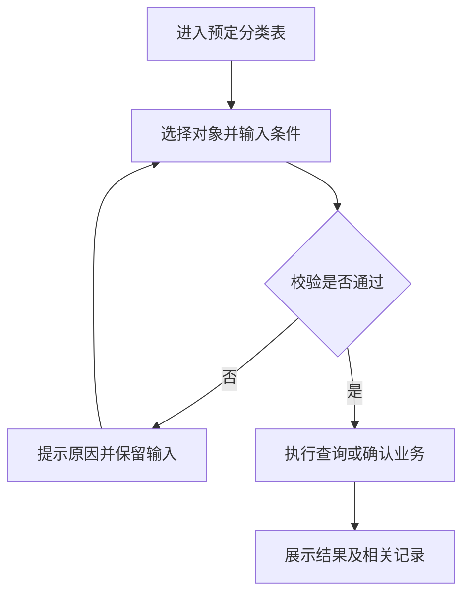
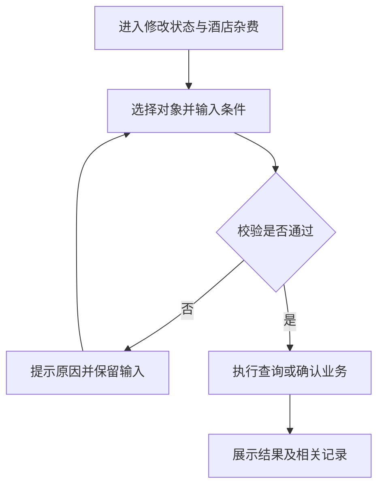
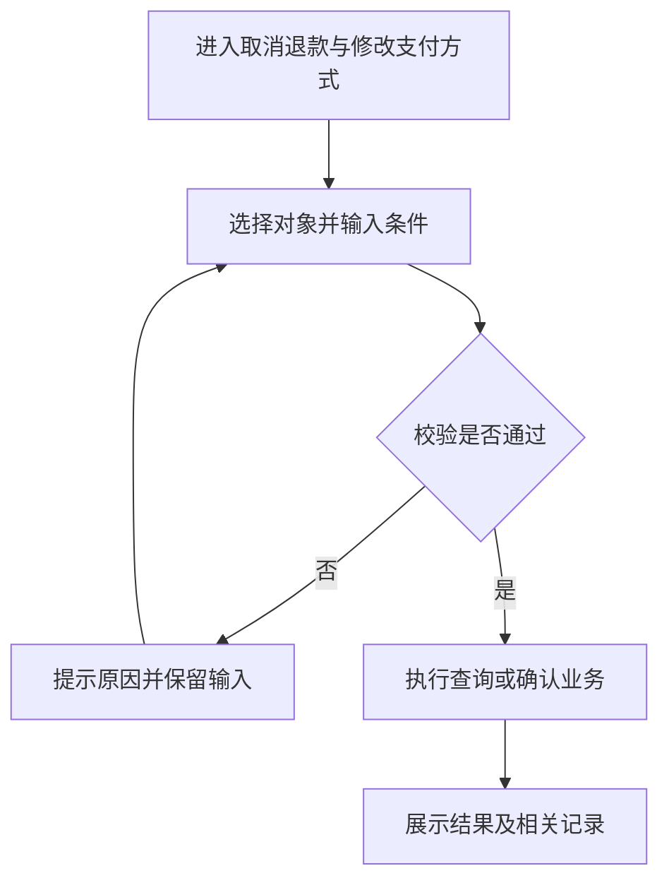
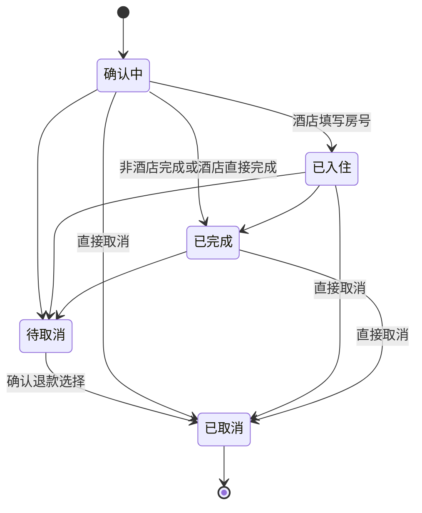
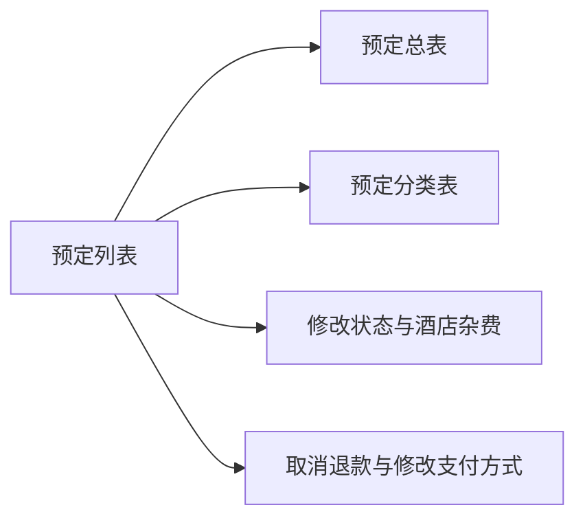

# 预定列表

## 目录

- [[#§1 修订追踪表]]
- [[#§2 背景与目标]]
- [[#§3 功能清单]]
- [[#§4 功能细节规格]]
- [[#§5 功能流程图]]
- [[#§6 功能结构图]]
- [[#§7 页面设计]]
- [[#§8 边界与异常]]
- [[#§9 验收清单]]

## 本文件使用说明

- 范围为 2026-11-23 至 2026-11-24 本会话新增、调整的需求，按最终说明归并，不重写全部账房需求。
- 本文件是新编菜单分册，不表示生产验收通过。原型可操作、脚本测试和真实业务验收是不同状态。
- 配套：[公共附录_20261124](公共附录_20261124.md)、[业务计算与开发交接_20261124](业务计算与开发交接_20261124.md)、[交付状态与验收差距_20261124](交付状态与验收差距_20261124.md)。
- [MOD] 历史基线：[此前菜单文档](../菜单PRD_20261109/00_阅读索引.md)及[本期原型基线](https://github.com/bala-luoluo/cashier-prototype/commit/0904c7edd8d79829ada53a1b2c7a75c82d531597)。新增业务页标记 [NEW]，其本期交互调整一并写入最终规格。
- 权限、生产记账和待确认业务细节见公共附录；开放项不应按默认假设验收。

## §1 修订追踪表

| 版本 | 日期 | 说明 |
|---|---|---|
| V1 | 2026-11-24 | 初稿，未送审 |

## §2 背景与目标

- 面向账房操作人员、复核人员和配置管理员，形成配置、预定、支付、还款、积分记录可追溯的业务流程。
- 将原型中的最终交互与业务要求转为开发和验收依据，保留真实缺口，不将演示行为当作生产能力。
- 本期隐藏消费记录、车辆设置、接送预订管理、预订月结名单管理入口；隐藏不等于删除历史数据。

## §3 功能清单

| 页面 | 名称 | 类别 | 目标 |
|---|---|---|---|
| P1 | 预定总表 | [NEW] | 在一个列表中管理全部类别预定及后续业务。 |
| P2 | 预定分类表 | [NEW] | 按类别查看业务字段，不提供操作栏。 |
| P3 | 修改状态与酒店杂费 | [NEW] | 把状态、杂费及取消退款分开操作。 |
| P4 | 取消退款与修改支付方式 | [NEW] | 按原支付记录冲回并追踪订单变化。 |

## §4 功能细节规格

### 4.1 P1 预定总表

- 左侧独立“预定列表”菜单内设置“预定总表”和“预定分类表”两个页签，默认进入总表。
- 总表汇总所有类别，展示单号、户口号、户名、开户厅、消费类别、预定日期、客人姓名、币别、消费金额、杂费、退款、总金额、预定状态、支付方式和结算状态。
- 支持按预定单号、户口、类别、日期、支付方式和预定状态查询、重置，显示匹配笔数。
- 操作栏固定右侧，提供详情、修改状态、取消／退款、酒店杂费和修改支付方式。已取消订单只读。
- 详情以业务字段呈现订单及历史，不显示原始代码；状态、金额和支付调整均需留痕。
- 总表与分类表读取同一批订单，不能各自生成重复订单。

- 正常结果：新预定保存后在总表和对应分类中显示相同订单。
- 异常结果：无匹配订单显示空态；非法操作须提示，不修改原记录。
- 边界情况：不同币种金额不直接相加；开户厅与本次开单厅不能混为一个字段。

### 4.2 P2 预定分类表

- 分类包括酒店、签证、机票、餐厅、快速通关、高尔夫球、其他；保留查询、重置及笔数。
- 共用单号、户口号、户名、币别和总金额；酒店显示酒店、房型、房号、客人、入住退房日期、晚数、延伸杂费。
- 签证显示类型、客人及日期；机票显示乘客、航班及日期；餐厅显示名称、客人及日期；其他类别显示对应项目、姓名及日期。
- 分类表不显示操作栏，也不显示客户版预览按钮；修改业务统一回到总表。
- 页面不重复显示预定管理标题及新增／设置导航。

- 正常结果：选择机票分类只显示机票订单及对应字段。
- 异常结果：分类内查询无结果显示空态。
- 边界情况：切换分类不保留与新类别冲突的筛选条件；已取消记录仍能按条件查看。

### 4.3 P3 修改状态与酒店杂费

- 修改状态弹窗只处理状态、相关房间号及备注，不显示杂费或退款字段。
- 酒店入住时必须填写房号；完成后不能退回确认中或已入住，已入住不能退回确认中。
- “待取消”记录取消申请；最终取消及是否退款通过独立入口处理。
- 杂费只对酒店提供独立入口，填写项目、金额、支付方式及必要支付积分；登记时状态为已完成。
- 杂费与原消费分别记账并累加订单金额；杂费使用公司垫付时新增待还欠款。
- 操作记录说明杂费项目、金额和支付方式；保存后总表、分类表及代垫明细同步。

- 正常结果：酒店填写房号入住，完成后登记杂费，金额与流水同步。
- 异常结果：入住无房号、杂费缺项目或状态回退时拦截。
- 边界情况：同单多次杂费为独立记录；重复点击不能重复计费的生产保障仍需专项验收。

### 4.4 P4 取消退款与修改支付方式

- 取消弹窗选择待取消或最终取消，最终取消时明确是否退款、退款金额及备注；积分订单另填退还积分。
- 退款不超过原消费剩余可退金额；非积分订单不可退积分。全额积分退款应退还全部原支付积分。
- 已有代垫还款的订单目前阻止直接退款，避免双重退还；需要形成正式的已还款退款处理规则。
- 已取消订单不得重复取消或修改支付方式；退款以原支付记录为依据，不能因后来更换中转配置改退其他户口。
- 修改支付方式先冲回原支付，再执行新方式，作为一次业务完成；任一校验失败整体不变。
- 已有还款、退款或杂费的订单不可直接更换支付方式。修改记录保留原方式、新方式、时间及备注。
- 原型支持原消费取消退款；杂费退款与多次退款不应视作已支持。

- 正常结果：无后续变更订单更换支付方式成功，原款冲回、新款正确记账。
- 异常结果：超退、重复取消、资金不足或已有后续账务时拦截。
- 边界情况：取消不退款与退款取消均保留历史，不能用删除订单代替取消。

## §5 功能流程图

### 5.1 P1 预定总表

### 5.2 P2 预定分类表

### 5.3 P3 修改状态与酒店杂费

### 5.4 P4 取消退款与修改支付方式

- 已完成后允许取消为当前原型能力，其生产边界需核对公共附录；不得允许无理由的状态回退。

## §6 功能结构图

## §7 页面设计

### 7.1 P1 预定总表

- 使用账房统一浅色界面、青色主按钮、卡片及表格。页面标题与菜单名称明确对应。
- 查询区、业务内容区、操作确认区按顺序排列；详情弹窗居中，长内容可滚动，关闭按钮可见。
- 列表操作栏固定右侧；预定分类表明确无操作栏。窄屏可换行，不遮挡输入和提交。

### 7.2 P2 预定分类表

- 使用账房统一浅色界面、青色主按钮、卡片及表格。页面标题与菜单名称明确对应。
- 查询区、业务内容区、操作确认区按顺序排列；详情弹窗居中，长内容可滚动，关闭按钮可见。
- 列表操作栏固定右侧；预定分类表明确无操作栏。窄屏可换行，不遮挡输入和提交。

### 7.3 P3 修改状态与酒店杂费

- 使用账房统一浅色界面、青色主按钮、卡片及表格。页面标题与菜单名称明确对应。
- 查询区、业务内容区、操作确认区按顺序排列；详情弹窗居中，长内容可滚动，关闭按钮可见。
- 列表操作栏固定右侧；预定分类表明确无操作栏。窄屏可换行，不遮挡输入和提交。

### 7.4 P4 取消退款与修改支付方式

- 使用账房统一浅色界面、青色主按钮、卡片及表格。页面标题与菜单名称明确对应。
- 查询区、业务内容区、操作确认区按顺序排列；详情弹窗居中，长内容可滚动，关闭按钮可见。
- 列表操作栏固定右侧；预定分类表明确无操作栏。窄屏可换行，不遮挡输入和提交。

## §8 边界与异常

| 编号 | 页面 | 场景与处理 |
|---|---|---|
| CC-01 | P1 | 不同币种金额不直接相加；开户厅与本次开单厅不能混为一个字段。 |
| CC-02 | P2 | 切换分类不保留与新类别冲突的筛选条件；已取消记录仍能按条件查看。 |
| CC-03 | P3 | 同单多次杂费为独立记录；重复点击不能重复计费的生产保障仍需专项验收。 |
| CC-04 | P4 | 取消不退款与退款取消均保留历史，不能用删除订单代替取消。 |

## §9 验收清单

### 9.1 功能验收

| 编号 | 页面 | 判定标准 |
|---|---|---|
| AC-P1-01 | P1 | 新预定保存后在总表和对应分类中显示相同订单。 |
| AC-P1-02 | P1 | 无匹配订单显示空态；非法操作须提示，不修改原记录。 |
| AC-P2-01 | P2 | 选择机票分类只显示机票订单及对应字段。 |
| AC-P2-02 | P2 | 分类内查询无结果显示空态。 |
| AC-P3-01 | P3 | 酒店填写房号入住，完成后登记杂费，金额与流水同步。 |
| AC-P3-02 | P3 | 入住无房号、杂费缺项目或状态回退时拦截。 |
| AC-P4-01 | P4 | 无后续变更订单更换支付方式成功，原款冲回、新款正确记账。 |
| AC-P4-02 | P4 | 超退、重复取消、资金不足或已有后续账务时拦截。 |

### 9.2 非功能验收

- 按 [[公共附录_20261124#A4 非功能要求]] 验证权限、密码保密、原子记账、重复提交及持久保存。
- 对照界面核验无代码裸露、无异常遮挡，浏览器刷新后的记录保持一致。

### 9.3 边界验收

- 逐项执行本文件 CC 编号用例，所有用例均应有明确结果，不得将待确认项标为通过。

### 9.4 专项验收

- 账目变化必须同时核对订单、客户、对应中转、厅别资金及操作记录，不能只凭成功提示。
- 需求签收要求所有适用项通过；当前验证覆盖见 [交付状态与验收差距_20261124](交付状态与验收差距_20261124.md)。

## 下一步建议

- 完成开放规则确认及缺口修复后，按页面执行正向、反向和边界验收。
