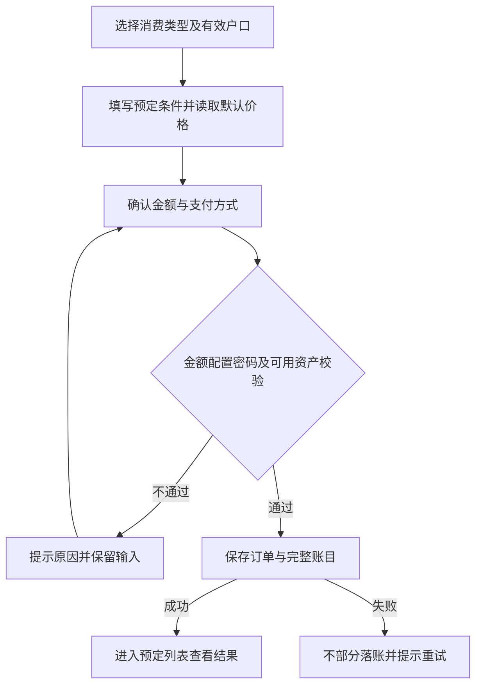
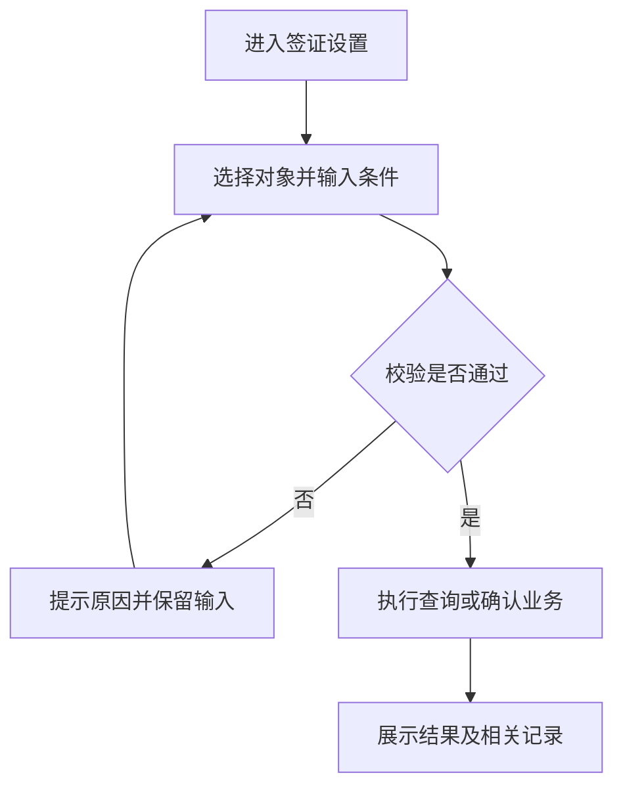
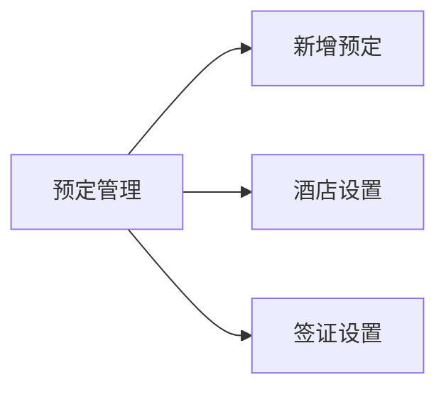

# 预定管理

## 目录

- [[#§1 修订追踪表]]
- [[#§2 背景与目标]]
- [[#§3 功能清单]]
- [[#§4 功能细节规格]]
- [[#§5 功能流程图]]
- [[#§6 功能结构图]]
- [[#§7 页面设计]]
- [[#§8 边界与异常]]
- [[#§9 验收清单]]

## 本文件使用说明

- 范围为 2026-11-23 至 2026-11-24 本会话新增、调整的需求，按最终说明归并，不重写全部账房需求。
- 本文件是新编菜单分册，不表示生产验收通过。原型可操作、脚本测试和真实业务验收是不同状态。
- 配套：[公共附录_20261124](公共附录_20261124.md)、[业务计算与开发交接_20261124](业务计算与开发交接_20261124.md)、[交付状态与验收差距_20261124](交付状态与验收差距_20261124.md)。
- [MOD] 历史基线：[此前菜单文档](../菜单PRD_20261109/00_阅读索引.md)及[本期原型基线](https://github.com/bala-luoluo/cashier-prototype/commit/0904c7edd8d79829ada53a1b2c7a75c82d531597)。新增业务页标记 [NEW]，其本期交互调整一并写入最终规格。
- 权限、生产记账和待确认业务细节见公共附录；开放项不应按默认假设验收。

## §1 修订追踪表

| 版本 | 日期 | 说明 |
|---|---|---|
| V1 | 2026-11-24 | 初稿，未送审 |

## §2 背景与目标

- 面向账房操作人员、复核人员和配置管理员，形成配置、预定、支付、还款、积分记录可追溯的业务流程。
- 将原型中的最终交互与业务要求转为开发和验收依据，保留真实缺口，不将演示行为当作生产能力。
- 本期隐藏消费记录、车辆设置、接送预订管理、预订月结名单管理入口；隐藏不等于删除历史数据。

## §3 功能清单

| 页面 | 名称 | 类别 | 目标 |
|---|---|---|---|
| P1 | 新增预定 | [NEW] | 建立各类消费预定，并关联客户、价格、支付和业务账目。 |
| P2 | 酒店设置 | [NEW] | 统一维护全厅酒店、Tower、房型和价格。 |
| P3 | 签证设置 | [NEW] | 支持一次新增多个签证类型并维护价格。 |

## §4 功能细节规格

### 4.1 P1 新增预定

- 页面先选择消费项目、开单厅和预定户口；户口支持输入号或姓名检索，必须选择有效结果并回显户名。
- 酒店支持酒店、Tower、房型、季节、早餐、入住和退房日期；酒店全厅通用。切换开单厅保留酒店、房型和本单手动金额。
- 签证选择已启用签证类型；机票填写航班号；餐厅填写名称、人数及预定姓名；快速通关填写证件号码；高尔夫填写球场；其他填写项目。
- 各类型保留预定日期时间、客人姓名、消费金额、币别、备注；机票姓名显示为乘客姓名。支持增加和移除多位客人。
- 酒店与签证自动带出配置金额；酒店按住宿条件及晚数带出总价。消费金额可编辑，修改仅影响本单，不修改配置。
- 填写备注、选客户、增减客人及切换支付方式不覆盖手动金额；改变房型、日期、季节、早餐或签证类型后重新带出默认金额，并显示价格说明。
- 支付方式包括现金、扣存款、积分、公司垫付、公司赠送。现金、公司垫付、公司赠送不因户口余额不足拦截；垫付与赠送仍正常扣对应消费中转户，可形成负数。
- 扣存款仍校验可用存款；积分支付仍校验可用积分。扣存款换汇读取系统汇率，显示扣款币种、汇率与换汇户口；本次允许修改汇率的现状须按附录确认。
- 业务中转户已配置时显示户口号与户名、隐藏设置入口；未配置时显示提示和设置入口，提交须有有效配置。
- 操作与确认密码分别填写，切换密码输入框不能清空；完成校验后保存订单及资金变动，进入预定列表。失败时不新增订单、不部分记账。

- 正常结果：有效客户及配置齐全，填完金额和密码后成功生成一笔预定。
- 异常结果：必填缺失、无有效配置、扣存款或积分不足时拦截，保留输入。
- 边界情况：配置不完整不显示虚假的零价格；价格允许编辑不等于允许绕过必要预定条件。

### 4.2 P2 酒店设置

- 取消厅别页签及厅别过滤；各厅共享已录入酒店，新酒店不再按厅单独维护。
- 保持酒店类别、Tower类别及房型层级，支持新增、编辑和启用状态。
- 房型价格分淡季含早餐、淡季不含早餐、旺季含早餐、旺季不含早餐四种，每种独立设置现金价和积分价。
- 旧酒店及其房型、价格和历史预定保留；禁用配置不再提供给新增预定，但历史订单仍可查看。
- 设置保存记录操作时间、操作人、确认人及变更内容；详情使用业务名称和值，不显示程序代码。
- 当前原型要求同名酒店不可重复新增；跨厅遗留同名酒店不自动删除或合并，须人工核对。

- 正常结果：保存房型四组价格后，任一厅均可选择酒店并读取对应价格。
- 异常结果：缺少必填信息、无效价格或新增同名酒店时不保存。
- 边界情况：历史酒店未配置季节价格时明确显示未设置，不将旧周末价格推断为旺季价格。

### 4.3 P3 签证设置

- 签证列表展示类型、现金价、积分价、状态和编辑入口，支持按类型查询。
- 新增弹窗支持添加、移除多行，每行独立填写类型、状态、现金价与积分价；至少保留一行。
- 一次填写两组密码，统一校验全部行后一次保存；既有类型重名及本批重名均拦截，任何一行失败均不保存其他行。
- 每种新增签证分别形成操作记录；编辑仍按单条维护。
- 新增预定选择签证类型后带出默认价格与积分；消费金额可以手动修改。

- 正常结果：新增两个不重名类型，保存后列表出现两条，各自价格正确。
- 异常结果：第二行重名或金额无效时整批不落单。
- 边界情况：移除中间行不丢失其他行内容；新增或移除行不清空密码。

## §5 功能流程图

### 5.1 P1 新增预定

### 5.2 P2 酒店设置

### 5.3 P3 签证设置

## §6 功能结构图

## §7 页面设计

### 7.1 P1 新增预定

- 使用账房统一浅色界面、青色主按钮、卡片及表格。页面标题与菜单名称明确对应。
- 查询区、业务内容区、操作确认区按顺序排列；详情弹窗居中，长内容可滚动，关闭按钮可见。
- 列表操作栏固定右侧；预定分类表明确无操作栏。窄屏可换行，不遮挡输入和提交。

### 7.2 P2 酒店设置

- 使用账房统一浅色界面、青色主按钮、卡片及表格。页面标题与菜单名称明确对应。
- 查询区、业务内容区、操作确认区按顺序排列；详情弹窗居中，长内容可滚动，关闭按钮可见。
- 列表操作栏固定右侧；预定分类表明确无操作栏。窄屏可换行，不遮挡输入和提交。

### 7.3 P3 签证设置

- 使用账房统一浅色界面、青色主按钮、卡片及表格。页面标题与菜单名称明确对应。
- 查询区、业务内容区、操作确认区按顺序排列；详情弹窗居中，长内容可滚动，关闭按钮可见。
- 列表操作栏固定右侧；预定分类表明确无操作栏。窄屏可换行，不遮挡输入和提交。

## §8 边界与异常

| 编号 | 页面 | 场景与处理 |
|---|---|---|
| CC-01 | P1 | 配置不完整不显示虚假的零价格；价格允许编辑不等于允许绕过必要预定条件。 |
| CC-02 | P2 | 历史酒店未配置季节价格时明确显示未设置，不将旧周末价格推断为旺季价格。 |
| CC-03 | P3 | 移除中间行不丢失其他行内容；新增或移除行不清空密码。 |

## §9 验收清单

### 9.1 功能验收

| 编号 | 页面 | 判定标准 |
|---|---|---|
| AC-P1-01 | P1 | 有效客户及配置齐全，填完金额和密码后成功生成一笔预定。 |
| AC-P1-02 | P1 | 必填缺失、无有效配置、扣存款或积分不足时拦截，保留输入。 |
| AC-P2-01 | P2 | 保存房型四组价格后，任一厅均可选择酒店并读取对应价格。 |
| AC-P2-02 | P2 | 缺少必填信息、无效价格或新增同名酒店时不保存。 |
| AC-P3-01 | P3 | 新增两个不重名类型，保存后列表出现两条，各自价格正确。 |
| AC-P3-02 | P3 | 第二行重名或金额无效时整批不落单。 |

### 9.2 非功能验收

- 按 [[公共附录_20261124#A4 非功能要求]] 验证权限、密码保密、原子记账、重复提交及持久保存。
- 对照界面核验无代码裸露、无异常遮挡，浏览器刷新后的记录保持一致。

### 9.3 边界验收

- 逐项执行本文件 CC 编号用例，所有用例均应有明确结果，不得将待确认项标为通过。

### 9.4 专项验收

- 账目变化必须同时核对订单、客户、对应中转、厅别资金及操作记录，不能只凭成功提示。
- 需求签收要求所有适用项通过；当前验证覆盖见 [交付状态与验收差距_20261124](交付状态与验收差距_20261124.md)。

## 下一步建议

- 完成开放规则确认及缺口修复后，按页面执行正向、反向和边界验收。
