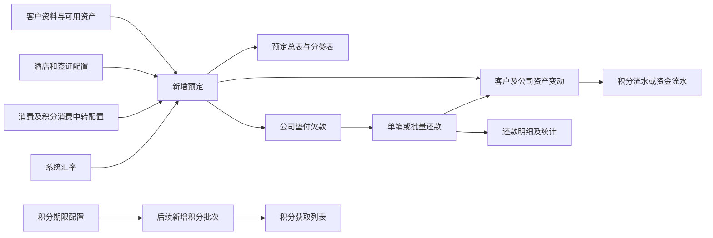
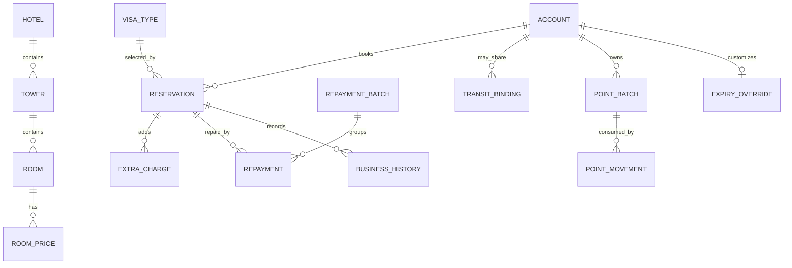

# 公共附录

## A2 目标用户与角色

| 角色 | 业务职责 | 本期边界 |
|---|---|---|
| 账房操作人员 | 建立预定、查询、发起状态变更及还款 | 具体账号权限须由权限模块授权 |
| 确认人员 | 复核资金及配置操作 | 不应将两组不同文本等同真实双人复核 |
| 配置管理员 | 酒店、签证、积分参数及中转绑定维护 | 生产权限矩阵待确认 |
| 客户查看场景 | 查看分类业务信息 | 分类表无操作栏不等于已实现客户权限隔离 |

## A3 资料流与系统串接

- 本地原型主要依靠浏览器保存数据，不能等同服务器交易、并发控制和权限完成。
- 预定记录、账房余额和独立积分模块存在不同数据来源；生产交付须统一可追溯关系。
- 设置变更不能修改已完成订单的历史支付快照。
- 接口、事务、幂等与精度设计由开发落实，业务运算口径见 [[业务计算与开发交接_20261124]]。

## A4 非功能要求

- 安全：两组密码不能明文写入订单、日志或浏览器业务数据；真实账号认证及双人授权需服务端执行。
- 原子性：新增预定、改支付和批量还款的所有资产变动及订单更新共同成功或共同失败。
- 幂等：同一次确认重复触发不得生成重复订单、退款、积分扣减或还款。
- 并发：提交时重新检查待还、可用余额及订单状态；若与预览不一致，应重算并要求用户确认。
- 持久性：刷新、重新登录和跨设备的生产持久性分别验收；本地刷新成功不能替代跨设备验证。
- 可追溯：保留业务单号、批次、对象、币种、方式、金额、时间和真实人员；日志不能以固定演示人员代替正式身份。
- 展示：金额与积分单位明确；右侧操作固定；筛选无结果显示空态；弹窗支持关闭和滚动。
- 性能：完整数据量下的查询耗时、分页规模与导出上限尚未定义，不编造指标。

## A7 B端业务关系

### A7.1 权限建议

| 操作 | 建议范围 | 待确认内容 |
|---|---|---|
| 查订单及欠款 | 授权账房人员 | 按厅、跨厅和客户范围 |
| 配置价格及期限 | 配置管理员并复核 | 管理员名单及复核关系 |
| 收付款、退款 | 操作人员及确认人员 | 余额豁免是否仍受冻结约束 |
| 客户分类查看 | 授权只读人员 | 是否需要独立客户角色 |

### A7.3 实体关系

- 一个户口可承接多个中转类型；各类型资产维度不混淆。
- 批量还款每笔明细对应原订单；总批次仅用于归集，不能替代逐笔还款凭证。

## A9 待确认事项

| 编号 | 事项 | 当前原型现状或建议 |
|---|---|---|
| Q-01 | 预定换汇是否允许手动改汇率 | 原型允许；用户要求可设置汇率，历史开工口径强调系统读取。建议明确预定独立规则。 |
| Q-02 | 同户口跨币种批量还款 | 当前只支持同币种；跨币种未授权自动折算。 |
| Q-03 | 同户口跨厅现金批量还款 | 原型按原订单厅入账；是否应按实际收款厅需确认。 |
| Q-04 | 已还部分代垫订单取消退款 | 当前拦截；需要明确退回客户、冲减欠款和冲回公司款的顺序。 |
| Q-05 | 杂费退款、多次部分退款及已完成订单取消 | 当前仅提供原消费单次取消退款；不要把这些扩展流程认定支持。 |
| Q-06 | 签证多位客人是否按人数计价 | 当前单价视为本单配置价；未确认按人数乘算，不自动扩展。 |
| Q-07 | 积分统一账本及单位 | 独立积分模块和账房积分来源未完全统一；历史示例单位、批次扣减和到期清理需专项校验。 |
| Q-08 | 现金还款公司资金口径 | 原型同时回补非公司消费中转余额和增加厅现金银头；需确认两者属于独立资产维度还是重复计入公司资金。 |
| Q-09 | 真实权限、账号认证和审批关系 | 当前仅演示必填及两组不同密码，不代表生产安全完成。 |
| Q-10 | 积分获取余量及取整方式 | 获取条件已给定，跨场累计余量、非整点和舍入方式未明确。 |

## A10 名词定义

| 名称 | 含义 |
|---|---|
| 消费中转户口 | 所有消费类别共同使用的现金业务中转配置 |
| 积分消费中转户口 | 消费积分及代垫积分还款的积分中转配置 |
| 公司垫付 | 公司先支付并形成客户待还欠款 |
| 公司赠送 | 公司承担消费，不形成客户代垫欠款 |
| 专属期限 | 某户口覆盖默认期限的新增积分使用期限 |
| 获取批次 | 一次获得积分形成的独立记录及其剩余、有效期 |

## A11 相关资源

- [[00_阅读索引]]
- [原型](https://bala-luoluo.github.io/cashier-prototype/)
- [本期最后已同步提交](https://github.com/bala-luoluo/cashier-prototype/commit/0904c7edd8d79829ada53a1b2c7a75c82d531597)
- [本轮界面实测记录](../预订管理复刻_20261123/验证/预定业务流程实测_20261123.html)
- [历史菜单文档](../菜单PRD_20261109/00_阅读索引.md)
